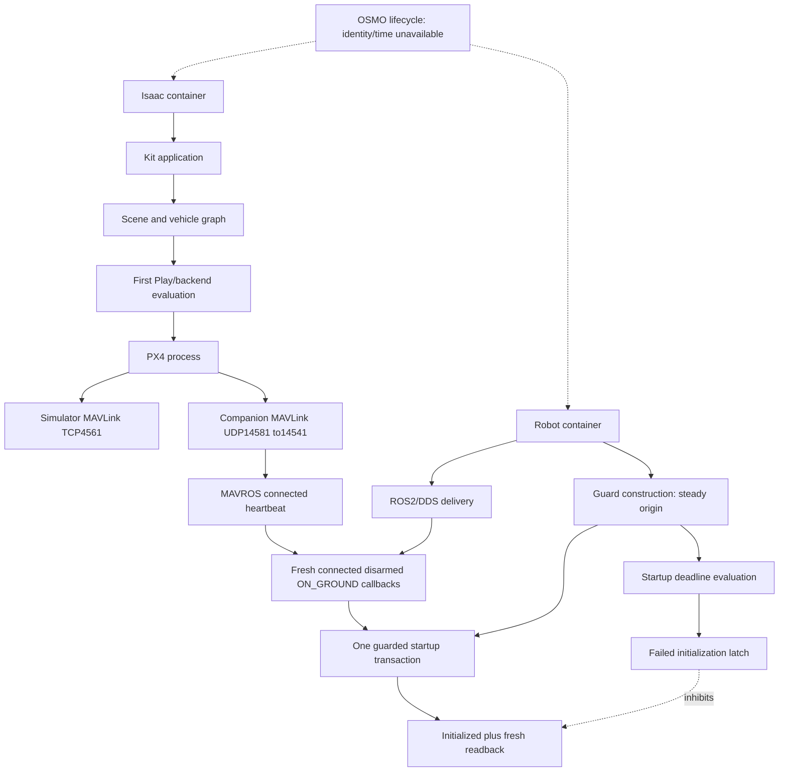

# M00-D startup dependency graph

The [machine-readable graph](../../../evidence/M00-D/dependency-graph.json) contains 17 nodes and 19 typed dependencies/propagation rules. Each edge records expected prerequisite, observed signal, timing evidence and failure propagation. It is a dependency graph, not a claim of total temporal ordering. “Observed” refers to the captured 2026-11-27 startup episode; current container metadata only confirms that services were not restarted during this investigation.

Source-backed edges: guard construction/clock/one-attempt safe-state/transaction/ready/latch rules are implemented in `px4_actuation_guard.hpp`; graph→first Play→actual backend/PX4 launch is documented in `pegasus_app.py` and PX4 backend source. Relevant line references and hashes are retained in M00-C source-locations/source-manifest and this milestone's source inventory. Actual app/graph/PX4/TCP/UDP/MAVROS sequence comes from M00-C startup-source-records.json. D1 workflow/compose designs document the orchestration concept, but deployed OSMO workflow and outer-entrypoint identity remain unavailable. Dashed workflow edges do not authenticate a running workflow implementation.

Observed order is not sufficient to assert an additional enabling dependency. For example simulator TCP is shown separately from companion UDP; later module startup follows TCP in this episode, but a pure causal TCP→UDP edge is not invented. Source inspection supports prerequisites; missing callback traces are not reconstructed from logs. The inhibitory latch edge is a rule explaining persistent false readiness, not an enabling signal for READY.

The repository epoch helper compares container StartedAt values. Its robot-after-sim predicate would consider this episode ordered, while actual interface starts 21.62s before PX4. This establishes that container order is an insufficient **readiness proxy**, not that the unverified outer orchestrator necessarily executed this helper or was the sole cause. Similarly `app ready` precedes graph/PX4 launch and does not mean scene or vehicle readiness.

The machine check enforces unique nodes/edges, valid endpoints, acyclic dependency structure, edge evidence references and hypothesis coverage. Runtime state machines may loop, but this graph deliberately models one startup attempt and its terminal latch rather than pretending a reset path was exercised.
