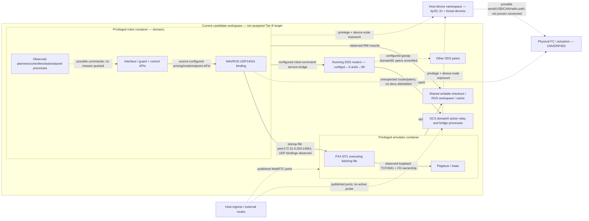

# M00-E1B isolation boundary and exposure evidence

**UNVERIFIED ISOLATION. Target designation UNVERIFIED. PREPARED — NOT AUTHORIZED FOR EXECUTION.**

Solid arrows below describe observed socket relationships or configured/running software paths as labeled; dotted arrows describe potential/unverified actuation/external paths, not observed physical connections. Separate Linux network namespaces still communicate over the shared bridge. Domain boundaries are bridged by configuration; unique domain alone does not establish containment.

EX01–EX12 exposure register ties each source/destination/interface to direct evidence and configured/observed/possible status, consequence and mitigation. Device metadata shows ttyS nodes without opening them. Selected process FD snapshots did not show serial/USB handles, and no ttyACM/ttyUSB names were present, but these negative snapshots do not exclude future access, other processes/namespaces, network FCs, hotplug or physical devices behind existing nodes. The broad privileged device namespace remains a Class D blocker.

Socket tables prove local bindings and selected loopback connections; process FD inode matching attributes some sockets to current PX4/Pegasus/MAVROS processes. They do not identify MAVLink payload commands or authenticate a physical peer. Startup-file fcu_url is a configured destination, not proof every packet follows only that route. No packet capture or active scan occurred. DDS/router service-name configuration and process presence identify potential command forwarding without claiming active mission/arming/messages.

Closure requires an exact PD-designated independent rig; owner-provided device/capability/host isolation and effective route/firewall/peer/process allowlist, no unintended autolaunch/mission stack, private mounts/resources, named stop authority and independent safety review. Class D safety restrictions take precedence over every proposed Class C test. Existing framework stop/recovery documents and low/no observed traffic do not prove these controls. No isolation configuration, firewall, mount, process or service was changed in E1B.
