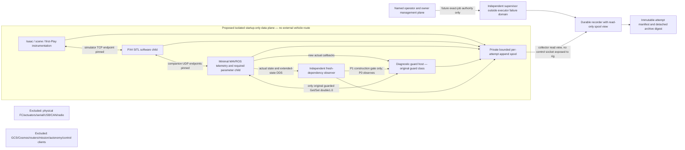
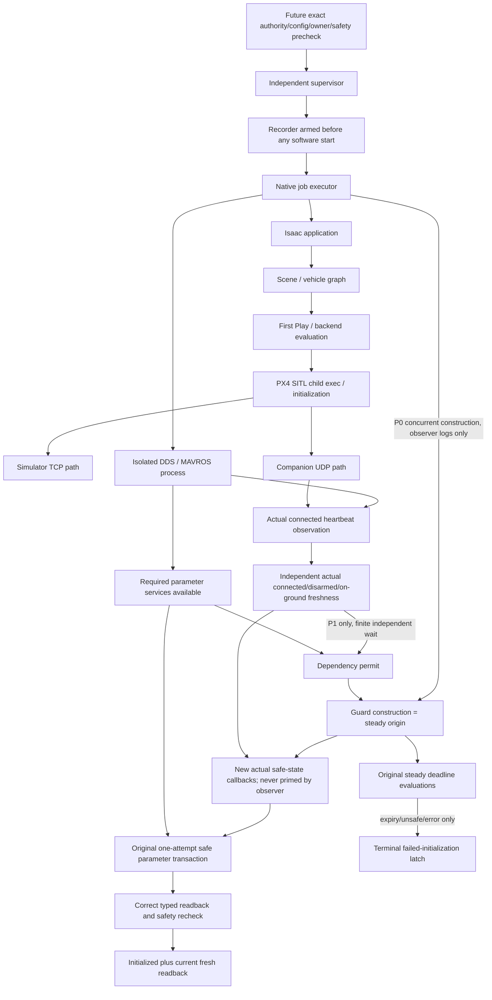

# Independent startup-only rig architecture — CAND04 revision proposal

**DESIGN PROPOSAL ONLY — NO DEPLOYMENT OR TIER B EXECUTION AUTHORIZED**

The independent rig is the preferred technical candidate for further design review. It is not constructed, designated, isolated or safe-to-operate by virtue of this document. Formal target designation remains UNVERIFIED. This design develops CAND04 from E1B; E1B's runtime observations remain historical and have not been refreshed in E1C.

## Components and boundaries

Prefer a dedicated development node or equivalent owner-attested physical/network boundary with **direct native unprivileged orchestration**, using OSMO only if its owner supports that model. Do not reuse the current privileged Docker-in-Docker interactive workspace or its broad entrypoint. OSMO scheduling/identity/lifecycle logging is necessary as a role; that product is not a mandatory dependency if an equivalent reviewed supervisor/runtime can meet the same records and isolation contract. Non-privileged Isaac/GPU execution, offline assets, DDS security and outside-job evidence supervision are **unverified platform assumptions**, not deployed capabilities.

Only Isaac/Pegasus, its PX4 SITL child, local MAVLink transport, minimal MAVROS/ROS2/DDS state and required parameter interfaces, a diagnostic guard host, independent dependency observer and bounded evidence/supervision are in the data plane. No physical flight-control hardware, operational mission or action dispatch is part of this rig. Source/config/scene artifacts are immutable and mounted read-only; caches and spool are private per attempt, never shared with current workspace. Stage all approved assets/images before the isolated run window; no runtime registry/Nucleus/internet path is assumed. The evidence transport is a private append spool with independently supervised read-only collection; exact persistence/mount/identity/durability policy remains owner-dependent. The experiment receives no Docker/Kubernetes/admin socket or general host control mount.

## Required integration delta — explicit review decision

The production robot_interface host creates arming/mode clients and command publishers (E1B source evidence); bringing it unchanged would defeat the minimum-process exclusion. Propose a **new diagnostic-only host for the exact Px4ActuationGuard class**, with only its actual state subscriptions, readiness/status publishers and required parameter Get/Set clients. No implementation, build or protected diff is applied in E1C. The guard source inspected locally is immutable; preserve its steady member-construction origin, deadline/freshness, typed double1.0 config/readback, one-attempt/unsafe latch and normal startup transaction semantics. Hooks must not change these rules. Reentrant/mutually-exclusive callback/executor semantics and build/source mapping must be reviewed, not assumed equivalent.

This host is a **material diagnostic configuration difference** from the historical full robot interface. Reviewer/PD must explicitly accept its narrower claim and source/build/overhead/context comparison before a trial design uses it. It can investigate ordering/phase behavior at unchanged guard rules; it cannot qualify the production host or claim CFG-SIL-01 equivalence. The existing24-row M00-D/E1/E1A schedule is unchanged and still proposed, with its original first-pair checkpoint; no candidate substitution or sample expansion is silently adopted. A follow-on exact manifest/scope amendment must bind the approved diagnostic host. Full production integration, if later needed, is a different reviewed scope.

MAVROS may need a plugin child exposing setpoint_raw parameter services to preserve the real guard transaction. Do not promise that every command API vanishes merely by using MAVROS. Owner must freeze the smallest telemetry/plugin/dependency list, identify automatic boot traffic and any remaining arming/mode/setpoint APIs, and enforce deny-by-default middleware identities/permissions and physical/network exclusion. No stub service or synthetic safe state may masquerade as the real counterpart. If the exact minimal counterpart cannot preserve required state/parameter behavior under this policy, return the design for revision rather than load the full mission stack.

## Startup dependency graph (semantic, not an asserted exact timeline)

P0 constructs the same diagnostic guard concurrently, without treating app-ready/container-start as FCU readiness. P1 alone delays **construction**, never resets/extends a running guard budget. Its observer is separate and cannot gate on the deferred guard's READY/status; it requires actual identity-bound fresh connected/disarmed/on-ground observations and service availability, then the guard must receive its own new real callbacks and perform the original transaction within its unchanged budget. No cached/synthetic state injection, stubbed transaction, latch clear or manual repair. Exact independent freshness, finite outer wait, scheduling and operational bounds require review/owner confirmation. The source's current10.0s budget,0.5s freshness,200ms timer are implementation reference facts, not adopted requirements. TCP and companion UDP remain separate phases; no invented TCP→UDP enabling edge. Deadline evaluation is ongoing and a failure edge is conditional, not a mandatory failure after every start.

M00E1C_DESIGN_MODEL.json is non-executable data describing26 roles and policy-specific dependencies. Offline DAG/ancestor checks can detect a circular P1 dependency or omitted control; they cannot prove runtime sequencing or platform feasibility. Graph projection checks P0/P1 separately. Underlying state-machine concurrency and callback ordering need later exact implementation evidence.

## Termination, abort and evidence retention

No automatic restart, retry, replacement or warm-up. Abort on physical/unknown device/peer, unapproved endpoint/process/arming/mode/motion/mission traffic, config drift, recorder/clock/drop/storage/resource-bound failure, cross-workflow effect or ownership doubt (E1B AB/AV controls retained). Exact limits, operator and independent stop authority must exist before any active scope. Ordinarily stop future transaction/command producers by the approved target identity, guard/MAVROS, then only target PX4/Isaac child tree; never restart the shared workspace. Safety may require immediate exact-job network/device isolation and termination ahead of recorder draining, through owner-approved management authority outside the data plane. No physical vehicle command is used for recovery.

Recorder/supervisor live outside executor failure domain with durable read access; termination of the job may still leave missing tail events, which must be explicit. Record every executor/child/recorder exit and abort identity, seal all completed/failed/aborted/incomplete/setup attempts and partial hashes, quarantine private leftovers, preserve caches and require reviewed disposition before any subsequent authorized start. No guarantee of REC-01 survival is asserted. The selected independent-failure-domain design, storage capacity and inert failure/stop tests require separate authorization. Existing hardware/mission hazards must be resolved before those active verifications, with safety precedence. No operational actions occur in E1C.
