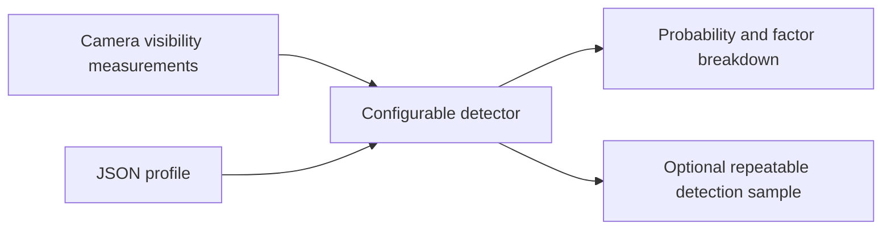

# Human detector model

A tunable human-detection surrogate for planner experiments. Supply measurements
from a camera view; get a detection probability and an optional repeatable
yes/no result. Uses visible human pixels, body visibility, visible parts, and
contrast/clutter. There is no pose input, viewing-angle penalty, or observation
history. Defaults are experimental assumptions, not measured detector accuracy.

## Run

Requires Python 3.10+. From the AirStack repository root:

```bash
cd common/human_detector_model
```

Then run without installation:

```bash
python3 -m human_detector --input examples/observations.jsonl --profile baseline --seed 7
```

For use from another project, install this folder with your Python environment:

```bash
python3 -m pip install /path/to/AirStack/common/human_detector_model
```

The installed CLI is `human-detector`; `python3 -m human_detector` also works.
The package has no runtime dependencies. Share the whole folder, ZIP, or wheel.

This is a standalone Python package excluded from colcon discovery. It is not
automatically wired into the rules planner or ROS launch files.



## Python API

```python
from human_detector import Detector, DetectorConfig, Observation

detector = Detector(DetectorConfig.profile("baseline"))
view = Observation(
    visible_pixels=120,
    visible_body_fraction=0.4,
    visible_parts={
        "head": 1.0, "torso": 0.7,
        "left_arm": 0.0, "right_arm": 0.0,
        "left_leg": 0.0, "right_leg": 0.0,
    },
    contrast=0.8,
    clutter=0.6,
)
probability = detector.probability(view)
result = detector.detect(view, seed=7, key="scene1/person2/drone3/view1")
print(probability, result["detected"])
print(result["contributions"])  # Explanation in log-odds units
```

`detect` returns a Bernoulli sample. The same seed/key gives the same draw across
processes, call orders, and profiles. Use matching keys/seeds to compare planners.
The key identifies an observation; it is not a factor in the probability.
Different keys give fresh samples, so using a new key every frame can accumulate
detections through repeated trials. Sampling cadence is the caller's choice;
this package does not remember observations or confirm/track people.

The probability is a model probability, not a calibrated image-model confidence.
Keep inputs, ground-truth IDs, and diagnostic contributions inside the simulator
or evaluator; send detected observations to the planner through your normal API.
False positives, localization noise and person tracking are outside this version.

## Inputs

| Input | Meaning |
|---|---|
| `visible_pixels` | Integer count of actually visible human silhouette pixels, excluding background inside the box. |
| `visible_body_fraction` | Visible silhouette pixels / unoccluded silhouette pixels from the same camera. Range 0–1. |
| `visible_parts` | Six per-part visible fractions, each 0–1. For example, `head: 0.5` means half the head's projected silhouette is visible, not that the head is half the visible person. |
| `contrast` | 0 = blends into background; 1 = clearly distinguishable. Supplied by the caller using a consistent measurement or controlled scenario setting. |
| `clutter` | 0 = clean surroundings; 1 = dense, confusing surroundings. Supplied by the caller. |
| `image_width`, `image_height` | Detector input resolution; defaults to 640×400. Must match the configuration. |

Pixel counts must be measured **after resizing to the detector input resolution**.
The unoccluded silhouette includes the body's own self-occlusion and in-frame
clipping, but excludes external obstacles. Use the same renderer/rasterization
for both silhouettes. Do not use world bounding-box area or a saved placement
cover fraction. If you have no in-frame silhouette, supply zero pixels/fraction.

Parts use `head`, `torso`, `left_arm`, `right_arm`, `left_leg`, `right_leg`.
Supply all six or omit the entire mapping. For a part with zero unoccluded
in-frame pixels, use 0. Measured body-part masks require part labels on the human meshes;
whole-person instance segmentation alone cannot provide them. Alternatively,
use the explicit placement assumption below.

Parts, contrast and clutter can be `None` when unavailable. Their contributions
are then neutral and they appear in `missing_features`; they are **not measured
as fully visible or clear**. Scores with missing features are optimistic compared
with the same inputs plus penalties. For controlled comparisons, use the same
feature availability. The package does not infer masks or appearance from RGB.

## Tune

Export a complete configuration, edit the JSON, and use it:

```bash
python3 -m human_detector --profile baseline --write-config detector.json
python3 -m human_detector --config detector.json --input examples/observations.jsonl --seed 7
```

| Setting | Baseline | Effect |
|---|---:|---|
| `pixels_50` | 80 | Visible pixels giving 50% probability for a fully exposed person, all parts visible, contrast 1, clutter 0. Lower is better for small targets. |
| `pixel_slope` | 1.5 | Steepness around that threshold. Steeper is not universally better. |
| `visibility_weight` | 1 | Penalty for an incomplete body. Lower is more tolerant; 0 disables it. |
| `parts_weight` | 0.75 | Penalty for missing recognizable parts. Lower is more tolerant; 0 disables it. |
| `part_weights` | Head .30, torso .40, each arm .10, each leg .05 | Relative recognition value. Normalized by their sum. These are configurable assumptions. |
| `contrast_weight` | 1 | Penalty for poor contrast. Lower is more tolerant; 0 disables it. |
| `clutter_weight` | 1 | Penalty for clutter. Lower is more tolerant; 0 disables it. |

Built-in profiles: `baseline`, `stronger`, `weaker`, `small_target`, and
`occlusion_tolerant`. The last two change only size sensitivity and occlusion
sensitivity respectively. `stronger` has at least as high a probability as
`baseline`, and `weaker` at most as high, for identical valid inputs. Custom
configs can specify only changed fields; omitted settings use baseline defaults.
Unknown keys and invalid values are rejected rather than silently ignored.
Slope and penalty weights are bounded above by 1000 to keep arithmetic finite.

The exact model is:

```text
parts = sum(part_weight[i] * visible_part_fraction[i]) / sum(part_weight)
z = pixel_slope * ln(visible_pixels / pixels_50)
    + visibility_weight * ln(visible_body_fraction)
    + parts_weight * ln(max(parts, 1e-12))
    - contrast_weight * (1 - contrast)
    - clutter_weight * clutter
p = sigmoid(z)
```

Unknown optional terms contribute zero. Zero visible pixels always gives p=0.
The body-fraction and parts penalties describe additional recognition difficulty
at the **same visible pixel count**. They intentionally complement pixel size;
set their weights to zero to test a size-only detector. These terms are not
claimed to be independent physical effects. Two views with identical four-factor
measurements have the same probability, whatever the pose or viewing angle.

## Connect to the simulator or existing recordings

```python
from human_detector import from_counts, from_demo_evidence

# Counts from matched body silhouettes with and without external occluders:
view = from_counts(visible_pixels=120, unoccluded_pixels=300)

# One entry from a coordinator recording's frame["people"] list:
view = from_demo_evidence({"pixels": 120, "visibleBodyFraction": 0.4})
# Both adapters accept visible_parts, contrast, clutter and image dimensions.
```

### Fixed body parts from human placement

When camera-specific part masks are unavailable, use the scene's listed parts
as a fixed exposure assumption: listed complete parts are **1**, unlisted parts
are **0**, from every direction. Pixel count and body fraction still come from
the actual camera view. Contrast and clutter remain optional separate inputs.

```python
from human_detector import Detector, from_placement_evidence, parts_from_placement

placement = {"visible_parts": ["head", "arms"]}
view = from_placement_evidence(
    {"pixels": 800, "visibleBodyFraction": 0.5}, placement,
)
result = Detector().detect(view, seed=7, key="scene/person/drone/view")
print(result["probability"], result["detected"])
# Or apply your experiment's threshold to Detector().probability(view).

# For generators that save intended exposure in a different field:
parts = parts_from_placement(
    {"planned_visible_parts": ["feet", "shins", "thighs", "head"]},
    field="planned_visible_parts",  # Explicit, never an automatic fallback.
)
```

| Placement labels | Detector parts set to 1 |
|---|---|
| The six canonical names | Matching part |
| `arms` / `legs` | Both arms / both legs |
| `feet` + `shins` + `thighs` | Both complete legs; all three are required |
| `left_foot` + `left_shin` + `left_thigh` (likewise right) | Complete leg on that side; generic segment names can also supply a segment |
| `hips`, `shoulders` alone | No complete canonical part |

An explicit empty list means no complete canonical parts are exposed; visible
fragments can still have nonzero pixels. Missing/null lists and unknown labels
raise an error. An empty camera view produces zero visible parts regardless of
placement. A planned list is an intended-exposure assumption, not a verified
visibility measurement. This mode adds no viewing-angle or observation-history
factor. Keep the same assumption and `parts_weight` across planner comparisons.

The recording adapter ignores `rangeMeters`, `knownCoverFraction`, pose and
bounding-box dimensions. Existing recordings lack measured part visibility and
appearance; these stay unknown unless supplied. For a new live integration,
score raw candidates before the old annotation-policy thresholds. Archived data
may already exclude small candidates, so replaying it cannot recover those
misses or establish full-scene recall. This package does not alter the old demo
or connect to ROS automatically.

Some archived entries also have `visibleBodyFraction: null`. The adapter rejects
these rather than inventing visibility; obtain an unoccluded silhouette count
before scoring them. `knownCoverFraction` is not a substitute.

The CLI reads JSONL rows with exactly `key` and `observation`; see
`examples/observations.jsonl`. It writes one JSON result per row to stdout.

## Tests

```bash
python3 -m unittest discover -s tests -v
```
