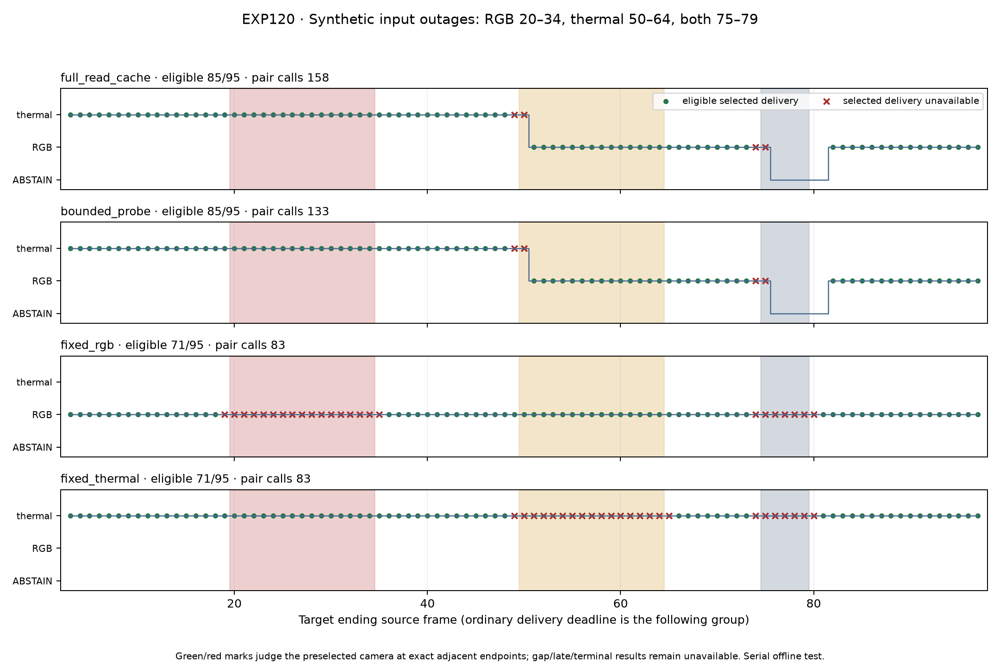

# EXP120: synthetic failures exercise switching and expose return-readiness limits

Date: 2026-11-03, America/New_York. Parent EXP119 / 50bcd672d. Execution freeze 45f60353a; evaluation/audit dd5f2622c.

**With explicit synthetic input outages, full-read and bounded probing each deliver 85/95 guarded preselected adjacent motions, versus 71/95 for each fixed-camera control. The active thermal failure causes alternate RGB preselection one source group after onset and eligible alternate delivery two groups after onset. Bounded probing uses 133 native pair calls versus 158 for perturbed full-read (15.8% fewer), and 15.9% less measured native processing.**

The software invariants pass, but inactive restoration exposes a readiness limit: fresh native cache state does not guarantee an on-time adjacent motion. No controller or production default is adopted. This is synthetic transport behavior, not evidence about natural physical faults.

## Coverage and intervention

All 36 camera/window native-health traces from the 18 exposed EXP117 windows were audited. Brief natural failures and returns exist, but none has at least three supported, three failed and three recovered pairs. This engineering criterion exercises more than a probe/continuation; it is not a definition of real-world dropout severity or proof that no useful transition exists elsewhere. All shorter cycles and trace hashes remain retained.

The exposed 100-frame day recording receives fixed synthetic source-input outages: RGB20–34, thermal50–64, both75–79 inclusive. Environment truth is revealed only after a camera request, through explicit transport-unavailable feedback. Failure resolves the cache false without fabricating native health or advancing the last processed source. Dropped/skipped inputs perform no decode, native run or frontend call. The planner cannot read the schedule or unrequested availability. Failed requests receive immediate explicit transport feedback; this tests reaction to declared unavailability, not detection of silent packet loss or selection of a physical timeout.

Original inputs, released weights, preprocessing and native algorithms remain unchanged. Cache TTL/period are one second and inactive bursts contain two requests. Five fresh dual captures include unperturbed full-read plus four perturbed controls. All policies share dual root/bootstrap/guard overhead; fixed-camera costs are not pure single-expert deployment costs.

## Delivery and measured cost

| Perturbed policy | Eligible / 95 | Selected unavailable | Uncommitted with opportunity | Pair calls | Native run seconds | Matched T RMSE (m) | Matched R RMSE (deg) |
|---|---:|---:|---:|---:|---:|---:|---:|
| full_read_cache | 85 | 4 | 1 | 158 | 55.539 | 0.067574 | 0.583995 |
| bounded_probe | 85 | 4 | 1 | 133 | 46.698 | 0.067631 | 0.584021 |
| fixed_rgb | 71 | 24 | 0 | 83 | 39.212 | 0.035326 | 0.122279 |
| fixed_thermal | 71 | 24 | 0 | 83 | 22.697 | 0.077612 | 0.627278 |

Proxy columns use the same **53 exact source intervals eligible in every arm**. They use first processing-write motion, nominal body transforms, unchanged stationary-twist duration projection to RGB intervals, and qualified recorded-SLAM references read after capture/prediction locks. Fixed RGB has lower matched proxy error but misses more delivery slots. There is no universally best policy or physical-accuracy claim.

Unperturbed full-read executes 198 pair calls. Synthetic input removal reduces perturbed full-read to 158; those 40 removed calls are not credited to the controller. The 25 additional calls saved by bounded probing are compared against perturbed full-read. Durations sum synchronized native runs, exclude model startup/separate first-depth probes, retain common initialization, and are single offline measurements on this hardware rather than live-throughput or energy estimates.

All 95 slots per policy remain in the denominator. Gap, skipped, dropped, unsupported, late, terminal and uncommitted results are preserved; another eligible camera cannot retrospectively replace the preselected camera.

Both adaptive policies lose the last healthy selected targets ending at 49 and 74: MACVO requires a later frontend invocation to write motion, and the next input is unavailable. They also select the newly unavailable camera at onset 50 and 75 before receiving failure feedback. Both abstain at source groups 76–81; the source 81 target has a native opportunity but no preselected output. After joint return 80, an adjacent RGB result is available at 82, while the first actually preselected eligible return is delivered at 83.

## Switching and return timing

The RGB-only outage occurs while thermal is active, so it is not an active-switch test. The thermal-only outage occurs while thermal is active. Both adaptive policies choose RGB at 51 and deliver its first eligible alternate target at 52. The table distinguishes input request, fresh cache view and actual motion receipt.

| Policy | Outage / camera | Active before outage | Returned input request | Fresh native view | On-time adjacent return delivery |
|---|---|---|---:|---:|---:|
| full_read_cache | rgb_outage / rgb | False | 35 | 37 | 37 |
| full_read_cache | thermal_outage / thermal | True | 65 | 68 | 67 |
| full_read_cache | joint_outage / rgb | True | 80 | 82 | 82 |
| full_read_cache | joint_outage / thermal | False | 80 | 82 | 82 |
| bounded_probe | rgb_outage / rgb | False | 37 | 42 | not observed |
| bounded_probe | thermal_outage / thermal | True | 65 | 69 | not observed |
| bounded_probe | joint_outage / rgb | True | 80 | 82 | 82 |
| bounded_probe | joint_outage / thermal | False | 80 | 82 | not observed |

Return horizons end before the next outage: 49 for RGB return, 74 for thermal return, 97 after the joint outage. Not observed means censored within that horizon, not permanent failure. No switch-back is required while another camera remains healthy.

Full-read provides adjacent return outputs at 37 and 67. Bounded probing observes returned inputs at 37 and 65 and fresh native views at 42 and 69, but neither single-camera restoration produces an on-time adjacent output within its horizon. Joint recovery refreshes both experts; selected RGB delivery resumes at 83, while bounded inactive thermal has no on-time adjacent return within that horizon.

A two-request inactive burst can write the first resumed gap motion while its second, adjacent motion awaits a later invocation. Fresh cache state therefore does not prove task-ready adjacent output. A follow-up should separately freeze an output-readiness handshake or additional continuation and its cost budget. No gap/late motion is relabeled as delivered and no repair is adopted here.

## Validation and scope

All five dual captures / ten native experts complete. Thirty-three focused tests pass, including eight new transport/endpoint/spawned-controller tests. The independent audit passes **34,779 checks** across 380 scored slots, five native timelines and 36 coverage traces. It reconstructs request-scoped failures, TTL/burst/fixed decisions, no-work/source mappings, ordinary deadlines, transition latency, independent reference interpolation, matrix-log projection and scalar losses. All 946 execution source/input/model/coverage pins remain unchanged.

Unperturbed passthrough is bitwise exact across all 5,226 NPZ arrays against EXP119 day full-read. Capture/prediction locks, every exclusion and return censoring remain preserved. No training, reserves or default changes occurred.

This is explicit synthetic input unavailability in serial offline execution. It does not certify natural outages, exposure timing, concurrent live queues, energy savings, physical calibration or generalization. Natural sustained failure-and-return recordings with a usable alternate camera would strengthen recovery claims; this audit provides no such exposed cycle. Existing inputs suffice for a bounded output-readiness test, so no upload is requested.

Artifacts: results/availability-transitions/run-001. Backup: backups/2026-11-03-availability-transitions. Input/weights/compiler EXP112; base runtime EXP106; unperturbed control EXP119; coverage timelines EXP117.
