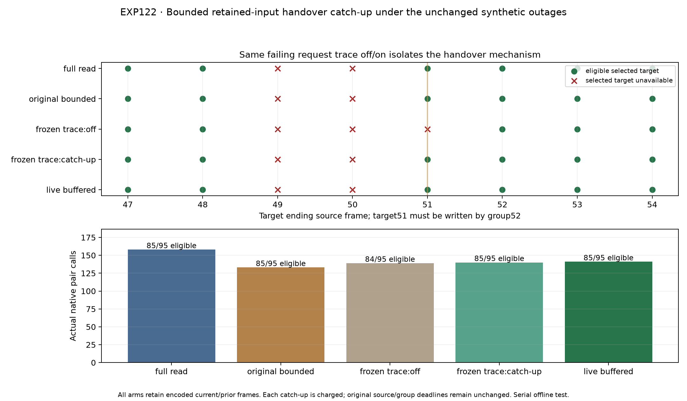

# EXP122: bounded retained-input catch-up repairs the declared handover

Date: 2026-11-03, America/New_York. Parent EXP121 / d3f9c0c76. Execution freeze 32720b0b1; final scorer/audit implementation 39acda700.

**The frozen development contract PASSES. Both the paired failing-request fixture and the live candidate retrieve one retained RGB frame 50 during group 51, produce the adjacent 50→51 target by group 52, and deliver 85/95 guarded selections. The live candidate restores on-time adjacent output in all four return episodes and uses 141 native pair calls versus 158 for perturbed full-read (10.8% fewer).**

This repairs the specific source-continuity failure seen in EXP121 under the declared buffer model. It does not validate natural outages, a real camera transport, acquisition cadence or physical pose accuracy. The implementation remains experimental; no production default is changed.

## Retention and causal access

The transport stores actual encoded stereo bytes for the current and immediately prior source frame, including inputs skipped by neural processing. An input removed by the synthetic outage is absent; age-based expiry does not preserve older available inputs through an outage. The planner cannot inspect unrequested buffer contents or the outage schedule. After selecting a camera and receiving its current input, it may query only the immediately previous source when exactly that one frame is missing from the native stream.

The fixed caps are one query per source group and two queries per run; a failed lookup still consumes budget. Readiness continuation retains four attempts/session and twenty extra requests/run. Selection and the native optimizer/writeback mechanism stay unchanged. Every accepted retained frame is decoded and run before the current frame, in increasing source order, with compact graph indices and original image IDs/timestamps.

Invocation source and actual delivery group are separate. Processing buffered 50 during group 51 can provide target 50 motion by its original group 51 deadline, but a source 49 motion first written there remains late for its group 50 deadline. Historical opportunities do not rewrite earlier actions or create retrospective fallback.

## Fresh live and fixed mechanism controls

All six dual captures retain the same encoded transport buffer. The unperturbed full-read control checks numerical preservation. Fresh perturbed full-read/original bounded/live buffered captures use their own returned feedback and controller clock. The paired fixture replays only EXP121 saved request/action fields with catch-up off/on, preserving the exact skipped RGB50 failure. It is an exposed open-loop mechanism test, not a fresh adaptive-policy comparison.

| Arm | Eligible /95 | Selected unavailable | Uncommitted with opportunity | Pair calls | Native run (s) | Controller processing (s) | Catch-up queries |
|---|---:|---:|---:|---:|---:|---:|---:|
| full_read_cache | 85 | 4 | 1 | 158 | 55.670 | 57.507 | 0 |
| bounded_probe | 85 | 4 | 1 | 133 | 46.743 | 48.303 | 0 |
| fixture_off | 84 | 5 | 1 | 139 | 48.931 | 50.549 | 0 |
| fixture_on | 85 | 4 | 1 | 140 | 49.387 | 50.992 | 1 |
| buffered_probe | 85 | 4 | 1 | 141 | 49.647 | 51.292 | 1 |

The no-catch-up fixture reproduces EXP121 readiness outputs bitwise and its target 51 gap. With the same requests/actions plus one charged retained invocation, fixture output improves 84/95→85/95 and pair calls 139→140. The live candidate uses 141 calls and one query; its own observation/clock-driven probe timing differs from the frozen fixture, so its result is not treated as a paired exact-request intervention.

The live candidate preselects RGB51 after active thermal failure50. It processes retained RGB50, then current RGB51, so first eligible alternate motion is target 51 delivered52. The synthetic onset and preceding late selected targets remain unavailable as in full-read/original controls. No gap, late or terminal result is relabeled as an adjacent delivery.

## Declared budget and retained-input overhead

Live readiness uses 13 of 20 extra request attempts, with no session above four attempts. Catch-up uses 1 of 2 queries and exactly one buffered native invocation. The additional invocation is already included in native calls and durations; it is not free.
Each perturbed arm ingests 156,530,123 encoded bytes (149.279 MiB) across the source window. Peak retained encoded payload is 4,217,128 bytes (4.022 MiB). Live lookup transfers 1,392,345 retained bytes; measured buffer I/O is 0.132 seconds.

That peak covers only encoded entries in the transport retention component, not total process RSS, IPC copies, decoded tensors, GPU memory or operating-system file cache. Keeping encoded inputs also incurs acquisition/storage traffic even when neural work is skipped. Every arm pays the same retention policy. Neural-call reductions are not sensor capture, bandwidth or energy savings.

Controller processing is measured from the first source 0 release to group 99 completion. It includes subsequent buffer handling, worker decode, IPC and native work; model startup, separate first-depth warmup and drain are outside that boundary. Buffer I/O is separately recorded, and stereo-decode counts include every processed source plus the common first-depth decode. Worker decode time is not isolated as a separate timer. Native durations are synchronized sums, not real-time cadence claims. No timing components are added as if they were disjoint end-to-end costs.

## Return outputs and qualified error proxies

| Restored camera / source | Full-read output group | Original bounded output group | Live buffered output group |
|---|---:|---:|---:|
| rgb / 35 (rgb_outage) | 37 | not observed | 39 |
| thermal / 65 (thermal_outage) | 67 | not observed | 67 |
| rgb / 80 (joint_outage) | 82 | 82 | 82 |
| thermal / 80 (joint_outage) | 82 | not observed | 85 |

The live candidate recovers all four camera return episodes within the original 49/74/97 horizons. Fresh cached health, readiness of one prior adjacent output, current source continuity and actually preselected delivery remain distinct. No switch-back is required while another expert stays healthy.

Proxy comparisons use the same **84 exact source slots eligible in every perturbed arm**, with first processing-write motion, unchanged nominal body transforms/stationary-twist projection and recorded-SLAM references read only after locks.

| Arm | Matched translation RMSE (m) | Matched rotation RMSE (deg) |
|---|---:|---:|
| full_read_cache | 0.066281 | 0.561573 |
| bounded_probe | 0.066338 | 0.561550 |
| fixture_off | 0.066300 | 0.561546 |
| fixture_on | 0.066306 | 0.561533 |
| buffered_probe | 0.066306 | 0.561533 |

These proxy differences do not establish physical accuracy or generalization. Complete 95-slot availability populations, all historical requests, missed/late motions and nominal/reference qualifications remain in the machine-readable results.

## Validation and frozen criteria

| Criterion | Outcome |
|---|---|
| fixture_off_exact | PASS |
| fixture_off_gap_preserved | PASS |
| fixture_on_adjacent_target 51 | PASS |
| all_four_return_episodes | PASS |
| eligible_noninferior | PASS |
| unavailable_noninferior | PASS |
| uncommitted_opportunity_noninferior | PASS |
| fewer_pair_calls_than_full | PASS |
| global_extra_cap | PASS |
| session_attempt_cap | PASS |
| catchup_query_cap | PASS |
| catchup_group_cap | PASS |
| strict_unperturbed_parity | PASS |

Fifty-two focused tests pass, including nine new buffer/bytes/spawned-order tests. Independent audit passes **48,655 checks** across 475 scored slots and six native timelines. It reconstructs encoded ingress/expiry/hashes/peak bytes, query and readiness budgets, original and historical source bindings, actual delivery groups/deadlines, fixture actions, reference interpolation, matrix-log projection and scalar losses. All 961 execution source/input/model/fixture pins remain unchanged.

Strict controls compare 8,918 NPZ arrays with zero mismatches: 5,226 unperturbed arrays against EXP121 and 3,692 fixed-trace-off arrays against EXP121 readiness. All twelve native experts complete. No retry, outcome-based budget adjustment, training or reserve access occurs.

A pre-freeze retention test had an off-by-one expectation: available source 19 correctly remains retained at 20, and expires at 21. The test was corrected to verify unavailable source 20 after 21; buffer implementation, masks and policy were unchanged before native execution.

## Remaining scope

The mechanism repair passes both the fixed failing trace and this live synthetic replay. Deployment still requires a real encoded input-retention service, bounded IPC/memory accounting and concurrency/acquisition deadlines. Natural sustained availability transitions and justified independent pose references remain needed for broader recovery/accuracy claims. These results do not remove those limits or automatically change production defaults.

Artifacts: results/buffered-handover/run-001. Backup: backups/2026-11-03-buffered-handover. Input/weight/compiler EXP112; base runtime EXP106; fixture/unperturbed/inherited coverage prerequisites EXP121.

A separate byte-level control check also passes all 8,918 arrays: dtype, shape and every logical-cell byte match, including NaN/signed-zero bit patterns. This does not compare NPZ container timestamps or compression bytes. Evidence: results/buffered-handover/run-001/byte-parity.json.
