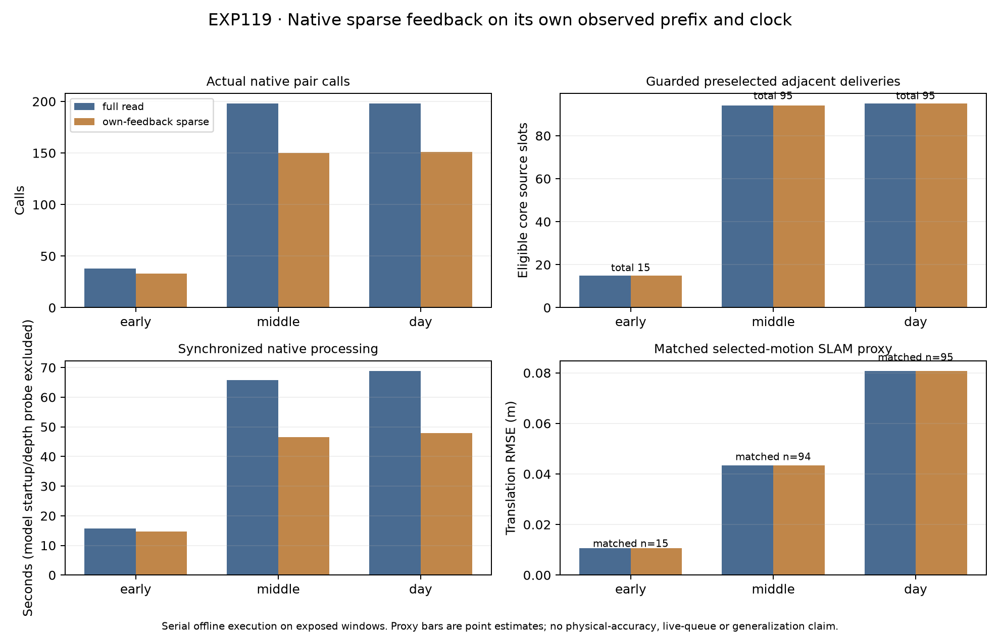

# EXP119: native sparse feedback on its own prefix and clock

Date: 2026-11-03, America/New_York. Parent EXP118 / `802953d0d`. Execution freeze `987c7c96e`; scoring/audit implementation `8bcb18c38`.

**The fixed development contract passes across the three exposed windows. Actual pair calls total 434 → 334 (23.0% fewer), and summed synchronized native processing totals 150.344 → 109.043 seconds (27.5% lower).** These totals compare the three primary captures per arm and exclude the early repeat. They are measured offline results on this hardware; no policy is adopted.

Across both arms, 204 of 205 guarded selections deliver an eligible adjacent motion; one middle-night core slot remains uncommitted despite a thermal opportunity. Matched selected-motion proxy errors are identical. Each scored window retains one camera: early RGB, middle thermal after the initial abstention, and day thermal. The selected expert remains dense, while the inactive expert is probed sparsely. This explains the unchanged selected outputs without establishing adaptive superiority. Full-read thermal alone has eligible native results on all 205 core slots, including the uncommitted middle slot; its single-camera processing cost is not measured here.

Seven dual-camera captures / fourteen expert attempts use persistent native workers. Each source-group decision uses only its own previously received health/first-write events and actual controller monotonic clock. Unrequested frames cause no image decode, native run or frontend call. Original weights, solver, preprocessing and source images remain unchanged. No frozen dense-derived schedule, pose-reference input, training or reserve access enters the controller.

Root frame0, first two pairs and trailing guards remain common. Cache parameters are unchanged: a 1-second TTL, a 1-second probe period and two-request bursts. A cache entry binds its actual native start/end source frames. An inactive expert can resume across a gap, but that long-interval result cannot count as an adjacent source-pair delivery. Processing-stage first writes enter state only through declared requested intervals/invocations; termination writes stay logged and never freshen the cache.

| Window | Core slots | Eligible full → sparse | Unavailable preselection full → sparse | Uncommitted with opportunity full → sparse | Actual pair calls full → sparse | Contract |
|---|---:|---:|---:|---:|---:|---|
| early | 15 | 15 → 15 | 0 → 0 | 0 → 0 | 38 → 33 | PASS |
| middle | 95 | 94 → 94 | 0 → 0 | 1 → 1 | 198 → 150 | PASS |
| day | 95 | 95 → 95 | 0 → 0 | 0 → 0 | 198 → 151 | PASS |

A preselection succeeds only when its selected camera produces a supported motion for the exact adjacent source endpoints before the next ordinary group deadline. There is no retrospective fallback to another eligible camera. An unselected camera is an opportunity upper bound. All 205 guarded source slots per arm remain in the denominators; bootstrap/guards and all native invocations remain in the cost logs.

| Window | Matched selected slots | Translation proxy RMSE full → sparse (m) | Rotation proxy RMSE full → sparse (deg) | Native processing full → sparse (s) |
|---|---:|---:|---:|---:|
| early | 15 | 0.010598 → 0.010598 | 0.065833 → 0.065833 | 15.670 → 14.657 |
| middle | 94 | 0.043304 → 0.043304 | 0.710069 → 0.710069 | 65.800 → 46.461 |
| day | 95 | 0.080776 → 0.080776 | 0.606776 → 0.606776 | 68.874 → 47.924 |

Proxy errors use eligible first processing-write motion, the previously fixed nominal camera/body transform, and unchanged stationary-twist duration projection to the RGB source interval. Gap motions never become missing adjacent outputs. Recorded-SLAM reference deltas are read only after capture and prediction locks. This differs from EXP118 finalized-pose scoring and cannot retroactively establish physical calibration or independent accuracy.

## Complete native availability and simple controls

| Window | Full-read RGB / thermal eligible | Sparse RGB / thermal eligible | Sparse actions | Sparse native gap exclusions RGB / thermal |
|---|---:|---:|---|---:|
| early | 15 / 15 | 15 / 1 | {'RGB': 15} | 0 / 4 |
| middle | 1 / 95 | 0 / 95 | {'ABSTAIN': 1, 'THERMAL': 94} | 23 / 0 |
| day | 95 / 95 | 1 / 95 | {'THERMAL': 95} | 23 / 0 |

Full-read RGB-only and thermal-only availability are descriptive fixed-camera controls from already computed native results, not measured single-camera costs. The cohort may favor a simple fixed camera or retain one active expert throughout a window. Passing this contract does not demonstrate an adaptive advantage, recovery from a real sensor return, physical accuracy, live scheduling or generalization. All unsupported, skipped, gap, late and terminal cases remain in the complete 410-row report.

## Validation and provenance

Twenty-five focused tests pass, including nine new ingress/skip/spawned-controller tests. Independent audit passes **32,671 checks** across 410 core rows and all seven native timelines. It reconstructs requested-only state and TTL/burst decisions from preceding event receipts, validates source mappings/calls/deadlines, and independently checks reference interpolation, matrix-log motion projection and scalar errors. All 1,413 execution source/input/model pins and scorer-only reference hashes remain unchanged.

Strict NPZ parity compares 12,584 arrays across six fresh full-read versus EXP118 controls and two early repeats: **0 mismatches**. All paths/outcomes are preserved; no tolerance or population adjustment was made.

A pre-freeze spawned test caught a journal-field collision (`kind` duplicated in ingress metadata). The field was renamed `event_kind`; all tests passed before freezing or native captures, without policy/parameter changes. All fourteen native experts completed; runtime startup driver diagnostics were retained while CUDA inference succeeded.

## Remaining boundary

Own-prefix software feedback in serial offline native execution is now exercised. The controller has not been validated against simultaneous live queues, camera acquisition deadlines, energy budgets or independent held-out recordings. Before claiming recovery or adaptive benefit, use a separately frozen availability-transition condition with explicit fixed-camera controls, correct gap/adjacent alignment and unchanged parameters. Existing exposed recordings can support that bounded engineering step; stronger physical/generalization evidence still needs justified independent recordings and references.

Artifacts: `results/closed-loop-sparse/run-001`. Backup: `backups/2026-11-03-closed-loop-sparse`. Input/weight/compiler prerequisites EXP112 / base runtime EXP106; EXP118 dense controls are required for parity. No production defaults changed.
