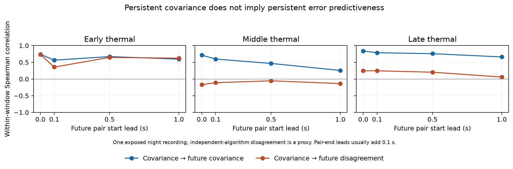

# Covariance persistence and future RGB–thermal reliability

2026-11-02, America/New_York. Retrospective saved-output diagnostic, not a new
model, prospective validation or demonstrated MACThermal improvement.

**Thermal covariance has temporal structure in the inspected long night windows,
but its association with future image disagreement changes across windows. The
saved cross-modal pose-proxy comparisons do not show a consistent benefit from
three-step covariance averaging. These results support separating covariance
persistence from future relative geometric reliability; they do not select memory,
an agent or a correction layer.**

## Question and increment over previous work

The user asks whether RGB covariance rises while thermal decreases, whether both
rise, how long a pattern lasts, and what would justify a pre-inference or
mathematical improvement. EXP014 already shows both rising from early to middle,
then thermal dropping while RGB remains high, in three separate short windows.
That is not a continuous anti-correlated trajectory or a calibrated camera ranking.

EXP016 checked contemporaneous/context-adjusted associations in short windows.
EXP091 fitted current/two-lag gates for current proxy quality and failed its
consistent transfer diagnostic. Here the new quantity is a **nonoverlapping future
pair at an explicit elapsed lead**. No model is fitted. All recordings were already
exposed; no reserve is opened. The questions about third-sensor generalization
remain open.

## Fixed protocol and timing

- Freeze: `e35cef011`; source-transform clarification and producer: `8e86e7f36`.
  Before new outcome calculation, source inspection established that EXP091's
  coordinate named `log_median_trace` uses `log1p`, which is preserved exactly.
- EXP032: all six 99-pair modality/window series from one night recording. Full-grid
  median nominal angular variance is the covariance series. Future disagreement
  is median model-versus-independent-LK angular disagreement on original valid-LK
  support. Full-grid covariance avoids selecting its predictor population by
  future LK success. RGB's sparse target support remains visible.
- EXP091: all 274 original decisions across three recordings and six windows.
  Current predictor is RGB minus thermal lag0 `log1p` native-pixel trace; history
  is the fixed mean of the three lag gaps. Target is future RGB squared proxy loss
  minus thermal squared proxy loss, separately for translation and rotation.
  Native trace differences are diagnostic coordinates, not calibrated risk.
- Leads 0, 0.1, 0.5 and 1.0 s refer to **future pair start after origin pair end**.
  Select the nearest nonoverlapping future start within 50 ms, ties earlier,
  within the same window. Matching precedes feature/label eligibility. No
  resampling, bridging between windows or tuning. The 0 s condition is the next
  pair, not a contemporaneous target. Correlations require at least eight finite
  observations and nonconstant ranks; otherwise remain undefined.
- At nominal 1 s lead, future pair endpoints are typically 1.1 s after the origin
  endpoint; retained acquisition gaps extend this to 2.3 s early / 2.2 s late.
  This is observation-time alignment. Neural completion latency and an achieved
  pre-inference deadline are not measured. EXP091 common intervals also retain
  their previous physical timing/frame/reference limitations.

## What persists?

Within-window Spearman correlation of current covariance with future covariance:

| Series | Next pair (0 s start lead) | 0.5 s start lead | 1 s start lead |
|---|---:|---:|---:|
| Early thermal | 0.740 | 0.671 | 0.595 |
| Middle thermal | 0.713 | 0.466 | 0.257 |
| Late thermal | 0.837 | 0.758 | 0.660 |
| Early RGB | 0.207 | −0.016 | −0.100 |
| Middle RGB | 0.089 | −0.002 | 0.001 |
| Late RGB | −0.010 | −0.049 | −0.131 |

Thermal has positive serial ordering across these tested leads. This is evidence
of covariance persistence in this recording, not a validated forecasting horizon
or evidence that covariance remains numerically constant. Median absolute
log-variance carry-forward errors at 1 s are 1.153 / 0.739 / 0.650 for early /
middle / late thermal. Correlation and calibration/prediction error are distinct.
RGB's weak fine-grained serial ordering does not contradict its persistent high
uncertainty and operational failure state over the original 10–15 s windows.
We did not test leads longer than 1 s or continuous behavior between these windows.

## Does persistent covariance anticipate disagreement?

Current thermal covariance versus future LK-disagreement correlation:

| Window | Next pair | 0.5 s start lead | 1 s start lead | n at 1 s |
|---|---:|---:|---:|---:|
| Early | 0.732 | 0.647 | 0.622 | 79 |
| Middle | −0.168 | −0.054 | −0.137 | 88 |
| Late | 0.246 | 0.204 | 0.058 | 78 |

The same persistent covariance series can have positive, negative or nearly zero
association with future disagreement. Early contains many acquisition gaps;
scene, timing, motion and support remain mixed. This is not a causal attribution
or evidence of incremental prediction beyond current state. Current disagreement
predicting future disagreement is included as an **oracle diagnostic**, requiring
LK, not an online physical-error baseline.

RGB future-disagreement summaries are especially weak: early/middle target pairs
have at most 2/4 supported grid points; late has only three supported target pairs
at the shorter leads and zero at 0.5/1 s. Its late coefficients remain undefined.
None supplies a reliable cross-camera winner label.

## Cross-modal pose-proxy check

Future translation squared-loss-gap correlations on matched eligible origin/target
populations. These are supplied-SLAM/nominal-frame proxies, not independent pose
errors. Each window is separate; nearby windows are not independent recordings.

| Recording/window | Next-pair n | Current gap / three-step mean | 0.5 s n | Current gap / three-step mean |
|---|---:|---:|---:|---:|
| Night early | 15 | −0.393 / −0.561 | 10 | 0.176 / 0.115 |
| Night middle | 0 | undefined | 0 | undefined |
| Day 0 | 95 | −0.032 / −0.004 | 88 | 0.108 / 0.086 |
| Day 1 original | 15 | 0.211 / 0.054 | 10 | −0.139 / −0.055 |
| Day 1 early | 15 | 0.368 / 0.139 | 10 | −0.079 / 0.612 |
| Day 1 late | 15 | −0.464 / −0.386 | 10 | 0.685 / −0.018 |

Three-step averaging changes signs/magnitudes in different ways; it supplies no
consistent forecast advantage here. Rotation associations are also retained in
full, with varying signs. At 1 s, only the longer Day 0 series has enough eligible
pairs for defined pose-proxy correlations (n=83); short windows have n=5 and night
middle n=0. The night middle availability failure is not zero geometric error.
These descriptive correlations neither prove nor disprove a more capable temporal
method. They do not test incremental value with a fitted causal persistence model,
held-out recordings, conditional prediction scores or downstream pose replay.

## Implication for the research direction

The empirical distinction is now explicit: **a sensor's uncertainty can persist
without consistently ranking its future geometric reliability**. Smoothness alone
is insufficient evidence for an LSTM or covariance-memory contribution. The
three-step average is one simple control, not an exhaustive temporal baseline.

No generally valid “RGB up implies thermal down” rule, relative reliability
forecast, pre-inference speed benefit or improved MACThermal method is established.
The next method needs a task-aligned, comparable error target and a specific
repeatable mismatch; then it must improve prediction beyond current covariance,
availability/recovery state and simple timing/quality controls on whole recordings.
This diagnostic is sufficient to avoid choosing memory from autocorrelation
alone. It is insufficient to choose a layer, temporal network or agent, or to
infer generalization to another sensor.

## Validation and recovery

The archived EXP016/032/091 packets were restored with archive SHA256 and all
65 / 4,344 / 72 member hashes checked. EXP016 was reviewed for context but not used
as a new outcome source. The recovery helper initially assumed a manifest key
shared by older packets; EXP091's file-table format was then handled explicitly.
This was recovery metadata handling before scientific execution.

Two boundary/statistic tests passed. The producer completed first attempt:
3,102 origin/target bindings, 48 summaries. These are overlapping, temporally
dependent observations, not 3,102 independent trials. An auditor that does not
import the producer reconstructs source values, eligibility and every timing
binding, and uses SciPy's separate Spearman routine for all correlations. It passes
87,298 checks and rejects timestamp, window, eligibility and statistic mutations.
All four source pins remain unchanged. The plot was visually inspected.

Runtime: immutable recovered Docker image
`sha256:9c0ea2714e913f310b99bd37ddbcae7b616789f8fae856f325030d57b4f4ac26`.
No new images, model execution, updates, reserve access, exposure-ledger changes or
production defaults. Scripts: `tools/covariance_lead_time{,_audit,_plot}.py`;
boundary tests: `tools/test_covariance_lead_time.py`. Run from the tools directory
with the project mounted; producer output requires a new, absent run directory.

Artifacts: `results/covariance-lead-time/run-001/`, including exact source protocol,
full bindings/statistics, independent audit and PNG/PDF. Recovery target:
`ore_ms:ore-ms/backups/2026-11-02-covariance-lead-time`; the compact packet includes
all four saved JSON sources, so reproducing this diagnostic needs no image packet,
model weights or repeated inference. Earlier scientific source provenance remains
EXP032 and EXP091.
