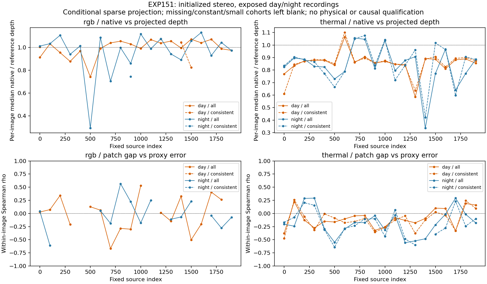

# Initialized stereo depth across day and night

2026-11-06 UTC. EXP151; parent EXP150/ac162c341. Freeze **14159db76** precedes new native replay, day depth decoding and ambiguity associations. [Protocol](cross-recording-stereo-depth-protocol-2026-11-06.md).

Thermal native depths are shorter than the supplied single-scan projected-depth proxy in both exposed recordings: median of per-image median ratios **0.865507 day** and **0.826784 night**. The predeclared locally consistent reference subsets retain ratios **0.871988** and **0.874161**. The observed depth pattern therefore extends across these two recordings after initialized matching. Same-rig calibration, time/projection assumptions and sparse support remain shared uncertainties; this does not identify a physical cause or justify a scale correction.

Patch-cost ambiguity retains a modest directional association with thermal proxy error. Day median within-image patch-gap/AbsRel rho is **−0.114880** (negative 15/20), versus night **−0.191699** (negative 17/20). Consistent-subset values are **−0.107990** (16/20) and **−0.232517** (15/19). The day association is weaker and individual images reverse direction. Descriptor margins/ratios remain weak or inconsistent. No confidence calibration, policy, trajectory or fusion gain has been validated.

## Frozen scope and native fidelity

Use the already development-exposed day `_2021-08-06-11-23-45` and night `_2021-08-13-21-18-04`, indices 0, 100,...1900, both cameras: 80 image pairs. This adds one recording to the preceding night native-depth diagnostic; it does not add an unseen or verified checkpoint-heldout test. Existing canonical images/settings/thermal recipe are byte-identical. No reserve access, new recording selection, learned model, trajectory run, calibration/scale/time fit or default change.

The unchanged initialized EXP149 wrapper is compiled against the exact repaired EXP150 native library, without rebuilding or changing that library or its other sources. First replay saves all geometry with no cost targets; its output lock precedes new day numeric depth decoding. Second-pass targets are all primary supported accepted features, bound before cost replay without error/ambiguity filtering. Depth errors are already available at target binding; this is declared conditional instrumentation, with no tuning or target-rule alternative. All 80 pairs have bit-identical geometry and right descriptors across passes. Native Hamming/patch/float32 reconstruction reproduces **2,938/2,938 primary points**. There are 160 standalone pair calls and no new SLAM trajectories.

Restore EXP048 source metadata/overlaps only after verifying its 742 MiB recovery archive and all 524 members. Exactly 40 new day single-scan PNGs are acquired through strict indexed ranges:41 compressed cache blocks, **164 MiB**, within the 1 GiB cap; two existing selected overlap PNGs match archived bytes. Forty night maps remain the prior EXP147 maps. TAR names/sizes/checksums and PNG chunk CRC/dimensions/uint16 schema pass. Historical whole day archive SHA is recorded; the current complete 10.1 GB archive is not rehashed. No merged or network-filtered depth enters this study.

## Conditional depth and support

Round native left coordinates with floor(x+.5), read the exact uint16 code, divide by256, and require implied right-image support. Every native feature retains outside/zero/right-outside/native-missing/compared status. No interpolation, clipping, residual filter or image substitution. The reference-only 5x5 consistent cohort requires at least 3 eligible depths with relative span <= .10. Equal-image statistics below retain all 20 image cases, with empty groups explicit. AbsRel is a fraction, not percent.

| Recording | Camera | Cohort | Compared points | Nonempty images / 20 | Median depth ratio | Median AbsRel |
|---|---|---|---|---|---|---|
| day | rgb | all_primary | 298 | 20 | 1.011975 | 0.125626 |
| day | rgb | locally_consistent | 5 | 4 | 1.024721 | 0.082997 |
| day | thermal | all_primary | 1242 | 20 | 0.865507 | 0.159157 |
| day | thermal | locally_consistent | 832 | 20 | 0.871988 | 0.146969 |
| night | rgb | all_primary | 309 | 20 | 1.003929 | 0.105427 |
| night | rgb | locally_consistent | 1 | 1 | 0.743348 | 0.256652 |
| night | thermal | all_primary | 1089 | 20 | 0.826784 | 0.265886 |
| night | thermal | locally_consistent | 672 | 20 | 0.874161 | 0.247771 |

| Recording | Camera | Native feature slots | Accepted native stereo slots | Compared slots | Images median ratio below 1 / 20 |
|---|---|---|---|---|---|
| day | rgb | 40074 | 20491 | 298 | 10 |
| day | thermal | 39535 | 25406 | 1242 | 19 |
| night | rgb | 29134 | 17384 | 309 | 10 |
| night | thermal | 36410 | 20768 | 1089 | 17 |

RGB consistency has only 5 points across 4 day images and 1 point in 1 night image, so its consistent-group statistics provide very limited evidence. Camera FOV/resolution, feature and projected-depth support differ; these rows do not establish a same-support camera ranking. Repeated feature/pixel counts are coverage quantities, not independent sample sizes. Native/reference depth may correspond to different visible surfaces even in a locally consistent projected neighborhood.

## Ambiguity replication

The variables and minimum 10 faithful nonconstant observations per image are inherited unchanged from EXP149. Higher patch gap means stronger separation from an alternative at least 2 search offsets away. Rho correlates that gap with absolute relative depth-proxy error. Parentheses give the number of defined image correlations; a dash denotes no qualifying image. Every defined/undefined image case and all three variables remain in the artifacts. There are no pooled-pixel/recording correlations, p-values or outcome-selected cutoffs.

| Recording | Camera | Cohort | Descriptor margin rho (images) | Descriptor ratio rho (images) | Patch gap rho (images) | Patch negative images |
|---|---|---|---|---|---|---|
| day | rgb | all_primary | -0.004468 (16) | 0.149820 (16) | 0.027473 (17) | 7 / 17 |
| day | rgb | locally_consistent | — (0) | — (0) | — (0) | 0 / 0 |
| day | thermal | all_primary | -0.032828 (20) | 0.052929 (20) | -0.114880 (20) | 15 / 20 |
| day | thermal | locally_consistent | -0.035536 (20) | 0.093746 (20) | -0.107990 (20) | 16 / 20 |
| night | rgb | all_primary | 0.058606 (14) | 0.030315 (14) | -0.054212 (14) | 8 / 14 |
| night | rgb | locally_consistent | — (0) | — (0) | — (0) | 0 / 0 |
| night | thermal | all_primary | 0.010463 (20) | 0.044133 (20) | -0.191699 (20) | 17 / 20 |
| night | thermal | locally_consistent | 0.055385 (19) | -0.057601 (19) | -0.232517 (19) | 15 / 19 |

RGB patch-gap directions vary between recordings, and neither camera has usable RGB consistent-group rank evidence. The thermal patch cue has a repeatable direction on these two exposed records, with modest strength and unresolved geometry/reference confounding. It remains a candidate diagnostic rather than calibrated reliability or a validated camera-selection signal.

## Timing and calibration provenance

The current [official setup](https://sites.google.com/view/multi-spectral-stereo-dataset/setup) describes external RGB/NIR synchronization, thermal stereo sync from the left camera, and timestamp-based sensor poses for projection. The [official data format](https://sites.google.com/view/multi-spectral-stereo-dataset/data-format) identifies rectified/synchronized streams, supplied calibration, single-scan versus merged products and encoded depth. These support the supplied benchmark convention. The two HTML snapshots and URL/hash/retrieval records are saved.

[EXP139's source review](ms2-clock-evidence-findings-2026-11-04.md) leaves exported timestamp event/clock-domain semantics and per-record exposure residual bounds unresolved. This phase refreshes the two official pages; it does not repeat a full source/issue survey or obtain acquisition/visibility uncertainty bounds. Recorded offsets remain metadata rather than measured exposure errors. These comparisons remain conditional on the supplied calibration/projection/time conventions.

## Validation, interpretation and next step

Three contract tests pass. Independent audit passes **1,434,047 checks** and rejects **seven corruptions**: Hamming cost, patch cost, candidate removal, native depth, reference units, pixel and support status. It recomputes complete feature support and native depth consistency, raw uint16 metrics, reference-only local groups, every scalar/equal-image statistic, raw descriptor/patch costs, native float32 refinement, tied ranks and all source/output/fidelity bindings. It does not certify physical correspondence or reference truth. All declared science stages complete once, with no outcome retry.

Next use predeclared depth/spatial support controls to test whether the thermal patch-gap association carries information beyond those confounders, while maintaining the separate timing/calibration/visibility qualification work. The current evidence supports continued diagnosis, without fitting a correction or deploying a selector. Physical/heldout/full-record/online/adaptive/fusion/EXP133 and default readiness remain unchanged.

Artifacts: results/cross-recording-stereo-depth/run-001. Recovery: ore_ms:ore-ms/backups/2026-11-06-cross-recording-stereo-depth-exp151, including exact native replay runtime, source/runtime/input/output locks, all 80 source cases/two native passes/raw costs, bounded acquisition records and80 projected maps, independent audit, figures/findings and incremental git bundle. Raw/canonical input PNGs are EXP141 prerequisites listed by exact hashes; scoring runtime remains EXP136. No credentials or protected recordings are included.
