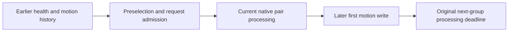
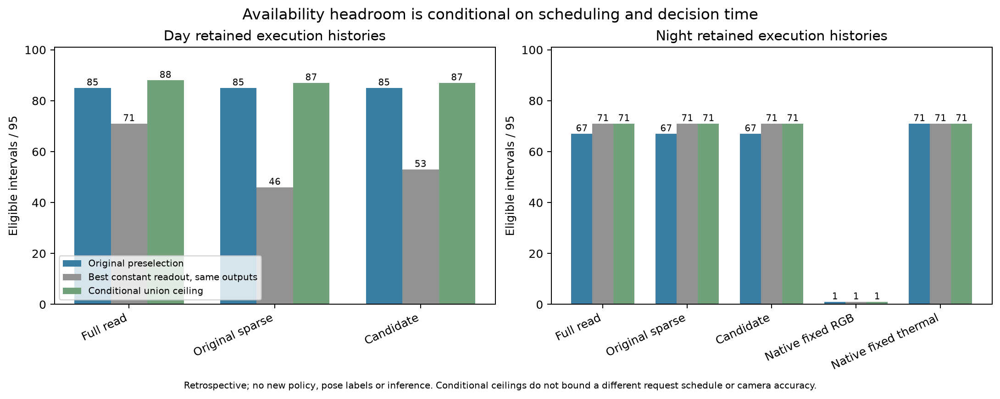

# EXP126: decision timing and conditional availability headroom

2026-11-03 / ore_ms. Parent9d778e7d1; accounting freeze9c6118ebb.
Retrospective diagnostic of already inspected runs, not a fresh confirmation.

The night execution histories have **zero availability headroom above thermal**:
every on-time eligible RGB interval is also eligible from thermal. Original
preselection yields67/95; the conditional union and constant thermal both give
71/95. Further camera-choice fitting on those same outputs cannot beat thermal
on this availability target. EXP125's failed research gate remains unchanged.

The day candidate yields85/95 with an87/95 conditional union. Thus changing only
its final readout could recover at most two existing-output slots on that
history. No readout policy is implemented or declared successful by this bound.
The clocks also establish that the running gate forecasts expert availability
before current-target processing; it is not yet choosing among completed
current-target motion estimates as in the original temporal-arbiter proposal.

## Exact populations and conditional ceiling

| Condition / executed arm | Calls | Original selected S | RGB constant R | Thermal constant T | Union U | U − best constant | U − S |
|---|---:|---:|---:|---:|---:|---:|---:|
| day/full_read_cache | 158 | 85 | 71 | 71 | 88 | 17 | 3 |
| day/bounded_probe | 133 | 85 | 42 | 46 | 87 | 41 | 2 |
| day/leased_probe | 141 | 85 | 48 | 53 | 87 | 34 | 2 |
| night/full_read_cache | 158 | 67 | 1 | 71 | 71 | 0 | 4 |
| night/bounded_probe | 130 | 67 | 1 | 71 | 71 | 0 | 4 |
| night/leased_probe | 137 | 67 | 1 | 71 | 71 | 0 | 4 |
| night/fixed_rgb | 83 | 1 | 1 | 0 | 1 | 0 | 0 |
| night/fixed_thermal | 83 | 71 | 0 | 71 | 71 | 0 | 0 |

All entries retain the same95 source ordinals within their own execution history.
Eight histories/760 guarded rows are bookkeeping populations, not eight
independent experiments. Day is EXP124, night EXP125. Fixture and2MiB diagnostic
arms are excluded by declaration. No new native execution, pixels, pose references,
training, reserved capture or policy/default change.

R and T mean a constant readout on that row's exact actually executed history,
with its exact cost. They do not mean rerunning a fixed-camera scheduler. U is
the count of slots with any actually returned eligible motion by the original
processing deadline. It is a conditional availability ceiling, not a deployable
oracle, camera-quality bound or bound on a different request schedule.

Writing A for RGB-only slots and B for thermal-only slots gives the identity
U−max(R,T)=min(A,B). The night full/original/candidate masks are identical:
24none,0RGB-only,70thermal-only,1both. Consequently their conditional headroom
above thermal is exactly0, including the full-read history. This conclusion is
about the original experts and synthetic source outages on this inspected
interval, not a general theorem about RGB/thermal at night.

Day full-read has7none,17RGB-only,17thermal-only,54both. Its17-slot headroom over
either constant readout is created in this synthetic availability condition;
it is not evidence for natural-fault recovery or cross-camera error calibration.
Day sparse histories depend strongly on switching requests. Candidate constant
readouts48RGB/53thermal versus union87 must not be presented as independently
scheduled fixed-camera baselines or as a34-slot scientific gain from adaptive
quality information. The original candidate already delivers85, leaving only2
slots of readout headroom on that execution history.

## Admission-time prediction and completed-motion choice are different tasks

For all760 targets, neither camera has an eligible **current-target** motion at
the original preselection clock (0/1520 camera-target records). The gate can use
only earlier returned health/history at that time. The target's native processing
and first motion write occur later. All retained receipt clocks, cache views,
source intervals, invocation groups and delivery groups remain explicit.

The original temporal-arbiter proposal describes selecting valid completed
common-interval motions, with current support/uncertainty/history as inputs.
The current scheduling controller instead predicts which expert to use before
that target exists. Both tasks can be studied, but their information sets,
latency and outputs differ. The comparison must state which is being evaluated.
This is a contract distinction, not proof of an implementation bug or a license
to make future output available at the earlier decision clock.

Candidate opportunity losses are fully enumerated:

| Condition / pair | Preselected action | Eligible camera(s) at deadline | Loss category | First eligible write group |
|---|---|---|---|---:|
| day / 49 | THERMAL | rgb | chosen_unavailable_with_alternate | 51 |
| day / 80 | ABSTAIN | rgb | abstain_with_opportunity | 82 |
| night / 2 | ABSTAIN | thermal | abstain_with_opportunity | 4 |
| night / 65 | ABSTAIN | thermal | abstain_with_opportunity | 67 |
| night / 66 | ABSTAIN | thermal | abstain_with_opportunity | 68 |
| night / 80 | ABSTAIN | thermal | abstain_with_opportunity | 82 |

Day pair49 (target ending50) preselects thermal; an eligible RGB motion is written
at group51. Day pair80 abstains before an eligible RGB write at82. Night pair
ordinals2,65,66,80 abstain before eligible thermal writes at4,67,68,82. Every such
write is after the original decision and by its prescribed deadline. They cannot
be used as earlier features. The day loss decomposes1abstention+1unavailable choice
with alternate; night loss is4abstentions. These account exactly for U−S.

Across every cohort,95=S+(U−S)+(95−U), with all unavailable and abstention slots
retained. Missing output under a sparse schedule does not establish that no
modality could have produced it under a different schedule.

## Abstention is not yet a measured downstream risk benefit

The EXP124/125 controller records preselection, request/lease control and native
observer events; it does not implement a selected-motion publisher/validated
final arbiter output contract. `selected_unavailable` means the earlier selected
expert has no eligible output by the target deadline. It is not a count of
geometrically incorrect poses published to a downstream consumer. Native support
flags are structural tracking availability, not pose accuracy or calibrated risk.

Night candidate4unavailable selections plus24abstentions and fixed thermal
24unavailable selections plus0abstentions are distinct status ledgers. They do
not by themselves show that the candidate emits safer motion. A valid final
output interface would need to specify which actual delta is accepted, at what
clock, and what happens when none qualifies. Relative abstention/failure costs
and physical quality references remain unestablished. No penalty is fitted
retrospectively to rescue EXP125.

## Verification

Eight new semantic tests pass: exact deadline equality, no future-at-decision
leak, late health/motion, shutdown writes, gap endpoints, native failure/missing
first motion, transport delivery and camera identity. The independent raw-journal
checker passes **33,874 checks** over760rows and reconstructs each
eligibility mask and timestamp, original outcome, constant-readout/union set,
loss decomposition and integer native cost ledger. It rejects8semantic mutations
including future evidence, dropped hard slots, fabricated masks/headroom/costs
and new-policy/pose-label claims. All48direct and1403inherited pins verify.

The new accounting agrees exactly with the original EXP124/125 expert eligibility
and preselection outcomes. Source studies, source native code, EXP125's original
frozen audit and separately documented scalar precision amendment remain intact.
No new aggregate research success criterion or statistical replication count is
created. The test counts validate this accounting, not the scientific hypothesis.

## Research decision

Keep the sparse/readiness/handover candidate frozen as a bounded systems mechanism.
Do not spend another selector-fit iteration on the inspected night availability
target: it contains no availability opportunity beyond thermal on these histories.
Do not turn synthetic day complementarity or schedule-conditioned constant
readouts into a general adaptive-quality claim.

Before a new method experiment, define two interfaces separately: request
admission under compute/storage budgets, and final motion validation/selection
at a declared clock. The quality question additionally needs an independently
justified common-interval reference. A completed-motion validator or late router
would be a separately declared candidate with its own latency and causal test;
none is introduced by this retrospective ceiling.

The next bounded evidence task is an **exposed-data and target adequacy audit**:
use already exposed dense health/motion traces to determine whether natural
conditions contain complementary useful modalities under fixed deadlines, and
inventory what independent reference/frame/timestamp evidence could support an
accuracy-selection target. Check existing local/Box material before requesting
new uploads. Keep reserved captures closed and mark any promising discovery
condition as exposed; it cannot become a blind confirmation set afterward.
If availability opportunity or justified accuracy targets are absent, identify
that evidence gap before another controller experiment. This is more informative
than choosing a more favorable penalty or camera preference on these runs.

Artifacts: results/decision-headroom/run-001. Backup: backups/2026-11-03-decision-headroom.
Prerequisites: EXP124 day and EXP125 night locked native runs; no new input or
model/runtime packet is needed beyond their inherited recovery dependencies.
