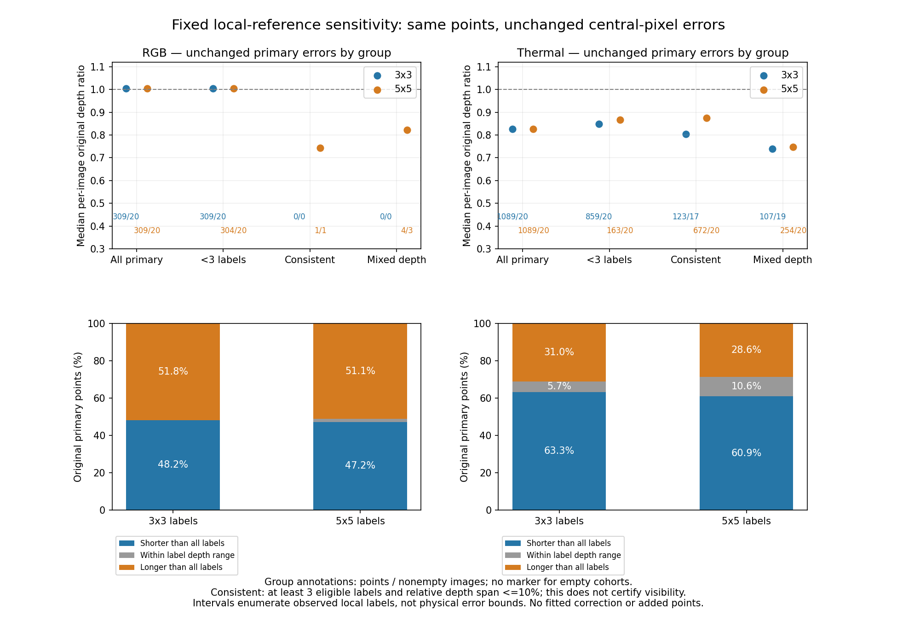

# Local projection and reference-depth sensitivity

2026-11-05 America/New_York. EXP148, parent EXP147/229eeb87f; freeze aa0b84505 before sensitivity computation. [Protocol](depth-projection-sensitivity-protocol-2026-11-05.md).

Thermal's short-depth pattern persists in a reference-only locally consistent subset: with a 5×5 window, **672 points across all 20 images** have at least three eligible labels and at most 10% relative depth span. Their median per-image original native/reference ratio is **0.874161**, versus **0.826784** for all original thermal points. Both the pixels and original errors stay unchanged; this is a different reference-defined population, not a correction or an estimator improvement.

Across all 1,089thermal primary points, **663 (60.88%)** remain shorter than every eligible observed reference depth in their 5×5window. Of those 663,99have fewer than three eligible labels;427are locally consistent and 137mixed depth. These finite windows and observed sparse labels are not physical uncertainty bounds. The result does not certify visibility or eliminate projection/occlusion/timing explanations.

Only **one RGB point in one image** qualifies as locally consistent in 5×5, and none in 3×3. Consequently this study supplies no comparable locally consistent RGB population and no camera-superiority inference.

## Frozen diagnostic

Reuse exactly the 40maps and 309RGB/1,089thermal primary compared features from EXP147, with the same 20fixed source indices per camera. Data are development-exposed. No new acquisition, native/model inference, fitting, primary support change, original reference-pixel replacement, correspondence warp or default change occurs. All80image/radius cases and 2,796point/radius memberships remain; these are not independent samples.

Enumerate squares centred on original rounded reference pixel: radii 1/2pixels (3×3/5×5). Eligible candidates are inbounds, nonzero uint 16/256 m labels with valid provided-model right projection at original native u. Zeros stay absent; no interpolation, dilation or hole filling. Reference-only strata are fixed before computation:

- **Insufficient:** fewer than 3eligible label pixels.
- **Locally consistent:** at least 3eligible pixels and(max−min)/median depth≤0.10.
- **Mixed depth:** at least 3eligible pixels and relative span>0.10.

These are engineering descriptions, not calibrated visibility or occlusion labels. Reference smoothness can still belong to the wrong projected surface. The radii are diagnostic perturbations, not measured calibration/timing bounds. No radius/threshold is selected from favorable outcomes.

Keep every original EXP147 error at its original central reference pixel. Candidate labels determine only strata and a conditional ratio interval[native/max(candidate depth),native/min(candidate depth)]. An interval wholly below 1means native is shorter than every observed candidate label; wholly above 1means longer; otherwise it contains 1. No best candidate is substituted for primary metrics. Native uncertainty, unseen surfaces and reference errors are outside this interval construction.

## Original errors by reference-only stratum

Ratios/relative errors are medians of per-image medians on each stratum's nonempty image cases. Every empty image/stratum remains explicitly null; different strata and radii retain different scenes/points. Counts below are feature observations, with duplicate label pixels from EXP147 retained.

| Camera | Window | Stratum | Points | Nonempty images /20 | Median original depth ratio | Median absolute relative error |
|---|---|---|---:|---:|---:|---:|
|RGB|3×3|All primary|309|20|1.003929|10.54%|
|RGB|3×3|Insufficient|309|20|1.003929|10.54%|
|RGB|3×3|Locally consistent|0|0|null|null|
|RGB|3×3|Mixed depth|0|0|null|null|
|RGB|5×5|All primary|309|20|1.003929|10.54%|
|RGB|5×5|Insufficient|304|20|1.004593|10.54%|
|RGB|5×5|Locally consistent|1|1|0.743348|25.67%|
|RGB|5×5|Mixed depth|4|3|0.822236|17.78%|
|Thermal|3×3|All primary|1,089|20|0.826784|26.59%|
|Thermal|3×3|Insufficient|859|20|0.847730|27.04%|
|Thermal|3×3|Locally consistent|123|17|0.804305|27.23%|
|Thermal|3×3|Mixed depth|107|19|0.738976|27.11%|
|Thermal|5×5|All primary|1,089|20|0.826784|26.59%|
|Thermal|5×5|Insufficient|163|20|0.866955|25.49%|
|Thermal|5×5|Locally consistent|672|20|0.874161|24.78%|
|Thermal|5×5|Mixed depth|254|20|0.748131|31.74%|

The5×5thermal locally consistent group covers 61.71% of primary points and all 20 images; its original absolute relative disagreement remains 24.78%. The3×3counterpart is only 123 points over 17 images (ratio 0.804305). The change between their medians does not isolate an effect of window size: the retained reference-defined populations differ. In RGB, sparse local support makes that comparison unavailable at useful coverage. All-point ratios remain exactly the EXP147 values at both radii.

## Conditional local-label sign ranges

All original points remain in the denominator. A central label is always eligible, so actual candidate sets are nonempty. Counts/percentages enumerate deterministic relations to available local labels, not confidence intervals or certified error signs against truth.

| Camera | Window | Shorter than all eligible labels | Within observed depth range | Longer than all eligible labels | Unavailable |
|---|---|---:|---:|---:|---:|
|RGB|3×3|149 (48.22%)|0 (0.00%)|160 (51.78%)|0|
|RGB|5×5|146 (47.25%)|5 (1.62%)|158 (51.13%)|0|
|Thermal|3×3|689 (63.27%)|62 (5.69%)|338 (31.04%)|0|
|Thermal|5×5|663 (60.88%)|115 (10.56%)|311 (28.56%)|0|

Within the 5×5locally consistent thermal group,427/672 points are shorter than all labels,231longer, and 14contain unit ratio. The all-point 5×5short count 663includes99insufficient-support points, so the full-cohort sign count must not be presented as663independently visibility-qualified observations. The3×3thermal count 689is even more dominated by insufficient support (548 points). No unavailable case, mixed-depth observation or longer-depth point is removed.

## Validation and implications

Six synthetic tests pass: singleton support, flat short/long cases, mixed-depth intervals, inclusive 10%threshold, image/radius/zero/right-support boundaries, and exact unit-ratio endpoints. Independent audit passes **84,738 checks**, rejects four corruptions (candidate removal, stratum, original ratio and interval endpoint), and reconstructs every window/candidate/rejection, stratum and interval with scalar arithmetic and division-free right support. It independently rechecks all original central errors from raw depth maps, exact 1,398primary identities, per-image/all/stratum/equal-image summaries, empty populations and all frozen hashes. Every original EXP147 all-point metric dictionary remains unchanged. No scientific retry or post-outcome threshold adjustment occurs.

This narrows a simple local-label explanation under the declared windows; it does not identify a physical cause. Locally consistent projected labels can still be displaced, temporally mismatched or from an occluding surface. Actual projection error might exceed the windows, and missing labels leave unseen depth possibilities. These data do not qualify synchronization/visibility, establish true stereo accuracy or justify rescaling VO. The approximately 0.61motion ratio uses a different temporal/optimizer population and is not corrected or explained quantitatively here.

The next useful observation is native stereo-match ambiguity on retained points, while physical projection and acquisition/export timing provenance remains unresolved. Original reserves/defaults, EXP133 readiness and prior error outputs remain unchanged. No heldout/full-record, physical calibration/time, online or adaptive-superiority claim follows.

Artifacts: `results/depth-projection-sensitivity/run-001/` retains all neighborhood candidates, strata, conditional intervals and unchanged original metrics. Recovery destination: `ore_ms:ore-ms/backups/2026-11-05-depth-projection-sensitivity-exp 148`, with source/labels/original-point closure, all new outcomes/audit, figures/findings and incremental bundle. Inherited EXP136 CPU runtime; no model/native rerun or camera images required. EXP147 remains the original HTTP/TAR provenance record.
