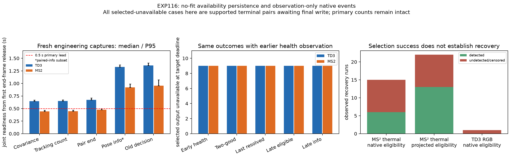

# EXP116: earlier observations preserve availability; timing and recovery still limit use

Client date: 2026-11-03. Frozen protocol/producer: `67bd5448a`; parent: `4709fba75`. This is exposed-data development and a matched native engineering test, with no policy adoption, new architecture, frontend training or actual sensor skipping.

**Native covariance and tracking summaries can be observed roughly half a decision cycle earlier without changing the estimator's outputs. A simple last-resolved eligibility rule matches the later information control's selected-output availability on this cohort. The combined primary criterion still fails because original-rig tracking readiness exceeds 0.5 seconds.** Recovery remains poorly tested on the original rig and is imperfect on MS². Availability success does not demonstrate lower pose error or adequate fused geometry.

The [protocol](early-health-availability-protocol-2026-11-03.md) fixes four fresh engineering cases and all 1,955 historical EXP115 forecast bindings before new outcomes. Fresh cases are exact prior TD3 day0 (100frames), night-middle (100), second-night early (20), and MS² night-late (100). Both arms retain geometry observation; only the on arm adds early events. Sixteen native expert attempts process 1,280 frame executions over the same 320 input groups. These cases were already exposed and chosen to exercise healthy and unsupported tracking; they are not a prospective validation sample.

The opt-in observer emits `early_covariance_available` immediately after native keypoint selection returns, using already copied grid covariance quantiles, and `early_tracking_available` after native outlier filtering returns. The latter records the actual native minimum retained-point threshold, 10 in these captures. It describes a count branch, not optimization success, metric quality or geometric adequacy. Native MACVO performs frontend estimation and writes the previous optimizer result before selection; this is an earlier observation point, not proof of the earliest possible frontend completion. No extra optimizer polling, changed return objects or estimator feedback is introduced.

**All 16,744 saved arrays match bit for bit off/on, with zero diagnostic drift.** Configurations, original native events including geometry, tracking states and original decisions match after removing only the added events and their sequence/time bookkeeping. There are 1,264 added early events across 632camera/pair instances. Every covariance/threshold snapshot agrees with the corresponding native pair-end telemetry; every count-branch result agrees with the native unsupported flag on these error-free pair executions. Unsupported transitions and native terminal handling remain retained.

| Fresh engineering domain | Joint pairs | Covariance median / P95 (s) | Tracking median / P95 (s) | Old decision median / P95 (s) |
|---|---:|---:|---:|---:|
| td3 | 217 | 0.647317 / 0.668863 | 0.650376 / 0.673600 | 1.356495 / 1.407486 |
| ms2 | 99 | 0.442568 / 0.466233 | 0.445887 / 0.469520 | 0.956379 / 1.072921 |

Fresh timings are controller receipt times relative to the earliest release of each pair's ending frame, including serial sensor replay, observer work and backend work. Joint means both cameras' snapshots are available. All 217TD3 and99MS²pair samples, including warm-up outliers, are retained. Tracking maxima are approximately4.00sTD3and3.77sMS². Paired pose-information timing exists for only120TD3and82MS²pairs; its median is1.329s/0.923s, and that conditional subset must not be confused with the full population. Off/on case-level timing distributions are saved; this is not an isolated microbenchmark of observer overhead.

The fresh P95 tracking readiness gate is **FAIL TD3** (0.674s exceeds0.5s), **PASS MS² engineering subset** (0.470s below0.5s). These are instrumented readiness checks, not validated live exposure/readout/queue deadlines. Native inference still runs for both sensors at every input group, and no reduced-compute or live-throughput result is claimed. Physical clocks and streaming queue behavior remain unverified.

The retrospective comparison uses seven previously exposed recordings and eighteen windows, exactly1,072forecasts at0.5s and883at1s. The early decision prefix is when both origin `pair_end` messages have been received, before the old delayed decision boundary. The fresh selector/filter timing experiment is kept separate; its faster timing is not silently substituted into the historical policy outputs. On saved traces, early pair-end delay has median0.673sTD3/0.478sMS², versus old decision1.355s/0.960s. All source target frames are unreleased at the earlier prefix.

Three fixed early rules use tracking-health persistence, two consecutive supported pairs, or last-resolved native eligibility. For the last-resolved rule, a known unsupported/error pair updates toFalse immediately; a supported pair with no returned motion is pending and carries the previous resolved state. A returned invalid/mismatched/ambiguous motion is an explicit failure. Unknown is kept distinct and abstains when no known eligible sensor exists. All actions are locked before future eligibility scoring. There is no model fitting or future fallback. Native camera-local eligibility and common-interval projected eligibility are separate targets; interval-transport horizon failures are not relabeled as tracking failures.

| Historical domain | Forecasts at 0.5 s | Early resolved: selected eligible / unavailable / abstain | Late information: selected eligible / unavailable / abstain |
|---|---:|---:|---:|
| td3 | 257 | 248 / 9 / 0 | 248 / 9 / 0 |
| ms2 | 815 | 806 / 9 / 0 | 806 / 9 / 0 |

The three early rules, late eligible-state preference and late information ranking have the same selected-availability counts here, with no abstentions. Their actions need not be identical: early resolved differs from late information on18primaryforecasts. No pose-error labels are read in this experiment, so equal availability does not imply equal accuracy. The primary availability noninferiority gate passes in both domains. Combined with the failed TD3 readiness gate, the overall fixed0.5scriterion is **FAIL**. At1s, early and late controls again match:203eligible/9unavailableTD3and663eligible/8unavailableMS². This sensitivity does not replace the primary or validate skipping.

A posthoc trace inspection explains every remaining selected-unavailable case for the early-resolved rule: all18primary and17sensitivity cases target the **final pair of a finite replay window**. Tracking is supported, but the first pose write occurs in `termination`, after the recorded target decision deadline. These are pending outputs at a clip boundary, not evidence of ordinary tracking loss. Full primary counts and hashes remain unchanged; the metadata-based boundary breakdown is separate. All1,054primary interior selections are eligible on this development cohort, with no claim of independent-sample confidence. In prior EXP115 context, the fitted probes'107primary unavailable selections comprise18terminal and89nonterminal targets; that contextual breakdown is explicitly posthoc.

That selected-output result does not establish accurate per-camera availability forecasting. At0.5s, MS²thermal projected eligibility has757TP,24FP,9TNand25FN for last-resolved persistence; RGB remains the reliable selected alternative in this cohort. For native camera-local thermal recovery there are15observedFalse→True runs onMS², nine undetected/right-censored. The projected eligibility target has22runs, nine undetected, because interval projection introduces additional changes. Median detection delay among detected runs is0s, but excludes those failures. TD3has only one observed RGB recovery run, lasting one target pair, and it is missed; no thermal recovery runs are observed there. Start-of-window and gapped runs are not invented recoveries, and these are not closed-loop recovery delays after skipping.

The result supports a lightweight eligibility-persistence baseline and an explicit pending state. It does not support adding a learned covariance-memory architecture on this evidence. The next evaluation should use continuous streams or prespecified trailing guard frames so final optimizer drains do not masquerade as sensor failure. Choose a prospective lead from measured processing cost, validate clock/queue behavior, and specify age/unknown/probe behavior when a sensor is genuinely skipped. Then compare pose error and compute cost under actual sparse observations. This implementation still requires both current health receipts and cannot itself operate as a continuous skipping controller. A successful eligible output can also have high pose error; adequate remaining geometry and third-sensor transfer remain separate tests.

Validation: seven focused tests pass, including native return/output preservation, observation exception isolation, pending-state carry, immediate unsupported-state updates and future-event exclusion. Independent chronological resolution, actual future-event mutation, target truth/population/confusion audits pass40,782checks across all1,955forecasts and1,076uniqueoriginprefixes. Independent recovery/censoring and fresh timing reconstruction pass8,738checks. All1,870frozeninput/sourcepins, selected image hashes and both released checkpoint hashes remain unchanged. No reserve was opened, no frontend weights changed and no policy was adopted.

Sources retain their prior limitations: exposed records, unknown original checkpoint training membership, nominal TD3 frames/SLAM proxies, provided MS² clock/calibration/preprocessing assumptions, short correlated windows and limited original-rig recoveries. No claim of independent physical ground truth, lower pose error, real-time throughput, reduced inference count, joint factor fusion or another-sensor validation.

Artifacts: `results/early-health-availability/run-001`. Input/source lock: `experiments/early-health-availability-2026-11-03.json`. Runtime: `sha256:44ff9a1e6fa95d220437714e5be9b94f0f73c8eaebd4fcae3f843ceea14bef09`. Backup target: `backups/2026-11-03-early-health-availability`; incremental repository prerequisite EXP115, original model/compiler prerequisites EXP112 (base runtime EXP106). The packet contains exact fresh pixels/calibration, all matched captures, saved-history inputs, prediction locks, native truth, audits, code, figures and notebook. Boundary diagnostics never replace primary counts.
