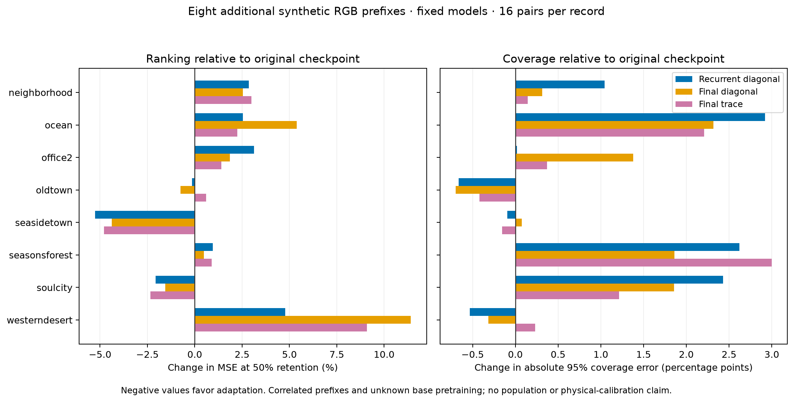

# EXP108 — Expanded fixed-model ranking and calibration evaluation

The recurrent adaptation’s earlier ranking advantage does not repeat in this expanded cohort. On eight additional environment prefixes, primary MSE at 50% retention worsens **4.435%** versus the original checkpoint (2.558774→2.672261 px²). Five of eight recordings regress, and the median record change is +1.745%. Coverage error and final-stage likelihood also worsen overall. All three adapted heads have worse primary ranking than the original. Keep the original checkpoint as the reference; no adaptation is adopted or promoted.

## Frozen cohort and comparison

Selection freeze `4d7d1e968`; exact members, support and metrics `02aeddfae`; native execution `42afcb9f5` after data audit and before model scores. The same four fixed EXP106 models use the exact saved runtime image `sha256:9c0ea2714e913f310b99bd37ddbcae7b616789f8fae856f325030d57b4f4ac26`. Zero optimizer steps and zero new checkpoint/model exports.

The source is the [pinned AirLab TartanAir mirror](https://huggingface.co/datasets/theairlabcmu/tartanair/tree/65e00180ea952475878a748543e11e9ec20beaac). The catalog/ledger rule selects every remaining base environment family, excluding _night/_winter variants of already observed families. ZIP metadata selects the lexically first trajectory containing the complete first17-left-image /16-provided-flow /16-mask prefix. This yields Neighborhood P000, Ocean P000, Office2 P000, Oldtown P000, Seasidetown P000, Seasonsforest P001, Soulcity P000 and Westerndesert P001. All 128 pairs are retained.

Primary is unchanged within-pair trace ranking at 50% retention, pooled within each recording then equally averaged over these eight records; the predeclared primary contrast is recurrent diagonal versus original. Secondary outcomes retain all four models, all five risk/random/oracle curves, per-record relative effects and win counts, macro/micro likelihood and risk, joint coverage, standardized moments, and final trace versus final diagonal. No metric, record or threshold is selected after scoring.

## Primary and common final-stage diagnostics

| Model | MSE50 (px²) | Joint nominal-95 coverage | Mean record absolute 95% coverage error (pp) | Final diagonal NLL | Recurrent diagonal NLL |
|---|---:|---:|---:|---:|---:|
| Original checkpoint | 2.558774 | 92.465% | 3.448 | 0.098989 | 1.774750 |
| Recurrent diagonal | 2.672261 | 91.294% | 4.415 | 0.133507 | 1.549638 |
| Final diagonal | 2.826302 | 91.461% | 4.296 | 0.131390 | 1.987086 |
| Final trace | 2.769599 | 91.423% | 4.271 | 0.126819 | 1.907949 |

The original checkpoint has the lowest aggregate primary risk and final-stage diagonal NLL and the smallest mean per-record absolute nominal-95 coverage error. Recurrent adaptation does improve its recurrent training-aligned NLL (1.774750→1.549638), while final-stage ranking/NLL/coverage regress. This metric disagreement remains part of the result; it does not justify choosing recurrent NLL as the replacement primary.

## Recording-wise effects versus original

| Adaptation | Ranking better / worse | 95%-coverage error better / worse | Final NLL better / worse | Median record ranking change |
|---|---:|---:|---:|---:|
| Recurrent diagonal | 3 / 5 | 3 / 5 | 3 / 5 | +1.745% |
| Final diagonal | 3 / 5 | 2 / 6 | 4 / 4 | +1.173% |
| Final trace | 2 / 6 | 2 / 6 | 4 / 4 | +1.145% |

No exact ties occur. All three dominance gates fail. Westerndesert has the largest absolute error scale and contributes most to the aggregate recurrent regression; the five recording regressions and positive median record effect also show that the direction is not confined to that one record. No record is dropped or downweighted.

[Vector PDF](figures/expanded-fixed-model-tradeoff-2026-11-02.pdf). Negative values favor adaptation. The coverage panel uses change in absolute distance from nominal95, so both undercoverage and overcoverage are represented.

## All per-record final-stage outcomes

| Recording | Model | MSE50 (px²) | Joint 95% coverage | Final diagonal NLL |
|---|---|---:|---:|---:|
| neighborhood | Original checkpoint | 0.548081 | 92.175% | 0.570592 |
| neighborhood | Recurrent diagonal | 0.563730 | 91.130% | 0.593653 |
| neighborhood | Final diagonal | 0.561979 | 91.862% | 0.589332 |
| neighborhood | Final trace | 0.564429 | 92.029% | 0.595763 |
| ocean | Original checkpoint | 1.148824 | 93.045% | 0.410057 |
| ocean | Recurrent diagonal | 1.178008 | 90.125% | 0.424043 |
| ocean | Final diagonal | 1.210789 | 90.728% | 0.426067 |
| ocean | Final trace | 1.174589 | 90.839% | 0.422773 |
| office2 | Original checkpoint | 0.113310 | 84.403% | 0.862072 |
| office2 | Recurrent diagonal | 0.116867 | 84.385% | 1.195374 |
| office2 | Final diagonal | 0.115421 | 83.025% | 1.199190 |
| office2 | Final trace | 0.114903 | 84.034% | 1.069042 |
| oldtown | Original checkpoint | 0.067782 | 95.721% | -0.955639 |
| oldtown | Recurrent diagonal | 0.067679 | 94.944% | -0.962303 |
| oldtown | Final diagonal | 0.067273 | 95.023% | -0.965975 |
| oldtown | Final trace | 0.068186 | 94.699% | -0.958666 |
| seasidetown | Original checkpoint | 0.030493 | 97.931% | -1.326779 |
| seasidetown | Recurrent diagonal | 0.028886 | 97.837% | -1.354638 |
| seasidetown | Final diagonal | 0.029156 | 98.007% | -1.347617 |
| seasidetown | Final trace | 0.029031 | 97.776% | -1.349011 |
| seasonsforest | Original checkpoint | 0.209560 | 92.482% | -0.488482 |
| seasonsforest | Recurrent diagonal | 0.211550 | 89.862% | -0.469641 |
| seasonsforest | Final diagonal | 0.210573 | 90.620% | -0.492750 |
| seasonsforest | Final trace | 0.211415 | 89.484% | -0.455705 |
| soulcity | Original checkpoint | 0.237236 | 93.321% | -0.242911 |
| soulcity | Recurrent diagonal | 0.232352 | 90.891% | -0.237779 |
| soulcity | Final diagonal | 0.233524 | 91.463% | -0.237989 |
| soulcity | Final trace | 0.231679 | 92.109% | -0.259029 |
| westerndesert | Original checkpoint | 18.114906 | 90.645% | 1.963004 |
| westerndesert | Recurrent diagonal | 18.979013 | 91.177% | 1.879350 |
| westerndesert | Final diagonal | 20.181699 | 90.960% | 1.880864 |
| westerndesert | Final trace | 19.762559 | 90.412% | 1.949383 |

## Pooled micro and stage-objective sensitivity

| Model | Pooled MSE50 (px²) | Pooled 95% coverage | Pooled final NLL |
|---|---:|---:|---:|
| Original checkpoint | 2.420094 | 92.666% | 0.044240 |
| Recurrent diagonal | 2.526832 | 91.466% | 0.075245 |
| Final diagonal | 2.671909 | 91.649% | 0.073176 |
| Final trace | 2.618212 | 91.602% | 0.069290 |

The pooled micro comparison agrees with the primary direction for recurrent adaptation. The secondary trace-versus-final-diagonal comparison improves aggregate ranking by 2.006%, but final trace remains worse than the original checkpoint. Its per-record effects remain mixed. This secondary contrast does not establish a useful gain over the existing reference.

## Data, exposure and independent validation

All 392 raw members verify ZIP CRC, size and SHA. Acquisition transfers 372,746,917 bytes; metadata enumeration transfers another 30,831,869 bytes. These bounded range reads cover selected members rather than full archives. Whole-archive LFS hashes remain source assertions, not recomputed whole-archive verification.

Preparation preserves native480×640 RGB/255, provided forward flow, source mask0 validity, finite GT and norm(GTflow)<400. Independent PIL/NumPy accounting passes 1,408 checks across 512 prepared array fields. There are 136 distinct new image hashes and no overlap with earlier training/evaluation images. All eight new canonical recording IDs are disjoint from our previous train/evaluation IDs. The ledger preserves the old28 records exactly and appends these eight as development-exposed (36 total).

Data audit: 2,898 checks. Final independent audit: 27,521 checks; three semantic mutations of primary macro, nominal95 coverage and retained population are rejected. All 969 protected source/data/artifact pins remain intact. All four model-state digests match EXP106 before and after inference, gradients remain absent, no optimizer is constructed, and all 1,536 common recurrent mean fields match across four models. CUDA32/NumPy64 likelihood, target/support identity, raw-member/prepared-array hashes, stable-tie risk/oracle/random accounting, per-record/macros and effect counts are checked.

The derived float64 signed-sum envelope from EXP107 is frozen before these outcomes. Maximum standardized-mean summation discrepancy is below 5.841e−14, within that envelope. All other frozen numerical checks remain unchanged. Metadata, acquisition, preparation, model evaluation, metrics, micro accounting, summary and audit pass on their first attempts. Visualization is run separately to preserve the original frozen orchestrator hash; its predeclared source is included in the execution pins. No scientific run is retried or repaired in this phase.

## Decision and limits

Keep the original released checkpoint as the benchmark reference. Retain recurrent adaptation as an experimental control and retain all candidates/results; do not adopt any adapted head. The bounded48-update, three-training-record adaptations have not established a reliable ranking/calibration advantage across additional records. This result does not identify a failure mechanism.

Further fitting or objective changes need a separately justified hypothesis, label/task scope, training coverage and prospective recording-level exposure contract. Do not reuse these newly observed records as untouched future evidence. The current family-coverage rule has now observed one prefix in every base-family catalog entry; additional trajectories/conditions still remain unexamined.

Scope is synthetic RGB provided-flow evaluation of temporally correlated prefixes, with unknown supplied-network pretraining overlap. Catalog family labels do not certify independent population replicates. No statistical-population, network-training-heldout, thermal, physical VO, probability-calibration or deployment claim follows. The prior seven MS² reference-readiness requirements and protected reserves remain unchanged.

Artifacts: `results/expanded-fixed-model-evaluation/run-001/`, `results/expanded-fixed-model-metadata/`, `data/tartanair-expanded-evaluation/run-001/`. Recovery target: `ore_ms:ore-ms/backups/2026-11-02-expanded-fixed-model-evaluation`, incremental from EXP107 `537506280`. Fixed model binaries and exact runtime remain in the documented prerequisite packets.
