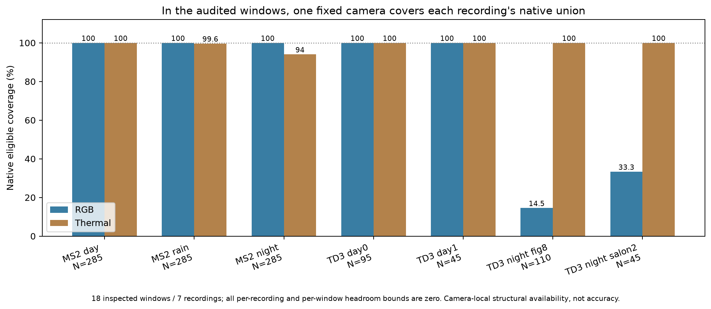

# EXP127: exposed data and target adequacy

2026-11-03 / ore_ms. Parent8e7ac9588; inventory freeze383d21147.
Retrospective evidence/discovery audit; no new selector, neural execution or test.

**Every audited window and recording group has zero natural availability headroom
over its better fixed camera.** Across18windows/7recordings, thermal covers all
295TD3 guarded intervals; RGB covers all855MS2 intervals. There is no exposed
within-recording complementary availability case in this fixed dense cohort.
The inspected reference evidence supports qualified provided-reference/proxy
comparisons, but does not establish an independent physical pose-quality target.

These are scoped evidence findings. They do not prove all recordings lack
complementarity, all references are unusable, uncertainty has no quality signal,
or that adaptive RGB–thermal estimation is impossible. They explain why more
availability-gate tuning on this cohort cannot establish the desired benefit.

## Natural dense availability

| Exposed recording | Core pairs | RGB eligible | Thermal eligible | Union | Headroom above better fixed |
|---|---:|---:|---:|---:|---:|
| ms2/_2021-08-06-11-23-45 | 285 | 285 | 285 | 285 | 0 |
| ms2/_2021-08-06-16-19-00 | 285 | 285 | 284 | 285 | 0 |
| ms2/_2021-08-13-21-18-04 | 285 | 285 | 268 | 285 | 0 |
| td3/20251027/0_salon_so_day | 95 | 95 | 95 | 95 | 0 |
| td3/20251027/1_salon_mac_cov_day | 45 | 45 | 45 | 45 | 0 |
| td3/20251027/night_mac_salon_warehousefig8 | 110 | 16 | 110 | 110 | 0 |
| td3/20251027/night_thermal_so_salon2 | 45 | 15 | 45 | 45 | 0 |

All1150guarded source pairs remain. The18windows are discovery-exposed, not18
independent recordings or a prospective holdout. Camera-local native eligibility
requires exact supported adjacent endpoints and first non-interpolated processing
write received by the original ordinary group-complete decision boundary. No
terminal write, late output, gap or unsupported motion fills a missing result.
Two bootstrap pairs and two trailing guards per window are excluded from this
headroom population, with full health histories separately retained.

For each native execution history, U−max(R,T)=min(RGB-only,thermal-only). That
quantity is0in all18windows and all7recording groups. The camera chosen in this
bound is retrospective; no preferred camera is installed. Do not pool TD3 and
MS2 into an apparent adaptive win: they are different rigs/datasets, and a
camera preference can differ by domain without requiring temporal selection.
These ceilings concern structural availability under actual dense execution,
not pose accuracy, uncertainty calibration, or a changed estimator/schedule.

The camera-local totals are TD3RGB171/thermal295 and MS2RGB855/thermal837. Prior
EXP117's MS2thermal829counts **projected common-interval** eligibility;8additional
transports are excluded there. Both populations are preserved per row. This is
not a changed count or an excuse to replace the declared common-motion target
with easier camera-local availability.

## Natural failure/return evidence

Across36full-window native health traces, there are18False→True returns
and17healthy–failed–returned triples. **0** meets the already used
requirement of at least3pairs in each phase. Short returns remain in the raw
run inventory and are not described as absent. The native support failures are
tracking diagnostics, not verified physical sensor outages or silent-fault labels.

No windows are stitched to fabricate a recovery. Each triple retains the failed
run's guarded-core IDs, whether that failure was wholly inside the core, and
whether the alternate actually supplied eligible output on those core pairs.
Thus the source can support short-failure and recovery bookkeeping, but this
sample lacks a sustained complementary natural-recovery demonstration condition.

## What was checked locally and in Box

A current scoped Box root metadata listing has the same9TD3ZIP names already
recorded as development-exposed. The backups listing has151entries at the saved
snapshot; seven relevant existing recovery folders were inspected by filenames
and sizes. This is not an exhaustive search of every folder/account or a claim
that no other evidence exists. The main contract-restoration step opens no recording member or reserve payload.
The separately declared ZIP-directory metadata supplement below adds only archive
indexes, preserving that scientific-payload boundary. New recording segments would not restore whole-recording holdout status.

Four existing metadata/evidence archives were downloaded from their previous
recovery folders, SHA-verified against their saved manifests, and10selected
contract/exposure/owner-evidence members were individually SHA-verified before
restoration into the new evidence directory. Prior rig, exposure and prospective
contract artifacts were absent locally; no historical paths were overwritten.
The archive/member chain is rechecked independently. This establishes preservation
of prior evidence, not new source authentication or new owner testimony.

## Reference and claim readiness

| Evidence or claim | Source-backed state and limit |
|---|---|
| TD3 supplied rig | Recovered contract reconstructs nominal matrices; physical body transform verification remains false. `gps_frame` has no supplied graph path, and it is not assumed equal to the named NovAtel IMU frame. |
| TD3 motion reference | Recorded Super Odometry/SLAM proxy; source owner reports direct auxiliary GNSS, tentative SO non-use, and some RTK runs. Exact signed axes, antenna/solution origin, timestamps/latency, per-interval quality and aiding dependencies remain unresolved. GNSS existence does not establish applicable independent camera/body truth. |
| Exported reference quality | The inspected13-field odometry export omits covariance and receiver solution quality. Prior bounded archive-name inventories do not identify explicit RTK/fix-quality streams. This does not prove such messages are absent from original bags or elsewhere. |
| MS2 native pipeline | Verified temporal/shared development preservation. Latest structured status is `ADAPTER_VERIFIED_OTHER_REQUIREMENTS_PENDING`. Earlier adapter-gap text is historical and must not erase this progress. |
| MS2 provided references | Existing declared GNSS/IMU-derived reference/calibration/time interpretations support reproducible qualified comparisons. They do not establish unqualified physical truth; EXP114 retains two grossly invalid reference intervals at day source002018 and its predeclared exclusions. No new reference errors are computed here. |
| Unknown training overlap | Still unknown for the exact supplied checkpoints. This restricts network-training-held-out claims; it does not by itself veto a narrower provided-reference benchmark. |
| New prospective test | No new assignment or input freeze. Two MS2records remain protected; exposure attestations and source-backed target qualification must be resolved separately before prospective claims. No reserve opened by this audit. |
| CATS | Inspected static stereo reference evidence is not temporal VO or motion-selection validation. |

The two protected metadata identities remain `_2021-08-13-16-31-10` and
`_2021-08-13-22-16-02`. Earlier reporting of unexamined pixels does not resolve
reference-member inspection or checkpoint training membership. No record is
promoted from uncertain exposure to blind holdout by this inventory.

The original quality question remains different from availability. Existing
EXP114 reported lower thermal translation **proxy** error on134of852jointly
scoreable comparisons despite an RGB-dominated availability cohort. Those are
previously inspected, reference-qualified observations, not new labels or proof
of a learnable transferable signal. Zero availability headroom does not imply
zero possible error-ranking headroom when both estimators track.

## Validation

Eight new semantic tests pass for deadline equality, late/terminal/gapped/missing
motion, native support, complementarity and local run boundaries. Independent
raw-journal/evidence audit passes **35,873 checks** over1150core rows,
36camera histories and7recording summaries, verifies64direct/35inherited pins,
compares original native/projected truth, and validates archive/member restoration.
Nine semantic mutations are rejected, including fabricated headroom/recovery,
erased reserves/adapter progress, physical-truth promotion and a blanket veto
from unknown training. All earlier gate failures and source qualifications remain.

## Research decision and concrete next evidence

Keep the scheduler/readiness/catch-up mechanism frozen. The exposed natural
availability cohort cannot demonstrate within-recording adaptive coverage above
its best fixed camera. Synthetic outages remain useful controlled engineering
fixtures, but cannot supply missing natural or quality-transfer evidence.

Separate request admission from final validated motion selection at a declared
clock, as identified in EXP126. For a quality-selector experiment, first declare
a provided-reference benchmark target with its assumptions and coverage controls;
physical accuracy requires stronger independent reference/frame/time evidence.
Do not condition all exploratory benchmark work on proving physical truth or
checkpoint disjointness if only the narrower claim is intended. Do not claim
physical quality/generalization from that narrower benchmark.

The useful missing inputs are specific: applicable rig/GNSS reference metadata
and original quality fields for already exposed intervals; source-backed MS2
reference/export/frame/time conventions; or metadata for a separate recording
with genuinely changing useful modalities and a suitable reference. Another
unqualified image archive does not supply reference quality. A focused
[request draft](research-evidence-request-2026-11-03.md) and an exact18-window
recorded-source endpoint manifest are prepared. **Nothing is sent.** Check any
new source material before declaring a recording-level validation split; discovery
payloads stay exposed and the protected records stay closed.

Artifacts: results/exposed-data-adequacy/run-001 and evidence-001. Box:
backups/2026-11-03-exposed-data-adequacy. Prerequisites: EXP117 dense source traces
(EXP112/113/114) and their pinned source/runtime chain. Small restored evidence
archives and selected members are included; models and raw images are not copied.

## Separately declared metadata supplement: five existing archives remain useful leads

The original1150pair population and its freeze383d21147remain unchanged. After
that summary, comparison with the Box root identified five **already project-
exposed** TD3 recordings outside the paired-native inventory. The
[metadata-only supplement declaration](exposed-archive-metadata-supplement-2026-11-03.md)
was written and source/plan hashes saved before their directory outcomes.
No recording image, odometry numeric data or reference-pose member was opened.

| Additional exposed TD3 archive | Indexed names | Explicit quality-name leads | GNSS-context names |
|---|---:|---:|---:|
| night_macthermal_salon_redcourse_waypointskip1.zip | 68,659 | 0 | 22 |
| night_so_waypoint_skip2.zip | 54,855 | 0 | 22 |
| night_teleop_so_salon_fig8.zip | 79,291 | 0 | 22 |
| night_thermal_so_salon.zip | 15,206 | 0 | 22 |
| night_thermal_so_salon3.zip | 56,622 | 0 | 22 |

The supplemental intake reads only bounded ZIP footers/ZIP64headers and central
directories, never a compressed member payload. All directories fit the fixed
16MiBper-archive cap. It uses40,898,365range bytes and indexes
274,633names. An independent Pythonzipfile directory-only reader
passes823,993metadata checks of names/counts/CRCs/size fields/bounds/range
hashes. A saved partial-directory hash is not a full-archive or publisher digest;
source metadata, range journals, both parsers and all derived listings are retained.

All five contain NovAtel/GNSS/IMU and related TF export names. None matches the
frozen explicit RTK/fix-status/solution-status/covariance filename terms. This is
not proof of absent quality information within generic files or original bags.
GQ7 antenna TF names are not evidence that the NovAtel solution had RTK, and no
new frame transform or reference quality is inferred without member inspection.

These are concrete existing-data opportunities: their **native complementary
availability is not yet measured** by this study. Do not extrapolate the18-window
zero-headroom finding to their full recordings, or request another image ZIP as
though the existing pool were exhausted. A separately frozen bounded development
survey could use predeclared source positions on these recordings before any new
collection. Their earlier whole-recording exposure remains development; they
cannot become blind confirmation data after this search. Reference-quality
provenance remains a separate requirement for stronger accuracy claims.

Figure presentation refinement: title explicitly limits the claim to audited windows; bar labels use percentages and N to prevent overlap. The original render is retained; no data or analysis changed.
