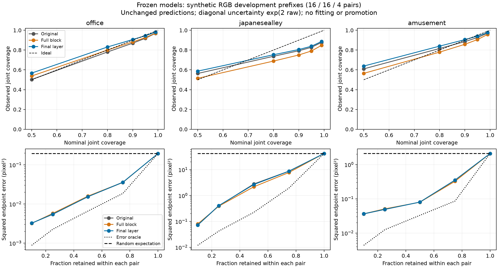

# EXP103 — coverage and ranking favor different frozen candidates

2026-11-02 (client date, America/New_York). Analysis contract committed as
`d1cf5ed82` before capture or metric outcomes; source and candidate state follow
EXP102 at `48333b736`. No training, fitting, new data, or model promotion.

Final-layer adaptation moves nominal 95% joint coverage closer to 95% on all
three observed recordings. Its two-added-record macro coverage is 89.154%,
up from 87.331% for initialization, and remains below nominal. Full-block
adaptation instead gives the lowest squared error at 50% retention on the two
added recordings: 1.09878 pixel² versus 1.34020 for final-layer and 1.40979 for
initialization. Its coverage is worse on Japanesealley and amusement.

The NLL winner from EXP102 therefore does not dominate uncertainty ranking.
These are descriptive development-prefix results; they do not select a deployable
model or establish thermal, physical VO, or independent-test generalization.

## Frozen setup and definitions

All 36 previously exposed pairs are reused: office Easy/P000 (16), Japanesealley
Easy/P001 (16), amusement Easy/P001 (4). All three checkpoints, preprocessing,
native pixel support, and deterministic GPU runtime are unchanged. Only the final
prediction stage is examined. Predictions and raw log-standard-deviation arrays
match EXP102 by full-array SHA256, including its final-stage NLL and mask support.

For error e=(predicted flow − provided flow) and raw logstd r, diagonal variance
is exp(2r). Joint ellipse membership is sum(e²/exp(2r)) ≤ −2log(1−p), the exact
two-dimensional Gaussian contour at probability p. Reported p values are 50%,
80%,90%,95%,99%; ideal mean squared normalized error is 2. Standardized bias and
axis second moments are diagnostics, with ideal values zero and one respectively.
No diagonal Gaussian shape or calibration assumption is asserted to hold in data.

Selective risk ranks valid pixels separately within every pair by ascending
predicted trace variance. Ties use original flat pixel index. At each retained
fraction f, k=max(1,floor(fN)) pixels remain. Risk is mean squared endpoint error
in pixel². The oracle sorts actual squared errors; random expectation is the
full-pair mean error and needs no random sampling. These are within-pair rankings,
not recording-wide thresholds or a deployment rejection policy.

Counts and error sums pool pairs within each recording. Group scores give each
recording equal weight. “Added two” means office + Japanesealley, not unseen data.
Random expected error sums weight the retained k in each pair; fullpair sample
counts can differ. Absolute macro risk here is strongly affected by Japanesealley.

[Frozen analysis protocol](frozen-calibration-ranking-protocol-2026-11-02.json).

## Predeclared endpoints

| Group | Model | Joint 95% coverage | Mean normalized squared error (ideal 2) | MSE at 50% | Random MSE | Oracle MSE |
|---|---|---:|---:|---:|---:|---:|
| Added two | Original | 87.331% | 3.696002 | 1.409787 | 21.111873 | 0.115636 |
| Added two | Full block | 85.837% | 4.112645 | 1.098781 | 21.111873 | 0.115636 |
| Added two | Final layer | 89.154% | 3.187124 | 1.340195 | 21.111873 | 0.115636 |
| Legacy | Original | 92.632% | 2.368359 | 0.080048 | 2.099515 | 0.032929 |
| Legacy | Full block | 90.603% | 2.935410 | 0.079514 | 2.099515 | 0.032929 |
| Legacy | Final layer | 94.099% | 2.183320 | 0.080197 | 2.099515 | 0.032929 |
| All three | Original | 89.098% | 3.253454 | 0.966540 | 14.774420 | 0.088067 |
| All three | Full block | 87.426% | 3.720233 | 0.759025 | 14.774420 | 0.088067 |
| All three | Final layer | 90.802% | 2.852523 | 0.920196 | 14.774420 | 0.088067 |

Final-layer reduces added-two 50%-retention risk by 4.94% versus initialization;
full-block reduces it by 22.06%. The shared random expectation is 21.11187 pixel².
All three rank much better than random on these prefixes, but remain far above
the error oracle (0.11564 pixel²). Relative percentages describe these fixed
observations, with no statistical independence or significance claim.

## All per-record calibration and risk curves

| Recording | Model | Cov50 | Cov80 | Cov90 | Cov95 | Cov99 | Mean normalized squared error |
|---|---|---:|---:|---:|---:|---:|---:|
| office | Original | 50.215% | 78.069% | 86.968% | 91.908% | 96.881% | 2.360248 |
| office | Full block | 53.774% | 79.985% | 88.244% | 92.599% | 97.070% | 2.213055 |
| office | Final layer | 56.739% | 83.091% | 90.655% | 94.450% | 98.059% | 1.957528 |
| japanesealley | Original | 56.340% | 73.710% | 79.285% | 82.754% | 87.696% | 5.031755 |
| japanesealley | Full block | 51.441% | 68.856% | 75.021% | 79.076% | 84.737% | 6.012235 |
| japanesealley | Final layer | 58.694% | 75.271% | 80.520% | 83.858% | 88.637% | 4.416720 |
| amusement | Original | 60.978% | 81.556% | 88.546% | 92.632% | 97.088% | 2.368359 |
| amusement | Full block | 56.465% | 77.884% | 85.789% | 90.603% | 95.741% | 2.935410 |
| amusement | Final layer | 63.828% | 83.939% | 90.529% | 94.099% | 97.609% | 2.183320 |

| Recording | Model / reference | MSE10 | MSE25 | MSE50 | MSE75 | MSE100 |
|---|---|---:|---:|---:|---:|---:|
| office | Original | 0.003231 | 0.005444 | 0.015347 | 0.035628 | 0.194912 |
| office | Full block | 0.003194 | 0.005744 | 0.015847 | 0.035864 | 0.194912 |
| office | Final layer | 0.003233 | 0.005488 | 0.015304 | 0.036069 | 0.194912 |
| office | Oracle | 0.000879 | 0.002253 | 0.006567 | 0.018656 | 0.194912 |
| office | Random expectation | 0.194912 | 0.194912 | 0.194912 | 0.194912 | 0.194912 |
| japanesealley | Original | 0.071974 | 0.398547 | 2.804227 | 8.782343 | 42.028810 |
| japanesealley | Full block | 0.079458 | 0.387204 | 2.181714 | 7.775569 | 42.028810 |
| japanesealley | Final layer | 0.072381 | 0.408009 | 2.665087 | 8.705868 | 42.028810 |
| japanesealley | Oracle | 0.011928 | 0.042311 | 0.224705 | 1.949076 | 42.028810 |
| japanesealley | Random expectation | 42.028835 | 42.028822 | 42.028834 | 42.028809 | 42.028810 |
| amusement | Original | 0.036229 | 0.048970 | 0.080048 | 0.351642 | 2.099515 |
| amusement | Full block | 0.036467 | 0.050839 | 0.079514 | 0.324293 | 2.099515 |
| amusement | Final layer | 0.036412 | 0.049158 | 0.080197 | 0.351338 | 2.099515 |
| amusement | Oracle | 0.004378 | 0.012506 | 0.032929 | 0.085864 | 2.099515 |
| amusement | Random expectation | 2.099520 | 2.099514 | 2.099515 | 2.099515 | 2.099515 |

Final-layer is closest to nominal at 95% on all three recordings, but this is
not uniform calibration dominance at all probability levels: coverage can cross
the nominal line. Japanesealley remains substantially undercovered (83.858% at
nominal95 for final-layer). Full-block has better 50% ranking on Japanesealley and
amusement, while final-layer is marginally better on office. Model differences
are small relative to the shared oracle gap; all100% risks are exactly shared.

| Recording | Model | Standardized bias (u,v) | Second moment (u,v) | Mean variance (u,v), pixel² |
|---|---|---|---|---|
| office | Original | (0.089733, 0.098344) | (1.489832, 0.870416) | (0.139597, 0.021225) |
| office | Full block | (0.049826, 0.091691) | (1.334137, 0.878919) | (0.112173, 0.018063) |
| office | Final layer | (0.077450, 0.091223) | (1.176210, 0.781319) | (0.168305, 0.022836) |
| japanesealley | Original | (0.311345, -0.065345) | (2.855216, 2.176539) | (66.388072, 22.102691) |
| japanesealley | Full block | (0.323656, -0.109698) | (2.984386, 3.027849) | (70.787746, 19.856990) |
| japanesealley | Final layer | (0.281966, -0.064371) | (2.323516, 2.093205) | (78.600022, 21.117920) |
| amusement | Original | (0.014109, 0.113287) | (0.870690, 1.497669) | (0.531779, 1.074787) |
| amusement | Full block | (0.001260, 0.124120) | (0.946482, 1.988928) | (0.436035, 0.667847) |
| amusement | Final layer | (0.011726, 0.112558) | (0.723101, 1.460220) | (0.604274, 1.027257) |

[Exportable PDF](figures/frozen-calibration-ranking-2026-11-02.pdf). Risk plots use
a log y axis; the retained fraction grids are fixed in advance, not an integrated
AURC estimate. Full precision counts/sums, per-pair metrics and all group curves
are retained in `results/frozen-calibration-ranking/run-001/metrics.json`.

## Integrity and scope

The first GPU capture succeeded. Every final-stage mean/raw array and NLL matches
EXP102, with identical masks. All three model parameter/buffer digests match
EXP102 before and after, and all parameter gradients remain absent. No optimizer,
candidate export, reserve access or data exposure change occurs. The one CPU
metric run and independent audit succeeded on their first attempts.

The independent audit passed **6,469 checks**: all 36 retained array hashes,
separate FP64 precision/variance formulas and lexicographic ranks, exact coverage
counts, risk/oracle/random sums, full-retention and oracle-bound invariants,
record/group aggregation, frozen source/input/old-artifact pins, model-state
identity and EXP102 NLL reproduction. Analytic contour inversion and deterministic
tie fixtures pass. All 599 production source files remain unchanged.

GPU image: `sha256:8f7bf1c66f251755fe796a0ebd281b2131d870bc1f936c5585dcc28e08569a33`.
CPU image: `sha256:6f8c1a104929edf2f56a9ae26cc01596cd040baf51743f2d5950b71e392b3bf4`.
Private execution scripts and exact protocol are bound by SHA in the public
declaration and recovery packet. No software tests rerun: production code is
unchanged, and validation targets the new scientific artifacts.

The data are synthetic provided RGB flow, not thermal or physical truth. Prefixes
are short and temporally dependent, with only two added recordings. Base network
pretraining membership is unknown. All recordings are already observed development
data and must remain so; nothing is newly designated a held-out test. The prior
seven MS² reference-readiness requirements and protected reserves are unchanged.

Next useful step: freeze a training-side uncertainty-ranking objective and its
comparison contract before any new optimization, keeping this development evidence
visible and requiring a separate future evaluation set. This analysis alone does
not justify another tuning cycle or checkpoint promotion.

Recovery packet: `backups/2026-11-02-frozen-calibration-ranking`; prerequisites are
the EXP102 frozen multi-record packet and its earlier candidate/model packets.
