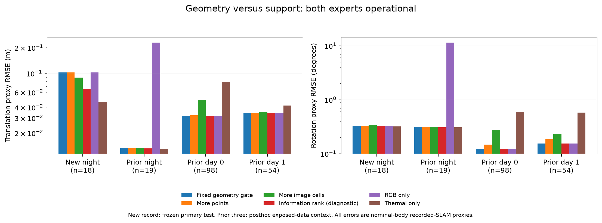

# Geometry versus support on an additional RGB–thermal recording

2026-11-02 America/New_York. EXP113. **The frozen geometry-admission test fails
on an additional recording. Both cameras pass the modeled adequacy floor on all
18 both-supported intervals, yet thermal has lower translation proxy error on all
18. The gate chooses RGB throughout. A predeclared information-ranking diagnostic
helps relative to point-count selection but still loses to thermal-only.**

This separates having sufficient conditional modeled information from identifying
the lower-error available camera. It does not identify the source of the mismatch,
prove that covariance is useless, or select a memory model, agent or calibration
architecture. No candidate is adopted or threshold tuned.

## Additional recording, fixed selection and explicit missing support

[Protocol](geometry-support-transfer-protocol-2026-11-02.md), before-inference
freeze `85eabf07c`. Restore SHA-verified EXP013/023 packets, checking all379/1019
members. Use physically distinct `td3/20251027/night_thermal_so_salon2`, which was
not in EXP112 but was previously inspected in this project. Its checkpoint-training
membership is unknown. This is an exposed-recording development replication,
not a prospective or network-held-out test.

Retain all three established20-frame windows (original manifest starts123/619/789).
RGB pixels and camera-info are unchanged original source; thermal pixels and
camera-info are the unchanged EXP023 experimental MSA baseline. A new composite
input directory copies these exact files and retains original row IDs/timestamps.
No image enhancement, calibration fit, new pairing or outcome-selected window.
Static nominal transforms follow the existing source graph and rectification
convention; references remain supplied recorded SLAM, not independent ground truth.

Prior EXP035–037 screening of the other remaining TD3 nights found predominantly
dark RGB or no continuous paired window under the existing association. This
study therefore uses the one additional recording with verified applicable
both-camera tracking, rather than label availability-only cases as quality
validation. More diverse both-usable conditions would materially strengthen the
study. The MS2 candidate reserves remain unassigned and unopened.

Six matched shared captures / twelve native expert attempts /240frame executions
complete their observation contract. Two late RGB attempts (off/on) retain the
native `FAILED: No visual matches were retained` result after all20frames. The
strict wrapper accepts only that complete zero-observation/no-supported-pairs/
zero-optimizer-submissions terminal case; every other native error propagates.
Original failed reports, no-motion status and absent RGB trajectory stay intact.
This is completed observation of a failed estimator, not successful VO.

| Window | RGB native tracking | Thermal native tracking | Both-supported decisions /19 |
|---|---|---|---:|
| early |all19pairs supported|all19pairs supported|18|
| middle |no supported pairs; legacy execution returns PASS with four retained matches|all19pairs supported|0|
| late |no supported pairs; explicit zero-match failure|all19pairs supported|0|

All57decisions/114camera slots remain. The shared one-group-lag/final-before-drain
policy yields18RGB and54thermal valid motion projections. The18both-supported
intervals are the primary quality population; other intervals test availability
and fallback, not relative error discrimination. They span only one short window
(about1.9s), with strong temporal dependence and no RGB-favored translation example.

## Fixed methods and primary result

Keep original frontend weights/configuration, native covariance weighting and
solver, compiler runtime44ff9a1e, stationary-body-twist projection and nominal-body
recorded-SLAM proxy target. Both experts run throughout. No joint measurement
fusion, skipped inference or live latency evaluation.

The primary gate is EXP112's unchanged minimum normalized information eigenvalue
floor1 at engineering budgets0.1m/1degree, then fixed RGB preference among adequate
available motions. Controls use higher retained count, higher occupied3x3cells or
higher retained/selected fraction; exact ties use RGB and unavailable motions are
never selected. Raw/history and both fixed cameras remain controls. Information
rank and per-native-factor information rank are predeclared **diagnostics**, not
replacement primaries. All57choices and the18-row mask were locked before fresh
reference errors. No historical expert errors label these new runs.

On the same18both-supported intervals, translation RMSE in metres / rotation
RMSE in degrees:

| Method | T RMSE | R RMSE | RGB / thermal choices |
|---|---:|---:|---:|
| Frozen geometry admission |0.102837|0.329481|18 /0|
| Raw / RGB-only |0.102837|0.329481|18 /0|
| Higher retained count |0.102837|0.329481|18 /0|
| Higher retained fraction |0.102837|0.329481|18 /0|
| Higher image-cell coverage |0.089175|0.344414|13 /5|
| Larger minimum information, diagnostic |0.065534|0.329428|5 /13|
| Information per native factor, diagnostic |0.065534|0.329428|5 /13|
| Thermal-only |0.046304|0.321984|0 /18|

Both cameras exceed the information floor on every primary row: RGB minimum
eigenvalues840.730–8642.120; thermal1792.238–12085.823. Thus the binary gate never
asks which of two adequate experts is more accurate. Its fixed RGB preference
retains the worse translation estimate on all18rows. This is failure of the
frozen selection criterion, not a proof that actual geometric observability or
all uncertainty methods fail.

Information ranking selects the lower translation-error camera13/18times and
improves over count. Normalizing by actual native factor count makes no decision
change here, so that particular scalar normalization does not remove the result.
This does not isolate geometry from noise-model/camera/scene composition or
establish incremental causal information. The diagnostic still selects RGB on
five rows where thermal is better; thermal-only wins the complete primary set.
The rotation tradeoff is retained; image coverage improves translation relative
to RGB but worsens rotation. No sensitivity becomes the primary after outcomes.

All-decision coverage is54/57for gate/raw/support/information methods, versus
51/57history and18/57RGB-only. Gate/raw all-decision translation/rotation RMSE is
0.110117m/0.642168deg; information ranking0.100161m/0.642159deg; thermal-only
0.096516m/0.640899deg. These include fallback-only rows and must not be sold as
additional both-healthy quality evidence. Primary superiority criterion: **FAIL**.

## A concrete informative-but-higher-error example

The first chronological primary row on which the information ranking chooses
RGB is `early/3`. It has200RGB versus199thermal retained/native factors,9versus8
occupied image cells, and minimum normalized information2096.971versus1792.238.
Both counts/coverage and information rank favor RGB. Fresh translation proxy
errors are **0.115234m RGB versus0.019930m thermal**; rotation0.470984versus
0.365880degrees. This is a deterministic illustrative row, not a new acceptance
threshold or an excluded outlier.

High conditional information accompanies a higher error here. The information
assumes fixed parent/landmarks/extrinsics, an appropriate local noise model and
linearization, and omits robust correction, model/clock/map/cross-camera uncertainty.
It is not calibrated total pose risk. The discrepancy is consistent with missing
uncertainty, biased measurement estimates or reference/calibration/model effects;
this study does not distinguish these explanations or assign a physical cause.

## Retrospective context on the previous three recordings

After seeing the additional-record result, commit `decb17b89` explicitly declares
[posthoc context](geometry-support-context-amendment-2026-11-02.md): apply the exact
same controls/rankings to all274saved EXP112decisions, lock contextual actions,
then join unchanged stored fresh errors. No new inference, parameters, selection
or original result mutation. Prior labels were already known. This is retrospective
context, not a replacement primary or independent prospective validation.

Translation RMSE on each recording's full both-supported population:

| Recording / n | Frozen gate | More points | More image cells | Information rank | RGB-only | Thermal-only |
|---|---:|---:|---:|---:|---:|---:|
| New night /18|0.102837|0.102837|0.089175|0.065534|0.102837|0.046304|
| Prior night /19|0.013408|0.013336|0.013344|0.013161|0.230324|0.013088|
| Prior Day0 /98|0.031459|0.032110|0.048481|0.031586|0.031459|0.079808|
| Prior Day1 /54|0.034459|0.034412|0.035369|0.034459|0.034459|0.041846|

Information ranking does not consistently beat point count: it is slightly worse
in Day1translation (while better in rotation). In Day0it slightly worsens RGB
(0.031459→0.031586m), despite improving over the count/coverage controls. The
opposite best fixed-camera behavior in night/day is retained, not pooled away.
No method establishes a general quality improvement or dominates both fixed
experts. Prior night still includes the known recovery event. The four recordings'
189both-supported intervals are temporally clustered and already exposed; they
are not189independent tests. Both new and contextual primary results remain failed.

## Research implication

Adequacy and relative risk are different targets. A minimum-information floor can
reject a weak recovery yet leave a consistently worse available expert admitted.
Current information ranking carries a useful descriptive preference on some
cases beyond simple count/coverage, but neither its absolute threshold nor its
ranking is a generally calibrated camera-selection rule in these results.

The grounded next question concerns why conditional information can be high
while task error is higher, and what observable quality/model context predicts
that mismatch. Previous constant camera scale/bias and short-history gates already
failed transfer; another constant scale or larger memory is not justified solely
by these results. No failure cause or architecture is chosen here. A future
experiment must separate these explanations with appropriate labels and simpler
controls; fixed-input covariance/solver controls remain prerequisites.

RGB–thermal is still the first empirical case. Neither more recordings nor a
common pose-information matrix establishes generalization to a third sensor.
No third sensor, learned calibrator or active sensing policy is implemented.

## Verification and preservation

85Docker CPU tests pass (new controls/terminal-failure cases plus prior geometry,
recorder/history/interval regression). All six captures finish first attempt.
All3164serialized arrays are bitwise equal off/on; original events, native configs,
raw decisions, flags and failure reports agree exactly. There are zero diagnostic
differences here, unlike EXP112; its historical diagnostic parity qualification
remains attached to the reused prior context.

Independent primary audit reconstructs76native information events,72common-
interval transports, causal counts/features/actions, references and every matched
score:8,997numeric checks pass. It does not import the producer selector, geometry
transport, reference loader or scorer. The context audit separately reconstructs
all274fixed control actions from original observed prefixes and recomputes matched
metrics:4,815checks pass; prior source information/reference validation is inherited
from EXP112. All1005new source/input and3reference hashes and all prior-context
input hashes stay unchanged. Plot inspected. No training, threshold search,
reserve access, production change or candidate adoption.

New artifacts: `results/geometry-support-transfer/run-001/`, including three
composite prepared inputs, all native captures/failures, exact preservation,
locked actions/primary mask, fresh reference labels, scores, independent audit
and PNG/PDF. `prior-context/` keeps the separately declared contextual analysis.
Backup: `ore_ms:ore-ms/backups/2026-11-02-geometry-support-transfer`. Exact original
models and compiler-runtime/base-image recovery are prerequisites from EXP112;
no duplicate checkpoint/runtime payload is needed in this packet.
