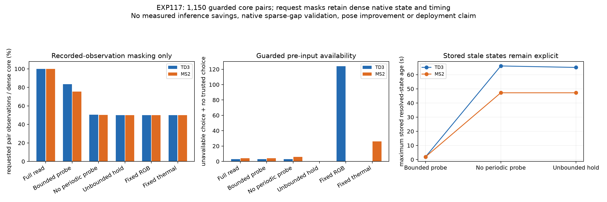

# EXP117: guarded cache/probe contract passes; native sparse inference remains untested

Client date: 2026-11-03. Execution freeze: `8ac4c9ede`; parent: `e726eb57b`. The previous work was already committed and the tree was clean when the user asked to commit and continue. This experiment uses exposed saved native traces; it performs no new image decoding, neural inference, training, native skipping or pose-error scoring.

**The fixed bounded-probe cache preserves the full-read cache's guarded preselection-availability counts while requesting fewer observations: 16.6%fewer core requests onTD3and24.6%fewer onMS². This passes its masked-replay development contract. It is not measured inference savings or a validated sparse-frontend controller.** The selected route remains available in most examples because another camera stays reliable; recovery evidence is often missed and simpler fixed/unbounded controls do better on this cohort.

The [fixed protocol](guarded-probe-cache-protocol-2026-11-03.md) uses all eighteen EXP112/113/114windows across fourTD3andthreeMS²recordings. The last two already processed frames are unscored guards and the first two pairs are common bootstrap. Scored pairs are indices2throughF−4, yielding **1,150corepairs**:295TD3and855MS². No windows or targets are filtered by favorable error/support. Every scored target has an ordinary `group_complete` deadline; all2,150eligible camera/output bindings have an exact processing-stage first write before that deadline. Native state and original full-window results remain unchanged. This removes the previously diagnosed shortened final-pair deadline from this new, explicitly guarded evaluation; it does not rewrite EXP116's full counts.

Decisions are made before the first release of each ending frame, using already received observations on the shared controller's monotonic clock. Source epoch timestamps are not mixed with that clock. The new cache handles health and motion arrivals independently for each camera. A known unsupported/error health result resolvesFalse immediately. A healthy pair with no returned motion ispending; it keeps the previous resolved state. A late old write cannot overwrite or freshen a newer failure. Unknown/stale states are explicit. The active camera stays selected while its cachedTrue state is fresh; otherwise the first fresh eligible RGB/thermal state is selected, or no trusted preference is declared and both are requested to refresh.

Fixed primary parameters are1secondTTL,1secondinactiveprobeperiod andtwo-consecutive-request probe bursts. A state is stale atage>=1s. The selected bounded state must be younger than1s; stored inactive states can be older and remain visiblySTALE. There is no claim that all stored evidence is fresh. Full-read, no-periodic-probe, unbounded-hold and fixed-camera controls are retained without tuning. Bootstrap and guard requests are common across policies and logged separately.

The masking rule respects a concrete native dependency: MACVO writes a previous optimizer result during a later frontend invocation. A motion callback is accepted only if both its originating pair and the processing invocation delivering it were requested. Unrequested dense invocations cannot provide free writeback; termination callbacks do not become online valid evidence. The two-request burst supplies a requested continuation. If a logged first write was hidden, it is not invented or re-delivered at a later time. These rules explain why one isolated probe is not assumed to provide a valid native motion estimate.

All108window/policy schedules are locked before target eligibility scoring. Hidden health/motion outcome mutations leave all108schedules unchanged. This is chronological masking, not training or future truth fallback. A trusted preference is evaluated against the unchanged ordinary-deadline native camera-local/common-interval eligibility. Whether any requested sensor has an eligible result is separately an opportunity upper bound; it is not an achieved output or pose-accuracy result.

| Domain / policy | Eligible preselection | Unavailable preselection | No trusted choice while available | Core pair requests | Fraction of full read |
|---|---:|---:|---:|---:|---:|
| td3 / full_read_cache | 292 | 0 | 3 | 590 | 100.00% |
| td3 / bounded_probe | 292 | 0 | 3 | 492 | 83.39% |
| td3 / bounded_no_probe | 292 | 0 | 3 | 298 | 50.51% |
| td3 / unbounded_hold | 295 | 0 | 0 | 295 | 50.00% |
| td3 / fixed_rgb | 171 | 124 | 0 | 295 | 50.00% |
| td3 / fixed_thermal | 295 | 0 | 0 | 295 | 50.00% |
| ms2 / full_read_cache | 851 | 4 | 0 | 1710 | 100.00% |
| ms2 / bounded_probe | 851 | 4 | 0 | 1290 | 75.44% |
| ms2 / bounded_no_probe | 849 | 4 | 2 | 857 | 50.12% |
| ms2 / unbounded_hold | 855 | 0 | 0 | 855 | 50.00% |
| ms2 / fixed_rgb | 855 | 0 | 0 | 855 | 50.00% |
| ms2 / fixed_thermal | 829 | 26 | 0 | 855 | 50.00% |

The primary contract compares bounded_probe to full_read_cache in each domain: at least as many eligible trusted preferences, no more unavailable preferences or uncommitted-while-available cases, and strictly fewer bootstrap+core requests. It passes both domains. Including common bootstrap, requests are626→528TD3and1746→1326MS², reductions15.7%and24.1%. Each domain has36additionalguardrequests; all-policy totals retain them. Across both domains, dense requests including guards are2444versus1926maskedrequests. These count pair-observation requests, not neural forward calls, joules, throughput or saved wall time.

The seven unavailable/uncommitted primary core choices remain explicit: threeTD3cases lack a fresh trusted preference and fourMS²preferences are ineligible at the target. All are interior ordinary-deadline cases, not the old final-pair artifact. The task and decision time also differ from EXP116's0.5second forecasting experiment, so its18tail counts are not a directly interchangeable baseline. Full-read caching itself has the same seven cases under the fixed1sTTL; this is not a claim of equivalence to the native estimator's best possible late selection.

The other controls matter. FixedTHERMAL has eligible choices on all295TD3corepairs, and fixedRGB on all855MS²pairs. Unbounded hold also gets all core choices eligible while requesting one camera per pair, but retains inactive state evidence aged up to65.1sTD3/47.2sMS². The bounded-probe maximum stored resolved ages are1.93s; expired evidence is not used as fresh. Bounded no-periodic-probe keeps only half the pair requests but adds twoMS²uncommitted cases and stores much older inactive evidence. The favorable fixed/unbounded results show that this cohort has limited pressure to demonstrate adaptive sensor switching. They are not suppressed, and no control is promoted after seeing outcomes.

Secondary native-recovery evidence is less favorable than selected-route availability. On sixteenMS²native-localFalse→True runs within the guarded core, bounded probing captures fresh successful-return evidence on five and both the preceding failure and subsequent return on only two. Full-read sees all sixteen. TD3has one one-pair recovery; bounded probing misses its return, while full-read records it. These are counts of accepted dense-native evidence with explicit source and receipt times, not recovered routing, correct pose, or actual sparse-frontend recovery. Dense return evidence that arrives after a run's ordinary deadline is not credited. Most route choices succeed because the other modality remains available.

The central limitation is counterfactual native state. Every original image pair was processed by both dense experts; native depth reuse, landmarks, graph parents, means/covariances and receipt timing still come from that dense execution. Trigger-gating writeback removes one optimistic side channel but cannot reconstruct what skipped frames would do. A two-request burst does not establish native warm-start/gap recovery. Request fractions cannot be turned into inference savings, and the captured unpaced wall-clock schedule does not establish live exposure/readout/queue behavior. The cache prototype also retains per-pair evidence for auditing; long-running retirement and missing-result ownership must be handled in a native integration.

The next grounded test is **actual native gap/probe replay using the frozen requested schedule**, with fresh dense controls, guard frames and explicit source IDs/timestamps. Measure whether a sparse frontend can produce eligible, accurate motion after the observation gaps, how much stereo/depth reinitialization it needs, and actual call/time cost. Score fresh outputs on matched intervals and keep support failure separate from pose error. This should precede another learned memory model or claims that covariance-based skipping improves MACThermal. RGB–thermal remains the tested scope; another-sensor generalization is unvalidated.

A pre-execution engineering correction is retained. The first draft lock was written before checking a failed unit fixture: that fixture accidentally aged the active sensor pastTTL and tested full refresh instead of the intended probe burst. Run-001 contains the original lock, snapshots and failure log, with no policy outcomes computed. The [fixture amendment](guarded-probe-cache-fixture-amendment-2026-11-03.md) changes the test timestamp and creates a new exclusive run-002/input lock; cache logic,parameters,cohort andprimary criteria are unchanged. The corrected suite passes before execution. No outcome-driven policy adjustment occurred.

Validation: **9focusedtests pass**. Independent accepted-prefix reconstruction, request/burst checks, guard accounting and scalar-score audit pass145,674checks; actual hidden-outcome mutation invariance is verified for all108window/policy schedules. Independent native guard/truth audit passes9,776checks across1,150corepairs and2,150processing-stage writebindings. All35executioninput/sourcepins and both released checkpoint hashes remain unchanged. No reserves, pose-error labels, native inference or weights were changed/read for this probe. Unknown checkpoint training overlap, exposed-data choices, nominal/provided clock/frame/eligibility assumptions and few original-rig recovery transitions still limit generalization.

Artifacts: `results/guarded-probe-cache/run-002`, with retained draft at `run-001`; execution lock `experiments/guarded-probe-cache-2026-11-03-fixture-v2.json`. Runtime `sha256:44ff9a1e6fa95d220437714e5be9b94f0f73c8eaebd4fcae3f843ceea14bef09`. Backup target: `backups/2026-11-03-guarded-probe-cache`; incremental repository prerequisite EXP116, original weights/compiler prerequisite EXP112/base runtime EXP106. No policy is adopted.
