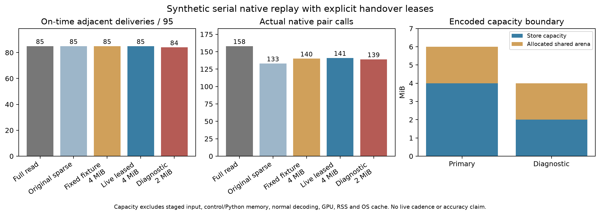

# EXP124: leased shared-memory native handover

2026-11-03 / ore_ms. Parent cb7f703e1; execution freeze 46062ec77.

The frozen synthetic engineering contract **PASSES**. This experiment connects
the sparse estimator-health scheduling mechanism to explicit encoded storage,
worker ownership and control-message limits. It does not test cross-camera
uncertainty calibration, physical pose accuracy, live acquisition cadence or
independent generalization. See [research position](research-position-2026-11-03.md).

## Native results

| Arm | Eligible / 95 | Unavailable selected | Pair calls | Native seconds | Controller seconds | Leases / ACKs |
|---|---:|---:|---:|---:|---:|---:|
| full_read_cache | 85 | 4 | 158 | 56.541 | 58.603 | 0 / 0 |
| bounded_probe | 85 | 4 | 133 | 47.428 | 49.103 | 0 / 0 |
| fixture_on | 85 | 4 | 140 | 49.433 | 51.189 | 1 / 1 |
| leased_probe | 85 | 4 | 141 | 49.872 | 51.592 | 1 / 1 |
| diagnostic_probe | 84 | 5 | 139 | 49.623 | 51.462 | 0 / 0 |

The primary4MiB candidate recovers adjacent output in
4/4 return episodes. Original sparse probing recovers only1/4 within the same
horizons. This costs eight additional pair calls (141 versus133), with the same
85/95 selected deliveries in this condition. The demonstrated gain is alternate
output readiness; it is not selected-delivery superiority over original sparse
probing or a pose-accuracy improvement.

| Return episode | First adjacent target ending source | Actual delivery group | Delay after return (groups) |
|---|---:|---:|---:|
| rgb at 35 | 38 | 39 | 4 |
| thermal at 65 | 66 | 67 | 2 |
| rgb at 80 | 81 | 82 | 2 |
| thermal at 80 | 84 | 85 | 5 |

The2MiB diagnostic is descriptive and has no required delivery outcome. It
misses retained RGB50, produces a native49→51 gap at handover, and drops to84/95
selected deliveries with five unavailable selections; all four later return
outputs still appear. Historical readiness alone again fails to protect that
one continuity interval. Retain
its complete population and budget results. Do not tune capacity or eviction
based on its outcomes. All arms use the same encoded retention/service overhead;
full-read savings compare against the perturbed full-read arm, not against
unperturbed inputs that have more available frames.

## Enforced service boundary

A new experimental controller uses the EXP123 byte-limited store: current/prior
per-camera lifetime, shared oldest-source/RGB-tie eviction, atomic oversized-pair
rejection. Primary store4MiB, diagnostic2MiB. All arms allocate one2MiB shared
handover arena. Successful catch-up copies actual encoded bytes there and sends
only scalar/string metadata, offsets, hashes and lease identity on the control
channel. No encoded image bytes are serialized into a step message.

The worker maps the descriptor, checks bounds and exact image hashes, decodes
without changing the TD3 recipe, and drops encoded views/mapping before its
completed acknowledgment. The owner cannot overwrite/reuse the slot until the
camera/source/group/token acknowledgment matches. Exactly one step is outstanding
globally. Serial blocking provides backpressure; it does not model independent
acquisition deadlines or an asynchronous live queue.

The primary encoded store+allocated arena ceiling is6MiB; diagnostic4MiB.
The bound excludes input staging, Python metadata/control serialization, kernel
buffers, normal current-input file decode, decoded tensors/GPU, RSS and OS cache.
It is not a process-memory, bandwidth or energy saving. Current neural inputs
still use the original source file decoder; shared ownership applies to retained
catch-up input. Deadlines remain source-group/actual native delivery boundaries.
A late historical result cannot revise an earlier interval's deadline.
The original RGB source span is 10.200 seconds; candidate controller
processing is 51.592 seconds in this
serial replay. This is therefore not a demonstration of keeping up with acquisition.

Maximum observed serialized step size: 505 bytes (ceiling4,096).
Maximum observed control message: 891 bytes (ceiling65,536).
Service journals retain every publish, command, completion and matching release;
worker/parent message conservation and sizes are independently checked.

## Controls and validation

| Frozen criterion | Outcome |
|---|---|
| strict_byte_controls | PASS |
| eligible_noninferior | PASS |
| unavailable_noninferior | PASS |
| uncommitted_opportunity_noninferior | PASS |
| all_four_returns | PASS |
| fewer_calls_than_full | PASS |
| resource_reports_bounded | PASS |
| readiness_caps | PASS |
| query_caps | PASS |

65 focused tests pass, including seven new spawned ownership/byte-integrity,
overwrite refusal, bad/stale acknowledgment, oversize/bounds/schema and native-like
controller tests. Independent audit passes 62,697 checks over
475 guarded rows and all six native timelines. It reconstructs actual
source-image hashes, store expiry/eviction/admission, lease identities, synchronous
command credit, message conservation/ceilings, native source mappings and call
costs, controller feedback prefixes, endpoints and actual write deadlines.

Strict controls compare 8,944 arrays against EXP122
unperturbed and fixed fixture_on using dtype, shape and every logical-cell byte,
including NaN/signed-zero bit patterns. This validates implementation parity;
fixed fixture_on is an exposed mechanism control, not an independent adaptive run.

All 992 source/input/runtime pins remain unchanged. Six dual native
captures complete without retries. Capture and prediction locks precede scoring;
no source pose references are read anywhere in this experiment. No training,
reserve access, new input acquisition or production-default changes.

## Research implication and next evidence

This is evidence about a causal, resource-accounted scheduling and handover
mechanism on a fixed exposed synthetic condition. It does not resolve the original
uncertainty-comparability question or establish improved accuracy over a best
fixed camera. Software audit checks are not additional scientific replications.

The next research evidence should move to separately predeclared conditions and
simple fixed-camera/matched-cost controls, with explicit reference and acquisition
deadline semantics. Additional iterations on the same synthetic interval cannot
establish generalization. Existing exposed data suffice for bounded software
checks; sustained natural transitions with a useful alternate and independent
pose references would strengthen broader recovery/accuracy claims.

Artifacts: results/leased-handover/run-001. Backup: backups/2026-11-03-leased-handover.
Prerequisites: EXP123 source/capacity store; EXP122 fixture/byte controls and its
inherited original input/model/compiler/runtime packets.
