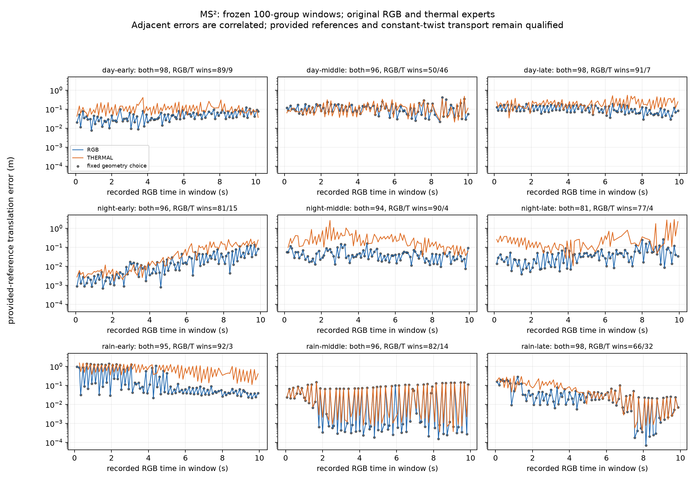
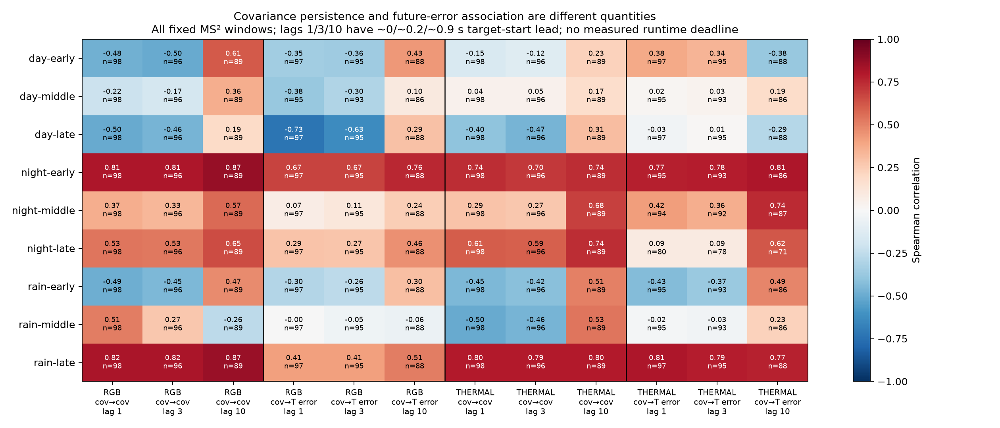

# EXP114: broader RGB–thermal data changes the diagnosis, not the selected method

2026-11-02 America/New_York. Sampling freeze `ac2cb6615`, capture/scoring source `f67473b04`, supplementary pre-label declaration `1e9cda98e`, independent auditors `180342881`.

The previous 18 jointly supported pairs were too narrow for a general negative conclusion. We expanded to **900 paired frames in nine fixed windows across three MS² day/night/rain recordings**. The fixed geometry gate still supplies no improvement over the original RGB preference. A separate, explicitly posthoc diagnostic reveals that recorded frame interval strongly affects covariance persistence. This is a concrete issue to resolve before choosing a memory architecture; it is not an adopted model or demonstrated VO improvement.

The [sampling and reference protocol](ms2-broader-range-protocol-2026-11-02.md) was frozen before retrieving new windows or seeing new outcomes. Each already-exposed recording contributes 100 consecutive source groups starting at 1, 1+floor(N/3), 1+floor(2N/3), spanning about ten seconds per window. These are three recordings, not nine independent recordings or 900 independent samples. Some early images were already inspected in the original pilots. Both reserve recordings remain untouched; checkpoint training membership remains unknown.

| Window | Starting source ID | Jointly scoreable | RGB / thermal translation wins | Longest observed winner run (pairs) |
|---|---:|---:|---:|---:|
| day-early | 000001 | 98 | 89 / 9 | 59 |
| day-middle | 001937 | 96 | 50 / 46 | 11 |
| day-late | 003874 | 98 | 91 / 7 | 61 |
| night-early | 000001 | 96 | 81 / 15 | 22 |
| night-middle | 003378 | 94 | 90 / 4 | 36 |
| night-late | 006755 | 81 | 77 / 4 | 25 |
| rain-early | 000001 | 95 | 92 / 3 | 34 |
| rain-middle | 003957 | 96 | 82 / 14 | 34 |
| rain-late | 007913 | 98 | 66 / 32 | 23 |

There are 891 decision slots: 854 have both causal, eligible, projected estimates. One severely nonrigid RGB reference pose at source ID `002018` invalidates day-middle pairs80 and81, leaving **889 reference-scoreable decisions and 852 jointly scoreable comparisons**. All native predictions remain retained. On these comparisons RGB has lower translation error on **718**, thermal on **134**, with no ties. Day-middle is 50/46, so the broader sample contains a genuinely mixed window, while the complete cohort remains RGB dominated. Winner runs are cut at missing/reference-invalid rows and at window boundaries; they are not estimates of persistence beyond each observed window.

All 36 native expert executions process 100 frames and return `PASS_EXECUTION_ONLY`. Thermal retains 17 unsupported pre-refinement pairs in night-late and one in rain-early. Across the predictor's thermal slots, 27 lack a source by the deadline (including initial warm-up), and ten exceed the unchanged interval-transport horizon. RGB has nine initial source-unavailable slots. Final interpolated poses are not substituted for unavailable causal results.

| Recording | Jointly scoreable pairs | RGB / geometry / information rank T RMSE (m) | Count T RMSE (m) | Thermal T RMSE (m) | RGB / geometry R RMSE (deg) |
|---|---:|---:|---:|---:|---:|
| day | 292 | 0.106984 | 0.106984 | 0.182225 | 0.047707 |
| night | 271 | 0.048920 | 0.057728 | 0.440083 | 0.063381 |
| rain | 289 | 0.284965 | 0.285069 | 0.485106 | 0.031645 |

The fixed geometry admission, two-confirmation recovery policy, original RGB preference and information-rank sensitivity have **identical actions on all 891 slots**: 882 RGB and nine abstentions. All available RGB normalized minimum-information values exceed the fixed floor (minimum3.522). Geometry admission scores880 reference-valid motions, versus852 for thermal-only and871 for history. Matched masks are retained in the machine-readable scores; different-coverage RMSEs must not be treated as matched comparisons. Per-factor information selects thermal on two slots and supplies no primary success. The fixed primary criterion fails on all three recordings. No sensitivity is promoted, threshold tuned, checkpoint trained, sensor skipped or estimator feedback enabled.

This narrows the conclusion: this scalar adequacy gate does not identify the 134 lower-error thermal opportunities. It does not show that covariance, multi-sensor factor fusion, temporal modeling or better calibrated risk estimates cannot help. Conditional pose information is not itself a calibrated comparison of total sensor error, including bias and model/reference uncertainty.

The [supplementary covariance diagnostic](ms2-broader-range-persistence-declaration-2026-11-02.md) was declared before computing new error labels. It uses the median full-grid learned flow-covariance trace, angularized by the supplied focal lengths, and fixed lags1/3/10. Grid values are not filtered by inlier or pose-error status. All ordinal slots, valid-target counts and recorded sensor-time leads are retained. Lag1 has zero target-start lead; lags3/10 have approximately0.2/0.9seconds. These are not measured wall-clock compute deadlines.

Raw adjacent covariance rank correlations range from −0.502 to0.817 across the18 series. Eight are negative. Strong persistence occurs in several night and late-rain series, while some day/rain series alternate. Rank correlations describe ordering and do not, by themselves, establish the absolute magnitude of covariance jumps. Future translation-error association at lag10 varies from approximately −0.380 to0.810; no uniformly reliable forecast is established.

After observing those results, the [posthoc recorded-interval diagnostic](ms2-broader-cadence-posthoc-2026-11-02.md) tests the elementary rate-covariance rescaling `angularized_flow_covariance / dt²`, using all windows and the same three lags. No exponent is fit. Recorded RGB intervals are commonly about0.0667 and0.1333seconds; thermal intervals vary too. Covariance/interval rank association is positive in all18series, ranging approximately0.196–0.828. This motivates checking temporal comparability before attributing every covariance change to sensor deterioration.

| Window | RGB adjacent rho, raw / divided by dt² | Thermal adjacent rho, raw / divided by dt² |
|---|---:|---:|
| day-early | -0.482 / 0.468 | -0.151 / 0.220 |
| day-middle | -0.215 / 0.895 | 0.040 / 0.766 |
| day-late | -0.502 / 0.719 | -0.401 / 0.059 |
| night-early | 0.811 / 0.873 | 0.735 / 0.864 |
| night-middle | 0.366 / 0.647 | 0.285 / 0.787 |
| night-late | 0.532 / 0.862 | 0.607 / 0.881 |
| rain-early | -0.492 / 0.708 | -0.451 / 0.343 |
| rain-middle | 0.509 / -0.369 | -0.501 / 0.708 |
| rain-late | 0.817 / 0.860 | 0.796 / 0.848 |

Rescaling improves adjacent persistence in **17/18series**, with median rho **0.163→0.742**; negative series decrease8→1. Rain-middle RGB worsens (0.509→−0.369), so this is not a universal explanation. Future translation-error-rate association at lag10 still ranges approximately−0.248 to0.833. The target rate metric is a supplementary diagnostic, not a replacement for primary pose error. Native predictions and all primary score/action hashes remain unchanged. Recorded timestamps have not been verified as physical exposure times, so physical timing/causal claims remain unproved.

The grounded next experiment is to replicate the interval effect using independently verified timing, including the original RGB–thermal rig, then test whether strictly past normalized covariance adds prospective error-ranking value beyond current information/support on recording-separated data. This does not select LSTM, agent, layer or another architecture. Actual skipping also needs a closed-loop test because suppressing a frontend changes its future map and recovery state; this offline whole-motion comparison runs both frontends throughout.

Validation: **99 tests pass** in the unchanged compiler runtime. All **47,034 saved arrays are bitwise identical** off/on, with zero allowed-diagnostic drift; native events, effective configurations, tracking states and original decisions match. Source/clock/calibration audit23,162checks; native geometry/control/reference/score audit204,599numericchecks, 1,764 native information events and1,736 eligible transports; covariance audit5,832checks; posthoc cadence audit738checks. The two grossly invalid reference intervals remain excluded by the predeclared rule. Bounded SVD roundoff corrections on the remaining reference rotations have maximum element change6.664e-7; inverse-pose convention sensitivity also fails the primary criterion and is never selected as the primary.

Input acquisition validates3,600PNG/TAR members, complete PNG chunk CRCs and native uint8RGB/uint16thermal schemas;228overlapping archived images match byte for byte. Preserved TAR/bzip2 indexes permit bounded HTTP206 retrieval, with every range checked for exact bounds and length. Selected PNGs total about1.25GB; compressed ranges fetched total about15.6GB instead of the approximately59.4GB complete archives. Complete current sync-archive SHA verification is **not** claimed. Intake-only `indexed_bzip2==1.6.0` is isolated from the scientific runtime. The initial serial intake was cleanly restarted with bounded parallel prefetch; no IDs or methods changed. The original figure render is retained under `figures-v1`; the presentation-only v2 removes overlapping y-axis labels.

Reproduce from the experiment packet and EXP112 original weights/compiler runtime (base runtime archive EXP106). Immutable runtime is `sha256:44ff9a1e6fa95d220437714e5be9b94f0f73c8eaebd4fcae3f843ceea14bef09`. Native and primary analysis source hashes remain pinned. Primary numerical outputs are under `results/ms2-broader-range/run-001`; the input lock is `experiments/ms2-broader-range-2026-11-02.json`. The explicit exposure ledger records these as development recordings, with unknown training overlap. Provided GNSS/IMU-derived references, rectified-camera calibration, constant-twist interval transport, thermal preprocessing/checkpoint provenance, short windows, class imbalance and within-record correlation limit inference. This is not independent physical ground truth, fused pose-graph improvement, online compute savings or evidence of transfer to another sensor type.

Backup target: `backups/2026-11-02-ms2-broader-range`, including selected pixels, captures, frozen actions, fresh labels, all audits, code/protocols, figures and recovery bundle. Compressed range payloads and previously backed-up model/runtime files are not duplicated.
