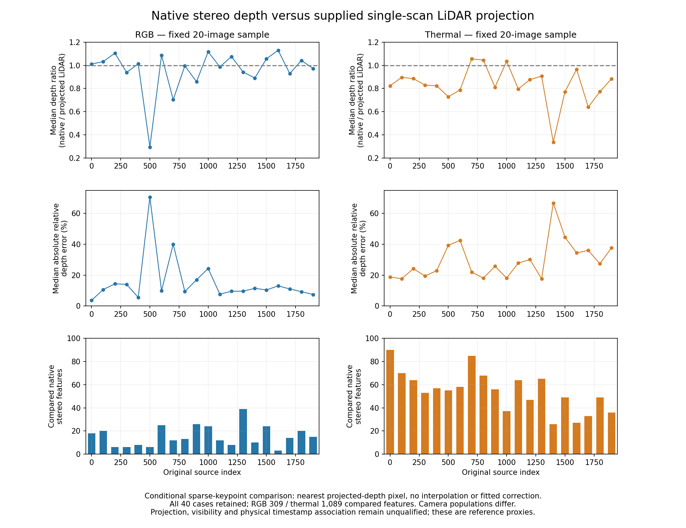

# Native stereo depth versus supplied single-scan LiDAR projection

2026-11-05 America/New_York. EXP147, parent EXP146/9fb25b7b4; freeze 568b46473 precedes additional depth decoding and errors. [Protocol](native-depth-proxy-protocol-2026-11-05.md).

Thermal native stereo depths tend to be shorter than the supplied projected LiDAR depth at the sparse supported keypoints: the median of 20 per-image median native/reference ratios is **0.826784**, versus RGB **1.003929**. Thermal ratios are below one in 17/20 sampled images; RGB in 10/20. This supports depth disagreement as a plausible contributor to the previously observed travel shortfall, but it does not determine how much of that shortfall it causes. Different point/frame/optimizer supports prevent using this depth ratio to predict or correct the approximately 0.61 motion ratio. No scale correction is fitted or applied.

## Reference qualification

The [official data-format page](https://sites.google.com/view/multi-spectral-stereo-dataset/data-format) identifies `depth` as single-scan VLP16 points projected to the left camera plane, uint 16 metric depth×256. The sensing modality is independent of ORB's stereo matcher. This qualifies the product's stated source and numeric convention, **not physical accuracy or synchronization**: applicable projection/calibration, visibility/occlusion, per-point uncertainty and exposure association remain unresolved. Projection can share camera calibration and timing/navigation assumptions with other supplied references. Merged32 and network-filtered products are excluded. The saved official loader also uses focal×baseline/depth, supporting the inherited pinhole-depth interpretation without proving physical export accuracy.

Forty maps use the same fixed grid 000000,000100,...001900 of the exposed first 2,000 night groups `_2021-08-13-21-18-04`, both cameras. All native tuples come unchanged from EXP146 run-002. New label values remain development data. No SLAM/model rerun, camera input change, other recording/reserve access, re-pairing, calibration/time/extrinsic/scale fit or default change. EXP133 gates remain unchanged.

Original EXP040/041 recovery packets and all their regular members were hash-verified before restoring selected night TAR/bzip metadata and archived overlap bytes. Packet integrity verification hashes other already archived members without numerically decoding their data; only selected metadata and overlap label bytes are extracted. Current bounded retrieval validates 40 TAR members/PNG schemas and chunk CRCs from 48 exact HTTP206 ranges totaling 201,326,592 bytes (192 MiB), below the frozen 1 GiB budget. Both source 000000 RGB/thermal PNGs match historical bytes exactly. Historical full 20GB archive SHA remains provenance; current complete archive SHA is not claimed. Source evidence, range metadata/bytes, TAR headers and original overlap hashes remain recoverable.

## Support and results

Reference location is floor(u_left+0.5),floor(v_left+0.5) at the native left keypoint, without interpolation, dilation, patch search or resizing. Positive projected depth must have expected right coordinate in[0,W−1). Every original feature remains with an explicit reason; positive native depth supplies the accepted-stereo comparison. No map-association, outlier, confidence or residual filter is used. A keypoint and rounded projected-depth pixel are not guaranteed to observe the same visible surface.

| Sample support | RGB | Thermal |
|---|---:|---:|
| Fixed image cases / empty cases |20 /0|20 /0|
| All native left features |29,134|36,410|
| Native accepted stereo features |17,384|20,770|
| Features with geometrically supported projected depth |504|1,997|
| Supported-reference features without native stereo |195|908|
| Compared accepted features |309|1,089|
| Sum of distinct reference pixels per image |262|945|
| Compared features per image, min–max |3–39|26–90|
| Features at zero reference pixels |28,630|34,413|
| Proxy-right or rounded-pixel outside image |0|0|

Only 1.78% of sampled RGB accepted features and 5.24% of thermal accepted features enter the depth comparison. The compared populations differ by FOV, resolution, feature locations, depth support and visibility. Repeated reference pixels across pyramid features are retained and counted; images/features are not independent experimental samples. These conditional rows cannot rank overall camera accuracy.

All entries below are **medians across 20 per-image medians**, giving each image equal weight, rather than pooled-point accuracy. Full mean/RMSE/p90/min/max and exact point arrays remain saved, with no clipping or case selection.

| Conditional proxy disagreement | RGB | Thermal |
|---|---:|---:|
| Native / projected depth ratio |1.003929|0.826784|
| Signed native−reference depth (m) |+0.011007|−2.750350|
| Absolute depth error (m) |1.695196|5.059634|
| Absolute relative depth error |10.54%|26.59%|
| Signed native−proxy disparity (px) |−0.068157|+0.779472|
| Absolute disparity error (px) |1.572769|1.600742|
| Absolute disparity error / focal length |0.002057|0.004128|

Thermal's positive disparity disagreement is consistent with shorter native depth under the same provided pinhole formula. Raw pixel differences across different focal lengths and different scene/support populations are not interchangeable physical errors. These observations do not isolate incorrect stereo matching from reference projection/occlusion/time effects.

| Source index | RGB compared | RGB median depth ratio | Thermal compared | Thermal median depth ratio |
|---|---:|---:|---:|---:|
|000000|18|1.011520|90|0.824112|
|000100|20|1.032497|70|0.896527|
|000200|6|1.105895|64|0.886044|
|000300|6|0.939581|53|0.829457|
|000400|8|1.012932|57|0.824095|
|000500|6|0.293700|55|0.728619|
|000600|25|1.087079|58|0.787537|
|000700|12|0.703987|85|1.056070|
|000800|13|0.996338|68|1.045835|
|000900|26|0.859046|56|0.811752|
|001000|24|1.117543|37|1.035596|
|001100|12|0.987477|64|0.795736|
|001200|8|1.076091|47|0.877226|
|001300|39|0.942176|65|0.906964|
|001400|10|0.890611|26|0.336768|
|001500|24|1.057103|49|0.772127|
|001600|3|1.130383|27|0.966615|
|001700|14|0.929001|33|0.639495|
|001800|20|1.042910|49|0.772626|
|001900|15|0.972288|36|0.884717|

The retained RGB source 000500 case has ratio 0.293700 on just six compared features; thermal source 001400 has 0.336768 on26. No extreme observation or image is removed. Sparsity and reference-location uncertainty are material limitations, not reasons to choose more favorable points after scoring.

## Validation and interpretation

Six synthetic support/unit/nearest-rounding/zero/sentinel controls pass. The independent audit passes **406,384 checks**, rejects four corruptions (ratio, pixel location, units and support), and reconstructs every original feature/pixel/support reason, point error, duplicate count, per-image and equal-image statistic using scalar formulas and sorted quantiles. It also verifies native raw-source equality, fixed 40case coverage, frozen hashes, current range bytes/bounds, TAR headers, PNG CRCs/schema, historical overlap and byte budget. All intake/evaluation/audit attempts succeed without scientific retries; original sources, native predictions and support/metric rules remain unchanged.

This completes the bounded comparison with an independently sensed projected reference. It does **not** complete qualification of a physical ground-truth depth reference. The next useful diagnostic is projection/visibility sensitivity on these same retained points, alongside acquisition/export timing evidence. Distinguish native correspondence error from projected-reference mismatch before proposing a repair. No heldout/full-record, physical synchronization/calibration, online/adaptive or benchmark-readiness claim follows.

Artifacts: `results/native-depth-proxy/run-001/` contains selected native tuples, source qualification, original/selected acquisition metadata, labels/headers/ranges, all point records, summaries and independent audit. Recovery destination: `ore_ms:ore-ms/backups/2026-11-05-native-depth-proxy-exp147`, including code/source/labels/point records, original native journals needed by audit, figures/findings and incremental git bundle. Score runtime remains inherited EXP136; no new Docker runtime or model weights required. Original source/native images are unnecessary for this saved-output comparison.
