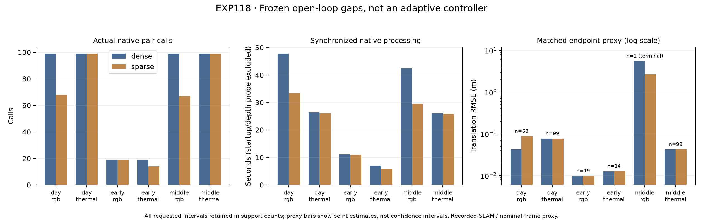

# EXP118: actual native gaps under a frozen request schedule

Date: 2026-11-03 (America/New_York). Execution freeze `28db17670`; evaluation/audit source `964d2552c`. Parent EXP117 / `524e78734`.

Fourteen fresh GPU captures use the original released checkpoints and exact recovered compiler runtime. Six camera/window cases have fresh dense and fixed sparse captures; early RGB and thermal also have fresh dense repeats. All source image IDs and acquisition times are preserved. Sparse manifests compact graph ordinals through an explicit original-row map. No skipped frame is fed to the estimator; resumed native motion spans the actual processed endpoints.

**This is an open-loop native engineering test using the already exposed dense-derived EXP117 schedule. It is not an adaptive sparse controller or a reproduction of its TTL clock.** All estimator settings remain unchanged. No training, reserve access or policy adoption.

**Actual native pair calls fall from 434 to 366 (15.7%), and summed synchronized native processing falls from 160.814 to 131.901 seconds (18.0%) across the six dense/sparse comparisons. Day RGB's matched translation proxy RMSE rises from 0.043206 to 0.088447 m (+104.7%), and rotation from 0.143017 to 0.150752 degrees. All 31 day RGB gap intervals remain supported. Early thermal changes are smaller and mixed: translation 0.012744 → 0.012874 m, rotation 0.032604 → 0.030978 degrees.**

Middle-night RGB supports only 1 of 67 sparse intervals; none of its 32 gap intervals has a supported motion. Its sole common-supported interval is source 98 → 99, written only at termination. The lower one-row finalized proxy error (5.623 → 2.630 m) is not tracking recovery or ordinary processing availability. All 366 sparse intervals remain in the report. The three all-read sparse controls and both 533-array early dense repeats are bitwise exact.

| Window / camera | Dense → sparse frames | Native pair calls | Native run seconds, dense → sparse | Sparse motion-supported intervals | Shared supported intervals |
|---|---:|---:|---:|---:|---:|
| day/rgb | 100 → 69 | 99 → 68 | 47.787 → 33.426 | 68/68 | 68/68 |
| day/thermal | 100 → 100 | 99 → 99 | 26.381 → 26.169 | 99/99 | 99/99 |
| early/rgb | 20 → 20 | 19 → 19 | 11.074 → 11.045 | 19/19 | 19/19 |
| early/thermal | 20 → 15 | 19 → 14 | 7.073 → 5.881 | 14/14 | 14/14 |
| middle/rgb | 100 → 68 | 99 → 67 | 42.384 → 29.530 | 1/67 | 1/67 |
| middle/thermal | 100 → 100 | 99 → 99 | 26.114 → 25.850 | 99/99 | 99/99 |

Counts are actual native frontend pair calls; every capture also executes two depth calls (the original runner’s separate first-depth probe and native initialization). Run durations are CUDA-synchronized, exclude model construction and the separate first-depth probe, and include native initialization. Nested frontend durations are not added to run durations. These are single offline runs on this hardware, not a real-time throughput, energy or universal speedup claim. Startup/drain and all raw timing observations are retained.

| Window / camera | Gap intervals | Gap common support | All matched translation RMSE, dense → sparse (m) | All matched rotation RMSE, dense → sparse (deg) |
|---|---:|---:|---:|---:|
| day/rgb | 31 | 31/31 | 0.043206 → 0.088447 | 0.143017 → 0.150752 |
| day/thermal | 0 | 0/0 | 0.077449 → 0.077449 | 0.612932 → 0.612932 |
| early/rgb | 0 | 0/0 | 0.009971 → 0.009971 | 0.068001 → 0.068001 |
| early/thermal | 5 | 5/5 | 0.012744 → 0.012874 | 0.032604 → 0.030978 |
| middle/rgb | 32 | 0/32 | 5.622766 → 2.629612 | 0.315197 → 0.309753 |
| middle/thermal | 0 | 0/0 | 0.042867 → 0.042867 | 0.676590 → 0.676590 |

Errors use finalized native graph poses at exact shared endpoints and qualified nominal-body recorded-SLAM reference deltas at those camera acquisition times. Dense composite intervals require every constituent native interval to be supported; sparse intervals require their own pre-refinement health and an actual supported first motion write. Missing/unsupported intervals receive no invented error. Finalization/terminal writes are retained as final-output evidence, not online-valid observations. No interpolation of missing sparse estimates or assignment of gap motion to an omitted adjacent pair occurs. All/gap/adjacent strata and complete exclusions are in `scores.json`. This is a SLAM proxy, not independent physical ground truth; transforms and pretraining overlap remain qualified.

## Reproducibility and validation

Independent endpoint, source-time, support, actual-call, reference-interpolation and scalar-score audit: **12,631 checks pass**, across 366 sparse intervals. Sixteen mapping/cache tests pass in the recovered runtime. All 1,437 execution source/input pins and scorer-only reference hashes remain unchanged. All fourteen captures completed without a native execution failure.

| Early dense repeat | Arrays compared | Exact | Mismatched arrays |
|---|---:|---|---:|
| rgb | 533 | True | 0 |
| thermal | 533 | True | 0 |

All-array repeat outcomes are reported without changing tolerances or dropping covariance diagnostics. Full mismatch paths are retained in the machine-readable report. All-read sparse arms also retain separate parity reports. The endpoint audit checks score arithmetic independently; it does not certify physical reference accuracy.

## Interpretation and next boundary

Only early thermal and middle/day RGB receive gaps in these three locked windows; their other camera remains dense. This cohort therefore stresses the inactive expert rather than demonstrating adaptive camera-switching benefit. Native skipping changes the estimator’s input interval and state; it cannot inherit the original dense stream’s adjacent-pair eligibility or errors. The cost/support/error tables above replace request-count-only reasoning for this frozen engineering cohort. They do not demonstrate an adaptive benefit or sparse recovery policy. A true closed-loop follow-up must decide from its own returned sparse health/motions on its own monotonic clock, retain unknown/stale states, and compare fresh controls on matched source intervals. Existing exposed images are sufficient for that engineering test; stronger generalization and physical accuracy claims still need independent recording/reference evidence.

Artifacts: `results/native-gap-replay/run-001`. Recovery: `backups/2026-11-03-native-gap-replay`, with EXP112 images/weights/compiler and EXP106 base runtime prerequisites. No production default changes.
