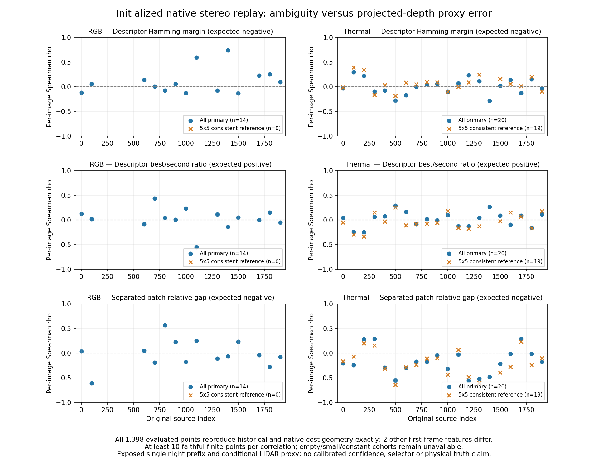

# Native stereo replay: ambiguity and the current research status

2026-11-05 America/New_York. EXP149; parent EXP148/f1aa3bf1d. Freeze **498fa12e7** precedes scientific replay and ambiguity/error associations. [Protocol](native-match-ambiguity-protocol-2026-11-05.md).

## Where the project is

The project is at baseline diagnosis and candidate quality-signal evaluation. Full-record RGB/thermal baselines and recovery exist. Thermal ORB tracks more continuously in the three exposed conditions, yet its translation error is worse. The fixed night prefix shows a distance shortfall: median finalized thermal ORB/reference travel ratio about 0.61, with almost all squared translation error parallel to travel. Finalizing received poses changes little. Supplied baseline/intrinsic conversions and native match counts do not explain that pattern by themselves.

The depth evidence is conditional: thermal native/projected-LiDAR depth ratio is 0.827 on the sparse EXP147 comparison and 0.874 in the EXP148 5×5reference-only locally consistent group. Local label substitutions do not erase the pattern for many points. The data do not qualify physical timing, calibration, projection or visibility. No uncertainty selector, learned fusion model or end-to-end adaptive VO improvement has been validated or adopted from this diagnostic chain. EXP133 gates and reserves remain unchanged.

This experiment finds a **modest candidate cue** in patch-cost ambiguity. Higher separated patch gaps associate with lower thermal absolute relative depth-proxy error: median within-image rho **−0.191699** across 20images, negative 17/20. In the pre-existing locally consistent subset, median rho is **−0.232517** across 19evaluable images, negative 15/19. Descriptor Hamming margins and best/second ratios are weak or inconsistent. This is an association on exposed accepted-stereo observations, not calibrated confidence, a risk predictor on unseen records or proof of pose/fusion benefit.

## Initialized replay and source-order limitation

The wrapper directly calls the pinned native ORBextractor and Frame.ComputeStereoMatches on the same 40canonical pairs, without tracking, map, vocabulary loading or optimizer. Native library/C++/headers/previous executables are unchanged; only a new wrapper is compiled. Original trajectories, source pixels, matcher thresholds and reference errors remain intact.

Source inspection found a baseline-initialization order issue: in the pinned stereo Frame constructor, `mb` is assigned after ComputeStereoMatches, while that method reads it to define the maximum disparity. The replay explicitly initializes `mb=bf/fx` from the provided configuration before matching. This produces defined standalone geometry; it is **not an adopted repair of historical SLAM runs**. It does not establish that the original constructor used the same candidate pool. Costs below describe the initialized replay, not a retained trace of historical candidate costs.

One reference-free 40pair smoke precedes freeze; one 40pair scientific replay follows. All historical left coordinates match. All **1,398/1,398primary points** reproduce historical right coordinates/depth exactly, and their independently reconstructed native subpixel results also match exactly. Two features outside the primary cohort in thermal source 000000 differ; every other per-feature geometry matches. We do not claim whole-frame bit identity or attribute those differences or the travel shortfall causally to the source-order issue. No alternate search bound was chosen to improve fidelity.

Initial wrapper build failed because direct Frame destruction required explicit DBoW2 linkage. CMake was corrected to link the existing library, and the successful build/native identities are retained. No native library was rebuilt. Both the initial build failure and the smoke/scientific fidelity results remain available.

## Frozen ambiguity variables and cohorts

Native right-keypoint row/scale/horizontal gates define descriptor candidates; strict first-minimum selection below 100 and the original<75patch branch remain. The observer saves all right descriptors/keypoints, each retained left descriptor/candidate Hamming costs, native 11×11left patch and 11right patch samples at offsets−5..5around the descriptor-selected right point. Raw samples and all candidate IDs/costs are preserved.

- **Descriptor margin:** second-best minus best Hamming distance; larger should indicate a more distinct descriptor match. A negative margin/error association was expected.
- **Descriptor ratio:** best/second Hamming distance; higher should indicate ambiguity, so positive error association was expected. Zero denominator is null rather than repaired.
- **Separated patch relative gap:**(lowest alternative L1cost at least 2pyramid positions away from the minimum−minimum)/max(1,minimum). Larger means a more distinct local patch minimum; negative error association was expected. Adjacent samples of the same minimum are excluded from this alternative, without fitting a threshold.

These costs cover the native local search, not all possible disparities or physical correspondences. Thermal contrast/preprocessing, scene geometry and proxy projection can confound their association. The selected accepted-stereo population already passed native rejection; this study does not predict recovery/availability of unmatched features.

Every original point and baseline error remains. Per-image ranks require at least 10faithful finite points and nonconstant variable/error; unavailable images retain a reason. No pooled-pixel p-values or population-significance claim. Cohorts are all primary points and the already declared EXP148 5×5locally consistent reference subset, with no new quality or error filter.

| Camera / cohort | Points | Faithful historical+cost points | Descriptor ties | Separated patch ties |
|---|---:|---:|---:|---:|
|RGB / all primary|309|309|9|0|
|RGB / 5×5 consistent|1|1|0|0|
|Thermal / all primary|1,089|1,089|15|1|
|Thermal / 5×5 consistent|672|672|6|1|

Exact ties are rare and cannot by themselves account for most proxy disagreement. Repeated right keypoints at different pyramid levels and local alternatives are not independent samples; the variables are descriptive cost-shape measurements.

| Camera / cohort | Variable | Defined images /20 | Median per-image rho | Negative images /defined | Min–max rho |
|---|---|---:|---:|---:|---:|
|RGB / all primary|Descriptor margin|14|0.058606|5 /14|-0.131–0.738|
|RGB / all primary|Descriptor ratio|14|0.030315|4 /14|-0.552–0.434|
|RGB / all primary|Separated patch gap|14|-0.054212|8 /14|-0.611–0.566|
|RGB / 5×5 consistent|Descriptor margin|0|null|0 /0|null|
|RGB / 5×5 consistent|Descriptor ratio|0|null|0 /0|null|
|RGB / 5×5 consistent|Separated patch gap|0|null|0 /0|null|
|Thermal / all primary|Descriptor margin|20|0.010463|9 /20|-0.281–0.300|
|Thermal / all primary|Descriptor ratio|20|0.044133|8 /20|-0.245–0.290|
|Thermal / all primary|Separated patch gap|20|-0.191699|17 /20|-0.557–0.292|
|Thermal / 5×5 consistent|Descriptor margin|19|0.055385|5 /19|-0.184–0.392|
|Thermal / 5×5 consistent|Descriptor ratio|19|-0.057601|13 /19|-0.337–0.255|
|Thermal / 5×5 consistent|Separated patch gap|19|-0.232517|15 /19|-0.642–0.231|

RGB has only one locally consistent point, so none of its 20consistent image cases has a defined correlation. Six RGB all-primary images have fewer than 10points; one thermal consistent image is below that guard. These absences are explicit. Do not compare medians as camera-superiority evidence on different scene/reference supports.

The patch-gap direction is descriptively more consistent in thermal than the tested descriptor variables. Its magnitude is modest and some images reverse sign. It does not establish calibrated uncertainty, causal stereo error, reliable camera selection or a learned architecture. No variable was selected for a new policy, no cutoff was tuned, and no pose estimator was changed.

## Validation and next priority

Six synthetic edge/rank tests pass. Smoke and scientific replay cover 80image-pair evaluations total, with no new trajectory. Independent audit passes **73,953 checks** and rejects four corruptions (Hamming cost, patch cost, candidate removal and native depth). It recomputes candidate gates, all Hamming bit counts and patch L1s from raw native buffers, native float32 parabolic right/depth results, historical point identity, unchanged proxy/group assignments, scalar tied ranks and all per-image/equal-image statistics. It does not reimplement ORB extraction or certify physical correspondence truth. Source/runtime/input pins verify unchanged. No scientific retry or threshold adjustment occurred.

**Next priority:** isolate the constructor initialization-order repair under frozen original/patched controls before building a confidence policy on these baselines. Then validate the patch-gap cue across recordings and against qualified reference evidence. The source-order issue is a concrete software concern, not an established explanation of the observed thermal bias. Physical acquisition/export timing and visibility provenance remain open.

This commit also fixes 12whitespace-corrupted backup path references for EXP146–148. Actual Box directories and verified packets were unchanged; the correct suffixes are`exp146`,`exp147`,`exp148`without spaces. Prior source/input/metric artifacts were not edited.

Artifacts under `results/native-match-ambiguity/run-001/`: prepared canonical input/target bindings, source snapshots, exact runtime identity, native raw descriptors/patches/costs, smoke and scientific fidelity, all 1,398point associations, per-image/cohort summaries and independent audit. Recovery: `ore_ms:ore-ms/backups/2026-11-05-native-match-ambiguity-exp149`, including exact replay runtime, source/input closure, all failures/outcomes, figures/findings and incremental git bundle. Inherited EXP136 scoring runtime remains a prerequisite. No protected data, new model weights or source clock/calibration correction.
