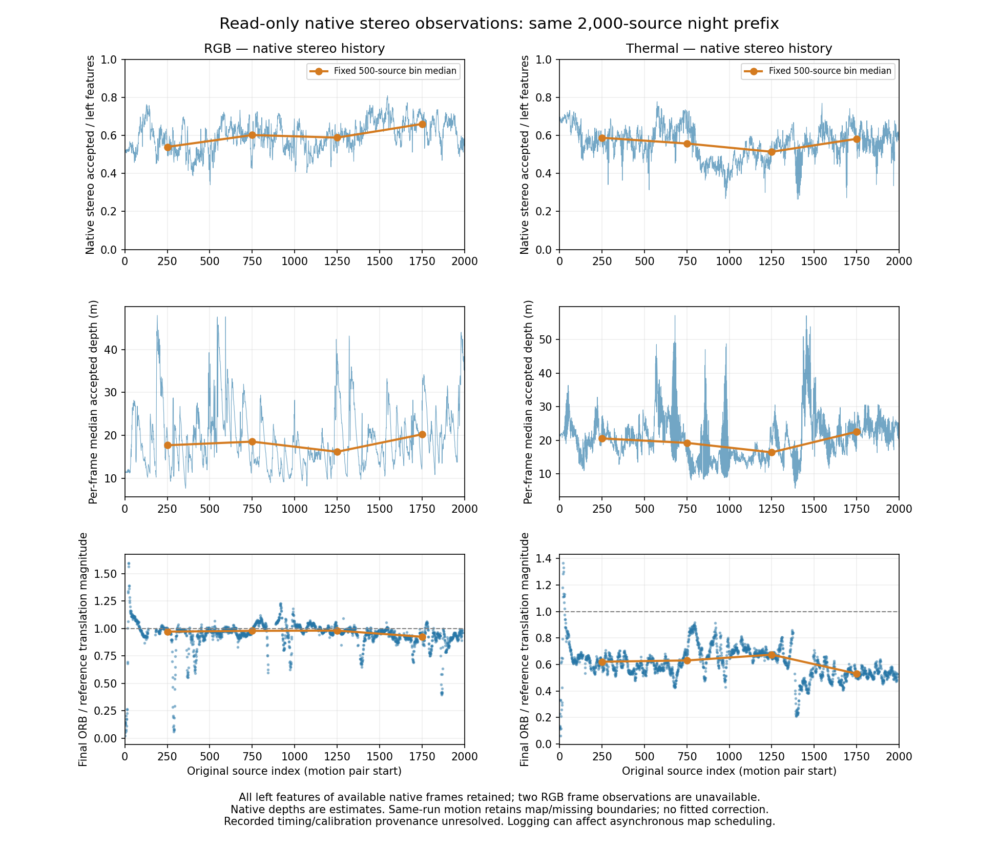

# Native stereo match/depth history on the fixed night prefix

2026-11-05 America/New_York. EXP146, parent EXP145/89574849b. Initial freeze dc5f6da01; cleared-frame amendment c8e5922cb before full recapture. [Protocol](native-stereo-history-protocol-2026-11-05.md).

Thermal's travel shortfall persists despite substantial native stereo acceptance: a median 1,008 accepted matches per frame, minimum 459, and 2,022,407 accepted observations across 2,000 frames. Finalized thermal ORB still estimates a median 60.96% of supplied-reference one-second travel;99.31% of its squared translation error lies parallel to travel. Native match count has almost no rank association with that ratio (rho 0.0192). This does not support a simple low-count explanation on this prefix. Accepted matches are not verified correct correspondences or independent depth truth, so their abundance does not establish stereo quality.

The experiment keeps the first 2,000 original groups 000000–001999 of development-exposed night `_2021-08-13-21-18-04`, both cameras, unchanged images/settings/loop-off/seed 0. Four sequential single attempts were initially declared: original control and observed wrapper per camera. An observation-only reset bug required an explicit amendment and complete four-arm recapture; all eight outcomes remain. No threshold tuning, scale/time/calibration/extrinsic fit, re-pairing, model update, new dataset payload or reserve access. No DROID rerun or change to EXP144/145 scores.

The new wrapper reads tracker-owned current-frame arrays after TrackStereo returns; native library/C++ implementation/vocabulary/headers/previous executables match EXP144 exactly. It records every feature of available frames: left u/v/octave, refined native right x/depth, current map-pointer presence/outlier flag, feature counts, bf/baseline/close threshold and original clocks. Shared map-point geometry is not dereferenced. The native matcher does not retain corresponding right keypoint ID/y; no native vertical residual is invented. Snapshot association/outlier flags are not final optimizer inlier or map-quality counts.

| Amended run | Native calls | Supported received poses | Received map/missing segments | Terminal success |
|---|---:|---:|---:|---|
| RGB control |2,000|1,937|3|Yes|
| RGB observed |2,000|1,937|3|Yes|
| Thermal control |2,000|1,969|2|Yes|
| Thermal observed |2,000|2,000|1|Yes|

Native observations retain all 2,000 source slots per camera. RGB has two unavailable post-return frames at 179/887, where the tracker clears its frame at map reset; thermal has none. Unavailable measurements are null, never zero-feature evidence. All statistics below use available frame observations and disclose counts.

| Native statistic | RGB | Thermal |
|---|---:|---:|
|Available frame observations|1,998|2,000|
|Observed left features|2,945,971|3,631,149|
|Observed accepted stereo features|1,776,908|2,022,407|
|Pooled accepted fraction of observed left features|60.32%|55.70%|
|Median left features per available frame|1508.5|1810.5|
|Median accepted per available frame|893.5|1008.0|
|Median of per-frame median disparity (px)|12.5622|5.8246|
|Median of per-frame median native depth (m)|18.2079|20.2331|
|Median native close count|154.0|170.0|
|Median native far count|723.0|820.0|
|Median currently map-associated accepted count|331.0|421.0|
|Median currently outlier-flagged accepted count|62.0|88.0|

Depth/disparity entries satisfy the unchanged native float32 bf/disparity relation within frozen numerical allowances. Baseline/focal metadata and native close threshold 35×baseline match the supplied model. This is numeric consistency, not physical calibration/depth validation. Counts and medians refer to each camera's own features/FOV and different resolutions; they are not matched scene populations. Per-column medians need not add to the median accepted count. Millions of features are not independent experiment samples.

| Same-run output | Supported poses / segments | Scored RPE pairs | SE3 ATE RMSE (m) | Translation RPE RMSE (m) | Rotation RPE RMSE (deg) | Median travel magnitude / reference |
|---|---:|---:|---:|---:|---:|---:|
|RGB control|1,937 /3|1,832|9.809422|0.989516|0.552569|0.967584|
|RGB received|1,937 /3|1,830|10.134389|0.902374|0.625426|0.965110|
|RGB final|1,937 /3|1,830|10.083192|0.888751|0.556523|0.966668|
|Thermal control|1,969 /2|1,878|82.428135|2.853540|0.829267|0.609444|
|Thermal received|2,000 /1|1,909|95.532155|2.857261|0.663881|0.607679|
|Thermal final|2,000 /1|1,909|95.517845|2.853459|0.646991|0.609556|

Observed received/final scores share exact support and received map/missing boundaries (RGB1,937 poses/3fragments, thermal 2,000/1). Control scores retain their own supported fragments; their pair masks differ and they are context rather than a matched-support causal estimate of logging effects. The unchanged approximately 1s RPE rules have 1,904eligible RGB pairs/1,909thermal. Own-camera references/times, SE3-only ATE and no scale fit remain. Original repeat variability and changed schedules prevent bitwise-preservation or intrinsic latency claims.

| Thermal fixed source bin | Median accepted count | Median accepted fraction | Median per-frame disparity (px) | Median per-frame depth (m) | Median finalized travel ratio |
|---|---:|---:|---:|---:|---:|
|0000–0499|1063.0|0.5874|5.7330|20.5562|0.6216|
|0500–0999|1043.5|0.5571|6.1286|19.2291|0.6309|
|1000–1499|912.5|0.5138|7.1767|16.4209|0.6746|
|1500–1999|1007.0|0.5817|5.2241|22.5585|0.5312|

The last bin still has about 1,007 accepted matches per frame while travel ratio falls to 0.5312. The pattern is not explained by counts alone. Native depth changes with scene geometry and motion, so these observations cannot identify bias against true depth.

| Descriptive Spearman correlation with finalized travel ratio (pair-start native observation) | RGB | Thermal |
|---|---:|---:|
|Accepted count|0.1551|0.0192|
|Acceptance fraction|-0.1036|-0.1066|
|Median disparity|-0.0378|0.4335|
|Median depth|0.0378|-0.4335|
|Signed recorded stereo time difference|0.1886|-0.0726|

All correlations use the full available pair-start cohorts: RGB1,830/thermal 1,909 pairs, no fitted correction or selected threshold. Native depth/disparity are algebraically related, so their opposite correlations are not independent evidence. Intervals overlap, and scene/motion/time can confound associations; no p-value, population significance or causal conclusion is claimed.

Thermal negative recorded-delta starts:863 pairs, median ratio 0.615896, translation RPE2.797763 m; positive starts:1,046 pairs, ratio 0.605108, RPE2.898605 m. Zero-delta cohort is explicitly empty. Both signs show the shortfall; this stratification does not isolate exposure timing or rule out a temporal stereo mechanism. Export timestamp meaning remains unresolved, and no alternative pairing or time fit is applied.

Initial run-001 is preserved: control RGB/thermal complete 2,000 calls with 1,969/2,000 supported poses; thermal observed completes 2,000 with 2,000 supported poses. Initial observed RGB stops after 180 calls (last source 179) when CreateMapInAtlas assigns a default Frame whose scalar fields are uninitialized; its final export is absent and publication fails closed with all 2,000 source slots null. Its raw partial journal/estimate and error remain. Initial total 6,180 calls; no initial reference scores were read. Amended c8e5922cb checks constructed vector emptiness before scalar reads, records an unavailable slot and continues. All four arms were recaptured under run-002 after the amended freeze, totaling 8,000 calls; no outcome-selected success replaces the original failure.

Validation: initial 7synthetic tests, amended 8 tests pass; initial four 20-source integrations total 80 calls, first-five stereo geometry exactly equal across repeats, independent 311,100 checks. Two amended 20-source integrations add 40 calls and retain original geometry exactly. Native parent identities remain exact. Full independent audit passes 13,394,957 checks and rejects 4 native corruptions (depth scaling, sentinels, omitted feature and source clock). It independently reconstructs all per-frame summaries/availability, original received transforms/segments, final factors and per-map official export compatibility, raw-reference metrics, scalar translation decomposition, strata and rank correlations. Large check count includes two flag checks per observed feature; it is not a count of independent samples. Official float exports agree within prior frozen compatibility allowances (max translation component discrepancy RGB0.10476mm/thermal 0.23156mm); scoring tolerances are unchanged.

The strongest conclusion is bounded: native count/acceptance alone does not establish thermal geometric accuracy. The next discriminating evidence is native depth against an independently qualified depth reference, together with acquisition/export timing provenance. Native bf/disparity self-consistency cannot validate true depth. No physical calibration/synchronization, heldout/full-record, online/adaptive or EXP133 readiness claim; reserves/defaults unchanged.

Recovery: `ore_ms:ore-ms/backups/2026-11-05-native-stereo-history-exp 146`. Both attempts/integrations, all feature/factor/raw/score/lock files, failures, source snapshots, findings/figures, git bundle and both exact observer runtime images retained. Original control/scoring runtimes and raw/canonical image prerequisites are explicitly declared in RECOVERY.md.
