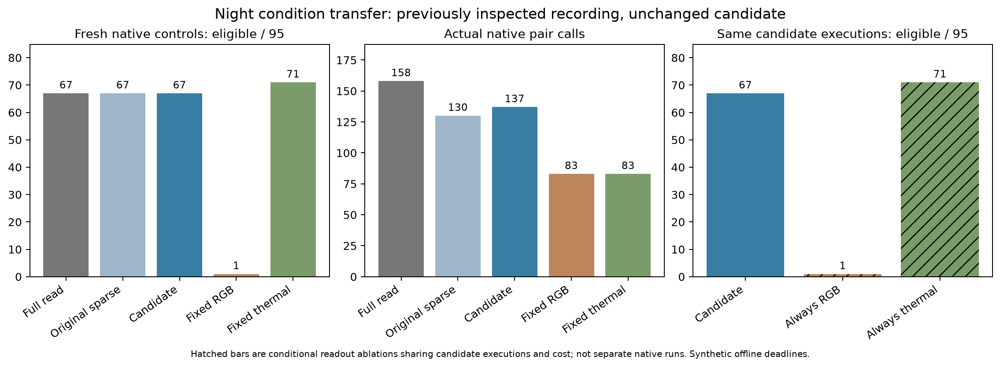

# EXP125: night-condition transfer

2026-11-03 / ore_ms. Parent680a2da7c; execution freeze02bfb3a44.

Execution validity: **PASS**. Frozen research superiority gate: **FAIL**.
The unchanged candidate yields67/95 selected eligible deliveries,
with137 native pair calls. Native fixed thermal yields
71/95 with83calls.

## Condition and scope

Transfer the exact EXP124 candidate to the sole >=100-frame prepared night
window in the EXP119 exposed inventory. Night RGB source945–1044 comes from
night_mac_salon_warehousefig8; day development was0_salon_so_day. All400 night
image hashes are disjoint from day development. This interval and its original
native health were inspected before. This is condition transfer, not a blind
holdout, independent training evaluation or causal illumination experiment.
No reserved MS2 recording, new data acquisition, pose labels or training.

Freeze source/weights/runtime/controller,4MiB encoded store+2MiB shared arena,
cache clocks/readiness4/20/query2, and relative outages RGB20–34,thermal50–64,
both75–79. Six new dual native captures include an unperturbed control, all with
identical dual root/guard/service overhead. Fixed-camera costs are not pure
single-expert costs. No failed-capture replacement, retry, budget change or policy
fit after native outcomes.

## Fresh native comparisons

| Fresh native arm | Eligible / 95 | Unavailable selected | Abstain with opportunity | Abstain, none eligible | Pair calls | Native seconds | Controller seconds |
|---|---:|---:|---:|---:|---:|---:|---:|
| full_read_cache | 67 | 4 | 4 | 20 | 158 | 53.649 | 55.435 |
| bounded_probe | 67 | 4 | 4 | 20 | 130 | 42.218 | 43.954 |
| leased_probe | 67 | 4 | 4 | 20 | 137 | 44.939 | 46.414 |
| fixed_rgb | 1 | 94 | 0 | 0 | 83 | 36.508 | 37.530 |
| fixed_thermal | 71 | 24 | 0 | 0 | 83 | 23.003 | 23.893 |

These are complete95-slot populations, not common-support-only or success-only
statistics. Eligibility requires supported exact adjacent native endpoints and
first processing-write by the original next source-group deadline. A skipped,
gapped, unsupported or late interval remains unavailable. Abstention is separate
from selecting an unavailable camera. No pose-error claim is evaluated here.

## Exact-cost conditional readouts

| Conditional choice | Eligible / 95 | Assigned exact native pair calls |
|---|---:|---:|
| matched_rgb | 1 | 137 |
| matched_thermal | 71 | 137 |

Both fixed readouts choose a predeclared constant camera at every candidate
source deadline using the exact same returned expert outputs. They share the
candidate's actual native source history, pair calls and assigned measured cost;
there is no extra neural execution. This isolates camera readout choice
conditional on candidate scheduling. It is not a standalone fixed-camera compute
allocation policy, independent run, or new runtime measurement. The fresh native
fixed arms above provide the separate scheduling comparison. Both readouts are
reported; no favorable one is selected after outcomes.

## Frozen research gate

| Research criterion | Outcome |
|---|---|
| eligible_noninferior_full | PASS |
| eligible_noninferior_original | PASS |
| fewer_calls_than_full | PASS |
| strictly_better_both_native_fixed | FAIL |
| strictly_better_both_matched_readouts | FAIL |

Execution checks and the research gate remain separate. Audit success establishes
that this implementation/comparison is valid under its protocol; it cannot supply
a missing superiority result. A research-gate failure is retained without tuning.

## Return behavior and native support

| Camera return | Original sparse first adjacent delivery | Candidate first adjacent delivery |
|---|---|---|
| rgb at 35 | none by horizon49 | none by horizon49 |
| thermal at 65 | target66 / group67 | target66 / group67 |
| rgb at 80 | target97 / group98 | target97 / group98 |
| thermal at 80 | target81 / group82 | target81 / group82 |

These are four prescribed transport-return episodes on one recording, not four
independent trials. Native support is not guaranteed by restored transport. All
censored return outputs remain visible. Candidate reason counts over95 slots:

- rgb: native_unsupported=42, not_requested=32, native_gap_not_adjacent=11, synthetic_transport_unavailable=9, eligible_adjacent_native=1
- thermal: eligible_adjacent_native=71, after_ordinary_deadline=2, synthetic_transport_unavailable=20, native_gap_not_adjacent=2

Complete event histories, session statuses, unavailable choices, abstentions,
all95-slot source bindings and original deadlines remain in machine-readable
scores. The test does not infer natural fault detection or physical pose quality
from the support flags.

## Validation and cost boundary

All12 native experts complete. Independent audit passes54,484 checks,
including all475 fresh-arm guarded rows,190 conditional readout rows,
source/prefix/native intervals/deadlines, encoded store admission/expiry/eviction,
lease ownership, one-command credit, bounded message sizes and matching ACKs.
Strict unperturbed control matches5,226 NPZ arrays against
EXP119 full-read night: dtype, shape and every logical-cell byte, including
NaN/signed-zero patterns. All1403 source/input pins remain unchanged.
The native implementation is unchanged from EXP124's65 passing focused tests;
no new native code or additional unit-test count is claimed. Scorers and the original
independent oracle were frozen before outcomes; the scalar audit-precision
amendment described below is retained separately. Capture and prediction locks are
retained; no source pose-reference labels are read.

Source span is9.900s; candidate controller processing is
46.414s in serial offline replay.
This is not live acquisition cadence. Encoded store+allocated shared arena<=6MiB
excludes staged inputs, Python/control/kernel buffers, normal decode, tensors,
GPU/RSS/OS cache. No total memory, sensor-bandwidth or energy claim.

## Research implication

The research superiority gate FAILS. Candidate and original sparse both deliver
67/95 and recover3/4 transport-return episodes within the prescribed horizons;
the candidate costs137 versus130 pair calls. Fixed thermal delivers71/95 with83
calls. Conditional always-thermal also delivers71/95 on the candidate's exact137
calls. Thus neither additional readiness utility nor adaptive selected-delivery
benefit transfers to this inspected night condition. Fewer calls than full-read
(137 versus158) is insufficient evidence when a simpler fixed-camera control
has both more deliveries and fewer calls.

The four extra thermal-eligible candidate slots have pair ordinals2,65,66,80
(target ending sources3,66,67,81). All are preselected ABSTAIN. Eligible thermal
motion arrives by the original deadline at groups4,67,68,82. That future output
was not necessarily available at decision time: this is a conditional fixed-choice
comparison, not evidence that the controller could read its future result. The
best fixed control is reported retrospectively alongside both fixed cameras;
no winner is installed into the policy.

The candidate uses15readiness-overlay extra requests and no successful early
RGB return after35; later RGB adjacent output arrives only at group98 after the
joint return80. Original sparse has the same episode censoring/endpoints. All
session/native unsupported outcomes remain in the journal. Net calls differ by7,
not15, because each arm also has its own observed feedback/clock/request schedule.

Audit precision amendment: the original frozen auditor failed exact equality of
summed per-camera floating-point seconds versus summed integer nanoseconds
converted once (approximately1e-14s difference). The original source/log remain
unchanged. A separately saved v2 auditor changes only that scalar comparison to
math.isclose(rel_tol=1e-12,abs_tol=1e-12), plus import/docstring. Its hash, original
source hash, capture lock and unchanged scores are locked in audit-amendment.json
before the corrected audit. No native retry, source-input change, outcome metric,
research criterion or policy modification occurs. All1403 original pins verify.

This bounded result tests whether the health/history scheduling mechanism adds
useful output beyond simple fixed-camera choices in a different recording.
It does not establish cross-camera uncertainty calibration or physical accuracy.
If the superiority gate fails, the supported conclusion is that adaptive benefit
has not transferred under this protocol; do not turn execution or audit counts
into scientific replications or tune the camera preference to this outcome.

Future evidence needs conditions with a useful changing alternate, separately
predeclared fixed-camera/matched-cost controls and justified reference/deadline
semantics. More mechanism checks on the development day trace cannot establish
that result. Existing exposed inputs suffice for bounded engineering; sustained
natural transitions and independent pose references would strengthen broader
recovery/accuracy claims. The final two unexamined MS2 captures remain reserved.

Artifacts: results/night-transfer/run-001. Backup: backups/2026-11-03-night-transfer.
Prerequisites: EXP124 implementation/service/runtime; EXP119 night input/control
coverage and its inherited original data/model/compiler packets.

Commitment/abstention qualification: candidate selects4unavailable targets and
abstains on24 (4with an eligible expert by deadline,20with none), whereas fixed
thermal selects24unavailable targets and never abstains. Fixed thermal's advantage
here is more delivered intervals and fewer calls, not superiority on every metric.
No combined penalty for abstention versus unavailable commitment or downstream
pose risk was declared; none is fitted afterward to rescue the failed gate.
