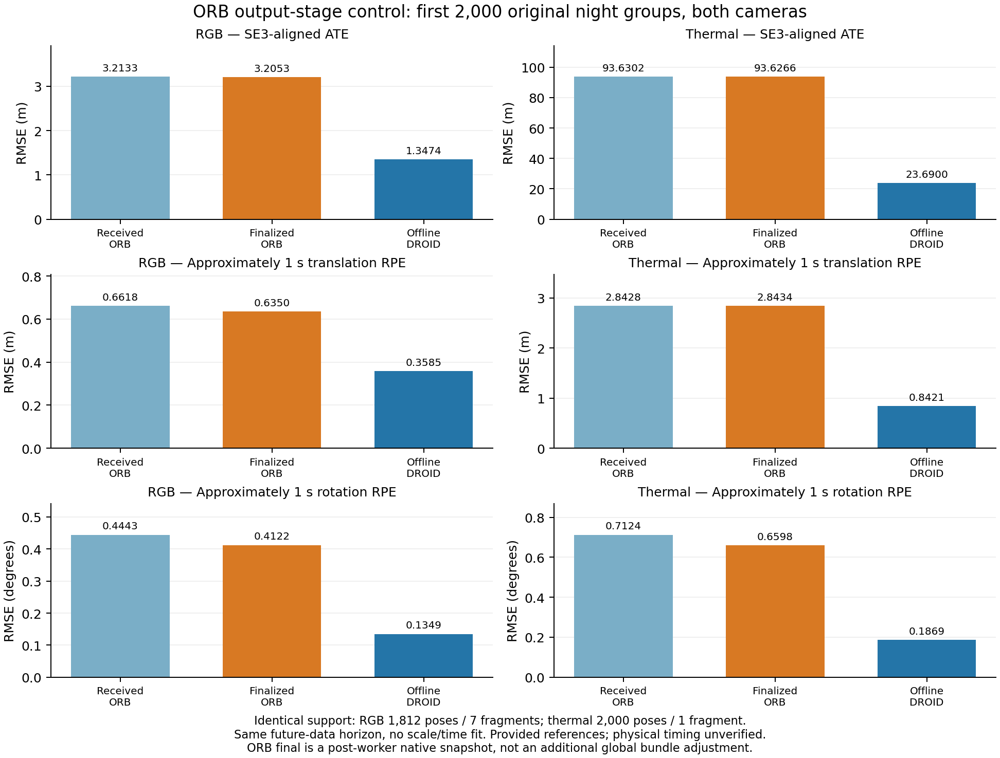

# ORB received versus finalized poses: bounded night control

2026-11-05 America/New_York. EXP144, freeze86571d280 before eight scientific arms. [Protocol](orb-finalization-protocol-2026-11-05.md).

Finalization explains only a small part of the ORB–DROID error gap on this fixed prefix. RGB translation RPE improves 4.04%; thermal changes by +0.021%. Finalized ORB still has 1.77×/3.38× DROID translation RPE for RGB/thermal on identical support. This bounds an output-stage explanation on this interval; it does not identify the remaining cause or establish general performance.

The first 2,000 original groups (000000–001999) of exposed night `_2021-08-13-21-18-04` were fixed before execution. Each camera has an original control, original repeat, paired received/final export and fresh same-prefix DROID run. All eight single attempts complete 2,000 native calls each. No quality-directed retry, scale/time fit, training, reserve access or default change. References and previous outcomes were development-exposed.

| Camera | Original control supported / segments | Original repeat supported / segments | Paired received supported / segments | Final supported | DROID supported |
|---|---:|---:|---:|---:|---:|
| RGB | 1,873 / 5 | 1,937 / 3 | 1,812 / 7 | 1,812 | 2,000 |
| Thermal | 2,000 / 1 | 1,969 / 2 | 2,000 / 1 | 2,000 | 2,000 |

Original repetitions vary despite wrapper seed0. Instrumentation is not claimed to preserve execution bitwise; the cause of variation is not isolated. Received/final poses come from the same paired native execution. Finalization preserves the received mask, so this does not test tracking recovery or credit additional official-export poses.

Scores use exact common support and received map/missing boundaries: RGB1,812 poses/seven fragments, thermal2,000/one fragment. RPE scores1,672/1,904 eligible RGB pairs and1,909/1,909 thermal pairs under unchanged approximately one-second rules. ATE is SE3 aligned within fragments, without scale fitting. DROID fragment boundaries are evaluation diagnostics, not native resets.

| Camera / output | ATE RMSE (m) | Translation RPE RMSE (m) | Rotation RPE RMSE (deg) |
|---|---:|---:|---:|
| RGB received ORB | 3.213320 | 0.661770 | 0.444294 |
| RGB finalized ORB | 3.205308 | 0.635020 | 0.412178 |
| RGB offline DROID | 1.347385 | 0.358476 | 0.134912 |
| Thermal received ORB | 93.630194 | 2.842827 | 0.712421 |
| Thermal finalized ORB | 93.626582 | 2.843425 | 0.659846 |
| Thermal offline DROID | 23.690050 | 0.842099 | 0.186891 |

Finalization lowers RGB/thermal rotation RPE7.23%/7.38%; ATE changes−0.249%/−0.00386%. Origin-aligned ATE received/final/DROID: RGB6.950188/6.872471/4.670966m, thermal222.626316/222.611210/64.725267m.

The runtime adds four inline read-only pointer accessors and compiles a new wrapper. Native library, vocabulary, original executable and native C++ implementations retain exact hashes. Native Shutdown requests finish without waiting in this pinned implementation; the wrapper explicitly waits for finished workers and no global BA. Final poses reconstruct native relative factors, culled-reference parent chains, final keyframe poses and per-map first surviving keyframe gauges. All surviving maps remain. This is a post-worker snapshot with loop closing disabled; no extra global bundle adjustment or convergence guarantee.

Independent float64 reconstruction checks exact source-time bindings, factors, gauges, masks, maps, original received rigid-transpose conversion and metrics. Official per-map float exports agree within frozen factor-magnitude numerical budgets: RGB1,812 comparisons/max translation component difference0.07853mm; thermal2,000/max0.24768mm. RGB official export has1,994 rows;182 additional rows outside received support remain excluded. These compatibility budgets do not change scoring rigidity/tolerances.

Validation:52 analytic/regression tests and265 integration checks pass. Full independent audit:107,179 checks,18 metric corruptions rejected. Separate DROID native audit:84,068 checks of pose conversion, actual tensors, geometry/baseline, capacity and tracking/filler indices0–1999. Fresh prefix inference uses no full-record future data. Source/runtime/prediction locks verify unchanged.

Two pre-scientific mechanical failures remain retained: Docker FROM-by-digest syntax failed, then the exact local base tag built; integration auditor rejected near-roundoff homogeneous rows, then checked the publisher's declared normalization. Both corrections precede the scientific freeze. Scientific predictions and metric rules were not revised after results.

Physical timestamp semantics and calibration provenance remain unresolved. Methods and compute differ (CPU ORB/GPU DROID); finalized/offline outputs do not establish causal online availability or latency. This exposed night prefix supports no heldout, day/rain, full-record, physical or adaptive-superiority claim. EXP133 gates remain unchanged.

Next useful diagnostic: inspect stereo/input/reference geometry assumptions behind tracking-supported thermal translation errors under a separately declared contract. This control does not justify attributing remaining error to a particular sensor or compute mechanism.

Recovery destination: `ore_ms:ore-ms/backups/2026-11-05-orb-finalization-exp144`. Packet retains all eight outcomes, raw factors/official exports, locks, scores, audits, pre-scientific failures, source closure, figures, git bundle and exact derived export runtime. Original ORB/DROID runtime and image prerequisites are declared in RECOVERY.md.
