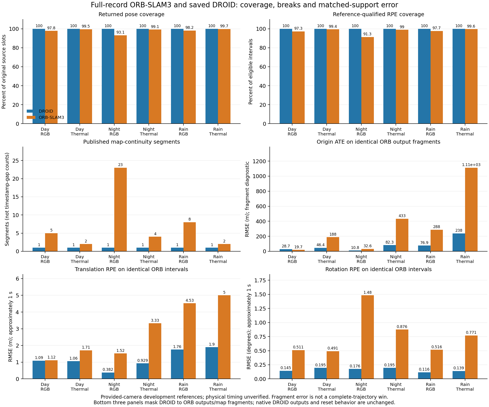

# EXP143: ORB thermal tracking availability and accuracy are different outcomes

2026-11-05 America/New_York. Parent EXP142 / bf0e1493e. Native freeze
`37932ff0e` precedes inference. Matched-support declaration `102cc0346` and
rigid-inverse audit refinement `97bddeb1f` precede every ORB reference score.

**All six native runs process every requested source call. Thermal returns more
tracking-supported poses and fewer map-continuity segments than RGB in day,
night and rain. Thermal nevertheless has higher provided-reference translation
RPE in all three ORB recordings. All six ORB trajectories break, so none passes
the declared continuous-trajectory engineering criterion. On exactly the same
ORB output fragments, saved DROID has lower translation and rotation RPE in
all six cases. This is development evidence, not a general sensor-reliability,
physical-accuracy, real-time or adaptive-fusion result.**

## Native completion, support and breaks

The original EXP134 binary/runtime, 2000-feature settings, loop closure off,
seed0, and exact EXP141 prepared inputs are frozen before the first call. All
six streams run once, sequentially, with a 3600-second per-case native timeout;
none times out or needs a retry. All native return codes are zero, calibration
receipts pass, and terminal success is true. There is no native estimator or
threshold change. Both cameras retain their complete original source axes.

ORB returns **54,432/55,618** poses admitted by its native tracking-OK/map rule.
The other **1,186** source slots remain null. These are native tracking-support
states, not verified correctness. There are **44** map-continuity segments and
**38** observed map identity changes. All six have at least one break; the
engineering-success flag is false for all six even though native execution
terminates successfully.

| Stream | Source calls | Returned poses | Pose coverage | Qualified RPE coverage | Segments | Observed map changes |
|---|---:|---:|---:|---:|---:|---:|
| day-rgb | 5,810 | 5,684 | 97.831% | 97.283% | 5 | 4 |
| day-thermal | 5,810 | 5,779 | 99.466% | 99.427% | 2 | 1 |
| night-rgb | 10,131 | 9,437 | 93.150% | 91.324% | 23 | 22 |
| night-thermal | 10,131 | 10,044 | 99.141% | 98.968% | 4 | 3 |
| rain-rgb | 11,868 | 11,651 | 98.172% | 97.706% | 8 | 7 |
| rain-thermal | 11,868 | 11,837 | 99.739% | 99.638% | 2 | 1 |

All **50,886/52,276** reference-qualified RPE opportunities are scored. Eligibility
uses the unchanged v2 reference rigidity, 1–1.15 second endpoint and <=150ms
source-gap rules. The ten nonrigid provided reference poses from EXP142 remain
excluded, with no source or pose slots discarded.

The old ORB publisher makes a new segment at timestamp gaps. Its legacy outputs
are preserved (40/38 day RGB/thermal, 84/70 night, 59/56 rain). A separate,
pre-inference-declared evaluation view changes segment identifiers only: missing
poses and native map changes break trajectories; a time-only gap does not create
an artificial map reset. Pose values and clocks stay identical. RPE still refuses
to cross long source gaps. This matches the saved DROID map-continuity convention
and prevents giving ORB extra per-gap ATE alignments.

## ORB errors on its complete declared output population

All values below are RMSEs against same-stem, own-camera provided navigation
references. SE3 alignment never fits scale. ATE is aligned **per returned segment**;
none of these ORB ATE values is an uninterrupted complete-trajectory win.

| Stream | Segment SE3 ATE (m) | Segment origin ATE (m) | ~1 s translation RPE (m) | ~1 s rotation RPE (deg) | Scored / eligible RPE |
|---|---:|---:|---:|---:|---:|
| day-rgb | 9.784255 | 19.699463 | 1.119965 | 0.511287 | 5,264/5,411 |
| day-thermal | 88.313491 | 187.772783 | 1.711558 | 0.491149 | 5,381/5,412 |
| night-rgb | 14.467066 | 32.601862 | 1.520480 | 1.482323 | 8,568/9,382 |
| night-thermal | 214.053468 | 432.979599 | 3.329051 | 0.876418 | 9,306/9,403 |
| rain-rgb | 146.299380 | 287.565231 | 4.526305 | 0.516001 | 11,075/11,335 |
| rain-thermal | 654.316434 | 1111.595377 | 5.000698 | 0.770998 | 11,292/11,333 |

Thermal rotation RPE is lower in day and night, higher in rain. Higher pose
availability is therefore not interchangeable with lower translation/rotation
error. Reference-clock/calibration interpretation remains conditional; these
numbers do not establish physical trajectory accuracy or identify a cause.

## DROID on identical ORB frames and fragments

Directly comparing fragmented ORB ATE to full DROID ATE would give ORB additional
alignment roots and different support. A supplemental diagnostic was declared
while native runs were underway, before any ORB reference score. For every case,
it masks a separate DROID scoring view to exactly ORB's returned frames and map
fragments. Original DROID/ORB predictions and full DROID results remain unchanged.
The diagnostic verifies identical source, reference and RPE populations/durations.
It does not imply DROID actually reset or lost output at ORB's boundaries.

| Stream | DROID matched SE3 ATE (m) | ORB SE3 ATE (m) | DROID matched T RPE (m) | ORB T RPE (m) | DROID matched R RPE (deg) | ORB R RPE (deg) |
|---|---:|---:|---:|---:|---:|---:|
| day-rgb | 15.396541 | 9.784255 | 1.090608 | 1.119965 | 0.144521 | 0.511287 |
| day-thermal | 22.265447 | 88.313491 | 1.060523 | 1.711558 | 0.195246 | 0.491149 |
| night-rgb | 2.794243 | 14.467066 | 0.382365 | 1.520480 | 0.176494 | 1.482323 |
| night-thermal | 34.503193 | 214.053468 | 0.928570 | 3.329051 | 0.195436 | 0.876418 |
| rain-rgb | 15.740010 | 146.299380 | 1.756262 | 4.526305 | 0.116459 | 0.516001 |
| rain-thermal | 120.112303 | 654.316434 | 1.895076 | 5.000698 | 0.139215 | 0.770998 |

DROID has lower matched translation and rotation RPE in all six cases. ORB day
RGB has lower fragment SE3/origin ATE than DROID on those same fragments; the other
five favor DROID. Preserve that exception rather than select one favorable metric.
Original full DROID SE3 ATE remains RGB 23.150/22.856/39.069 m and thermal
24.218/59.439/133.915 m for day/night/rain; those unmasked results are not replaced
by the diagnostic.

This is still estimator context, not a matched-latency or equal-hardware result.
ORB publishes CPU received poses, while DROID uses GPU offline backend/filler poses.
DROID does not supply the same native tracking-failure/receipt interface. Its
100% offline pose coverage cannot be interpreted as equivalent tracking-OK evidence.
The methods also apply different declared internal image processing/resizing.

## Computation is configuration- and workload-dependent

These are single-run observations on the frozen machine, not intrinsic thermal
sensor costs or statistically established speedups. ORB reads RGB 384x1224 and
thermal 256x640 canonical images. Thermal wall time is lower in all three cases,
but its peak child-process RSS is higher in night and rain. Different image sizes,
map histories, tracking outcomes and background scheduling remain confounded.

| Stream | Native adapter wall (s) | Mean native TrackStereo (ms/call) | Peak child RSS (GiB) |
|---|---:|---:|---:|
| day-rgb | 205.639 | 23.320 | 4.009 |
| day-thermal | 125.188 | 18.874 | 3.003 |
| night-rgb | 279.638 | 16.830 | 4.725 |
| night-thermal | 179.811 | 15.411 | 6.524 |
| rain-rgb | 405.104 | 22.937 | 4.102 |
| rain-thermal | 291.248 | 22.208 | 4.756 |

Native adapter wall includes startup/shutdown and image loading, excludes the
prior input-hash verification. TrackStereo timing excludes image decoding and
is not a disjoint total CPU-cost measure. Wrapper/driver timings are retained
separately. RSS is peak resident memory across child processes in an isolated
per-case wrapper, not total system memory or Torch GPU allocation. Precomputed
thermal canonical preprocessing, sensor acquisition/power and real-time deadlines
are not measured here. Inputs are fed offline without capture-rate pacing.

## Posthoc provided-index availability overlap

This descriptive table uses original source stems, not a shared exposure clock
or controller receipt time. It is not an oracle delivery/accuracy score or evidence
that a mixed-camera controller can meet a deadline. The separate camera clocks
remain unverified. RGB still supplies unique supported source IDs in night/rain,
so greater thermal availability does not imply it dominates every source slot.

| Condition | Both supported | RGB only | Thermal only | Neither |
|---|---:|---:|---:|---:|
| day | 5,684 | 0 | 95 | 31 |
| night | 9,389 | 48 | 655 | 39 |
| rain | 11,620 | 31 | 217 | 0 |

## Validation and audit refinement

Forty adapter/segment tests pass before inference; five matched-support tests and
three rigid-inverse controls pass before ORB scoring (48 tests total). The frozen
v1 audit's first full native check fails: a general matrix inverse is not the
original publisher's rigid-transpose inverse for accepted rounded float rotations.
The failed check and its source remain preserved. In night RGB, 3,612 comparisons
exceed its 1e-5 component threshold; the maximum difference is 0.000303381 m in
translation, with maximum native rotation orthogonality error 8.073e-7.

V2, separately declared at `97bddeb1f` before scoring, independently checks the
existing block inverse R-transpose / -R-transpose*t and the unchanged 1e-5 native
rigidity rule. Output comparison tolerance also stays 1e-5. No pose, native code,
calibration, run setting or metric is changed. The synthetic rounded-rotation
control reproduces why the original comparison fails, an exact rigid control
agrees with matrix inversion, and gross nonrigid input stays rejected.

Independent v2 native/input/segment/reference/metric audit passes **818,793
checks / 36 rejected corruptions**. It checks actual image
and prepared-file hashes, source axes, binary/build/calibration identity, Tcw
conversion, nulls/map boundaries, all reference exclusions, errors and summaries.
The matched DROID diagnostic independently passes **153,030
further metric checks**. All six actual native command lines, copied plan hashes,
runtime IDs and thread environments match the freeze. Original DROID/scorer
hashes remain unchanged. No quality-driven retries, training or reserve access.

## Scope, recovery and next question

References and DROID outcomes were already development-exposed. The native method
freeze is pre-inference, not blind/heldout data selection. Exact source stems and
own-camera recorded clocks are retained without clock/scale fitting. Physical
stereo exposure timing, frame/calibration validity, causal output availability
and general sensor superiority remain unverified. EXP133 active validation/test
lists stay empty; no benchmark promotion, default or selector is adopted.

Native protocol: `experiments/orb-full-record-2026-11-05.json`.
Supplemental matched-support and audit-refinement declarations are versioned
separately. All native/legacy/evaluation outputs, scores, diagnostics and logs:
`results/orb-full-record/run-001`. Recovery:
`backups/2026-11-05-orb-full-record-exp143` (runtime EXP134; raw/canonical images EXP141;
provided-reference/DROID context EXP142).

The evidence supports a narrow statement: **thermal maintained ORB tracking support
more often on these three provided recordings, but was not more accurate in
translation.** A smaller pose uncertainty or native tracking-OK state cannot be
assumed to certify comparative motion quality.

The next useful control is to separate ORB's received-pose versus finalized-map
output scope on a predeclared existing interval, preserving all native map breaks.
That addresses a concrete estimator comparison confound before attributing errors
to a sensor or fitting a new reliability model. The high thermal translation errors
also motivate testing supplied stereo timing/geometry assumptions, without fitting
clock or scale to the reference. Independent acquisition/export evidence is still
needed to strengthen the physical interpretation.
