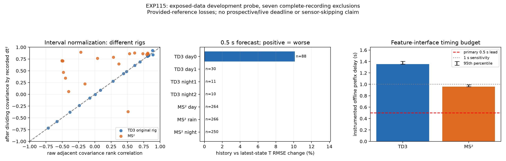

# EXP115: past covariance adds no reliable primary forecast increment

Client date2026-11-03. Frozen protocol/source `8b4daf442`; parent `04f51f35d`. Saved-output development experiment with whole-recording exclusion; these recordings and their losses were already exposed. No prospective validation or adopted sensor-skipping model.

We completed the original-rig interval replication and a fixed future-sensor-risk comparison. **The 0.5second primary development criterion fails.** Adding two previous covariance values changes only4of1072forecasts, worsens the original-rig macro translation and rotation losses, and offers only tiny MS² changes. The existing instrumented prefix is also later than the tested0.5second lead on every forecast. These results do not justify moving to an LSTM, agent, new layer or actual sensor skipping.

[Protocol and exact feature/fit/target definitions](past-only-sensor-risk-protocol-2026-11-03.md). All seven physical temporal recordings and eighteen windows from EXP112/113/114 are retained. There are1,222source decision slots and36sensor/window covariance series. Origins require three contiguous covariance slots with native pair-end receipts at the exact saved decision prefix. The target has not yet been released at that prefix. Targets are nearest future starts at0.5seconds, with1second as an unpromoted sensitivity, within50ms and within the same window. Missing ordinals are never compacted. Preparation retains1,955forecasts total:1,072primary and883sensitivity;72cold-start horizon slots and417time-unmatched slots remain counted. All forecast targets are later than the latest released source group; no target event, future availability or reference loss is a predictor input.

The current-state analytical ridge has16features: per-camera current rate covariance, interval, pose information, count, occupancy, retained fraction and availability indicators. The augmented fit adds four covariance-history differences. Both use identical origins, fixed ridge1, training-only record-balanced means/stds, and a signed future translation-error-gap target. Each held-out recording is excluded before label lookup or scaling across all its windows. Twenty-eightfits are saved (sevenrecordings × twofamilies × twoleads); every fit converges analytically. Excluded-record label deletion and feature mutation leave its model unchanged. All predictions are locked before scoring their held-out labels. This controls fit leakage but cannot make previously inspected data prospective.

The original-rig timestamps are mostly at0.1second intervals, unlike MS²'s alternating/variable recorded intervals. Of36TD3stream/window checks,24have retained source timestamp files; their1,120sample/index bindings match native manifest nanoseconds exactly (maximum discrepancy0ns). Twelvechecks for the three `1_salon_mac_cov_day` windows have no original sensor timestamp streams locally; those retain manifest-only provenance. Extracted timestamp files and frame IDs do not establish physical exposure/readout timing or reproduce a raw-bag converter revision. Hardware clock synchronization remains unverified.

On the eighteen original-rig covariance series, dividing by dt² leaves fourteen adjacent rank correlations exactly unchanged, improves two and worsens two. Median rho stays0.4623. Thus EXP114's strong MS² rescaling result does **not** explain a general original-rig covariance-memory deficiency or fix the prior geometry gate. Some original-rig covariance series are persistent; others have weak or negative adjacent ordering. Existing pose/information interval transport is unchanged; the new normalization concerns the temporal covariance coordinate, not a newly discovered missing transport operation in MAC-VO.

| Held-out recording | Joint target comparisons | Latest-state T RMSE (m) | With history T RMSE (m) |
|---|---:|---:|---:|
| ms2/_2021-08-06-11-23-45 | 264 | 0.10705815 | 0.10705815 |
| ms2/_2021-08-06-16-19-00 | 266 | 0.25924973 | 0.25924974 |
| ms2/_2021-08-13-21-18-04 | 250 | 0.04949179 | 0.04948989 |
| td3/20251027/0_salon_so_day | 88 | 0.04237731 | 0.04666891 |
| td3/20251027/1_salon_mac_cov_day | 30 | 0.04966940 | 0.04966940 |
| td3/20251027/night_mac_salon_warehousefig8 | 11 | 0.30264847 | 0.30264847 |
| td3/20251027/night_thermal_so_salon2 | 10 | 0.11318996 | 0.11318996 |

The primary has919reference-valid, jointly supported target comparisons:139TD3and780MS². Two additional primary targets have the already-known invalid reference pose; they remain unscored. Counts refer to forecasts, with unique target counts also reported; repeated labels and nearby frames are not independent samples. The two TD3 night records supply only11and10joint comparisons at this horizon, so the larger combined corpus still does not resolve original-rig night quality sample size.

| Domain | Current macro T MSE | History macro T MSE | Current / history macro R MSE | Primary increment |
|---|---:|---:|---:|---|
| td3 | 0.0271677378 | 0.0272632756 | 57.36039406 / 57.36233110 | FAIL |
| ms2 | 0.0270404359 | 0.0270403742 | 0.00237468 / 0.00237407 | PASS |

Macro MSE averages recordings equally within each domain. History worsens TD3 translation MSE by about0.352%; its day0 RMSE rises0.042377→0.046669m. MS² macro translation MSE improves by only about0.000228%. The strict combined primary fails. At1second the fixed numerical development inequalities pass in both domains, with translation-MSE decreases of only approximately0.00209%TD3and0.0000275%MS². Nineof883actions change. This sensitivity does not replace the primary, establish a practically reliable gain or pass an original-rig timing budget. No lag, exponent, ridge penalty or architecture was selected after seeing outcomes.

Future availability is a larger issue than the tiny error-ranking changes. Over the same1,070reference-valid primary forecasts, current and history probes each select an unavailable target sensor107times and score963motions. The origin information-ranking control selects an unavailable sensor18times and scores1,052motions, using no future fallback. On the same919both-supported targets its translation/rotation RMSE is0.153785m/0.085681degrees, versus0.157800m/1.661316degrees for current and0.157916m/1.661539degrees for history. These are qualified supplied-reference errors, not physical ground truth. The forecasters' supervised target exists only when both future experts have valid losses; it does not explicitly train future failure prediction. This is a reason to test availability forecasting separately, not proof of a complete explanation for the failures.

Missed thermal opportunities on the primary joint-target population are150for both fits, with40missedRGBopportunities. Winner-run diagnostic has244contiguous runs after earliest-origin deduplication: current fails to detect106runs, history108. Median delay among detected runs is0seconds for both; that median excludes the many undetected/right-censored runs and is not actual sensor-recovery performance. The complete runs and masks are saved.

The observed instrumented prefix delay is measured from the earliest release of an origin's ending frame to its saved controller decision boundary. Median/P95: **TD3 1.355/1.402seconds; MS²0.960/0.990seconds**. The delay includes serialized sensor replay, native estimator/backend work, observer work and the existing one-group deadline policy. CPU evaluation of a frozen ridge is about4.5microseconds median, measured separately. Noneof1072primaryforecasts has a positive remaining instrumented0.5second budget. At1second TD3remains0/212positive; MS²is652/671positive. Pair-processing medians are approximatelyTD3RGB0.429s/thermal0.225s andMS²RGB0.338s/thermal0.115s. These are instrumented offline measurements, not an optimized deployment benchmark or proof that all future predictors cannot be fast enough. Source physical clocks, live queues/readout and skipped-frontend feedback are not validated.

The grounded next step is to measure when native covariance and tracking-health signals can first be read, before waiting for the present pose-information/decision interface, and test persistence of **availability** using the last eligible/information-based choice as a mandatory baseline. Conditional quality prediction should then be evaluated on longer, usable original-rig night segments. A new supervised complexity is not supported by this test. Actual skipping remains conditional on a useful, timely prospective signal because it would change future map/recovery state; both native frontends ran in all source captures.

Validation: six focused tests pass; an independent augmented weighted-SVD fit reconstruction, training-only scaling check, excluded-label/feature mutation check, source-array/receipt/target audit and scalar score audit pass81,112checks across28models/1,955forecasts. Independent timestamp/tied-rank persistence audit passes1,708checks. All2,538source/inputpins, the three separate label-file hashes and the original two checkpoint hashes remain unchanged. No new native inference, frontend fine-tuning, reserve access, sensor skipping or architecture adoption. Source claims retain their original EXP112/113nominal-frame/SLAM-proxy andEXP114provided-GNSS/IMU-reference/clock/calibration/preprocessing limitations. Unknown checkpoint training overlap and exposed-data feature design limit generalization; no third-sensor claim.

Artifacts: `results/past-only-sensor-risk/run-001`; frozen cohort/source lock `experiments/past-only-sensor-risk-2026-11-03.json`. Runtime `sha256:44ff9a1e6fa95d220437714e5be9b94f0f73c8eaebd4fcae3f843ceea14bef09`. Backup target `backups/2026-11-03-past-only-sensor-risk`; original native/recovery prerequisites EXP112–114. This probe can rerun from saved native outputs without new image decoding or neural execution.
