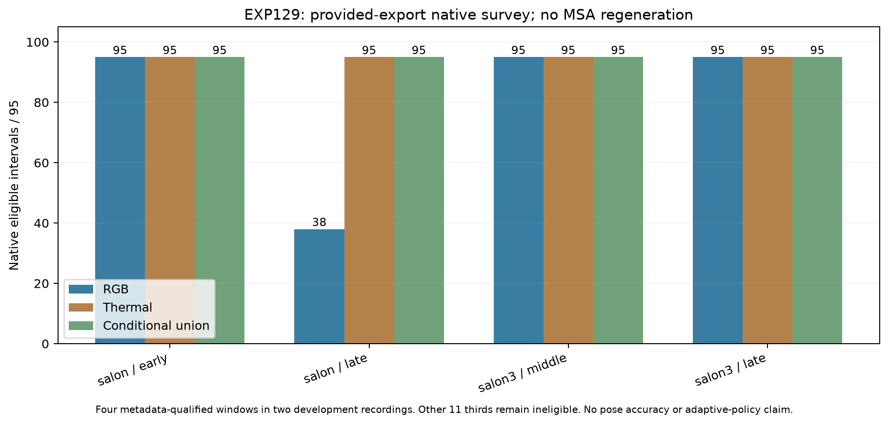

# EXP129: native survey of exact archive-provided exports

2026-11-04 / ore_ms. Source freeze126b4fe35. Exploratory after input inspection;
no native outcomes were available at that freeze. This is a distinct provided-
export benchmark, not a successful repetition of EXP128's failed MSApreparation.

Four of15predeclared chronological thirds qualified for100paired source groups
under EXP128's fixed metadata rule. Allfour receive one fresh dense dual capture.
There are0windows with positive conditional availability headroom above
the better fixed camera. Eight native expert observations complete, with
0strict terminal zero-match failures preserved asFAILED, never successfulVO.

## Exact population and outcome

| Fixed window | RGB eligible / 95 | Thermal eligible / 95 | Union / 95 | Conditional headroom above better fixed | Native RGB / thermal status |
|---|---:|---:|---:|---:|---|
| night_thermal_so_salon/early | 95 | 95 | 95 | 0 | PASS_EXECUTION_ONLY / PASS_EXECUTION_ONLY |
| night_thermal_so_salon/late | 38 | 95 | 95 | 0 | PASS_EXECUTION_ONLY / PASS_EXECUTION_ONLY |
| night_thermal_so_salon3/middle | 95 | 95 | 95 | 0 | PASS_EXECUTION_ONLY / PASS_EXECUTION_ONLY |
| night_thermal_so_salon3/late | 95 | 95 | 95 | 0 | PASS_EXECUTION_ONLY / PASS_EXECUTION_ONLY |

| Measured recording subset | Slots | RGB | Thermal | Union | Conditional headroom |
|---|---:|---:|---:|---:|---:|
| td3/20251027/night_thermal_so_salon | 190 | 133 | 190 | 190 | 0 |
| td3/20251027/night_thermal_so_salon3 | 190 | 190 | 190 | 190 | 0 |

All380guarded interval slots remain. Bounds are local to actually executed
histories:U−max(R,T)=min(RGB-only,thermal-only). A better fixed camera is identified
retrospectively for the bound, not installed as a policy. The4windows are two
sampled recording subsets, not four independent test records or entire captures.
The11metadata-ineligible thirds and their three unmeasured recordings are not
scored as native failures and are not replaced with other scenes.

There are0sustained healthy–failed–returned native-support triples with
>=3pairs in every phase across these8health series. This is tracker support, not
physical sensor-fault detection or measured pose accuracy. All short/failed native
runs and source timestamps remain in the machine-readable survey. No cross-window
stitching or pooling of this input recipe with the earlier MSAcohort is permitted.

## Why this is separate from EXP128

EXP128strict original-producer parity fails on all800provided thermal images;
the frozen MSA target also reproduces none exactly. Original gray MAE is small
(roughly0.04–0.19 levels), but exact equality was required. Its first failed prep
attempt, raw source associations, source/config/metadata hashes and all800diagnostic
rows remain unchanged. No tolerance or substitute recipe converts that test toPASS.
The cause of the source mismatch is not established. No MSAnative inference ran.

EXP129 is declared separately after these source diagnostics and before model
outcomes. It bytecopies the archive's actual provideduint8RGB/thermal files and
exportedcamera-info data.yaml. It does not require pretending their producer is
reproduced, does not regenerateMSAimages, and makes no MSAcandidate-transfer claim.
There is no input contrast/normalization/calibration/clock fit. The native
TD3adapter's original uint8BGR/gray-to-RGB unit scaling is unchanged.

The question here is whether the **provided exports**, under their own recorded
camera-info and the inherited acknowledged provisional geometry, produce native
eligible motion in the exact selected windows. Source bytes/calibration metadata
are auditable; physical mounting, source-rectification correctness and independent
reference quality remain unverified. This narrower benchmark is not an accuracy
or uncertainty-comparability result.

## Unchanged execution and failure semantics

Keep the released RGB and thermal checkpoints,seed0,FP32,native matching/solver,
mappingfalse,serialoptimizer and exact compiler image44ff9a1e unchanged. The
existing geometry_support_replay runs without the geometry observer, processing
both cameras densely. Its already tested terminal wrapper accepts only completed
nativeNo visual matches were retained with all99pairs unsupported,0retained
observations, complete observer and no optimizer submissions. The originalFAILED
report/no-motion status is retained. Other errors propagate; no native retry or
replacement window occurs.

Original source frames/left timestamps/native endpoints and current source-group
processing deadlines remain. Eligibility requires supported exact adjacent native
health and first non-interpolated processing motion by the original next-group
decision. Shutdown writeback cannot fill a missing interval. RGB and thermal
camera-local native endpoints/frames are different: this is readiness/coverage,
not validated common-body motion switching or fusion.

The candidate health/readiness/cache/catch-up policy remains frozen and is not
run or validated by this dense survey. The legacy raw advisory chooses among
completed current outputs; its contract differs from pre-processing forecasting
as established in EXP126. No camera preference or new selector is adopted.

## Validation

All1,600source images and16camera-infofiles are exact copies of their archive
sources. ZIPCRC/SHA,dtype/dimensions and finiteP/nonzero stereo baseline checks
pass6,457input checks. These establish native schema/source fidelity,
not physical calibration. Native audit passes4,756checks over all380
core rows,8expert outcomes, original endpoints, actual deadlines, source/capture
locks and preserved terminal failures. Its frozen independent implementation is
reused with only the explicit new artifact root/plan/integrity binding; no
eligibility arithmetic is altered. All2169source/input
pins verify. Capture files and input locks are immutable. No pose references,
reserved records, training, new weights, source messages or production defaults.

## Research interpretation

This is a bounded development survey and a source-contract diagnostic. It does
not establish that unmeasured thirds lack complementary availability, that either
camera is physically accurate, that the MSAsystem is validated on these sources,
or that any learned uncertainty/selection method improves VO. Interpret positive
headroom only as a discovery lead requiring a separate frozen confirmation; if
headroom is zero, retain the lack of availability pressure on these measured
exports instead of fitting another selector to them.

The useful next source questions concern the actual processed-thermal producer/
configuration/library version and input/calibration provenance for these recordIDs,
plus the previously unresolved reference/frame/time/quality evidence. Exact native
output/interval and request-admission contracts remain distinct. Existing data
were sufficient for this benchmark; no extra imageupload or reserve access was
needed. A [focused source-question draft](five-recording-source-questions-2026-11-04.md)
is prepared locally, not sent.

Artifacts:results/provided-export-survey/run-001. Input/preflight/failure ancestry:
results/five-recording-survey/run-001. Combined Box recovery:
backups/2026-11-04-five-recording-survey, with original runtime/model dependencies.

## Concrete research opportunity found by this survey

Both native experts are eligible on323/380guarded intervals:salon early95,
salon late38,salon3middle95,salon3late95. All8nativeexperts return
PASS_EXECUTION_ONLY. This is a larger new jointly-supported **development** pool
for a future quality comparison; it is not evidence that their motions are equally
accurate or that uncertainty can choose correctly. Thermal covers380/380,so
availability-only adaptation has0conditional coverage headroom in these windows.
No new selector fit or availability-success claim follows.

Salon lateRGB has59initial unsupported pairs followed by40supported pairs across
its full99pair history. It starts unsupported; there is no preceding healthy phase
inside this window, so it is not a healthy–failed–returned demonstration. The other
7native camera histories are supported throughout. Windows are not stitched.

Previously verified ZIPdirectory metadata lists SuperOdometry info/data/interpolated
pose/timestamp files and NovAtel info for both measured recordings. No reference
member payload is read in this survey; filenames alone do not attest reference
coverage, independence, axes, clocks or applicable body anchors. These are concrete
existing source leads. The next useful step is a source-backed, explicitly
qualified provided-reference **quality-headroom** audit on these323joint outputs,
with matched IDs and coverage retained. Check reference/time/frame metadata first,
freeze interpretation before errors, and keep independent physical/network-held-out
claims separate. Do not tune another availability gate on this saturated target.
