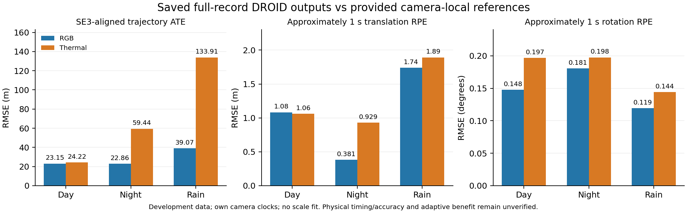

# EXP142: full-record DROID provided-reference baseline

2026-11-05 America/New_York. Parent EXP141 / 79339e882. Prediction/scoring freeze
`c1e5f4a5c` precedes all new reference matrix reads.

**All six existing latest declared DROID streams can be scored on their complete
source populations. RGB has lower SE3-only ATE in day, night and rain. Thermal
has slightly lower approximately-one-second translation RPE in day, but higher
rotation RPE there and worse ATE. These are conditional provided-reference
development results, not physical accuracy, a heldout benchmark or an adaptive
RGB–thermal benefit.**

The official loader pairs odometry with image stems and returns absolute poses
relative to the sequence's first image. The dataset describes navigation-derived
left-camera reference poses. Each camera here uses its own exact source stems,
reference camera and recorded left-clock nanoseconds. No mixed-camera transport,
clock search/correction, scale fit, extrinsic fit, inference or training occurs.
[Pinned official loader](https://github.com/UkcheolShin/MS2-MultiSpectralStereoDataset/blob/0bb0fc1a544d8ad58c7fda5bc025cb0cbb400284/dataloader/MS2_dataset.py#L291)
and [official format](https://sites.google.com/view/multi-spectral-stereo-dataset/data-format)
are preserved as source snapshots. Their conventions are not independent physical
exposure/clock or calibration verification.

## Fixed predictions and full populations

Use EXP141's latest attempts under its predeclared capacity/layout rules, with no
reference-based run selection. Original day/rain successes, the two original night
capacity stops, and the two night packed32 backend failures remain preserved. The
two corrected 4096-slot night attempts retain all active/reserve feature bits;
this evaluation does not rerun or reselect them.

All **55,618/55,618** estimator slots have finite offline poses, one segment per
stream, no resets and terminal success. This is availability of saved offline
backend/filler output, not a causal timing or tracking-correctness claim.

| Condition / camera | Source poses | Valid provided references | SE3 ATE (m) | Origin ATE (m) | ~1 s translation RPE (m) | ~1 s rotation RPE (deg) | Qualified RPE pairs |
|---|---:|---:|---:|---:|---:|---:|---:|
| Day RGB | 5,810 | 5,809 | 23.149546 | 41.665506 | 1.081582 | 0.147769 | 5,411 |
| Day thermal | 5,810 | 5,808 | 24.218242 | 50.253098 | 1.059462 | 0.196824 | 5,412 |
| Night RGB | 10,131 | 10,129 | 22.855692 | 56.553165 | 0.380549 | 0.180726 | 9,382 |
| Night thermal | 10,131 | 10,128 | 59.439284 | 116.101897 | 0.929137 | 0.197644 | 9,403 |
| Rain RGB | 11,868 | 11,867 | 39.069333 | 174.792435 | 1.739123 | 0.119324 | 11,335 |
| Rain thermal | 11,868 | 11,867 | 133.914598 | 274.453334 | 1.892469 | 0.144206 | 11,333 |

Values are RMSEs from the unchanged v2 scorer. SE3 alignment never fits scale.
The equal-recording mean SE3 ATE is RGB **28.358190 m** and thermal **72.524041 m**;
mean translation RPE is **1.067085 m** and **1.293690 m**, respectively. These are
arithmetic means of the three recording-level RMSEs per modality, not pooled
interval RMSEs or a population-generalization estimate. All individual conditions
remain visible; no confidence interval is inferred from correlated intervals.

## Reference exclusions and recorded-time support

The scorer excludes ten nonrigid source reference matrices under the inherited
1e-5 rule. Their source stems remain in all source/pose denominators:

| Stream | Excluded reference stems |
|---|---|
| Day RGB | 002018 |
| Day thermal | 004749, 004955 |
| Night RGB | 004773, 009443 |
| Night thermal | 004774, 004867, 004931 |
| Rain RGB | 009734 |
| Rain thermal | 007799 |

All **52,276/52,276 reference-qualified RPE pairs** are scored. This denominator
already excludes intervals outside the 1–1.15 s endpoint window, intervals with
source gaps above 150 ms, and intervals crossing invalid reference poses. It is
not coverage of every possible pair or proof of uniform acquisition. The longest
gap-free source runs are 616 day, 869 night and 1,077 rain frames per camera.
All six satisfy the frozen engineering-success flag; that flag tests completion,
resets and qualified coverage, not an accuracy threshold.

## Validation, source access and recovery

Fifteen analytic adapter/scorer tests pass before reference reads. The independent
geometric auditor reconstructs source axes, exclusions, Kabsch/origin alignment,
relative translation/rotation, each RPE duration, coverage, segments and aggregates
from raw matrices: **213,088 checks and 30 rejected mutations**. A separately
declared supplemental source audit directly compares every extracted matrix byte
with its original TAR member and pinned archive: **166,861 checks / 9 rejected
mutations / all 55,618 members equal**. The supplemental check was added after
the geometric audit to close the archive-to-extracted-file identity explicitly;
original scores, predictions, source pins and acceptance tolerances stay unchanged.
Combined: **379,949 checks and 39 rejected mutations**.

The EXP040 recovery packet, containing these historical development references,
was downloaded during source discovery before the new prediction lock. Its
reference matrix members were unopened until after freeze commit `c1e5f4a5c`.
This is declared development-data reuse, not prospective payload acquisition or a
heldout result. Three archive hashes are bound to the historical backup manifest;
each newly extracted member has its own SHA-256. No NIR/LiDAR/depth reference
member, reserve recording or new recording is extracted into the evaluation.

Protocol: `experiments/provided-reference-full-record-2026-11-05.json`.
Results and raw references: `results/provided-reference-full-record/run-001`.
The original EXP133 benchmark file is hash-pinned and unchanged; active validation
and test assignments remain empty. No production default or selector is adopted.
Recovery: `backups/2026-11-05-provided-reference-full-record-exp142`.

## Consequence for the next comparison

Full offline completion alone did not produce small long-trajectory errors, and a
blanket night-thermal preference is not supported by this DROID development case.
The small day translation-RPE difference is not evidence for a deployable selector,
and none of these separately camera-local scores measures same-time cross-camera
selection headroom. Large trajectory/reference disagreement does not identify
whether tracking drift, preprocessing, reference conventions or timing caused it.

The next discriminating control is a separately frozen complete-record ORB-SLAM3
comparison using the same already prepared per-camera images and the same scoring
contract. That can distinguish a DROID-specific pattern from one shared by another
visual baseline under the provided conventions. Keep source-time/calibration
limits explicit; do not tune a selector or covariance model to these outcomes.
