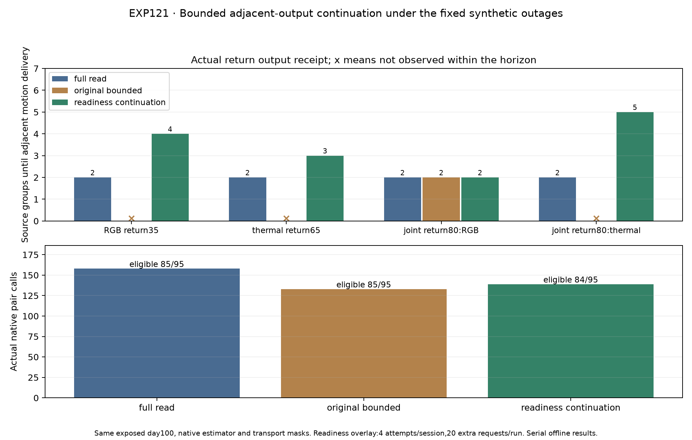

# EXP121: continuation restores return output but fails the handover availability gate

Date: 2026-11-03, America/New_York. Parent EXP120 / 4ee294435. Execution freeze c3e76e894; scoring/audit implementation 5c8fb50b9.

**The frozen development contract FAILS. Readiness continuation restores on-time adjacent output in all four declared return episodes, using 12 of 20 permitted extra requests and at most three of four attempts per session. However, eligible preselected deliveries fall from 85/95 to 84/95, with one extra unavailable selection at handover. The candidate is not adopted.**

This is a bounded synthetic-input experiment on exposed day100, with unchanged original weights, native estimator/solver, sensor-time mapping and outages: RGB20–34, thermal50–64, both75–79. There is no training, reserve access, natural-fault or physical-accuracy claim.

## Frozen mechanism and controls

The overlay invokes the original health-based planner for selection and base requests. It can only add inactive-camera continuation requests. A session finishes only when a supported first processing write has exact adjacent original source endpoints, ends within the session and arrives during the immediately following source invocation. Old, gap, late and terminal writes cannot satisfy it. Native health failures remain visible; transport failures close sessions without advancing native endpoints. Active promotion/common refresh return control to the base request path.

Hard caps are four requested attempts per session and twenty extra requests across the run. These count attempts even if transport subsequently fails. The native optimizer/writeback contract, one-second TTL/period and two-request base bursts stay unchanged. No readiness observation forces a camera selection.

Four fresh dual captures compare unperturbed full-read passthrough, perturbed full-read, original bounded and readiness-enabled bounded. All share the same dual root/bootstrap/guards and explicit request-scoped synthetic transport feedback. Unrequested input availability is hidden. A requested outage is signaled immediately; silent packet-loss detection is not tested.

## Primary criteria

| Frozen criterion | Outcome |
|---|---|
| Adjacent return observed in all four episodes | PASS |
| Eligible selections >= original bounded | FAIL |
| Unavailable selections <= original bounded | FAIL |
| Uncommitted while opportunity <= original bounded | PASS |
| Fewer actual pair calls than perturbed full-read | PASS |
| At most 20 extra requests | PASS |
| At most 4 attempts/session | PASS |
| Strict unperturbed source-array parity | PASS |

The two failed availability criteria describe the same added miss, not two independent regressions. No thresholds, budgets, policies or output populations were changed after native results.

## Delivery, costs and qualified proxy losses

| Policy | Eligible /95 | Selected unavailable | Uncommitted with opportunity | Pair calls | Native run seconds | Matched T RMSE (m) | Matched R RMSE (deg) |
|---|---:|---:|---:|---:|---:|---:|---:|
| full_read_cache | 85 | 4 | 1 | 158 | 55.903 | 0.066281 | 0.561573 |
| bounded_probe | 85 | 4 | 1 | 133 | 46.954 | 0.066338 | 0.561550 |
| readiness_probe | 84 | 5 | 1 | 139 | 49.067 | 0.066300 | 0.561546 |

All proxy comparisons use the same **84 exact core source intervals eligible in all three policies**. They retain the unchanged nominal-body stationary-twist projection and recorded-SLAM reference protocol. References are read only after capture and prediction locks. Tiny matched-error differences do not compensate for the predeclared availability failure or establish physical accuracy.

Candidate pair calls 139 are below full-read 158 (12.0% fewer) but exceed original bounded 133. Its 12 overlay extras are request additions relative to its own evolving base prefix, not 12 net calls compared with a different run: feedback and actual elapsed time change later base probe phases. Native processing 49.067 seconds is below full-read 55.903 but above original 46.954. These are single synchronized offline measurements on this hardware, excluding model startup/separate first-depth probes, not live-throughput or energy estimates.

## Return episodes

| Restored camera / source | Full-read delivery | Original bounded delivery | Continuation delivery | Continuation source-group delay |
|---|---:|---:|---:|---:|
| rgb / 35 (rgb_outage) | 37 | not observed | 39 | 4 |
| thermal / 65 (thermal_outage) | 67 | not observed | 68 | 3 |
| rgb / 80 (joint_outage) | 82 | 82 | 82 | 2 |
| thermal / 80 (joint_outage) | 82 | not observed | 85 | 5 |

The unchanged censoring horizons are 49 for RGB return 35, 74 for thermal return 65, 97 after joint return 80. Latencies refer to actual output receipt source groups, not merely the target interval ending frame. All four return episodes now have adjacent output; this repairs the specific inactive-return observation gap tested here. It does not make that readiness persist through later idle frames.

## The handover failure

Both original bounded and candidate preselect RGB at source 51 after the active thermal request fails at 50. Original bounded had processed RGB 49 and 50, so the new motion is adjacent50→51 and is delivered at 52. The candidate had just completed an inactive readiness session over requested sources 47,48,49: its evidence was adjacent47→48 written at 49. It then skipped RGB 50. At handover 51, its new native interval is49→51, a gap, and cannot satisfy the adjacent50→51 target. Its first eligible alternate output is target 52 written at 53, one group later than the original policy.

Fresh cached health and a previously delivered adjacent estimate therefore do not guarantee continuity for the next handover target. The candidate obeyed its own fresh-state selection rule; the extra miss is a structural current-source continuity issue, not a request-cap violation or incorrectly relabeled gap. The last healthy pre-outage targets 49/74, onset failures 50/75 and joint-outage abstentions remain explicit as in the controls.

## Session budget and validation

There are 20 sessions: 13 satisfied and 7 closed on transport failure. Twelve sessions use three attempts, two use two attempts and six use one. No session exhausts the 4-attempt cap; total extras 12 remain below 20. Every evidence record retains its native endpoints, first-write sequence, triggering source and receipt timestamp.

All four dual captures / eight native experts complete. Forty-three focused tests pass, including ten new readiness/cap/spawned-controller tests. Independent audit passes **28,412 checks** across 285 core rows and four native timelines. It independently reconstructs base and overlay requests, budget/session transitions, native feedback, exact endpoints/ordinary deadlines, return latency, reference interpolation, matrix-log projection and scalar errors. All 951 execution source/input/model pins remain unchanged.

Unperturbed passthrough is bitwise exact across all 5,226 NPZ arrays against EXP120. Software validation passes while the scientific development contract fails; both outcomes are preserved. All native journals, sessions, masks, exclusions, costs and capture/prediction locks remain intact.

## Remaining boundary

The next distinct problem is handover source continuity, not simply obtaining one adjacent inactive output. A follow-up should separately freeze continuity-aware admission or bounded buffered catch-up, specify what past inputs may be retained/requested, and charge every extra invocation against the same source/deadline and cost rules. Admission alone can avoid promising an unavailable output but cannot invent the missing prior frame or recover its motion. No such follow-up or parameter tuning is performed here.

This remains synthetic immediate input-failure feedback in serial offline execution. Natural sustained failure/return recordings, real queue/buffer constraints and justified physical references are still needed for broader recovery/accuracy claims. Existing exposed inputs suffice for another bounded software test; no upload is requested.

Artifacts: results/readiness-continuation/run-001. Backup: backups/2026-11-03-readiness-continuation. Original inputs/weights/compiler EXP112; base runtime EXP106; unperturbed and inherited coverage prerequisites EXP120.
