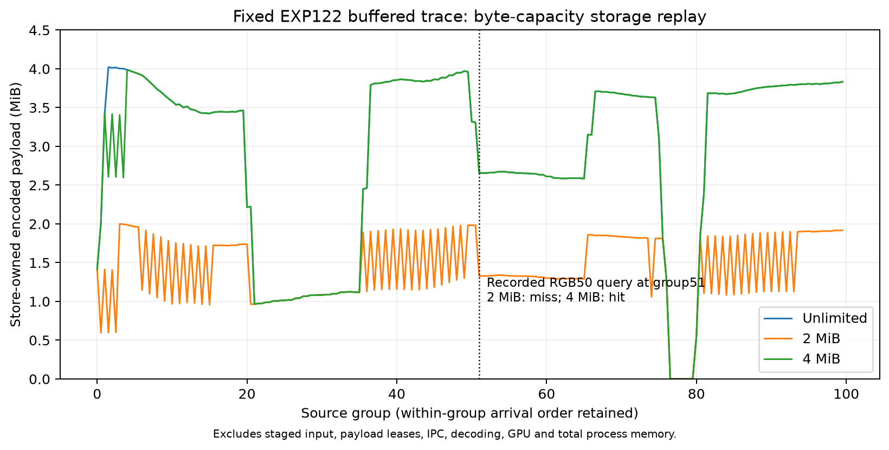

# EXP123: encoded retention capacity replay

Date: 2026-11-03. Branch: ore_ms. Parent: 521bfa164; execution freeze: 8360c23b3.

The fixed-trace storage contract passes all 30 cases. A 2 MiB encoded store loses
the predecessor used by the EXP122 handover repair. A 4 MiB store retains that
particular frame despite other evictions. This is a storage availability result:
no estimator ran, future actions were fixed, and no bounded-memory native delivery
rate, live deadline or deployment budget is established.

## Design and cost boundary

The new opt-in CapacityInputBuffer keeps the EXP122 current/prior per-camera
source lifetime and synthetic input outages. The shared store rejects an oversize
stereo pair atomically. Otherwise it evicts oldest source globally, RGB before
thermal on ties, until the whole pair fits. All actual encoded ingress is read
and hashed, including pairs later rejected. The historical controller, native
worker, solver, weights and production defaults are unchanged.

The cap covers only bytes referenced by store-owned entries. Staged input,
returned payload leases, Python metadata, transient copies, IPC, decoder/GPU
memory, total RSS and OS cache are excluded. It is not a total-memory limit or
acquisition/bandwidth saving. A retrieved payload can outlive its store entry;
bounded worker leases and backpressure remain necessary for a full service.

Before outcomes, freeze unlimited/0/2/4/8 MiB, deterministic policy, protocol,
tests, independent auditor, six prior arrival/query traces and 979 source/input
pins. Replay each case once with actual original encoded images, using the
recorded arrival order and querying immediately after the matching camera's
arrival. Preserve all future fixture actions even on a miss. No reference labels,
new neural calls, reserve access, fitting or new data acquisition.

## Recorded buffered-trace result

| Capacity | Peak retained bytes | Evicted pairs | Rejected pairs | Recorded query |
|---|---:|---:|---:|---|
| Unlimited | 4,217,128 | 0 | 0 | hit |
| 0 MiB | 0 | 0 | 160 | miss |
| 2 MiB | 2,096,485 | 140 | 0 | miss |
| 4 MiB | 4,180,804 | 5 | 0 | hit |
| 8 MiB | 4,217,128 | 0 | 0 | hit |

The fixture_on trace gives the same storage outcomes. These are the same RGB50
query at group51 in two request fixtures, not independent recovery episodes.
The other four traces contain no catch-up queries; their zero query counts are
not successful recoveries. All five perturbed traces have identical physical
arrivals and therefore identical capacity states.

At 2 MiB, admitting RGB51 evicts RGB50: the encoded pairs total 2,785,381 bytes,
which exceeds 2,097,152. The 4 MiB store keeps both for the recorded query. Across
the perturbed trace it still evicts five other pairs and peaks at 4,180,804 bytes.
Unlimited and 8 MiB peak at 4,217,128 bytes and evict none. Thus 4 MiB does not
reproduce all unlimited retention state, even though this one query succeeds.
No search for a minimum sufficient capacity or alternative eviction policy occurs.

All perturbed cases still read 156,530,123 encoded bytes. At zero capacity all
160 available stereo arrivals are rejected (40 unavailable camera-arrivals store
nothing). The unperturbed input stream reads 196,713,504 bytes, with 200 available
arrivals; its 4 MiB case evicts nine pairs and peaks at 4,188,901 bytes.

## Validation

58 focused tests pass, including seven new tests for budgets, atomic stereo
rejection, global/tie eviction, exact original bytes after file changes, TTL,
outages and strict arrival ordering. The independent metadata-only oracle imports
no capacity implementation and passes 60,342 checks across 30 cases and 6,000
arrival states. It reconstructs expiry, admission, evictions, full store states,
byte counts, exact image metadata/hashes, query results and counters. All 979
execution pins and replay artifact hashes verify.

Unlimited replay matches each EXP122 arrival's stored images, expiration and
per-camera retention, plus original total ingress, peak payload, query availability
and retrieved bytes. Both historical catch-up query payloads match their exact
source-image hashes. All case outputs were exclusively created and locked before
analysis; no case retries or source changes after freeze.

A preliminary plot placed RGB before thermal within every group despite the
recorded order changing in this interval. The corrected display uses arrival
ordinal/2; both plot attempts are retained. Data, capacity policy and metrics
were unchanged.

## Next evidence

Integrate a fixed byte budget with explicit worker lease ownership and bounded
IPC/backpressure, then run a separately frozen native replay with actual queue
and acquisition deadlines. Storage-query success alone does not establish the
EXP122 delivery count under that service. Existing exposed inputs suffice for
bounded engineering; sustained natural availability transitions and independent
pose references remain needed for broader recovery and accuracy claims.

Artifacts: results/retention-capacity/run-001. Backup: backups/2026-11-03-retention-capacity.
Prerequisite: EXP122 for arrival/query traces, source images and inherited runtime.
