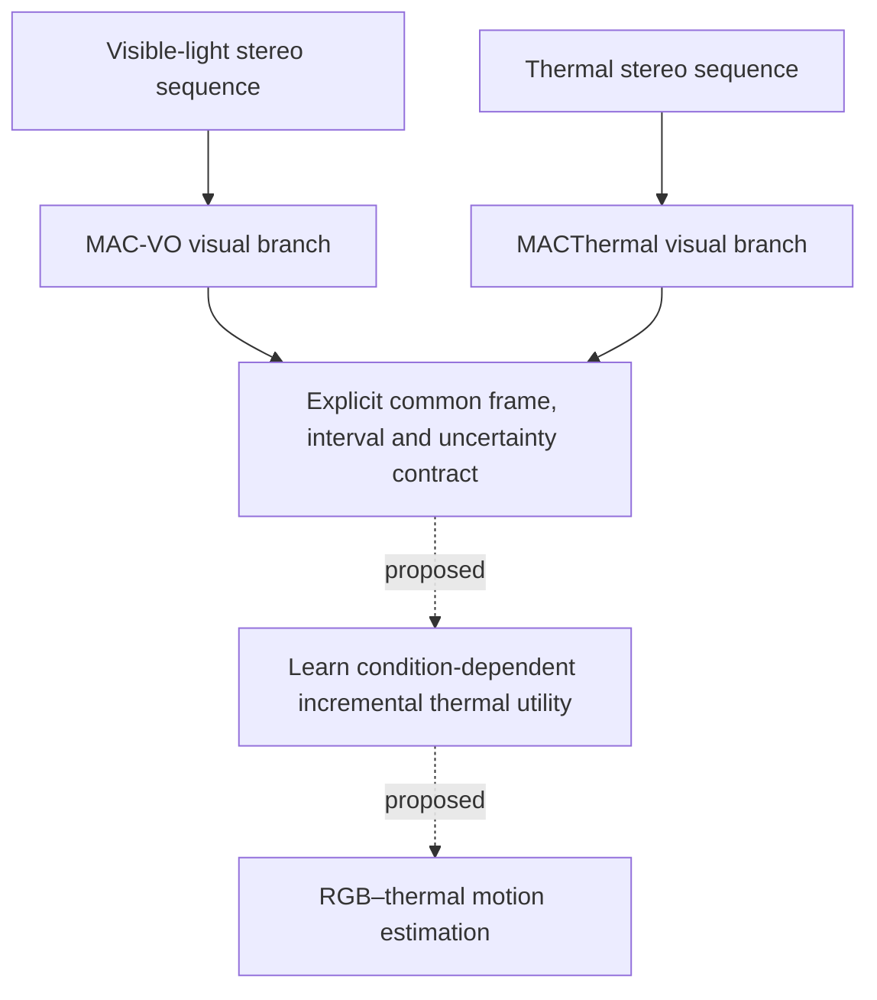

# RGB–thermal architecture and contribution reset

**Execution update:** The [local relationship learning comparison](local-relationship-learning-findings-2026-11-14.md)
is complete. The design and next-step language below records its pre-execution
state; do not treat qualification or the40update run as pending.

14 November 2026, America/New_York. Branch `ore-ms-orb-development`, baseline
`53afa19d1` plus documented local studies. Architecture clarification and scope
update; no new implementation, inference, training or experiment execution.

## Starting systems

| System | Estimation inputs in the described setup | Role |
|---|---|---|
| MAC-VO | Visible-light left/right stereo images over time | Visual motion and geometry using learned matching/depth uncertainty. |
| MACThermal | Thermal left/right stereo images over time | Thermal adaptation of the MAC-VO matching/covariance pipeline for thermal stereo VO and mapping. RGB-derived architecture or synthetic training does not imply RGB input during thermal inference. |
| MAC-I² | MAC-VO visual estimates and IMU measurements | Learned visual/inertial uncertainty for initialization and camera–IMU calibration. Does not provide RGB–thermal fusion. |
| MAC-VIO in Xiang Fei's thesis | Stereo visual constraints and IMU preintegration | Continuous visual–inertial estimation. Distinguish this thesis system from similarly named downstream integrations. |

The user initially understood MACThermal to already fuse RGB and thermal. It
does not provide that starting architecture. Earlier discussion should have made
this distinction explicit. Our RGB–thermal fusion studies are local extensions,
not evaluations of an original RGB–thermal fusion layer inside MACThermal.
MACThermal's accurate thermal odometry objective remains valid independently of
whether adding its observations to strong RGB improves a joint estimator.

Primary source basis, already inspected in this project:
[MACThermal thesis, sections 3.3–3.5](https://publications.ri.cmu.edu/storage/publications/2025/12/YifeiLiu_CMU_MSR_Thesis_ThermalOffroadAutonomy.pdf),
[MAC-I² paper](https://arxiv.org/html/2609.07116v1), and
[visual–inertial thesis](https://publications.ri.cmu.edu/learned-metrics-aware-covariance-for-visual-inertial-fusion).
No fresh paper reading or author-system reproduction is claimed by this reset.

## Proposed extension

The proposed relationship layer would learn how sensor characteristics, local
matching/depth geometry and temporal evidence condition the relative usefulness
of RGB and thermal observations for a common motion estimate. It is a hypothesis,
not an implemented or validated new model. It is not merely a scalar conversion
between the two uncertainty outputs.

These are logical processing branches, not a requirement for two independent
persistent estimators or two complete pose graphs. A shared geometric backend
can consume both branches' measurements. Pose-level fusion and factor-level
weighting are different implementations; the new learned layer's interface is
not selected by this document. Any common contract must retain source timestamps,
extrinsics, measurement units, uncertainty type and missing-data behavior.
Pixel/disparity covariance, 3D point covariance and pose covariance cannot be
compared as interchangeable confidence scalars. Frame transport alone does not
make their statistical scales comparable or synchronize acquisition intervals.

IMU fusion is an optional future extension, not part of the recent RGB–thermal
experiments or the presently proposed two-modality question. MAC-I² can inform
uncertainty propagation/fusion design; substituting a thermal input is not an
already demonstrated MAC-I² result.

## Research objective and proposed contribution

**Question:** Can local sensor-conditioned evidence predict when and how thermal
observations improve a reliable RGB-based motion estimate?

**Proposed contribution, not yet established:** A condition-aware RGB–thermal
measurement-use method that exploits useful thermal information beyond RGB to
improve pose/trajectory accuracy under stated conditions, or preserves accuracy
with lower measured end-to-end computation, relative to strong applicable controls.

A scoped, repeatable improvement is enough to advance a candidate. It need not
work best in every environment or solve uncertainty calibration universally.
Report favorable conditions and regressions together. Better confidence scores,
flow metrics, formal information, or reference-informed oracle gains alone do
not establish improved VO. A compute claim must include the relationship layer's
and both branches' measured costs; reduced backend factor count alone is not a
system-level computation saving.

## What the experiments actually tested

| Evidence family | What was tested | What it does not establish |
|---|---|---|
| MACThermal publication | Thermal-specific matching, uncertainty, stereo estimation and mapping | An existing RGB–thermal uncertainty relationship model. |
| Our saved-pose fusion | Selection or blending of completed RGB/thermal motions, including summary-feature regression | A dense/local learned sensor-characteristic representation or full shared-state native estimator. |
| Our shared-factor/window studies | Specific joint geometric objectives and limited learned measurement weights | That every shared backend or condition-aware relationship is ineffective. |
| Latest image-feature comparison | Eight geometric summaries plus eight global image/KLT summaries on matched nominal 100-group cohorts | A test of a rich local cross-modal representation. Day/night choose RGB; rain regresses. |
| Latest local factor comparison | Standard information/uniform allocation of 64 accepted factors in a conditional fixed-source solver | A trained local relationship layer, full native trajectory improvement or compute saving. Uniform thermal gives translation gains with rotation costs. |
| Synthetic oracle analyses | Reference-informed best convex translation blend | Achieved or deployable relationship prediction. Different cohorts/timing conventions must remain separate. |

Details: [image/temporal comparison](thermal-incremental-comparison-2026-11-14.md),
[local geometry](local-thermal-geometry-findings-2026-11-14.md),
[earlier component fusion](translation-fusion-findings-2026-11-09.md),
and [shared-factor controls](nominal-joint-motion-findings-2026-11-12.md).
The experiments remain useful groundwork; neither their negative configurations
nor their scoped positive results settle the proposed learning question.

## Existing RGB–thermal work and contribution boundary

MSO already combines RGB, thermal and inertial constraints with uncertainty-aware
adaptation. Optical/thermal handover and reliability-driven parallel tracking
also precede this proposal. Generic multisensor fusion, thermal fallback,
information-based selection, and learning modality weights are not our novelty.
See [MSO method review](mso-method-overlap-review-2026-11-12.md) and
[handover prior-art decision](rgb-thermal-handover-prior-art-decision-2026-11-14.md).
A new layer needs a specific mechanism and benefit beyond applicable published
and simple controls; using MAC-VO/MACThermal backbones alone is insufficient.

## Next decision before a new learned-model run

Choose the layer's actual interface and target: local observation influence in a
shared estimator or correction/fusion of completed poses. Specify which available
thermal/RGB factors explain incremental utility and how it differs from existing
learned weighting/representation baselines. Bind common frames/intervals and
recording-level data splits, then fix one comparison with RGB-only, thermal-only,
simple fixed fusion and a matched-capacity input ablation. Include an applicable
published or clearly labeled method-inspired RGB–thermal baseline where feasible.

The current evidence motivates this question but does not yet select a new model,
loss, numerical freeze or training run. Do not repeat the closed global-summary
or logDet configurations as pending work. The historical empirical transfer-limit
study remains reportable supporting analysis; it is not the user's sole intended
research outcome. Broader foundational-paper gaps stay open.
