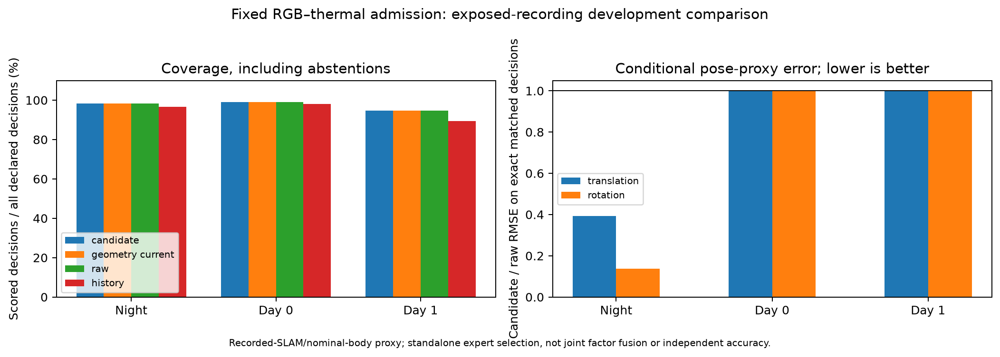

# Fixed RGB–thermal admission comparison: one known recovery, no memory increment

2026-11-02 America/New_York. EXP112, six exposed windows / three recordings.
**The fixed candidate fails the per-record improvement criterion. It changes
exactly one raw choice, the previously known RGB recovery at middle/96. The
current-geometry-only control makes identical choices on all 274 decisions:
recovery confirmation adds no empirical benefit in this population.**

No policy, threshold, budget, model or input-window tuning. Neither a memory model
nor a geometric gate is adopted. This is independent native expert motion selection,
not joint measurement-level fusion or demonstrated other-sensor generalization.

## Frozen design and actual execution

Use the approved [direction](sensor-admission-direction-2026-11-02.md) and
[fixed policy](sensor-admission-comparison-protocol-2026-11-02.md). Original RGB and
thermal checkpoints, native weights, selection/filters/solver and all six EXP091
windows remain fixed. Two cameras run continuously. Nominal-body right-tangent
Gaussian information is derived from returned native disparity factors, propagated
through the same existing stationary-twist interval model. Budgets remain 0.1 m /
1 degree, minimum normalized information eigenvalue at least 1, with two adequate
supported pairs for confirmed recovery and the declared current-evidence exception.
These are engineering budgets, not calibrated probability/error guarantees.

Original freeze `db7aa7b51`; compiler runtime amendment `32c8cca66`; scoped
preservation amendment before policy prediction/scoring `6e9297650`.
Final captures: twelve shared runs / twenty-four completed native expert runs /
1,120 frame executions. 274 declared decisions / 548 camera slots are retained.
All six original windows remain; no reserve, new training or scene replacement.

The first runtime lacked a C compiler. Its early off/on captures completed, but
night-middle off failed at the native Torch Inductor recovery path. Preserve its
partial outputs and error. A derived runtime adds GCC and required OS libraries,
including six upgraded C-runtime/development packages. All 181 Python package
entries remain identical; 78 tests and the formerly failing Triton driver-compile
probe pass. Refreeze and rerun every matched capture in that one runtime. Do not
mix earlier successful runs into the final comparison.

Final immutable runtime:
`sha256:44ff9a1e6fa95d220437714e5be9b94f0f73c8eaebd4fcae3f843ceea14bef09`.
Its exact Docker config/new layer and eight verified base layer references are
preserved as a 71,950,481-byte delta. Merging the delta with the already-backed-up
EXP106 base archive was verified. No additional full base image backup is needed.

## Preservation: original stronger gate failed, scoped check passed

The original demand that every serialized array match bitwise **failed**. Across
14,716 arrays, 14,518 match exactly and 198 differ: three derived target 3D
covariance arrays plus 195 local-depth-variance diagnostic arrays. Maximum relative
observed difference is 1.108461e-6; large absolute differences at extreme magnitudes
remain in the mismatch report. Cause is not established; do not assert that the
observer did or did not cause the diagnostic drift.

All native poses, active uv/disparity covariance, fixed points, learned-output
samples, selection/filter masks and remaining serialized arrays are exact.
All original native events (excluding sequence/clock/new geometry), effective
configs and raw actions/availability match exactly. No observer errors. The active
disparity graph does not use the changed 3D covariance as its optimization weight;
the sanity filter's actual masks also match, so indirect filter use is checked.

The separately committed [scope amendment](sensor-admission-preservation-amendment-2026-11-02.md)
preceded policy actions and label scoring. It retains the original FAIL and every
mismatch and permits **qualified descriptive scoring of the preserved active
estimator outputs**. No tolerance passes changed active values. This is not a
retroactive pass of the original stronger engineering gate. Completion records
must retain `strict_all_serialized_arrays_bitwise_preserved=false`.

## Fresh outputs and exact-matched proxy results

All 274 policy actions were locked before reference semantics were read for
scoring. Use fresh native motions and new errors against the original supplied
recorded-SLAM reference, not historical expert errors. Original static nominal
transforms/interval model/reference scope remain conditional and unverified for
independent physical accuracy or measured live deadlines.

Raw and candidate have the same available decision IDs, so each row below is an
exact matched comparison. Translation RMSE in metres, rotation RMSE in degrees:

| Recording | Scored / declared | Raw translation → candidate | Raw rotation → candidate |
|---|---:|---:|---:|
| Night, two windows | 116 / 118 | 0.101162 → 0.039674 | 4.702700 → 0.645755 |
| Day 0 | 98 / 99 | 0.031459 → 0.031459 | 0.124174 → 0.124174 |
| Day 1, three windows | 54 / 57 | 0.034459 → 0.034459 | 0.154488 → 0.154488 |

The current-geometry-only control is identical to the candidate on **every one of
274 decisions**, including abstentions and selected means. All strict per-record
quality criteria fail, including the required strict advantage over that control.
Day comparisons tie raw/RGB. Thermal-only remains slightly better than candidate
on night matched support: translation 0.039657 m versus 0.039674 m, rotation
0.645264 degrees versus 0.645755 degrees.

History scores 114 / 97 / 51 decisions, respectively, versus candidate/raw
116 / 98 / 54. Candidate and history select the same motion on every matched
interval; their matched translation and rotation errors are therefore identical.
The six extra scored decisions are the existing history rule's one-per-window
cold-start cost. This is a mechanical coverage distinction already represented
by previous fallback/state-shadow work, not a newly established quality gain.

## What changed, and what does it establish?

The only candidate/raw action difference is `middle/96` in the known night
recording. Raw selects RGB; candidate/current-geometry select thermal:

| Fresh quantity | RGB | Thermal |
|---|---:|---:|
| Translation proxy error, m | 1.003081432 | 0.040677771 |
| Rotation proxy error, degrees | 50.187673923 | 1.337598915 |
| Minimum normalized information eigenvalue | 0.007524453 | 1203.304038 |

The geometric rule rejects this RGB estimate without needing recovery memory.
The event contributes **100%** of raw-to-candidate matched squared translation
proxy reduction: 1.004517678 m². No other choice changes; both day reductions are
zero. This is the same known development event, not a newly discovered failure or
independent validation. The covariance/geometry quantities are conditional model
information, not probabilities of correctness.

This supplies a concrete example of a currently supported RGB motion with weak
modeled pose information while thermal remains strong. It does not show that
geometry is generally superior to covariance/support/count controls, that temporal
state adds value, or that the 0.1 m / 1 degree budget is transferable. Existing
history already avoids the same event. Larger memory or an agent remains
unjustified by this result; no architecture is selected.

A future claim needs additional declared conditions with informative camera
tradeoffs and comparisons against simpler support/count controls. Retuning these
windows would not establish transfer. RGB–thermal remains the first case; a third
sensor still requires an explicit independent measurement-type evaluation.

## Independent validation, limits and recovery

The auditor imports no producer policy, information transport, pose-reference
loader or scorer. It reconstructs all 451 native information events from saved
factors/returned poses, all 439 eligible common-interval transports using separate
matrix logarithm/exponential calculations, all 274 state/actions, independently
interpolates provider poses and recomputes every selected error and matched score.
51,654 numeric values pass; all 1,651 frozen source/input hashes and nine reference
hashes remain unchanged. Plot inspected. Audit status:
`PASS_INDEPENDENT_ADMISSION_AUDIT`. This does not certify physical references,
calibrated uncertainty or the failed all-array bitwise gate.

All matrices retain fixed-landmark/parent/extrinsic assumptions and omit robust
correction, damping, map/clock/model/cross-camera uncertainty. Keep recorded SLAM,
nominal rig geometry, unknown checkpoint training membership and offline serial
controller timing qualifications. The six windows are only three previously
exposed recordings. No physical, prospective, sensor-generalization or compute-
scheduling benefit is claimed. No threshold search, model fitting or adoption.

Artifacts: `results/sensor-admission-execution/run-001/` retains the original
runtime attempt; `run-002/` contains the final captures, preservation drift report,
locked source/mean/policy predictions, fresh labels, exact-matched scores,
independent audit, behavior diagnostic and figure. Original failed and scoped
checks are both preserved. Backup:
`ore_ms:ore-ms/backups/2026-11-02-sensor-admission-execution`; base runtime prerequisite
`2026-11-02-objective-comparison/runtime-image.tar.gz` and Git prerequisite
`66ca40390` from EXP111. Exact prepared inputs, reference files, original model
weights and compiler delta are included for bounded replay.
