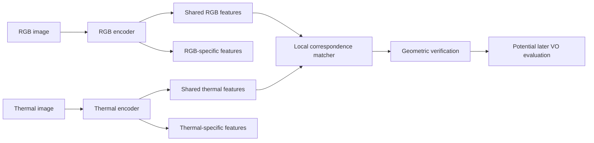

# Shared RGB–thermal representations: references and next research question

2026-11-09, America/New_York. Literature scoping requested after the characterization report. Primary publication pages, author abstracts and the cited CVPR correspondence paper were checked online. This is a reading note and proposed direction, not a completed reproduction or an executed training/evaluation protocol. The stopped angular-rule evaluation retains its original disposition.

## What a common sensor space means

Two modality-specific encoders can map RGB and thermal observations into a compatible feature space. Training encourages corresponding content to have similar features. This need not produce a fused image, and a common vector dimension alone does not establish alignment.

Three different goals need different evidence:

- Semantic alignment: recognize the same object or scene across sensors.
- Geometric alignment: match the same physical points across sensors and time.
- Reliability estimation: predict whether a match or motion is trustworthy.

Success at the first does not establish the second or third. For VO, local correspondence is the nearer target; scene-level semantic embeddings may be useful context but do not by themselves supply metric geometry or calibrated covariance.

## Papers to read and cite

| Reference | What the paper establishes or proposes | Relevance and limit for this project |
|---|---|---|
| Girdhar et al., **ImageBind: One Embedding Space To Bind Them All**, CVPR 2023. [Publication](https://openaccess.thecvf.com/content/CVPR2023/html/Girdhar_ImageBind_One_Embedding_Space_To_Bind_Them_All_CVPR_2023_paper.html). | Separate encoders and projection heads align six modalities, including RGB and thermal, using image-paired contrastive learning. Thermal training uses LLVIP pairs. | Direct reference for a common semantic embedding. Recognition/retrieval evidence is not evidence of dense geometric precision or calibrated cross-camera reliability. |
| Tian, Krishnan and Isola, **Contrastive Multiview Coding**, ECCV 2020. [Publication](https://www.ecva.net/papers/eccv_2020/papers_ECCV/html/1453_ECCV_2020_paper.php). | Contrastive multiview learning seeks compact representations of information shared across views. | Foundational explanation for learning shared factors from sensor views; does not itself establish an RGB–thermal VO solution. |
| Bousmalis et al., **Domain Separation Networks**, NeurIPS 2016. [Publication](https://proceedings.neurips.cc/paper/2016/hash/45fbc6d3e05ebd93369ce542e8f2322d-Abstract.html). | Domain adaptation with shared and domain-private representations, task supervision and reconstruction. | Architectural precedent for retaining sensor-specific information alongside shared structure. This is a domain-adaptation reference, not direct validation of RGB–thermal fusion. |
| Shrivastava and Owens, **Self-Supervised Spatial Correspondence Across Modalities**, CVPR 2025. [Paper](https://openaccess.thecvf.com/content/CVPR2025/papers/Shrivastava_Self-Supervised_Spatial_Correspondence_Across_Modalities_CVPR_2025_paper.pdf), [record](https://arxiv.org/abs/2506.03148). | Learns cross-modal and intra-modal cycle-consistent correspondence from unlabeled data without requiring spatially aligned training pairs; evaluates RGB–thermal geometric matching. Dedicated modality encoders feed a shared matching transformer. | Particularly relevant to local matching for geometry. Self-supervised training and cycle consistency do not remove the need for independently justified geometric evaluation. |
| Kwon et al., **TartanMatch: Towards Universal Dense Correspondence Across Modalities**, arXiv preprint, 10 October 2026. [Record](https://arxiv.org/abs/2610.14513). | Adapts an RGB-pretrained matcher with lightweight modality adaptation in one shared network across 25 ordered pairs of RGB, event, thermal, depth and projected LiDAR. | Directly relevant robotic dense matching work. Public preprint status verified; no peer-reviewed venue is asserted here. Headline benchmark improvements are authors' results, not a demonstrated improvement on our recordings or VO. |

TartanMatch was already listed as a research lead in the historical handoff; its public preprint is now a stronger bibliographic pointer. The project-page fetch failed during this review, so code/checkpoint availability and licensing were not verified. ImageBind's author [model card](https://github.com/facebookresearch/ImageBind/blob/main/model_card.md) confirms the six modalities and semantic classification evaluation; suitability for our data remains untested.

Suggested reading order: ImageBind for the shared-space idea; Shrivastava/Owens and TartanMatch for geometric correspondence; Domain Separation Networks for preserving complementary information; Contrastive Multiview Coding for the learning objective foundation.

## Proposed direction, distinct from rescuing the stopped rule

**Question:** Can a representation aligned for RGB–thermal correspondence improve geometric matching under illumination changes, while preserving information specific to each sensor?

This changes the representation and target task. It is not a justification for rescaling the old uncertainty values or tuning another selector on the completed evaluation recordings. Those recordings remain exposed development data. A common feature space would not automatically make old covariance magnitudes comparable.

A plausible architecture has RGB and thermal encoders, local shared features for correspondence and optional sensor-specific features for complementary evidence. A matcher operates on local features; any uncertainty or motion head requires its own supervision and evaluation. Keeping private features is a design hypothesis motivated by the domain-separation literature, not a result established for this project.

The diagram illustrates a candidate design; private features are retained for future task-specific use, and no fusion head is implemented or validated here.

## Concrete next work before implementation

1. Inspect the two geometric papers' released implementations, checkpoints, input preprocessing and training datasets. Record whether our datasets overlap their training data and whether their outputs are reusable as local correspondences. Availability and compatibility are presently unverified.
2. Inventory existing RGB/thermal calibration, timestamps, field-of-view overlap and geometric reference evidence using metadata first. A paired timestamp or visually similar patch alone does not certify the same physical point. Any existing exposed recordings are suitable only for development/smoke use.
3. Specify one small frozen-model feasibility comparison before training: published matcher versus a suitable existing matching baseline on predeclared development inputs, with geometric error/inlier coverage and failures reported separately. Freeze the matching target and geometric eligibility before reading outcomes. Do not infer success from embedding similarity alone.
4. Only if the representation shows useful geometric evidence, write a separate implementation/evaluation plan. Compare shared features with separate encoders, shared-plus-private features and simple fusion under comparable compute; use recording-separated evaluation and preserve all failed/missing cases. Treat later VO accuracy and runtime as additional endpoints, not automatic consequences of better matching.

These are proposed tasks, not a frozen executable experiment. No new training, model download, reserve access or native run occurred in this literature step. The next immediate deliverable is a compatibility and data-sufficiency assessment; the completed [characterization report](characterization-report-2026-11-09.md) remains valid regardless of that assessment.
