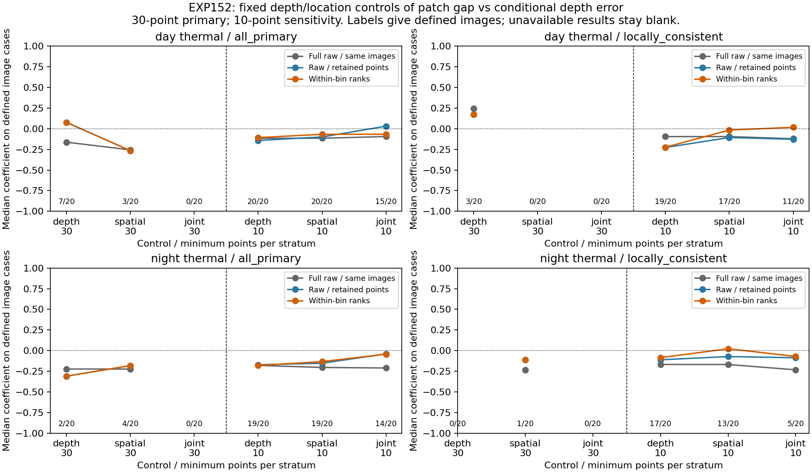

# Fixed depth/location controls weaken the patch-gap evidence

2026-11-05 America/New_York. EXP152; parent EXP151/6b984d4ef. Freeze **7d6941e1a** precedes all controlled outcomes. [Protocol](stereo-ambiguity-controls-protocol-2026-11-05.md). EXP151's 2026-11-06 UTC filenames are retained; current user-facing date follows the client timezone.

The existing evidence does not support promoting patch gap to a reliability policy. **No image supports joint depth/location conditioning at the primary 30-point stratum minimum.** The predeclared 10-point sensitivity produces small thermal all-primary within-bin coefficients: median **−0.066791 day** and **−0.043283 night**, negative in **8/15** and **8/14** defined images. It retains a median **32.1%** and **33.3%** of points in those defined images. These are sparse, support-sensitive descriptive results, without a robust joint-control demonstration.

The locally consistent-reference sensitivity is also variable: day joint coefficient **+0.017544** in 11 images (5 negative), night **−0.070730** in 5 images (3 negative). Physical calibration, timing, projection/visibility and continuous geometry/texture confounding remain unresolved. No threshold, correction, model, selector or default is fitted or changed.

## Inputs and fixed method

Reuse all 80 EXP151 image pairs and 2,938 original primary compared features, with exact original source IDs, gap, depth-proxy error, native coordinates, reference depth and reference-only local group. No inference, image acquisition, new reference values or trajectory run. All original full-support patch-gap correlations and their availability reproduce EXP151. Original depth ratios/errors remain unchanged.

Depth groups inherit EXP047: (0,5),[5,10),[10,20),[20,40),[40,80),[80,infinity) metres; exact boundaries enter upper bin. Native image coordinates define a 3×3 grid. Depth/spatial/joint controls have 6/9/54 possible bins. Primary bins need at least 30 faithful finite points and nonconstant gap/error. The separately frozen 10-point sensitivity addresses the sparser accepted-keypoint setting and never replaces unsupported primary results. Both all-primary and locally consistent reference cohorts remain intact.

For each eligible stratum of size n, center average tied ranks at (n+1)/2, divide by n, and combine rank products/squares across eligible strata within the image. This retains stratum-size/tie weighting. It is a descriptive stratified-rank coefficient, rather than a standard partial-Spearman estimator, causal adjustment, significance test or percent confounding removed. Coarse depth/location bins do not fully account for continuous depth, texture, geometry or reference error.

Every one of 960 case/cohort/control/minimum results retains every possible bin, its original feature IDs, eligibility/missing reason, normalized ranks/sums and retained support. All 48 equal-image aggregates and all 80 image cases remain, including empty/constant/undersized groups. No outcome-selected bin revision, threshold reduction or sample substitution occurred. No pooling across images/recordings or p-values.

## Original raw association

Full-support medians below reproduce EXP151 exactly. Points recur across controls and cohorts; these are dependent coverage counts, not independent samples. Empty rank cohorts are retained.

| Recording | Camera | Cohort | Valid cue points | Raw rho images / 20 | Median raw rho |
|---|---|---|---|---|---|
| day | rgb | all_primary | 298 | 17/20 | 0.027473 |
| day | rgb | locally_consistent | 5 | 0/20 | — |
| day | thermal | all_primary | 1242 | 20/20 | -0.114880 |
| day | thermal | locally_consistent | 832 | 20/20 | -0.107990 |
| night | rgb | all_primary | 309 | 14/20 | -0.054212 |
| night | rgb | locally_consistent | 1 | 0/20 | — |
| night | thermal | all_primary | 1089 | 20/20 | -0.191699 |
| night | thermal | locally_consistent | 672 | 19/20 | -0.232517 |

## Primary minimum: 30 points per stratum

All entries are medians over defined image cases, with counts explicit. **Full raw / same images** uses complete cue points from exactly the images where the controlled coefficient is available. **Raw / retained points** uses exactly the eligible points from those same images, before rank stratification. This separates changes in image availability and point support from within-bin weighting. Median retained percentage is conditional on those defined images; separate all-nonempty-image retention statistics and every zero are saved in the artifacts. A dash is unavailable.

| Recording | Camera | Cohort | Control | Defined images | Full raw / same images | Raw / retained points | Within-bin | Negative images | Median points retained / defined images |
|---|---|---|---|---|---|---|---|---|---|
| day | rgb | all_primary | depth | 0/20 | — | — | — | 0/0 | — |
| day | rgb | all_primary | spatial | 0/20 | — | — | — | 0/0 | — |
| day | rgb | all_primary | joint | 0/20 | — | — | — | 0/0 | — |
| day | rgb | locally_consistent | depth | 0/20 | — | — | — | 0/0 | — |
| day | rgb | locally_consistent | spatial | 0/20 | — | — | — | 0/0 | — |
| day | rgb | locally_consistent | joint | 0/20 | — | — | — | 0/0 | — |
| day | thermal | all_primary | depth | 7/20 | -0.162801 | 0.076752 | 0.076752 | 3/7 | 56.3% |
| day | thermal | all_primary | spatial | 3/20 | -0.255739 | -0.265618 | -0.265618 | 3/3 | 43.8% |
| day | thermal | all_primary | joint | 0/20 | — | — | — | 0/0 | — |
| day | thermal | locally_consistent | depth | 3/20 | 0.244315 | 0.175000 | 0.175000 | 1/3 | 47.6% |
| day | thermal | locally_consistent | spatial | 0/20 | — | — | — | 0/0 | — |
| day | thermal | locally_consistent | joint | 0/20 | — | — | — | 0/0 | — |
| night | rgb | all_primary | depth | 0/20 | — | — | — | 0/0 | — |
| night | rgb | all_primary | spatial | 0/20 | — | — | — | 0/0 | — |
| night | rgb | all_primary | joint | 0/20 | — | — | — | 0/0 | — |
| night | rgb | locally_consistent | depth | 0/20 | — | — | — | 0/0 | — |
| night | rgb | locally_consistent | spatial | 0/20 | — | — | — | 0/0 | — |
| night | rgb | locally_consistent | joint | 0/20 | — | — | — | 0/0 | — |
| night | thermal | all_primary | depth | 2/20 | -0.223312 | -0.309374 | -0.309374 | 2/2 | 41.6% |
| night | thermal | all_primary | spatial | 4/20 | -0.223312 | -0.181678 | -0.181678 | 3/4 | 48.0% |
| night | thermal | all_primary | joint | 0/20 | — | — | — | 0/0 | — |
| night | thermal | locally_consistent | depth | 0/20 | — | — | — | 0/0 | — |
| night | thermal | locally_consistent | spatial | 1/20 | -0.232517 | -0.111070 | -0.111070 | 1/1 | 46.4% |
| night | thermal | locally_consistent | joint | 0/20 | — | — | — | 0/0 | — |

Joint primary results are unavailable for both cameras and both cohorts. RGB has no eligible primary control of any type. Thermal primary depth/spatial results use only 0–7 images per cohort/control, so they cannot provide a representative 20-image robustness claim. For example, day all-primary depth control changes from full raw −0.162801 on 7 eligible images to retained raw +0.076752 and within-bin +0.076752. The sign change already occurs when points are retained; attributing it entirely to conditioning would be incorrect.

## Predeclared sensitivity: 10 points per stratum

| Recording | Camera | Cohort | Control | Defined images | Full raw / same images | Raw / retained points | Within-bin | Negative images | Median points retained / defined images |
|---|---|---|---|---|---|---|---|---|---|
| day | rgb | all_primary | depth | 3/20 | 0.341176 | 0.435065 | 0.562683 | 1/3 | 62.5% |
| day | rgb | all_primary | spatial | 0/20 | — | — | — | 0/0 | — |
| day | rgb | all_primary | joint | 0/20 | — | — | — | 0/0 | — |
| day | rgb | locally_consistent | depth | 0/20 | — | — | — | 0/0 | — |
| day | rgb | locally_consistent | spatial | 0/20 | — | — | — | 0/0 | — |
| day | rgb | locally_consistent | joint | 0/20 | — | — | — | 0/0 | — |
| day | thermal | all_primary | depth | 20/20 | -0.114880 | -0.141789 | -0.107096 | 16/20 | 89.7% |
| day | thermal | all_primary | spatial | 20/20 | -0.114880 | -0.099522 | -0.067416 | 11/20 | 65.8% |
| day | thermal | all_primary | joint | 15/20 | -0.094372 | 0.031136 | -0.066791 | 8/15 | 32.1% |
| day | thermal | locally_consistent | depth | 19/20 | -0.095011 | -0.227273 | -0.223791 | 14/19 | 78.1% |
| day | thermal | locally_consistent | spatial | 17/20 | -0.095011 | -0.106620 | -0.015955 | 10/17 | 51.2% |
| day | thermal | locally_consistent | joint | 11/20 | -0.120968 | -0.127273 | 0.017544 | 5/11 | 37.1% |
| night | rgb | all_primary | depth | 6/20 | -0.035038 | -0.114603 | -0.106144 | 4/6 | 57.8% |
| night | rgb | all_primary | spatial | 5/20 | -0.110324 | 0.172727 | 0.172727 | 1/5 | 55.0% |
| night | rgb | all_primary | joint | 3/20 | -0.110324 | -0.010237 | 0.245608 | 1/3 | 55.0% |
| night | rgb | locally_consistent | depth | 0/20 | — | — | — | 0/0 | — |
| night | rgb | locally_consistent | spatial | 0/20 | — | — | — | 0/0 | — |
| night | rgb | locally_consistent | joint | 0/20 | — | — | — | 0/0 | — |
| night | thermal | all_primary | depth | 19/20 | -0.179151 | -0.171819 | -0.180428 | 15/19 | 83.9% |
| night | thermal | all_primary | spatial | 19/20 | -0.204247 | -0.152582 | -0.133423 | 14/19 | 63.5% |
| night | thermal | all_primary | joint | 14/20 | -0.210440 | -0.039793 | -0.043283 | 8/14 | 33.3% |
| night | thermal | locally_consistent | depth | 17/20 | -0.168112 | -0.111278 | -0.085599 | 13/17 | 66.7% |
| night | thermal | locally_consistent | spatial | 13/20 | -0.168112 | -0.072332 | 0.022318 | 6/13 | 57.1% |
| night | thermal | locally_consistent | joint | 5/20 | -0.232517 | -0.086564 | -0.070730 | 3/5 | 51.2% |

In thermal all-primary joint sensitivity, the day medians are full raw −0.094372 on 15 defined images, retained raw +0.031136, within-bin −0.066791. Night gives −0.210440 on 14 images, −0.039793 retained raw and −0.043283 within-bin. The night reduction is already prominent after support selection. The day within-bin weighting changes direction relative to retained raw, but individual-image signs remain mixed. These values have different weighting/estimands; no fraction of association or error explained is inferred.

Depth-only sensitivity remains negative in most available thermal images (day 16/20; night 15/19). Spatial sensitivity is less consistent, including a positive consistent-reference median at night. Joint conditioning is weaker and sparser. RGB sensitivity has few qualifying cases and variable signs; consistent-reference RGB has no qualifying control. The complete primary/sensitivity results support continued diagnosis, without establishing calibrated confidence or a reliable camera-selection signal.

## Validation and research consequence

Four synthetic contract tests pass, covering exact depth/grid boundaries, tied ranks, retained support, empty/constant/undersized bins, and a between-bin confounding fixture whose within-bin direction reverses. Independent audit passes **115,338 checks**, reproduces every EXP151 raw rho, validates all 960 controlled rows / 48 aggregates and rejects **six semantic corruptions** (bin membership, eligibility, normalized rank, retained support, coefficient and source depth). It reconstructs ranks by pair-count midranks rather than the production scipy routine, plus exact original joins, bin boundaries, normalized rank sums and equal-image statistics.

This closes the present descriptive control step. Do not promote the patch-gap cue from these comparisons. Prioritize supported reference/correspondence and timing/calibration/visibility validation before confidence learning or adaptive fusion; sparse controls and changing supports leave the independent value of the cue unresolved. The thermal shorter-depth/travel observations from EXP150/151 remain descriptions, without a fitted cause or correction. EXP133 physical/heldout/online/fusion gates, reserves and defaults remain unchanged.

Artifacts: results/stereo-ambiguity-controls/run-001. Recovery: ore_ms:ore-ms/backups/2026-11-05-stereo-ambiguity-controls-exp152, including normalized inputs and exact EXP151 per-feature source records, all bins/ranks/controls/empties/aggregates, frozen code/protocol/source/output locks, tests/audit/figure/findings and incremental git bundle. No new native image: inherited EXP136 score/audit runtime remains a prerequisite. Original EXP151 source/native acquisition packet remains the prerequisite for redoing its upstream measurement audit. No credentials or protected captures included.
