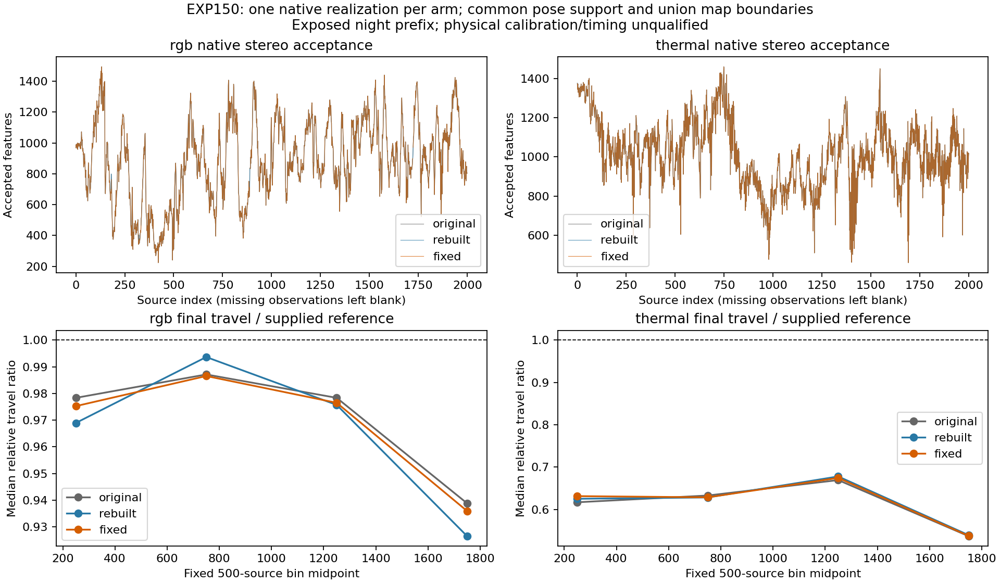

# Stereo baseline initialization: controlled repair

2026-11-05 America/New_York. EXP150, parent EXP149/ed971d3cb. Freeze **5a41bc175** precedes all six full captures and new scores. [Protocol](stereo-baseline-initialization-protocol-2026-11-05.md).

The repair removes the demonstrated constructor dependence on prior storage bytes. The repaired thermal final median relative travel is 0.613906 of the supplied reference on common support; translation RPE is 2.8326 m (RGB 0.6435 m). The thermal travel shortfall persists after the repair. This single exposed-prefix comparison does not establish a causal accuracy gain.

The original and rebuild-only libraries are byte-identical. Rebuilding preserves every inherited native source, observer executable, header, vocabulary and dependency hash. The repaired image changes only Frame.cc and the resulting native library. Within the stereo constructor, the baseline assignment moves before ComputeStereoMatches and uses current K.fx; the matcher, thresholds, other constructors and class layout remain unchanged. This is an experimental runtime; historical outcomes and the default remain intact.

The synthetic constructor probe uses the same binary and deterministic 4-pixel shifted stereo pair across all runtimes. Original and rebuild-only each return 512 accepted matches with storage patterns 0 and 63, but zero with pattern 85. All nine probes complete. The repaired constructor returns bit-identical geometry for all 1,834 features, including 512 accepted matches, across all three patterns. Median accepted disparity is 4.001190 px and baseline 0.300000012 m. This establishes the storage-dependence failure and repair on this test; it does not establish which uninitialized bytes every historical trajectory encountered.

Both initial clean builds failed because ORB's generated clean target deleted external g2o. Identical amended build steps preserve and restore the inherited g2o/DBoW2 bytes around clean. All failures/logs remain. Four 20-source RGB/thermal integrations complete (80 calls), with 311,100 independent native/export checks before freeze. No reference score informed this change.

## Matched received/final comparison

One attempt per original/rebuilt/fixed runtime and camera, first 2,000 existing night groups: 12,000 native calls, all terminally complete. Same observer, images, settings, seed 0, one extraction thread, loop-off. The common pose mask intersects all six received/final streams per camera. Every map/missing boundary from every stream splits the common view. Poses remain in their own gauges; there is no stitching, scale/time fit or reference-informed frame selection. Fragment SE3 ATE is a diagnostic, not continuous global trajectory accuracy. RPE uses the inherited fixed clock-window convention.

| Camera | Arm | Stage | Common poses / 2000 | RPE pairs | SE3 ATE m | Translation RPE m | Rotation RPE deg | Median travel/ref |
|---|---|---|---|---|---|---|---|---|
| rgb | original | received | 1821 | 1681 | 5.7177 | 0.6932 | 0.5533 | 0.968852 |
| rgb | original | final | 1821 | 1681 | 5.7086 | 0.6609 | 0.4637 | 0.969470 |
| rgb | rebuilt | received | 1821 | 1681 | 8.0579 | 0.6974 | 0.7932 | 0.965975 |
| rgb | rebuilt | final | 1821 | 1681 | 8.0590 | 0.6544 | 0.7623 | 0.969129 |
| rgb | fixed | received | 1821 | 1681 | 5.2300 | 0.6712 | 0.5296 | 0.968180 |
| rgb | fixed | final | 1821 | 1681 | 5.2211 | 0.6435 | 0.5208 | 0.969214 |
| thermal | original | received | 2000 | 1909 | 95.6177 | 2.8491 | 0.7401 | 0.608148 |
| thermal | original | final | 2000 | 1909 | 95.6149 | 2.8481 | 0.7082 | 0.609447 |
| thermal | rebuilt | received | 2000 | 1909 | 95.9431 | 2.8161 | 0.7042 | 0.611425 |
| thermal | rebuilt | final | 2000 | 1909 | 95.9370 | 2.8152 | 0.6571 | 0.610758 |
| thermal | fixed | received | 2000 | 1909 | 93.7355 | 2.8332 | 0.7329 | 0.613442 |
| thermal | fixed | final | 2000 | 1909 | 93.7314 | 2.8326 | 0.7234 | 0.613906 |

The original and byte-identical rebuild can differ in trajectory through native asynchronous scheduling. A single realization per arm supplies context for variability, not statistical confidence or causal attribution. Both received and final outcomes are retained.

Common support is defined within each camera; RGB and thermal have different populations and own-camera references. These rows do not establish same-support cross-camera superiority.

## Own-support results

These retain each stream's full supported population; differing supports prevent direct accuracy ranking from these rows alone.

| Camera | Arm | Stage | Own poses / 2000 | Segments | SE3 ATE m | Translation RPE m | Rotation RPE deg |
|---|---|---|---|---|---|---|---|
| rgb | original | received | 1937 | 3 | 10.6966 | 0.7392 | 0.8807 |
| rgb | original | final | 1937 | 3 | 10.7202 | 0.7095 | 0.7163 |
| rgb | rebuilt | received | 1936 | 3 | 16.5294 | 0.9708 | 1.2200 |
| rgb | rebuilt | final | 1936 | 3 | 16.4985 | 0.9463 | 1.1985 |
| rgb | fixed | received | 1874 | 5 | 5.5186 | 0.6967 | 0.5450 |
| rgb | fixed | final | 1874 | 5 | 5.5098 | 0.6714 | 0.5366 |
| thermal | original | received | 2000 | 1 | 95.6177 | 2.8491 | 0.7401 |
| thermal | original | final | 2000 | 1 | 95.6149 | 2.8481 | 0.7082 |
| thermal | rebuilt | received | 2000 | 1 | 95.9431 | 2.8161 | 0.7042 |
| thermal | rebuilt | final | 2000 | 1 | 95.9370 | 2.8152 | 0.6571 |
| thermal | fixed | received | 2000 | 1 | 93.7355 | 2.8332 | 0.7329 |
| thermal | fixed | final | 2000 | 1 | 93.7314 | 2.8326 | 0.7234 |

## Native stereo observations

Feature geometry is the complete post-return native frame snapshot. A frame cleared at reset is explicitly unavailable, not assigned zero features. Median depth below is the median of per-frame median accepted depths, not independent depth truth.

| Camera | Arm | Available / 2000 | Feature slots | Accepted slots | Median accepted/frame | Median frame depth m | Unavailable indices |
|---|---|---|---|---|---|---|---|
| rgb | original | 1998 | 2945537 | 1776542 | 892.5 | 18.2079 | [179, 1903] |
| rgb | rebuilt | 1998 | 2946564 | 1777157 | 893.5 | 18.2014 | [332, 880] |
| rgb | fixed | 1996 | 2943543 | 1775284 | 893.5 | 18.2014 | [181, 322, 889, 1722] |
| thermal | original | 2000 | 3631149 | 2022407 | 1008.0 | 20.2331 | [] |
| thermal | rebuilt | 2000 | 3631149 | 2022407 | 1008.0 | 20.2331 | [] |
| thermal | fixed | 2000 | 3631149 | 2022405 | 1008.0 | 20.2331 | [] |

Comparisons below use common available frames and exact left x/y/octave identity before counting acceptance/right/depth changes. All 2,000 source indices, exclusions and coordinate mismatches remain in the artifacts. Counts are descriptive; a changed stereo value can propagate through tracking, while schedule-dependent resets also affect observation availability.

| Camera | Comparison | Comparable frames | Coordinate mismatch frames | Acceptance changes | Right-x changes | Depth changes | Changed source frames |
|---|---|---|---|---|---|---|---|
| rgb | original-vs-rebuilt | 1996 | 0 | 0 | 0 | 0 | 0 |
| rgb | rebuilt-vs-fixed | 1994 | 0 | 0 | 0 | 0 | 0 |
| rgb | original-vs-fixed | 1994 | 0 | 0 | 0 | 0 | 0 |
| thermal | original-vs-rebuilt | 2000 | 0 | 0 | 0 | 0 | 0 |
| thermal | rebuilt-vs-fixed | 2000 | 0 | 2 | 2 | 2 | 1 |
| thermal | original-vs-fixed | 2000 | 0 | 2 | 2 | 2 | 1 |

On comparable available observations, RGB right coordinates, depths and acceptance are identical across all arms. Thermal original/rebuilt are also identical; the repaired thermal arrays differ at only two features, both at source 0. No later comparable thermal stereo geometry differs. Thermal final travel/reference medians remain 0.609447 original, 0.610758 rebuilt and 0.613906 repaired. This repair does not remove the prefix-wide travel compression. RGB coverage drops in the repaired realization despite identical comparable stereo geometry, reinforcing the limit on attributing native trajectory changes from one run.

## Validation and next work

Three contract tests pass. Independent audit passes **40,093,761 checks**, reconstructs all **24 own/common score populations**, and rejects four semantic corruptions (depth, sentinel, omitted feature, source clock). It validates source minimality and runtime identities, storage probes, complete per-feature clocks/calibration/float32 depth contracts, received native transforms/continuity, final factors and official per-map exports, common masks/boundaries/unchanged poses, geometry differences and scalar motion summaries/bins. It does not certify physical correspondence or reference truth. All native outputs were hashed before scores were read.

Next qualify the initialized stereo/depth evidence across recordings and obtain acquisition/export timing and visibility/calibration provenance before selecting a correction or confidence policy. The patch-gap cue from EXP149 remains a modest exposed association. No learned selector, fusion gain, physical/heldout/full-record/online qualification, reserve/default change or EXP133 promotion follows from EXP150.

Artifacts: results/stereo-baseline-initialization/run-001 and integration-001. Recovery: ore_ms:ore-ms/backups/2026-11-05-stereo-baseline-initialization-exp150, including all three exact native images (docker load verified), all attempts/probes/build failures, source/input/score/audit closure, 4,000 supplied prefix reference matrices and incremental git bundle. Raw/canonical PNG hashes bind the EXP141 prerequisite; scoring runtime remains EXP136. No credentials in the recovery packet.
