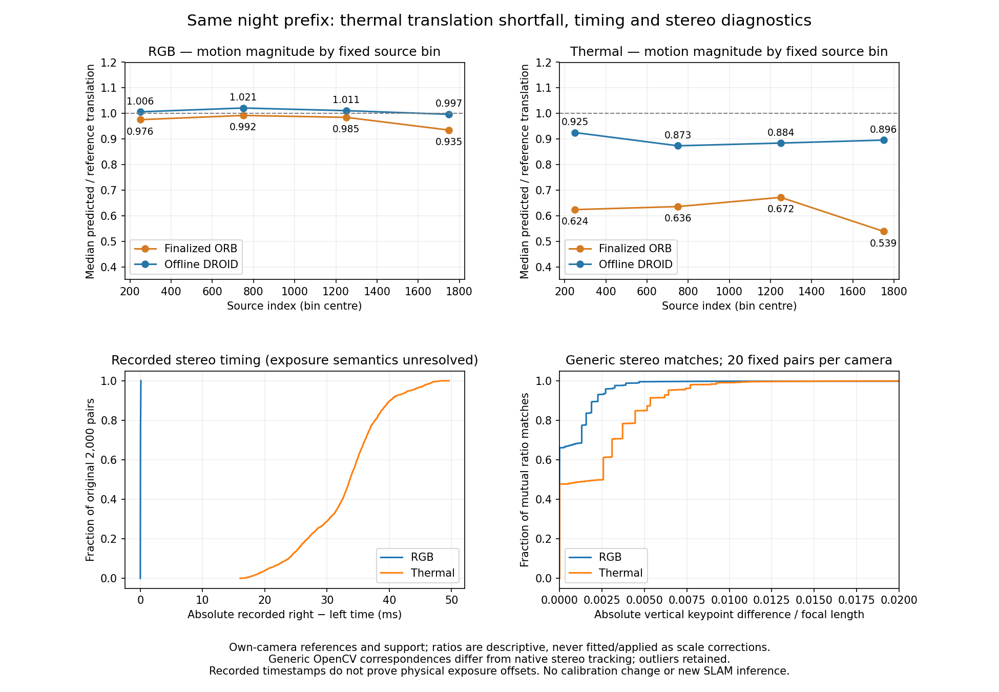

# Stereo/input/reference diagnostic after ORB finalization

2026-11-05 America/New_York. EXP145, initial freeze96151728c, replay-runtime amendment0ecad88cf before the completed diagnostic. Parent EXP144/08c1583f5. [Protocol](stereo-reference-diagnostic-protocol-2026-11-05.md).

Thermal ORB's translation disagreement on this prefix is predominantly a travel-distance shortfall. Finalized ORB follows the supplied reference direction closely but its median one-second translation magnitude is61.4% of the reference;99.28% of squared translation error is parallel to reference travel. Fresh-prefix DROID also tends to shorter thermal travel, with median ratio89.4%. This points toward investigating stereo depth/time association and their native estimation behavior; it does not identify a physical cause or justify a correction.

All diagnostics reuse the original first2,000 night source groups and EXP144 predictions/reference matrices. No new SLAM inference, model update, re-pairing, scale/time/axis/extrinsic fit, reserve access, default change or payload acquisition. Predictions, original scores and calibration remain unchanged. Provided camera-local reference convention and physical timing qualifications remain explicit.

| Camera / output | Scored pairs | Reference translation RMS (m) | Predicted translation RMS (m) | Median magnitude ratio | Median direction cosine | Parallel error RMS (m) | Perpendicular error RMS (m) | Parallel squared-error share |
|---|---:|---:|---:|---:|---:|---:|---:|---:|
| RGB received ORB |1,672|6.9745|6.6909|0.9729|0.999247|0.5922|0.2953|80.08%|
| RGB finalized ORB |1,672|6.9745|6.6927|0.9748|0.999273|0.5649|0.2900|79.15%|
| RGB offline DROID |1,672|6.9745|7.0410|1.0104|0.999309|0.2215|0.2818|38.19%|
| Thermal received ORB |1,909|6.6491|3.9556|0.6113|0.999040|2.8326|0.2407|99.28%|
| Thermal finalized ORB |1,909|6.6491|3.9580|0.6140|0.999039|2.8332|0.2415|99.28%|
| Thermal offline DROID |1,909|6.6491|5.9566|0.8942|0.999334|0.8060|0.2439|91.61%|

Relative translations use the same start-camera axes as the unchanged RPE contract. Parallel/perpendicular components decompose prediction-minus-reference translation; their squared sums equal the original translation RPE squared. Ratios and cosines are descriptive per-pair values, never fitted or applied. All10,743 arm/pair rows remain. RGB/thermal use their own clocks and different supported pair populations; this is not a physically synchronized cross-camera comparison. No zero-reference-motion pair is dropped silently.

Thermal finalized-ORB median ratios across the four fixed500-source bins are0.6237,0.6356,0.6716,0.5386 (pair counts479/500/469/461). Distance shortfall therefore varies over the prefix. These bins retain pairs by original start index, including pairs ending beyond that bin; no favorable window is selected and no single scale repair is adopted.

| Recorded stereo times / fixed image diagnostic | RGB | Thermal |
|---|---:|---:|
| Median absolute recorded right-minus-left time |0.0199ms|33.6835ms|
| P90 absolute difference |0.0718ms|40.1662ms|
| Maximum absolute difference |0.0984ms|49.6060ms|
| Pairs within inherited2ms diagnostic /2,000 |2,000|0|
| Right time before left / after left |1,501 /499|902 /1,098|
| Fixed image pairs |20|20|
| Generic mutual ratio matches (pooled) |3,615|6,394|
| Matches with positive left-minus-right disparity |3,523 (97.45%)|6,247 (97.70%)|
| Matches within absolute vertical2px |3,381 (93.53%)|5,579 (87.25%)|
| Median absolute vertical difference |0px|1.0000px|
| P90 absolute vertical difference |1.7280px|2.0736px|
| P90 absolute vertical / focal length |0.002260|0.005347|
| Median signed disparity |10.3680px|4.9766px|

Both recorded timing signs occur in thermal, so a single constant receive-time offset would not describe the recorded pair differences. Export timestamps are not established exposure times: no physical asynchrony, causal depth error or valid alternative pairing follows from these numbers.

Generic OpenCV ORB correspondences use fixed indices0,100,...1900, both directions'0.75 ratio and mutual matching, with no epipolar filtering before statistics. Empty cohorts are retained (none observed). Raw match coordinates/distances remain in images.json. These are not native ORB-SLAM stereo correspondences, inlier counts or verified true matches. Different focal lengths/resolutions/scenes, descriptor outliers and motion can affect the statistics. Smaller thermal disparity is also expected from its smaller supplied focal length; it is not itself evidence of a unit or calibration error. Pooled keypoints are not independent experimental samples.

Numeric contract checks confirm equal supplied left/right intrinsics, identity stereo rotation and horizontal right translation; baseline RGB0.2991842053m/thermal0.3038995142m. ORB uses fxB; DROID's calibration-only native0.1 baseline conversion remains2.9918420531/3.0389951424. Prepared DROID resize/crop and adjusted intrinsics are recorded in contract.json. Previous native-input audits remain applicable. These checks rule out the checked metadata/adapter inconsistencies, not incorrect physical calibration.

The saved official loader associates identical stems and calls its returned poses absolute relative to the first sequence image. This supports the inherited camera-to-initial interpretation; it is not export-generation code proving all physical axes/rectification/time associations. No reference inversion is selected by scores and no new physical reference guarantee is claimed.

A retained execution failure exposed an environment distinction: the original producer runtime uses OpenCV4.6.0; the scoring runtime uses4.11.0 (both NumPy1.26.4). Replaying the unchanged thermal function in4.11 differs by at most1uint8 level on80,543 left/80,904 right pixels of the first pair;4.6 reproduces both exactly. The original runtime then verifies80/80 sampled raw→canonical images exactly, and the amended freeze pins that report. The repeated diagnostic uses those unchanged canonical images in the declared scoring runtime. This is a replay-environment mismatch, not evidence that SLAM consumed changed images or that it explains pose error. The exact OpenCV sub-operation responsible was not isolated. Initial test collection also failed on a missing tools import path; corrected before initial freeze. Both failures remain retained.

Validation:9 synthetic tests pass. Independent audit passes154,236 checks and rejects5 semantic corruptions (scope, units, motion summary, match sign/count and omitted pair). It reconstructs relative translation with separate scalar matrix arithmetic, unchanged RPE error, source/pair/timestamp populations, bin summaries and match statistics from raw coordinates, plus frozen hashes. It does not independently reimplement the descriptor/matcher algorithm. No additional tests or inference were selected on scientific outcome.

The next useful measurement is native thermal stereo disparity/depth and accepted-match history on this same prefix, with unchanged native settings, to see where distance shortfall arises. Physical timing/calibration attribution still needs acquisition/export provenance; matching/re-pairing or fitted scale should not be introduced as a presumed fix. This step establishes no heldout, full-record, physical, online, adaptive or EXP133 benchmark-readiness claim.

Recovery: `ore_ms:ore-ms/backups/2026-11-05-stereo-reference-diagnostic-exp145`; new metadata/source closure and git bundle, with EXP144 output/runtime and EXP141 image prerequisites explicitly declared. All failed/completed diagnostics and original freeze/amendment remain recoverable.
