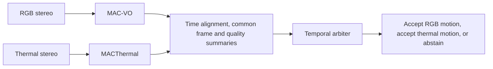

# Proposal: a temporal arbiter for RGB and thermal VO

**Paired input update, 2026-10-29:** [EXP-072](../../experiments/EXP-072-paired-arbiter-events.md) captures the existing early-window thermal counterpart and joins19 verified RGB/thermal intervals. Both camera-local event streams are available;offsets and separate-replay timing remain explicit. The next step is a shared chronological replay and advisory availability rule; no gate is trained or pose gain established.

**2026-10-29 implementation update:** the [opt-in causal event recorder](../../experiments/EXP-071-causal-arbiter-events.md) is implemented and passes state/CPU/native GPU preservation controls. It records motion result commits before refinement and labels submission/availability stages. No arbiter has been trained; paired expert intervals and the comparison target remain next.

**Input audit completed:** [saved health fields and causal-use limits](arbiter-input-audit-2026-10-28.md) are now inventoried on 217 EXP033 pair records. Counts, coverage and raw temporal uncertainty are present; online unfilled motion snapshots and optimizer convergence telemetry are not. Next implementation is a read-only event recorder; no gate has been fitted.

2026-10-28 America/New_York. User proposed an agent/elector layer after CATS
access approval. Status: concrete research proposal, not an implemented,
trained or validated selector. The original estimators/defaults are unchanged.

## The research has not failed

The published success of uncertainty-aware VO and our failed cross-camera
selectors can both hold. [MAC-VO](https://arxiv.org/html/2409.09479v2), Section
IV-B/Table IV, reports gains from uncertainty-based keypoint selection and
covariance-weighted optimization. It uses spatial covariance and inter-axis
terms in its backend, not just the scalar depth-risk score used by our recent
cross-camera tests. Its ablations compare complete pipeline choices on stated
datasets; they do not establish universal cross-sensor probability calibration.

The [MACThermal thesis](https://publications.ri.cmu.edu/storage/publications/2025/12/YifeiLiu_CMU_MSR_Thesis_ThermalOffroadAutonomy.pdf),
Sections3.4–3.5, PDF40–42/printed27–29, describes covariance-aware thermal pose
estimation and presents trajectory/map results. Table3.1 gives improved
thermal flow accuracy versus the RGB-trained MACVO baseline. Its trajectory
examples are qualitative; that flow table is not a quantitative proof of
universal pose improvement. The 17420576-byte PDF was re-read from the official
source; SHA256 `91d680477b21d2292e81877df8ed05dfef0dbe829784857baa1581add645d6a4`.

The narrow negative result in EXP070 is that the declared constant
bias/scale mappings did not improve the tested cross-camera selection loss
consistently. It does not show that MAC-VO/MACThermal has no useful uncertainty,
nor that adaptive RGB–thermal VO is impossible. Our within-camera ranking
results already show useful information on the supplied-reference populations.

## Proposed architecture

Use two unchanged estimators and a small causal decision layer. The initial
proposal selects a valid relative-motion estimate over a common time interval;
it does not average full trajectories or reinterpret network variance as a
shared calibrated risk. Later measurement gating or factor weighting would be
separate variants requiring their own evaluation.

The arbiter is a gating model or a deterministic state machine, both of which
are mathematical models. It does **not** require both experts' uncertainty
outputs to be calibrated Gaussian variances on the same scale. It can learn a
decision/risk mapping from uncertainty plus other evidence. Calling it an agent
does not remove the need for a defined input, action, training target and
evaluation. An LLM is not justified in the per-frame loop by the current
evidence; an optional offline diagnostic assistant would be a different role.

## Concrete interface

At each completed interval `[t0,t1]`, each expert supplies:

| Field | Meaning / restriction |
|---|---|
| `t0,t1,frame_id` | Actual estimator interval and coordinate frame, not a nearest filename match. |
| `delta_pose` | Original relative SE(3) estimate; finite and valid flag retained. |
| `support` | Candidate, retained, matched and unsupported-pair counts; spatial coverage. Preserve pre-interpolation tracking diagnostics from EXP033. |
| `optimization` | Convergence/finite status and residual summaries available by interval end. Native residual scales are separate features, not automatically comparable likelihoods. |
| `uncertainty` | Per-camera quantiles/dispersion/valid fractions from the existing interface. A pose covariance is included only if the expert actually provides one. |
| `history` | Past/current tracking availability, motion continuity and previous action. No future frame, reference error or evaluation label. |

Time alignment and a verified camera-to-common-body transform are prerequisites
for comparing motion increments. Switching increments requires transport to the
same frame and composition convention. Separate trajectory origins cannot be
switched as if they were continuous poses. Missing geometry or timestamp support
produces an unavailable action, not an invented conversion.

Output is `rgb`, `thermal` or `abstain`, with reason code, score/margin,
available-action mask and recorded inputs. A decision margin is not a calibrated
probability. `Abstain` means no valid VO increment from this layer, explicitly
reported to the downstream system; it must not silently count as success or
perfect zero error. No hold-last/interpolation output may conceal tracking loss.

Hard selection is the initial scope because it preserves each selected
estimator's internal uncertainty use and makes actions auditable. It still
needs temporal testing. Fusing increments/covariances would additionally require
frame-consistent uncertainty semantics and treatment of correlated estimator
errors. Neither inverse-variance averaging nor pixel-wise uncertainty ratios
is assumed to solve that problem.

## What makes this different from EXP062–064

Those experiments already trained a pointwise cost-sensitive camera selector
from log propagated variances, predicted ranges and pixel position. It showed
development gains and failed consistent prospective transfer. Rebranding it
as an agent would add no scientific evidence.

This proposal changes the **decision target and information**: common-interval
VO increment availability/quality, causal tracking/optimization history, and an
explicit unavailable action. It tests the hypothesis that motion-estimator
health/history contributes decision information beyond instantaneous uncertainty.
That hypothesis is plausible, not yet measured. Extra capacity alone is not the
claimed distinction, and image-derived uncertainty is not discarded.

Before fitting, audit which of these fields actually exist in the restored
temporal runs. A missing optimizer diagnostic cannot be reconstructed from a
success flag or presented as measured. If pose labels/reference or frame
transport are inadequate, keep the first temporal experiment at an explicitly
bounded availability target rather than reporting physical pose gains.

## Smallest credible evaluation sequence

1. **External stereo check on CATS.** Use the [approved intake](cats-intake-2026-10-28.md)
   to establish disparity conventions, masks and thermal input provenance, then
   assess native stereo error/ranking with frozen scenes. CATS static scenes
   cannot establish temporal arbiter performance or VO improvement.
2. **Temporal input/target audit on existing recordings.** Inventory raw tracking
   status and interval alignment for both experts. Establish common-frame
   conversion and what pose reference actually supports. This audit can precede
   training and does not require touching the final MS² captures.
3. **Declared small arbiter comparison.** Freeze a deterministic health-rule
   baseline and a small learned gate with train-only normalization. Compare
   uncertainty-only, health/history-only and combined inputs; split entire
   recordings, not neighboring frames. Model family, features, thresholds,
   history length, switching policy and targets must be declared before fitting.
4. **Only then test downstream VO claims.** Preserve RGB-only, thermal-only,
   fixed/existing weighting and a reproducible fusion baseline where available.
   Evaluate tracking availability and failures, relative translation and rotation
   errors, trajectory drift, switching discontinuities and compute/latency.
   Rejecting hard cases must not improve the reported error by hiding coverage.

Use an oracle only as a labelled upper-bound diagnostic, never as an inference
input or deployable baseline. Freeze failure penalties, translation/rotation
tradeoffs, abstention coverage and success criteria before model scores; these
are unresolved design choices, not parameters authorized for a search here.
No method can be declared successful simply because one expert wins somewhere.

## Decision today

Proceed with the bounded CATS adapter/convention audit and a temporal field
inventory. Keep the gate as a concrete candidate for the original reliability
question. No claim is made that it is novel, that an LLM is needed, or that it
will improve VO. No training, extensive compute, baseline replacement or reserved
capture access is part of this proposal. The next implementation should make
the required data and targets reviewable before committing to the method.

## EXP073: causal advisory path established

The [shared replay](../../experiments/EXP-073-shared-arbiter-replay.md) now
records decisions from live prefixes on one controller timeline. The 20-group
early window produces 18 both-available RGB-preference decisions and one final
pre-drain abstention. Both experts preserve 533 arrays bitwise. This is an
offline availability baseline; uncertainty/history quality gating still needs
a common-frame interval target and independent loss. Next test an already
examined support-collapse segment with declared fixed baselines.

## EXP074: thermal fallback verified, quality selection still untested

The [known-collapse diagnostic](../../experiments/EXP-074-arbiter-support-collapse.md)
produces97thermal,1RGB and1abstain decisions under the unchanged rule. Availability
is98/99 versusRGB-only1/99, matchingthermal-only98/99 at identical deadlines.
No unsupported result is chosen; stale RGB writes and shutdown results cannot
backfill advice. Both experts preserve2613arrays bitwise. The availability path
now works in supported and collapse cases. A quality gate next needs a declared
common-body/interval comparison target, applicable reference and fixed loss;
these results do not establish a VO advantage over thermal-only.

## EXP075: a fixed proxy loss exposes the RGB-preference weakness

[Conditional body/interval benchmarking](../../experiments/EXP-075-arbiter-pose-proxy.md)
now uses copied first-write motions at original deadlines, supplied nominal
extrinsics and offline reference bridges. Middle advisory RMSE0.10985m exceeds
thermal-only0.04262m on equal98/99 available intervals because the one selected
RGB result has1.00308m proxy loss. The source is recorded SLAM, not independent
GT; body anchoring remains nominal. No gate fitted. Next predeclare a causal
history/recovery baseline rather than promote tracking support as pose quality.
