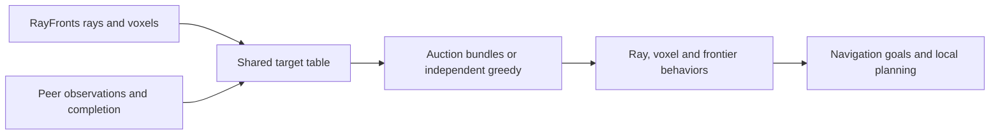

# RAVEN navigation

RAVEN consumes RayFronts semantic rays and voxel detections, combines local and
gossiped target observations, and selects navigation goals. The semantic-search
task executor launches it per robot; local planning and control execute goals.

## Allocation parameters

| ROS parameter | Default | Meaning |
|---|---|---|
| `assignment_mode` | `auction` | `auction` or `independent_greedy` |
| `bundle_len` | 1 | Maximum ordered reservation count; missions normally use 3 |
| `share_rays` | true | Allow bidding on peer ray leads |
| `share_bbs` | true | Allow bidding on peer BB/voxel targets |
| `use_shared_completion` | true | Adopt peer completed labels and visited-BB status |
| `debug_auction` | true | Publish and save assignment diagnostics |

`RAVEN_ASSIGNMENT_MODE`, `RAVEN_SHARE_RAYS` and `RAVEN_SHARE_BBS` pass through
robot Compose into the semantic-search executor, which supplies the ROS
parameters. Bundle length is supplied in the `SemanticSearchTask` action goal.
Independent greedy requires length 1 and rejects other values at startup.

The auction assigns exclusive heads before growing tails, stops at ray tasks,
and limits each tail extension to 20 m. Independent greedy reuses the same
single-robot L1 scoring but does not consider peer allocation or ownership.
It disables target-level peer yielding while preserving shared perception,
completed-target filtering, frontier behavior and navigation safety.

## Local completion ablation

Set `RAVEN_USE_SHARED_COMPLETION=false` in the mission environment to pass
`use_shared_completion:=false` through Compose and the semantic-search executor.
Each robot then maintains its own completed-target state. Peer completed labels
are not merged into its navigation completion list. Shared bounding-box geometry
is still consumed, including boxes peers report as visited, but their status is
interpreted locally as observing until this robot completes the instance.
Normalize that status before BB fusion: fusion otherwise propagates visited
status into the persistent visited cache and silently restores shared completion.

Own visited instances remain sticky and excluded from further pursuit. Both
confirmed-target and completed-target publications continue unchanged; this
ablation changes how peer completion is consumed, not what is transmitted.
The existing `_peer_visited_bbs` cache contains only locally completed instances
in this mode, despite its historical name. The setting is fixed at node startup.

Ray/BB sharing, auction allocation, peer intentions, ray-lead service messages,
frontier coverage sharing and navigation remain enabled. This is separate from
both the no-sharing and independent-greedy ablations. GT scoring still counts
each physical target once across the fleet, regardless of local completion lists.

`raven_3robot_full_local_completion_s1_20261015.yaml` runs all eight matched s1
scenes with three robots, full communication, auction bundle length 3 and a
300-second simulated search window. Compare against the existing matched L3
control. `test/test_local_completion.py` exercises actual node methods to verify
peer geometry preservation, local completion isolation, sticky own visits,
unchanged completion publication and the default shared behavior.

## Interfaces and dependencies

The node depends on ROS 2, NumPy, RayFronts observations and the coordination
peer-state inputs. Topics use the robot namespace. Important outputs include
`debug/auction_solve` (JSON in `std_msgs/String`) and `auction_table`, with
results and intent events also saved by the semantic-search results flow.
See `raven_nav_node.py` and `launch/raven_nav.launch.xml` for topic remappings.

Diagnostics include assignment mode, configured maximum, actual per-agent
bundle occupancy, task count and task status counts, including empty ticks.
In independent mode `local_solves` holds each local decision. Auction-table
rows expose `assigned_agents`; the legacy scalar `assigned` is null when a
task has multiple selectors.

## Validation and experiment

`test/test_independent_greedy.py` checks duplicate selections, independence
from peer inputs, retained local costs, eligibility, completion filtering,
node-level yielding gates and bundle limits 1/3/6/12. Run with the package on
`PYTHONPATH` inside the robot Docker image. Existing sharing tests remain valid.

The full matched experiment and analysis definitions are in
`docs/experiments/raven_bundle_study_20261014.md` at the repository root.
