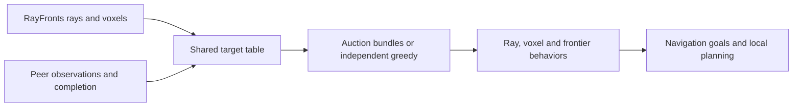
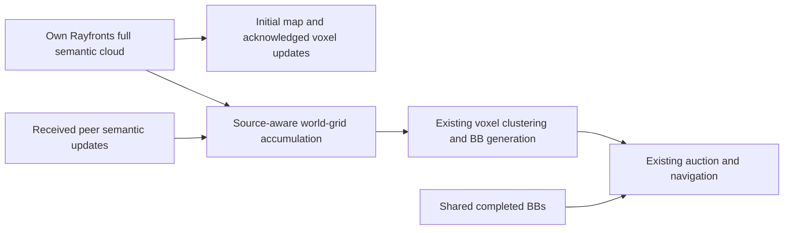
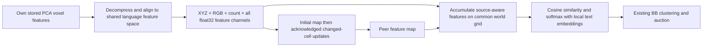

# RAVEN navigation

RAVEN consumes RayFronts semantic rays and voxel detections, combines local and
gossiped target observations, and selects navigation goals. The semantic-search
task executor launches it per robot; local planning and control execute goals.



## Enabling ablations on multi-raven

All variants live together on **`multi-raven`**. Select them with mission `env`
settings (or the corresponding ROS parameters), not separate source branches.
The Compose defaults keep ordinary RAVEN allocation/sharing enabled and the map
transport experiments disabled. Combine switches where appropriate; map codecs
are mutually exclusive and require the mode settings documented below.

| Ablation | Mission environment / goal setting |
|---|---|
| No shared rays | `RAVEN_SHARE_RAYS=false` |
| No shared unfinished BBs | `RAVEN_SHARE_BBS=false` |
| Neither rays nor unfinished BBs | Set both sharing flags above to `false` |
| Local completed-target list | `RAVEN_USE_SHARED_COMPLETION=false` |
| Ignore peer positions/selections | `RAVEN_USE_PEER_ALLOCATION_STATE=false` |
| No auction / independent greedy | `RAVEN_ASSIGNMENT_MODE=independent_greedy`; action goal `bundle_len: 1` |
| Bundle length | Action goal `bundle_len: 1`, `3`, `6`, or `12`, with `RAVEN_ASSIGNMENT_MODE=auction` |
| No BB–BB association | `RAVEN_ASSOCIATE_BBS=false` |
| No ray–BB association | `RAVEN_ASSOCIATE_RAY_BBS=false` |
| No ray–ray association | `RAVEN_ASSOCIATE_RAYS=false` |
| No ray-uncertainty penalty | `RAVEN_RAY_COST_PENALTY=0.0` |
| No incumbent retention, including bearing persistence | `RAVEN_COMMIT_SWITCH_MARGIN_M=0.0`, `RAVEN_RAY_BEARING_PERSISTENCE=false` |
| Auction retention alone off | `RAVEN_COMMIT_SWITCH_MARGIN_M=0.0` (bearing persistence independently selectable) |
| No travel-distance cost | `RAVEN_DISTANCE_COST_WEIGHT=0.0` |
| No task repulsion | `RAVEN_TASK_REPULSION=false` |
| No destination repulsion | `RAVEN_DESTINATION_REPULSION=false` |
| Neither repulsion term | Set both repulsion flags above to `false` |
| Query-score map sharing | `RAVEN_SEMANTIC_MAP_SHARING=true`, `RAVEN_SHARE_BBS=false` |
| Expanded reusable features | Above map settings plus `RAVEN_REUSABLE_FEATURE_MAP=true`, `RAYFRONTS_QUERY_COMPRESSED=False` |
| Wire-only PCA100 sharing | Above reusable settings plus `RAVEN_WIRE_PCA_MAP=true`, `RAVEN_NATIVE_COMPRESSED_MAP=false`; local mapper stays uncompressed |
| Bandwidth measurement | `GOSSIP_MEASURE_BYTES=true` |

For example, omit ray penalty and retention together without changing branches:

```yaml
env:
  RAVEN_RAY_COST_PENALTY: '0.0'
  RAVEN_COMMIT_SWITCH_MARGIN_M: '0.0'
  RAVEN_RAY_BEARING_PERSISTENCE: 'false'
```

The original cost defaults are ray penalty `50.0`, distance weight `1.0`,
retention margin `8.0`, bearing persistence `true`, and both repulsion terms
`true`. Original sharing/completion/peer-state/association switches are `true`;
map-sharing and compressed-transport modes default to `false`. Standard matched
ablation missions use `bundle_len: 3`. Restore these values (or remove overrides)
to return to the original configuration. Native-coefficient transport is also
implemented, but requires an actually PCA-enabled mapper; the deployed image has
PCA disabled, so it must not be substituted for the wire-only experiment.

Submit from this consolidated branch:

```bash
bash ./airstack.sh osmo:mission osmo/missions/<mission>.yaml \
  --branch multi-raven --pool dsta --priority HIGH
```

## Allocation parameters

| ROS parameter | Default | Meaning |
|---|---|---|
| `assignment_mode` | `auction` | `auction` or `independent_greedy` |
| `bundle_len` | 1 | Maximum ordered reservation count; missions normally use 3 |
| `ray_cost_penalty` | 50.0 | Additive auction cost for ray and ray-localized tasks, in m-equivalent units; 0 removes it |
| `distance_cost_weight` | 1.0 | Nonnegative multiplier on additive travel cost for heads, tails and exploration; 0 removes this term |
| `task_repulsion` | true | Include repulsion from tasks allocated earlier in the solve |
| `destination_repulsion` | true | Include repulsion from other robots' shared destinations |
| `commit_switch_margin_m` | 8.0 | Auction incumbent-head bonus magnitude; tails and exploration retention use half; 0 removes auction retention |
| `share_rays` | true | Allow bidding on peer ray leads |
| `share_bbs` | true | Allow bidding on peer BB/voxel targets |
| `use_shared_completion` | true | Adopt peer completed labels and visited-BB status |
| `use_peer_allocation_state` | true | Use peer positions, destinations and selection state for allocation and yielding |
| `associate_bbs` | true | Fuse BB hypotheses before publication, in persistent memory and in the auction table |
| `associate_ray_bbs` | true | Resolve unfinished ray leads against observed BBs and apply ray-to-BB observer yielding |
| `associate_rays` | true | Combine ray hypotheses and apply peer same-target ray conflict checks |
| `debug_auction` | true | Publish and save assignment diagnostics |

`RAVEN_ASSIGNMENT_MODE`, `RAVEN_SHARE_RAYS` and `RAVEN_SHARE_BBS` pass through
robot Compose into the semantic-search executor, which supplies the ROS
parameters. Bundle length is supplied in the `SemanticSearchTask` action goal.
Independent greedy requires length 1 and rejects other values at startup.

The ray/BB sharing flags restrict task eligibility to robots recorded as
observers; they do not stop all observation transport. Multiple observers can
still compete for a task, while a single-observer task has only one eligible
robot. Peer positions, intentions, completion and frontier coordination remain
active unless separately disabled. Thus disabling both eligibility-sharing
flags is not equivalent to removing all coordination.

The auction assigns exclusive heads before growing tails, stops at ray tasks,
and limits each tail extension to 20 m. Independent greedy reuses the same
single-robot L1 scoring but does not consider peer allocation or ownership.
It disables target-level peer yielding while preserving shared perception,
completed-target filtering, frontier behavior and navigation safety.

## Full semantic map versus BB sharing

`RAVEN_SEMANTIC_MAP_SHARING=true` replaces unfinished-BB transport with
sender-owned query-semantic voxel updates. Set `RAVEN_SHARE_BBS=false` in
this mode; map-derived tasks remain eligible for every robot. The original
mode remains the default. Both modes retain rays, completed targets, auction
costs and frontier coordination.



The new `coordination_msgs/msg/SemanticVoxelMap` carries voxel XYZ
and all configured query/background float32 score channels, plus explicit
ordered labels and voxel size. It is a query-semantic map, **not** RGB and not
Rayfronts' latent feature embeddings for arbitrary future language queries.
Coordinates are global ENU XY with AGL Z (`world_xy_agl`); receivers subtract
their own boot XY before navigation. This intentionally follows Raven's BB
convention, rather than the raw-cloud gossip MSL-Z transform.

Each source contributes at most one latest vector per 0.5 m world-grid cell.
Previously seen cells persist; overlaps average positions and scores across
sources. Repeated snapshots do not increase evidence weight. Vocabulary,
frame and resolution mismatches are rejected. Only the sender's own raw map
is transmitted, never the fused union, preventing evidence recirculation.
`RAVEN_SEMANTIC_MAP_VOXEL_SIZE` must match Rayfronts `mapping.vox_size` (0.5 m
in the experiment config). This fusion and fresh BB clustering can change
behavior; equivalent performance is a hypothesis tested by the experiment.

Small range-filtered gossip profiles advertise each robot's TCP endpoint.
Bulk maps are **not** embedded in PeerProfile: best-effort DDS delivery of
growing multi-MiB profiles stopped updating some peers in the first attempt.
Independent per-peer stream workers send an initial map, then lossless deltas
relative to that peer's acknowledged state. The ACK is issued only after the
receiving Raven planner has fused the update, so late startup or a planner
restart cannot silently discard a base map. Changed and new cells carry full
float32 score vectors with no value thresholding or compression. Unchanged
cells stay at the receiver. A failed ACK, missing base or new endpoint session
forces a full resync. Latest-snapshot backpressure bounds queue growth.
This direct stream is used for the full-comms, same-workflow comparison.
Large local DDS messages also stopped advancing in the first stream attempt.
Both local handoffs therefore use bounded atomic files in the container's
`/tmp`: Raven replaces its latest full snapshot, and the receiver replaces one
update file per peer. The sender polls for changed snapshots; Raven polls for
received updates and sends a small ROS fusion ACK. Network updates never
advance until that ACK, preventing an unread delta from being overwritten.
The full debug map topic is published only when a local subscriber requests
it; neither inter-robot nor local map delivery depends on that topic.

Runtime checks require multiple updates from both peers, fresh maps (at most
15 wall seconds old) during at least 70% of post-warmup auction ticks, and
fresh fleet maps near the end. Merely receiving the initial small maps is
insufficient. Traces save per-peer update counts, cell counts and ages.

No unvisited BB geometry is sent in either `confirmed_targets` **or** the
visualization `auction_table` payload in map mode. Completed/visited BBs are
still shared. Local auction traces retain the full table for analysis.

Set `GOSSIP_MEASURE_BYTES=true` in both modes to save
`/tmp/gossip_bandwidth_<robot>.jsonl`, collected with each trial's logs.
Counters record actual application publish/receive events, per-payload
serialized byte counts, whole-PeerProfile CDR bytes, simulation time and wall
time. RX includes messages before application dedup/range rejection. TX is
counted once per publisher, not multiplied by fleet size; relay transmissions
are counted and identified separately. Direct map streams instead count every
actual per-peer send/receive, including retries/partial transfers, and identify
the transport. Compare fleet **received** application bytes for consistent
fan-out accounting across DDS and TCP; do not multiply DDS TX counts and call
them measured wire traffic. Stream prefix bytes and incomplete transfer counts
are recorded separately. These counters exclude DDS/TCP/IP and
Ethernet headers, retransmissions, and GCS/local registry traffic.

The mission runner saves `gossip_bandwidth_summary.json` automatically after
collecting the logs. To regenerate it, run
`python3 osmo/workspace/summarize_gossip_bytes.py <iteration-dir>`. It uses each
robot's own `mission_start_ts` for a 300-second
window. Compare map versus BB payload bytes as well as total TX, RX, and
wall-clock Mbit/s. Both fresh eight-scene missions use identical starts and
full original bidding costs, with `GOSSIP_MEASURE_BYTES=true`.

## Bidding cost ablations

The October 28 repulsion missions independently disable the two additive sums:

| Mission variant | `RAVEN_TASK_REPULSION` | `RAVEN_DESTINATION_REPULSION` |
|---|---|---|
| `no_task_repulsion` | `false` | `true` |
| `no_destination_repulsion` | `true` | `false` |
| `no_repulsion` | `false` | `false` |

Both environment switches pass through robot Compose to identically named
lowercase ROS parameters, defaulting to true. They affect head and tail costs.
The first sum includes every earlier allocation in the solve, including the
same robot's preceding tasks during bundle growth. The second sum excludes the
robot itself and uses the existing forward-ray geometry for ray tasks.
All three missions retain distance weight 1, ray penalty 50, retention margin 8,
bearing persistence, sharing, freshness weights, ownership gates and bundle
detour limits. Each runs eight matched s1 scenes with three robots, full comms,
bundle length 3 and 300 simulated search seconds. Trace parameters record both
switches even on empty ticks; selected costs retain separate `repulsion` and
`peer_heading` fields. New traces also preserve peer destinations and ray
origin/direction for offline replay. Older traces lacking those inputs cannot
fully reproduce destination repulsion.

Set `RAVEN_DISTANCE_COST_WEIGHT=0.0` for the no-distance-cost ablation.
Robot Compose passes it to the semantic-search executor as the ROS parameter
`distance_cost_weight` (default 1.0; must be finite and nonnegative). It scales
the head's age-weighted surface distance, each tail's chain distance, and the
exploration alternative's travel distance. The exploration markup, ray penalty,
incumbent retention and both peer-repulsion terms are unchanged. Physical-distance
ownership/poaching gates, the 20 m tail detour cap, ray-bearing persistence,
frontier selection and navigation still use geometry. This isolates the additive
auction travel term rather than removing every use of distance in the planner.
The October 28 mission uses all eight matched s1 scenes, three robots, full
communication, bundle length 3 and 300 simulated search seconds; all other
ablation switches retain their original settings. The auction trace records
`params.distance_weight`, weighted `base`, and unweighted `raw_distance`.
Offline replay honors the logged coefficient (old traces default to 1.0).

The unified auction minimizes travel cost **plus** the ray uncertainty penalty
**minus** incumbent retention, plus peer repulsion. The sign matters: rays are
penalized, while an incumbent is made cheaper. Head retention is 8 m-equivalent;
tail matches and previous exploration receive 4 m-equivalent retention.

Set `RAVEN_RAY_COST_PENALTY=0.0` to remove the additive ray penalty for every
head and tail candidate, leaving `RAVEN_COMMIT_SWITCH_MARGIN_M=8.0`.
Set `RAVEN_COMMIT_SWITCH_MARGIN_M=0.0` to remove all auction retention (head,
tail and exploration), leaving `RAVEN_RAY_COST_PENALTY=50.0`. These environment
variables pass through robot Compose and the semantic-search executor as ROS
parameters. Both must be finite and nonnegative. Defaults preserve existing
behavior. Separate ray-pursuit bearing locks and navigation safety remain active:
the experiment removes a bidding-cost term, not every form of temporal memory.

The October 23 `no_ray_penalty` and `no_retention` missions each run all eight
matched s1 scenes with three robots, full communication, bundle length 3 and
300 simulated search seconds. All sharing, completion and task-association
switches remain enabled. Compare with the existing matched original RAVEN
control; retain all valid results regardless of score. `params.ray_penalty`
and `params.switch_margin` in each robot's auction trace record the effective
coefficients, including ticks without candidates. Nonempty solves also record
the selected candidates' `ray_pen` and `retention` contributions. Offline replay
reads the logged ray coefficient and supports a `no_ray_penalty` variant.

To remove the separate ray-bearing persistence as well, set
`RAVEN_RAY_BEARING_PERSISTENCE=false` with
`RAVEN_COMMIT_SWITCH_MARGIN_M=0.0`. This disables the previous-direction and
origin-alignment penalties in ray-group selection, the 25% improvement gate,
and the 4-second minimum hold. Candidate groups still match the auction-assigned
label; selection uses their current distance. Shared perception, task association,
ray uncertainty penalty, stalled-target release, and navigation safety are retained.
The default is `true`, preserving the previous behavior. The effective boolean is
recorded as `params.ray_bearing_persistence` even on empty auction ticks.
The October 25 `no_retention_no_bearing_hold` mission runs eight matched s1 scenes
with this switch off, retention zero, and ray penalty 50.

## Peer position and selection ablation

Set `RAVEN_USE_PEER_ALLOCATION_STATE=false` in the mission environment. Compose
and the semantic-search executor pass `use_peer_allocation_state:=false` to
each robot. The assignment solver receives only that robot's position, weight,
exploration cost and committed waypoint. Peer commitments no longer exclude
rays, peer observers no longer cause ray yielding, and voxel behavior no longer
defers to a closer or committed peer. Frontier selection also ignores peer
position and waypoint repulsion.

Shared rays, bounding boxes, completed targets, serviced leads, frontiers and
explored coverage remain enabled. Received messages and their coordinate
transforms are preserved; a masked view removes planning state only where
navigation behaviors consume it. This is a consumption ablation, not a network
bandwidth ablation. Local collision avoidance and control are unchanged.

The matched experiment retains `assignment_mode=auction` and bundle length 3.
With only one agent row, the existing solver constructs a local bundle; it
cannot allocate exclusively across robots or compute their distance-based bids.
This differs from the independent-greedy ablation, which uses length 1 and
retains frontier coordination. `test/test_peer_allocation_state.py` checks
invariance to peer motion/selection, length-3 bundles, shared-information
preservation, frontier repulsion removal and the unchanged default behavior.

`raven_3robot_full_no_peer_allocation_s1_20261018.yaml` runs eight matched s1
scenes with three robots, full communication and 300 simulated search seconds.
The flag is recorded in every auction trace alongside actual bundle occupancy.

## Task association ablations

The October 18 experiments disable one association type at a time with
`RAVEN_ASSOCIATE_BBS`, `RAVEN_ASSOCIATE_RAY_BBS` or `RAVEN_ASSOCIATE_RAYS`.
Each environment variable passes through Compose and the semantic-search
executor to the corresponding ROS parameter. All default to true; all three
flags are recorded in startup logs and every auction solve trace.

| Variant | Removed associations | Retained mechanisms |
|---|---|---|
| No BB–BB | Own-fragment fusion, cross-robot BB fusion, persistent house-box fusion, final task-table BB union | Voxel clustering and temporal confirmation; completed-instance filtering |
| No ray–BB | Pruning leads against unfinished observed boxes, discovery BB attachment, observer yielding, shared-BB inference between bearings | Completed-BB exclusion; ray triangulation; navigation from a selected bearing into local voxel observations |
| No ray–ray | Same-snapshot lead deduplication, peer-lead deduplication, discovery triangulation, peer same-target ray conflict suppression (including proximity fallback) | Upstream 45-degree raw-ray grouping, temporal confirmation and one-to-one temporal lead refresh; ray–BB resolution |

These switches ablate association of unfinished **task hypotheses**, not all
perception processing or temporal identity. Local voxel clustering/containment
suppression and raw-ray grouping still generate the input hypotheses. Repeated
BB snapshots update source-and-occurrence slots within the existing spatial
cache cells; two BBs in one cell remain separate when association is off.
Ray snapshots update each previous lead at most once, so two current hypotheses
remain distinct without creating fresh copies on every tick. Peer lead arrays
are rebuilt from the received snapshot rather than appended to persistent
memory on every receipt.

Completion labels, visited-instance matching, serviced-lead handling and pursuit
continuity remain active in every arm. Removing duplicate unfinished tasks is
different from forgetting that a target has been completed. With ray–ray
association off, two rays may still independently resolve to the same BB via
the retained ray–BB mechanism; these are individual, not combined, ablations.

The `build_targets()` triangulation graph produces discovery diagnostics, not
the auction input directly. Auction BBs come through `_house_boxes()` and
`build_tasks()`; ray tasks come from persistent leads. Changing only the
triangulation graph would therefore not implement a task-table ablation.
`test/test_task_association.py` checks the actual node-to-task-builder path,
duplicate keys, repeated snapshots, independent switches, peer conflict gates
and preserved completed-target filtering.

The three `raven_3robot_full_no_*_association_s1_20261018.yaml` missions each run
eight matched s1 scenes, three robots, full communication, auction L3 and 300
simulated search seconds. Rays, BBs, completion, coverage and peer allocation
state are shared in all arms. Reuse the existing matched original RAVEN control;
report these as single-start descriptive comparisons. Score against the same
query-filtered GT and actual trajectories, deduplicating targets fleet-wide.
Retain all valid trials regardless of performance.

## Local completion ablation

Set `RAVEN_USE_SHARED_COMPLETION=false` in the mission environment to pass
`use_shared_completion:=false` through Compose and the semantic-search executor.
Each robot then maintains its own completed-target state. Peer completed labels
are not merged into its navigation completion list. Shared bounding-box geometry
is still consumed, including boxes peers report as visited, but their status is
interpreted locally as observing until this robot completes the instance.
Normalize that status before BB fusion: fusion otherwise propagates visited
status into the persistent visited cache and silently restores shared completion.

Own visited instances remain sticky and excluded from further pursuit. Both
confirmed-target and completed-target publications continue unchanged; this
ablation changes how peer completion is consumed, not what is transmitted.
The existing `_peer_visited_bbs` cache contains only locally completed instances
in this mode, despite its historical name. The setting is fixed at node startup.

Ray/BB sharing, auction allocation, peer intentions, ray-lead service messages,
frontier coverage sharing and navigation remain enabled. This is separate from
both the no-sharing and independent-greedy ablations. GT scoring still counts
each physical target once across the fleet, regardless of local completion lists.

`raven_3robot_full_local_completion_s1_20261015.yaml` runs all eight matched s1
scenes with three robots, full communication, auction bundle length 3 and a
300-second simulated search window. Compare against the existing matched L3
control. `test/test_local_completion.py` exercises actual node methods to verify
peer geometry preservation, local completion isolation, sticky own visits,
unchanged completion publication and the default shared behavior.

## Interfaces and dependencies

The node depends on ROS 2, NumPy, RayFronts observations and the coordination
peer-state inputs. Topics use the robot namespace. Important outputs include
`debug/auction_solve` (JSON in `std_msgs/String`) and `auction_table`, with
results and intent events also saved by the semantic-search results flow.
See `raven_nav_node.py` and `launch/raven_nav.launch.xml` for topic remappings.

Diagnostics include assignment mode, configured maximum, actual per-agent
bundle occupancy, task count and task status counts, including empty ticks.
In independent mode `local_solves` holds each local decision. Auction-table
rows expose `assigned_agents`; the legacy scalar `assigned` is null when a
task has multiple selectors.

## Validation and experiment

`test/test_independent_greedy.py` checks duplicate selections, independence
from peer inputs, retained local costs, eligibility, completion filtering,
node-level yielding gates and bundle limits 1/3/6/12. Run with the package on
`PYTHONPATH` inside the robot Docker image. Existing sharing tests remain valid.

The full matched experiment and analysis definitions are in
`docs/experiments/raven_bundle_study_20261014.md` at the repository root.


### Reusable feature-map experiment

Set `RAVEN_REUSABLE_FEATURE_MAP=true`, `RAVEN_SEMANTIC_MAP_SHARING=true`,
`RAVEN_SHARE_BBS=false` and `RAYFRONTS_QUERY_COMPRESSED=False`. The original
score-map mode above remains separately selectable. For a matched BB control,
keep `RAYFRONTS_QUERY_COMPRESSED=False` but disable both map-sharing flags and
enable BB sharing. This makes both modes use the same RayFronts query operation.



When PCA is enabled, each robot fits a different basis online. Never average or exchange bare PCA
coefficients as though they share a basis. The adapter reconstructs the stored
features and applies the original encoder language projection, then transmits
**every dimension** of the resulting reusable language feature vector as float32,
plus XYZ, RGB and observation count. It applies no additional PCA, quantization,
query selection or thresholding. If local mapping uses PCA, its original approximation still exists;
reconstruction cannot restore information that local mapping discarded.
These vectors support arbitrary future language queries with the same encoder;
this is not transmission of model weights, raw images, occupancy/free-space VDB,
or every GPU allocation. Features are fused before computing query scores.
RGB/count are retained as map attributes; independent source contributions are
averaged once per cell, rather than counted repeatedly on retransmission.

The AirStack `rayfronts_feature_server.py` adapter wraps upstream MappingServer
without modifying the RayFronts submodule. Atomic local exports are handed to
Raven, which sends only its own source map through the existing acknowledged
TCP delta transport. Query vectors are generated locally, never sent as the map.
An encoder-config fingerprint and full channel schema prevent incompatible
feature-space fusion. Runtime exports independently reproduce the first 64
actual RayFronts voxel-query results; an absolute score error above 0.002 aborts
instead of silently using a different semantic operation. Auction traces record
representation, dimension and parity error. The end-of-trial checker archives
`robot_N_reusable_features.npz` alongside metrics, preserving all source feature
vectors and query metadata for offline fusion and new queries. Network counters
continue to count actual delivered application bytes, including full-map resyncs.
The frontier protocol is unchanged in both modes.


The adapter also normalizes an empty `accum_occ_voxels()` result from `None` to
an empty `(0,3)` tensor. RayFronts otherwise reads `.shape` on `None` when a frame
produces no occupancy updates and terminates mapping. Nonempty updates are
unchanged; the existing zero-row check skips frontier recomputation for that
batch. This applies to both comparison modes and does not create map evidence.

### Native PCA coefficient transport

`RAVEN_NATIVE_COMPRESSED_MAP=true` (together with reusable feature mode) changes
only the network representation. Raven still fuses and queries the expanded,
common language feature vectors locally. Every mapped voxel sends XYZ, RGB,
observation count and the mapper's 100 stored float32 PCA coefficients.
Initial/full-resync messages also contain that source's float32 PCA basis,
its dimensions and content fingerprint; acknowledged deltas omit the basis.
Changing the basis/schema forces a full resync. Basis and resync bytes are
included in the application-byte ledger, rather than treated as free setup.


Each receiver uses **the sender's basis**, never its own independently fitted
basis. Reconstruction uses the exact `PcaCompressor.decompress` operation in
this RayFronts version (`Y @ basis.T`, with no mean offset). The existing local
encoder applies its original language projection on the already allocated GPU;
no encoder weights are transmitted and no second model is loaded into Raven.
Model/config fingerprint, coefficient dimensions and basis fingerprint are
validated before decoding. A missing basis prevents ACK and triggers resync.
Native buffers and decoded buffers are separate per-source atomic files.

Source-side checks reconstruct a sample through this same native decoder and
compare query scores with actual RayFronts results (maximum absolute error
0.002), in addition to the existing expanded-feature parity check. Trials record
native mode, 100-D coefficient dimension and native parity error in auction
traces. Full source archives contain coefficients, basis and expanded features,
allowing offline verification and arbitrary new text queries. Local expansion,
model weights, temporary files and GPU memory are not counted as network data.
This reuses the native map's existing PCA approximation; it introduces no new
quantization, dimensionality reduction or voxel selection.


#### Deployment verification: PCA is disabled in the current mission image

The deployed image selected by `.env`,
`airlab-docker.andrew.cmu.edu/airstack/airstack:vraven-multi-0.19.0-alpha.1_robot-x86-64_dev`,
has the `override feat_compressor: pca` line **commented out** in its baked
`/opt/rayfronts/rayfronts/configs/low_memory.yaml`. Its mapper has no fitted PCA
basis. The checkout's `common/rayfronts_configs/low_memory.yaml` and newer
`v0.21.0-dev.15` image enable PCA, so testing against those does not establish
that the deployed mission uses compression. Inspect the exact image chosen by
the mission before assuming a native representation or changing an experiment.

Consequently, native-PCA mode as implemented requires explicit PCA enablement
and correctly rejects this deployment with `native map mode requires the mapper
PCA basis`. The prior expanded-feature runs did **not** establish an existing
100-D native map or lossless 11.5x opportunity. Enabling PCA in local mapping
changes its evidence; compressing only the network updates is a distinct lossy
communication ablation. Keep these experiment definitions separate. Transport
unit/integration tests use synthetic bases and verify the protocol, not runtime
compression configuration. The expanded maps remain reusable features rather
than query-score vectors regardless of whether local PCA is enabled.

### Wire-only 100-D PCA experiment

Set `RAVEN_WIRE_PCA_MAP=true`, `RAVEN_NATIVE_COMPRESSED_MAP=false`,
`RAVEN_REUSABLE_FEATURE_MAP=true`, `RAVEN_SEMANTIC_MAP_SHARING=true`,
`RAVEN_SHARE_BBS=false`, and `RAYFRONTS_QUERY_COMPRESSED=False`.
This is a **lossy communication ablation**, not transmission of an existing
compressed local map. The deployed mapper must retain `feat_compressor=None`;
exports fail if local mapping PCA is accidentally enabled.

Fit a centered rank-100 PCA once per sender/trial on its first feature map with
at least 100 voxels. Use all available voxel semantics/background without query
or BB filtering; if there are more than 20,000 voxels, select 20,000 evenly spaced
indices. Fix seed 17 inside a restored RNG scope and keep the fitted basis and
mean unchanged for the trial. Encode each language-aligned full feature as
`(feature - mean) @ basis`. Neither mapper tensors nor its RNG sequence are
changed. Each robot's own evidence remains full precision; only received peer
maps are reconstructed approximations.

`wire_pca_v1` transmits XYZ/RGB/count plus 100 float32 coefficients. The initial
map/full resync includes the source basis and centering mean; later deltas omit
both. The fingerprint covers both, and a change forces full resync. Existing
receiver RayFronts reconstructs `coefficients @ basis.T + mean` directly in the
common language space; it **does not** apply the native encoder projection again.
Only then does Raven fuse sources, compute query scores and produce BBs. There
is no second local model, BB transport, voxel downsampling or query-score map.

Runtime traces record `wire_pca_map`, `native_dimension`, first-fit voxel count,
feature reconstruction RMSE and query-score distortion. Loss/distortion is
recorded rather than rejected: this lossy protocol intentionally differs from
full-feature scores. The independent full local-map query parity check remains
strict (0.002 maximum absolute error), and map freshness/fleet completeness checks
are unchanged. Source archives contain full features, coefficients, basis, mean
and loss measurements. Network ledgers include basis/mean, retries and resyncs.

The matched setup is 3 robots, full comms, original s1 starts, 300 simulated
seconds, unchanged rays/completion/auction logic. Eight trials are split 3/3/2
with 2-hour workflow timeouts. Semantic-search relay startup grace is 60 wall
seconds to avoid the 15-second startup-loss failure; the simulated search budget
and trial quality requirements are unchanged. Verification must use the exact
`vraven-multi-0.19.0-alpha.1` deployment image, not the newer PCA-enabled image.

Uncompressed semantic scoring in the adapter uses float32 normalized 2-D
matrix multiplication in 4096-voxel batches. The upstream broadcasted matmul
can allocate an intermediate proportional to voxels × queries × feature
dimensions (observed 19 GiB allocation failures on the deployed image).
Batching retains every voxel and the same per-voxel query softmax; it changes
neither the local map nor the wire PCA basis. Freshness checks remain strict.

Set `GOSSIP_STALL_DUMP_S=30` for a diagnostic Python stack dump if the gossip
executor stops publishing for 30 wall seconds. Normal publish ticks rearm the
timeout; a stalled callback is captured in the existing collected
`gossip_robot_N.log`, even when its ROS watchdog timer cannot run. The default
is 0 (disabled). This does not restart nodes, change transport or payloads,
relax freshness checks, or modify planner behavior.

For map-transport timing diagnosis, `RAVEN_MAP_PROFILE=true` logs wall time for
own-snapshot polling, fusion/query refresh, and peer integration in the existing
RAVEN log. `OSMO_CAPTURE_SIM_CONSOLE=true` in a mission preserves continuous Isaac
tmux output as `logs/isaac-sim_console_full.log`, including freeze onset that a
final history snapshot can lose. Both options default off. They change no scores,
freshness timestamps, acceptance checks, map content, starts, or planner settings.
