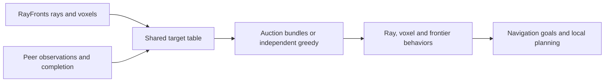

# RAVEN navigation

RAVEN consumes RayFronts semantic rays and voxel detections, combines local and
gossiped target observations, and selects navigation goals. The semantic-search
task executor launches it per robot; local planning and control execute goals.

## Allocation parameters

| ROS parameter | Default | Meaning |
|---|---|---|
| `assignment_mode` | `auction` | `auction` or `independent_greedy` |
| `bundle_len` | 1 | Maximum ordered reservation count; missions normally use 3 |
| `ray_cost_penalty` | 50.0 | Additive auction cost for ray and ray-localized tasks, in m-equivalent units; 0 removes it |
| `commit_switch_margin_m` | 8.0 | Auction incumbent-head bonus magnitude; tails and exploration retention use half; 0 removes auction retention |
| `share_rays` | true | Allow bidding on peer ray leads |
| `share_bbs` | true | Allow bidding on peer BB/voxel targets |
| `use_shared_completion` | true | Adopt peer completed labels and visited-BB status |
| `use_peer_allocation_state` | true | Use peer positions, destinations and selection state for allocation and yielding |
| `associate_bbs` | true | Fuse BB hypotheses before publication, in persistent memory and in the auction table |
| `associate_ray_bbs` | true | Resolve unfinished ray leads against observed BBs and apply ray-to-BB observer yielding |
| `associate_rays` | true | Combine ray hypotheses and apply peer same-target ray conflict checks |
| `debug_auction` | true | Publish and save assignment diagnostics |

`RAVEN_ASSIGNMENT_MODE`, `RAVEN_SHARE_RAYS` and `RAVEN_SHARE_BBS` pass through
robot Compose into the semantic-search executor, which supplies the ROS
parameters. Bundle length is supplied in the `SemanticSearchTask` action goal.
Independent greedy requires length 1 and rejects other values at startup.

The ray/BB sharing flags restrict task eligibility to robots recorded as
observers; they do not stop all observation transport. Multiple observers can
still compete for a task, while a single-observer task has only one eligible
robot. Peer positions, intentions, completion and frontier coordination remain
active unless separately disabled. Thus disabling both eligibility-sharing
flags is not equivalent to removing all coordination.

The auction assigns exclusive heads before growing tails, stops at ray tasks,
and limits each tail extension to 20 m. Independent greedy reuses the same
single-robot L1 scoring but does not consider peer allocation or ownership.
It disables target-level peer yielding while preserving shared perception,
completed-target filtering, frontier behavior and navigation safety.

## Bidding cost ablations

The unified auction minimizes travel cost **plus** the ray uncertainty penalty
**minus** incumbent retention, plus peer repulsion. The sign matters: rays are
penalized, while an incumbent is made cheaper. Head retention is 8 m-equivalent;
tail matches and previous exploration receive 4 m-equivalent retention.

Set `RAVEN_RAY_COST_PENALTY=0.0` to remove the additive ray penalty for every
head and tail candidate, leaving `RAVEN_COMMIT_SWITCH_MARGIN_M=8.0`.
Set `RAVEN_COMMIT_SWITCH_MARGIN_M=0.0` to remove all auction retention (head,
tail and exploration), leaving `RAVEN_RAY_COST_PENALTY=50.0`. These environment
variables pass through robot Compose and the semantic-search executor as ROS
parameters. Both must be finite and nonnegative. Defaults preserve existing
behavior. Separate ray-pursuit bearing locks and navigation safety remain active:
the experiment removes a bidding-cost term, not every form of temporal memory.

The October 23 `no_ray_penalty` and `no_retention` missions each run all eight
matched s1 scenes with three robots, full communication, bundle length 3 and
300 simulated search seconds. All sharing, completion and task-association
switches remain enabled. Compare with the existing matched original RAVEN
control; retain all valid results regardless of score. `params.ray_penalty`
and `params.switch_margin` in each robot's auction trace record the effective
coefficients, including ticks without candidates. Nonempty solves also record
the selected candidates' `ray_pen` and `retention` contributions. Offline replay
reads the logged ray coefficient and supports a `no_ray_penalty` variant.

To remove the separate ray-bearing persistence as well, set
`RAVEN_RAY_BEARING_PERSISTENCE=false` with
`RAVEN_COMMIT_SWITCH_MARGIN_M=0.0`. This disables the previous-direction and
origin-alignment penalties in ray-group selection, the 25% improvement gate,
and the 4-second minimum hold. Candidate groups still match the auction-assigned
label; selection uses their current distance. Shared perception, task association,
ray uncertainty penalty, stalled-target release, and navigation safety are retained.
The default is `true`, preserving the previous behavior. The effective boolean is
recorded as `params.ray_bearing_persistence` even on empty auction ticks.
The October 25 `no_retention_no_bearing_hold` mission runs eight matched s1 scenes
with this switch off, retention zero, and ray penalty 50.

## Peer position and selection ablation

Set `RAVEN_USE_PEER_ALLOCATION_STATE=false` in the mission environment. Compose
and the semantic-search executor pass `use_peer_allocation_state:=false` to
each robot. The assignment solver receives only that robot's position, weight,
exploration cost and committed waypoint. Peer commitments no longer exclude
rays, peer observers no longer cause ray yielding, and voxel behavior no longer
defers to a closer or committed peer. Frontier selection also ignores peer
position and waypoint repulsion.

Shared rays, bounding boxes, completed targets, serviced leads, frontiers and
explored coverage remain enabled. Received messages and their coordinate
transforms are preserved; a masked view removes planning state only where
navigation behaviors consume it. This is a consumption ablation, not a network
bandwidth ablation. Local collision avoidance and control are unchanged.

The matched experiment retains `assignment_mode=auction` and bundle length 3.
With only one agent row, the existing solver constructs a local bundle; it
cannot allocate exclusively across robots or compute their distance-based bids.
This differs from the independent-greedy ablation, which uses length 1 and
retains frontier coordination. `test/test_peer_allocation_state.py` checks
invariance to peer motion/selection, length-3 bundles, shared-information
preservation, frontier repulsion removal and the unchanged default behavior.

`raven_3robot_full_no_peer_allocation_s1_20261018.yaml` runs eight matched s1
scenes with three robots, full communication and 300 simulated search seconds.
The flag is recorded in every auction trace alongside actual bundle occupancy.

## Task association ablations

The October 18 experiments disable one association type at a time with
`RAVEN_ASSOCIATE_BBS`, `RAVEN_ASSOCIATE_RAY_BBS` or `RAVEN_ASSOCIATE_RAYS`.
Each environment variable passes through Compose and the semantic-search
executor to the corresponding ROS parameter. All default to true; all three
flags are recorded in startup logs and every auction solve trace.

| Variant | Removed associations | Retained mechanisms |
|---|---|---|
| No BB–BB | Own-fragment fusion, cross-robot BB fusion, persistent house-box fusion, final task-table BB union | Voxel clustering and temporal confirmation; completed-instance filtering |
| No ray–BB | Pruning leads against unfinished observed boxes, discovery BB attachment, observer yielding, shared-BB inference between bearings | Completed-BB exclusion; ray triangulation; navigation from a selected bearing into local voxel observations |
| No ray–ray | Same-snapshot lead deduplication, peer-lead deduplication, discovery triangulation, peer same-target ray conflict suppression (including proximity fallback) | Upstream 45-degree raw-ray grouping, temporal confirmation and one-to-one temporal lead refresh; ray–BB resolution |

These switches ablate association of unfinished **task hypotheses**, not all
perception processing or temporal identity. Local voxel clustering/containment
suppression and raw-ray grouping still generate the input hypotheses. Repeated
BB snapshots update source-and-occurrence slots within the existing spatial
cache cells; two BBs in one cell remain separate when association is off.
Ray snapshots update each previous lead at most once, so two current hypotheses
remain distinct without creating fresh copies on every tick. Peer lead arrays
are rebuilt from the received snapshot rather than appended to persistent
memory on every receipt.

Completion labels, visited-instance matching, serviced-lead handling and pursuit
continuity remain active in every arm. Removing duplicate unfinished tasks is
different from forgetting that a target has been completed. With ray–ray
association off, two rays may still independently resolve to the same BB via
the retained ray–BB mechanism; these are individual, not combined, ablations.

The `build_targets()` triangulation graph produces discovery diagnostics, not
the auction input directly. Auction BBs come through `_house_boxes()` and
`build_tasks()`; ray tasks come from persistent leads. Changing only the
triangulation graph would therefore not implement a task-table ablation.
`test/test_task_association.py` checks the actual node-to-task-builder path,
duplicate keys, repeated snapshots, independent switches, peer conflict gates
and preserved completed-target filtering.

The three `raven_3robot_full_no_*_association_s1_20261018.yaml` missions each run
eight matched s1 scenes, three robots, full communication, auction L3 and 300
simulated search seconds. Rays, BBs, completion, coverage and peer allocation
state are shared in all arms. Reuse the existing matched original RAVEN control;
report these as single-start descriptive comparisons. Score against the same
query-filtered GT and actual trajectories, deduplicating targets fleet-wide.
Retain all valid trials regardless of performance.

## Local completion ablation

Set `RAVEN_USE_SHARED_COMPLETION=false` in the mission environment to pass
`use_shared_completion:=false` through Compose and the semantic-search executor.
Each robot then maintains its own completed-target state. Peer completed labels
are not merged into its navigation completion list. Shared bounding-box geometry
is still consumed, including boxes peers report as visited, but their status is
interpreted locally as observing until this robot completes the instance.
Normalize that status before BB fusion: fusion otherwise propagates visited
status into the persistent visited cache and silently restores shared completion.

Own visited instances remain sticky and excluded from further pursuit. Both
confirmed-target and completed-target publications continue unchanged; this
ablation changes how peer completion is consumed, not what is transmitted.
The existing `_peer_visited_bbs` cache contains only locally completed instances
in this mode, despite its historical name. The setting is fixed at node startup.

Ray/BB sharing, auction allocation, peer intentions, ray-lead service messages,
frontier coverage sharing and navigation remain enabled. This is separate from
both the no-sharing and independent-greedy ablations. GT scoring still counts
each physical target once across the fleet, regardless of local completion lists.

`raven_3robot_full_local_completion_s1_20261015.yaml` runs all eight matched s1
scenes with three robots, full communication, auction bundle length 3 and a
300-second simulated search window. Compare against the existing matched L3
control. `test/test_local_completion.py` exercises actual node methods to verify
peer geometry preservation, local completion isolation, sticky own visits,
unchanged completion publication and the default shared behavior.

## Interfaces and dependencies

The node depends on ROS 2, NumPy, RayFronts observations and the coordination
peer-state inputs. Topics use the robot namespace. Important outputs include
`debug/auction_solve` (JSON in `std_msgs/String`) and `auction_table`, with
results and intent events also saved by the semantic-search results flow.
See `raven_nav_node.py` and `launch/raven_nav.launch.xml` for topic remappings.

Diagnostics include assignment mode, configured maximum, actual per-agent
bundle occupancy, task count and task status counts, including empty ticks.
In independent mode `local_solves` holds each local decision. Auction-table
rows expose `assigned_agents`; the legacy scalar `assigned` is null when a
task has multiple selectors.

## Validation and experiment

`test/test_independent_greedy.py` checks duplicate selections, independence
from peer inputs, retained local costs, eligibility, completion filtering,
node-level yielding gates and bundle limits 1/3/6/12. Run with the package on
`PYTHONPATH` inside the robot Docker image. Existing sharing tests remain valid.

The full matched experiment and analysis definitions are in
`docs/experiments/raven_bundle_study_20261014.md` at the repository root.
