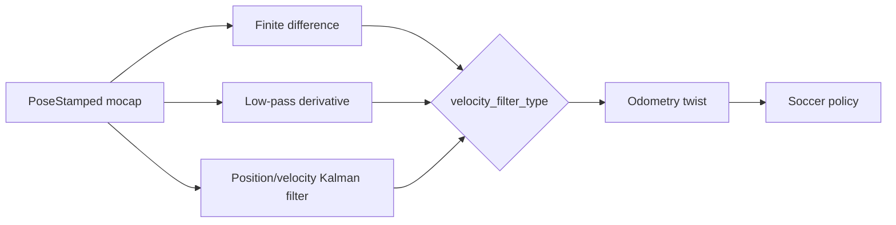
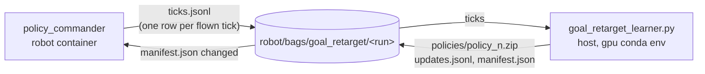

# SVG Ground Control

Central multi-drone ground controller for mocap flight with a **CBF
collision safety filter** (velocity-CBF with hybrid Dykstra projection,
ported from `~/drone_soccer` where it is MuJoCo-validated against the
Starling 2 Max airframe).

> **Commands:** see [experiment.md](experiment.md) — the maintained,
> copy-pasteable command reference for sim and hardware.

## Architecture

```
 OptiTrack Motive ──▶ natnet_ros2 ──▶ /{name}/pose   (hardware only)
                                          │
                          ┌───────────────▼────────────────────────────┐
                          │ mocap_bridge → /{name}/fmu/visual_odometry │
                          └────────────────────────────────────────────┘
                          ┌────────────────────────────────────────────┐
 /{name}/odometry_        │ swarm_commander  (20 Hz)                   │
 conversion/odometry ──▶  │  scenario nominal | per-drone teleop       │
 /svg/{name}/teleop ───▶  │  → cbf_filter.filter_velocities()  [REAL]  │
                          │  → /{name}/.../velocity_command            │
                          │  services: takeoff / start / hold / land   │
                          └────────────────────────────────────────────┘
                                   │ per-drone robot_interface
                          sim: MAVROS          real: px4_interface (uXRCE-DDS)
```

Sim and hardware differ **only in the topic templates** in the config YAML
(`config/swarm_sim.yaml` vs `config/swarm_real.yaml`).

## Ball mocap velocity filtering

`mocap_bridge` can publish a filtered world-frame velocity with each rigid
body's pose on `/{name}/mocap_odometry`. The PX4 direct external-vision path
remains pose-only; these velocities are for the soccer policy, logging, and
debugging.



The supported `velocity_filter_type` values are:

| Value | Behavior | Typical use |
|---|---|---|
| `finite_difference` | Unfiltered position difference | Noise baseline only |
| `low_pass` | First-order filter over the derivative | Simple, predictable smoothing |
| `kalman` | Six-state constant-velocity filter updated by position | Recommended for ball mocap |

Important parameters:

| Parameter | Default | Tuning effect |
|---|---:|---|
| `velocity_filter_type` | `low_pass` | Selects the bridge estimator; the SoccerBall hardware configs override this to `kalman`. |
| `velocity_low_pass_cutoff_hz` | `0.0` | Positive values enable a rate-independent cutoff; lower is smoother but slower. At `0`, `velocity_filter_alpha` is used. |
| `velocity_filter_alpha` | `0.4` | Legacy low-pass weight; lower is smoother. |
| `velocity_kalman_position_stddev_m` | `0.005` | Expected mocap noise; increasing it smooths more. |
| `velocity_kalman_acceleration_stddev_mps2` | `10.0` | Expected ball acceleration; increasing it responds faster to kicks but passes more noise. |
| `velocity_kalman_initial_velocity_stddev_mps` | `2.0` | Initial velocity uncertainty. |
| `velocity_filter_max_dt_s` | `0.5` | A longer sample gap resets the estimate to zero. |

Tune the Kalman estimator in a rolling Matplotlib window:

```bash
ros2 run svg_ground_control plot_mocap_velocity --ros-args \
  -p pose_topic:=/SoccerBall/pose \
  -p history_s:=15.0 \
  -p velocity_kalman_position_stddev_m:=0.004 \
  -p velocity_kalman_acceleration_stddev_mps2:=0.1 \
  -p velocity_kalman_initial_velocity_stddev_mps:=1.7
```

The blue curve is the Kalman estimate computed from the mocap pose samples.
Sliders tune its position measurement noise, acceleration process noise, and
initial velocity uncertainty in real time. Changing a slider restarts the plot
estimate; it does not modify the running `mocap_bridge`. Use **Reset sliders**
to restore the startup values. Close the window or press `Ctrl-C` to exit. The
The production bridge publishes the tuned estimate on
`/SoccerBall/mocap_odometry`. The `policy_commander`,
`drone_soccer_depl/inference_soccer_pos_sp`, and legacy `pos_sp_soccer`
deployment paths consume or prefer that shared ball state. Their drone state
remains sourced from PX4 odometry, including the onboard EKF's velocity
estimate.

## Scenarios (`scenario:=` launch arg)

Ported from drone_soccer plus goal-tracking and a squeeze profile:

- `hover` — hold configured positions
- `goal` — each drone seeks a per-drone goal you set live via
  `/svg/{name}/goal_command` (PoseStamped) + `/svg/{name}/speed_command`
  (Float32); backs the single- and multi-drone tracking tests
- `random_walk` — fixed-speed drift with wall bounces
- `random_goals` — random goal seeking, resampled on arrival
- `head_on` — two facing groups swap sides repeatedly
- `antipodal` — sphere-to-antipode crossings through the center
- `squeeze` — **3-drone CBF showcase** ([config/squeeze_3drone.yaml](config/squeeze_3drone.yaml)):
  two holders goal-track explicit posts; the intruder shuttles through the
  gap; the holders must yield and return. Order: `[holder, holder, intruder]`.

`teleop_drones` (comma-separated string) lists operator-driven, **CBF-exempt**
drones (the moving obstacles) — empty = fully autonomous. `external_drones`
are tracked for the filter but never commanded (e.g. RC-flown). Drive a
teleop drone with `ros2 run svg_ground_control keyboard_teleop --ros-args -p
drone:=drone_3` (one instance per teleop drone).

## Hybrid sim/real, geofence, RViz

- **Per-drone sim/real routing** (`drone_modes: "real,real,sim"`): each drone's
  commands route to MAVROS (`/{name}/interface/…`, sim) or px4_interface
  (`/{name}/fmu/…`, hardware), all under one CBF. See
  [config/hybrid_squeeze.yaml](config/hybrid_squeeze.yaml).
- **Geofence**: `fence_enabled` + `fence_min`/`fence_max`; any airborne drone
  leaving the box latches a swarm-wide freeze until `~/reset_fence`.
- **RViz**: all drones' world positions on `/svg/viz/markers`
  (`rviz2 -d $(ros2 pkg prefix svg_ground_control)/share/svg_ground_control/config/svg_drones.rviz`).

Full how-to for all of the above: **[experiment.md](experiment.md)**.

## CBF filter

`svg_ground_control/cbf_filter.py` is a verbatim port of
`drone_soccer/cbf.py`: pairwise barrier `h = ||p_i−p_j||² − (2r)²`,
constraint `ḣ + αh ≥ 0` (linear in velocities), least-squares projection via
parallel Dykstra + Gauss-Seidel polish, constraint pruning, and an emergency
push-apart fallback when the QP is infeasible. Tests:
[test/test_cbf.py](test/test_cbf.py) (kinematic suite from drone_soccer),
[test/test_scenarios.py](test/test_scenarios.py) (includes a kinematic
squeeze rollout), and [test/functional_squeeze_test.py](test/functional_squeeze_test.py)
(closed-loop ROS test against fake drones — barrier held at exactly 2r).

## PPO policy deploy (drone_soccer)

Inference-only: `policy_commander` loads an SB3 `.zip`, builds the policy's
observation from PX4 odometry plus ball mocap, and publishes PX4
`TrajectorySetpoint` and `OffboardControlMode` messages directly to
`/{name}/fmu/in/trajectory_setpoint` and
`/{name}/fmu/in/offboard_control_mode`. The policy's full 3D waypoint is used.
While the drone is more than `geofence_buffer_m` (default `0.5 m`) from every
horizontal geofence face, the resulting ENU X/Y waypoint is left unconstrained.
Once the drone is within that buffer—or is already outside the fence—the X/Y
waypoint is clamped to `bounds_min` and `bounds_max`. Altitude is always
clamped to the configured Z bounds.

The ball goal supplied to the policy observation can be `fixed`, `circle`,
`figure8`, or `random`. `target_x` and `target_y` specify the fixed goal or
periodic-curve center. `goal_radius`, `goal_period_s`, and `goal_phase_rad` configure the
periodic modes. `goal_rotation_rad` then rotates the complete curve
counter-clockwise in ENU around its center. Calling `/policy_commander/start`
resets the reference phase. Before rotation, phase zero starts at
`(target_x + goal_radius, target_y)`. The current XY reference is published on
`<debug_topic_prefix>/goal` as
`std_msgs/Float32MultiArray`.

In `random` mode, one goal is sampled uniformly from the axis-aligned ENU
rectangle defined by `goal_spawn_min_xy` and `goal_spawn_max_xy`. A new goal
is sampled when the drone's XY position (or the ball's, with
`goal_arrival_reference: ball`) comes within `goal_arrival_radius` of the
current goal, or after `goal_timeout_s` if that is positive. `goal_random_seed: -1` uses nondeterministic sampling; a
non-negative seed makes test runs repeatable. Starting the policy samples a
fresh first goal. The current goal topic remains active even when
`publish_debug` is false and is included by `record_drone_flight_bag.sh`.

**Policy frame.** drone_soccer trains policies in one of two frames
(`TrainConfig.policy_frame`); the commander reads which one from the checkpoint's
observation size, and every policy swapped in later must use the same frame:

| frame | observation | action `(dx, dy, z)` |
|-------|-------------|----------------------|
| `world` (18 values) | `arrays_to_observation`: altitude, body-z axis, velocities, ball - drone, goal - ball, ball velocity in ENU | `dx, dy` along ENU x/y |
| `goal_aligned` (15 values) | `batched_arrays_to_goal_aligned_observation`: everything in a frame with its origin at the goal, x-axis from the goal toward the ball, z up, so turning the scene about the vertical changes nothing (no rotation symmetry left for the policy to learn) | `dx, dy` along that frame's axes; clipped to the action box in the frame, then rotated to ENU (`goal_aligned_actions_to_world`) |

`goal_aligned.zip` (drone_soccer `saved_policies/`) is the goal-aligned expert.
The startup log line names the frame (`policy_frame=...`).

Policies train on goals at most 4 m from the ball, so the goal the policy sees
is capped at `max_goal_distance_m` (default `4.0`) from the ball along its true
direction (`cap_observation_goal` / `cap_goal_distance`); in the goal-aligned
frame the capped goal is the frame's origin. The `<debug_topic_prefix>/goal`
topic still carries the uncapped goal; `<debug_topic_prefix>/obs` shows the
observation the policy acted on (18 or 15 values), and `<debug_topic_prefix>/action`
the action in ENU axes (what the waypoint is built from).

The circle moves counter-clockwise in ENU. The figure eight is a Gerono
lemniscate with `goal_radius` as its half-width and half that value as its
maximum vertical displacement:

```text
x = target_x + goal_radius * cos(theta)
y = target_y + goal_radius * sin(theta) * cos(theta)
theta = goal_phase_rad + 2*pi*time/goal_period_s
[x_rot]   [cos(rotation) -sin(rotation)] [x - target_x]
[y_rot] = [sin(rotation)  cos(rotation)] [y - target_y]
```

```yaml
target_x: 0.0
target_y: 0.0
goal_trajectory: "circle"
goal_radius: 1.5
goal_period_s: 8.0
goal_phase_rad: 0.0
goal_rotation_rad: 0.0
```

Select the figure eight without changing the other parameters:

```yaml
goal_trajectory: "figure8"
goal_rotation_rad: 1.5707963267948966  # long axis along ENU Y
```

Select arrival-triggered random goals inside a rectangular spawn region:

```yaml
goal_trajectory: "random"
goal_spawn_min_xy: [-1.5, -1.5]
goal_spawn_max_xy: [1.5, 1.5]
goal_arrival_radius: 0.35
goal_random_seed: -1
```

Install in the robot container:

```bash
pip install --break-system-packages -r /root/AirStack/robot/ros_ws/src/svg_ground_control/requirements-policy.txt
bws --packages-select svg_ground_control
```

The standard `scripts/start_drone_soccer_lab_tmux.sh` launcher performs the
policy dependency import check and installs `requirements-policy.txt`
automatically when an older or recreated robot container is missing it.
Running `bws`/`colcon` by itself does not install Python `install_requires`.

The read-only `/root/drone_soccer` mount is included in the robot container's
`PYTHONPATH`, so an editable install is neither needed nor writable.

See [experiment.md](experiment.md) (topic table) and
[QUICK_REFERENCE §4](../../../../.codex/skills/yutong-fly-starling/QUICK_REFERENCE.md)
for disarmed checks and flight sequence.

### Online policy-memory updates (`online_memory_learner`)

`online_memory_learner` improves the flying policy in rounds with drone_soccer's
policy-memory fine-tune (`drone_soccer/policy_memory/online.py`):

1. It buffers the live flight of the active policy (mocap poses, commander goal,
   `<prefix>/action` ticks, PX4 setpoints) from 0.5 s after the commander announces
   that policy on `<prefix>/active_policy`.
2. Every 2 s it cuts the buffer into 3 s chunks with the offline `real-chunks` filters
   (tracking loss, goal switch, landed, idle, barrier margin) plus a pause filter
   (chunks need policy ticks throughout). When `min_kept_chunks` pass (60 = 30 s),
   it fine-tunes the active checkpoint in a background thread (about 3-5 s on CPU);
   samples arriving meanwhile are dropped.
3. It saves `policy.zip`, `update.json`, `real_chunks.npz` and `flight_states.npz` under
   `output_root/<session>/update_<n>/` and publishes the policy path on
   `<prefix>/load_policy`. The commander loads it off its control loop, swaps it in at
   the start of a tick and announces it, which starts the next round with an empty buffer.

```bash
ros2 launch svg_ground_control policy_commander.launch.py enable_policy_hot_swap:=true
ros2 launch svg_ground_control online_memory_learner.launch.py
```

Without `enable_policy_hot_swap:=true` the commander ignores load requests and the
learner keeps re-sending its first update. Set `run_dir` / `memory_dir` in
`config/drone_soccer/online_memory_learner_drone3.yaml` to the training run whose
policy memory should drive the updates, and `barrier_dataset` to the day's barrier
polygon in drone_soccer's `BallResidualConfig`. The commander must keep
`publish_debug: true` (the learner counts policy ticks on `<prefix>/action`).
Updated policies have not been evaluated in sim; watch the first swaps closely.

### Online goal-retargeting updates

drone_soccer's goal-conditioned policy update can update the flown policy during a
flight. The learner is `drone_soccer.goal_retarget.plan_learner.PlanUpdateLearner`
(pseudocode revision 7; method and settings in drone_soccer's skill reference
`goal-conditioned-policy-update.md` and `goal_retarget_config.PLAN_UPDATE`). The
2026-11-19 flights (drone_soccer `experiments/goal_retarget_hw_20261119/`) used the
earlier `GoalRetargetLearner` with the world-frame expert; that learner is no longer
wired in. Two processes share one run directory:



- The **commander** (`goal_retarget_enabled: true`) creates
  `/bags/goal_retarget/<stamp>_<drone>/` at launch, writes `session.json` (including
  the policy frame), and appends every flown tick (true goal, drone and ball state,
  ENU action, waypoint, flying iterate) to `ticks.jsonl`. Ticks are grouped in
  segments: a stop or a tick skipped for stale inputs ends one. Each tick it checks
  `manifest.json`; a new iterate is loaded in a background thread and swapped in
  between ticks.
- The **learner** (`scripts/run_goal_retarget_learner.sh`) runs on the host in the
  drone_soccer `gpu` conda env (torch, JAX, CasADi; no rclpy). Every 5 s it reads new
  ticks. pi_E is the frozen goal-aligned expert; pi_F is pi_E (or the commander's
  starting policy) plus LoRA adapters. One **batch** is the first 20 s
  (`--batch-window-s`) of flight of the newest pi_F; once that and one more 1 s plan
  horizon are flown, for every tick of the batch it:
  1. measures the ball's speed, acceleration and jerk limits (and the same for turning)
     over the batch, and plans the ball's time-optimal path from its real state to the
     goal, cut where the plan and the real ball start moving apart;
  2. rejects the tick if the plan did not converge or is too short, if the plan or the
     real ball comes within 0.1 m of the barrier, or if the goal switches or is reached;
  3. takes a goal step dg_curr from the gap between the planned and the real ball
     (`--goal-step-rule`: `final_displacement`, the default, the planned minus the real
     ball position at the plan's end; `mean_displacement`, that gap averaged over the
     plan; or `bptt`, the gradient of pi_F's plan-tracking error through drone_soccer's
     surrogate model; scaled by `--goal-step-gain`);
  4. recovers the goal shift pi_F already applies (dg_cum, by inverting pi_E), and
     labels the tick with pi_E's action at the shifted goal. Both clips on the shift
     only turn the goal about the ball, never change its distance: the step turns the
     current aim by at most 45°, and the whole shift stays within 90° of the true goal.

  It then fits pi_F's adapters to the labels, saves `policies/policy_<n>.zip`, appends
  the diagnostics to `updates.jsonl`, and rewrites `manifest.json`. **The next batch
  starts at the first tick the commander records as flown by the new iterate**, so
  every batch holds only one iterate's flight. A segment break drops the unfinished
  batch and starts it again at the next segment. A batch with no accepted tick gives no
  update; the next batch of the same iterate starts then.
- It refuses a commander whose policy frame differs from the expert's, whose
  `policy_dt`, goal cap, policy type or action box differ from training, or whose
  starting policy file on the host does not match the commander's (SHA-256).
- **Resuming:** pi_E is always `saved_policies/goal_aligned.zip` (`--expert`
  overrides it); pi_F starts from the commander's `model_path`. Pointing `model_path`
  at an earlier run's last iterate (`/bags/goal_retarget/<run>/policies/policy_<n>.zip`)
  continues from it with fresh LoRA adapters. The 2026-11-19 iterates are world-frame
  policies and cannot be resumed against the goal-aligned expert.

`policy_commander_drone3_goal_retarget.yaml` is `policy_commander_drone3.yaml` plus
learning, the goal-aligned expert as the starting policy, and goals that switch only
when the **ball** is within 0.3 m (`goal_arrival_reference: ball`; the default
`drone` keeps the old behavior). There is no time limit (`goal_timeout_s: 0.0`): the
drone keeps trying for a goal until the ball reaches it. Learning requires
`policy_type: standard`, `policy_dt: 0.1`, `deterministic: true`, and
`max_goal_distance_m: 4.0`; the commander refuses to start otherwise.

```bash
# robot container (after bws --packages-select svg_ground_control)
ros2 launch svg_ground_control policy_commander.launch.py \
  config:=$(ros2 pkg prefix svg_ground_control)/share/svg_ground_control/config/drone_soccer/policy_commander_drone3_goal_retarget.yaml
# host, AirStack checkout: attaches to the newest run; pass the current barrier polygon
scripts/run_goal_retarget_learner.sh --barrier-dataset data_20261119
#   or --barrier-corners x1 y1 x2 y2 ... (counter-clockwise ball-centre polygon)
#   --goal-step-rule mean_displacement|bptt for the other goal steps
```

`start_drone_soccer_lab_tmux.sh --goal-retarget` types both commands (policy launch
with this YAML in the container, the learner in a host tmux session
`drone_soccer_learner`) without running them.

**Watching policy updates.** The consoles show one line per event; the details go
to log files in the run directory.

Commander console: one `WARN` line at the tick the new weights start flying (the
action change is between the old and new policy on that exact state, in ENU; then
how long the old iterate flew and how many goals it reached):

```text
POLICY UPDATE 1 -> 2 | action change 0.19 m | iterate 1: 42 s, 5 goals
```

Learner console: one line per update and a progress line every 30 s
(`--status-period-s`). `fit a/b`: b ticks were accepted, a of them also had the shift
pi_F applies recovered within 0.1 m. The goal step, the shift pi_F applied before the
update and the shift its labels use are medians over the batch. From an offline replay
of the 2026-11-19 run 1 ticks (not a flight of these iterates):

```text
14:13:35 UPDATE 2 published | fit 116/163 ticks | loss 0.065 -> 0.008 | action change 0.23 m | goal step 0.18 m, shift 0.31 -> 0.36 m
14:13:37   127 s flown | iterate 2: 15/21 s of its batch flown | 2 updates | 74% of judged ticks accepted
```

Healthy updates: most ticks accepted and fit, loss falling, and the shift staying
small (in drone_soccer's sim tests it kept growing with light balls, and the policy
degraded).
Load failures and configuration warnings still appear on the console.

Detailed logs, `<run>/commander.log` and `<run>/learner.log`: every segment start
and end, load request, every closed batch's full record (ball limits, plan and goal-step
times, verdicts, inversion quality), and for each swap:

```text
POLICY UPDATE: now flying learner iterate 2 (policy_002.zip), replacing iterate 1; first tick: segment 1 tick 1112
  learner update 2: fit 116 of 163 accepted ticks | loss 0.0647 -> 0.0075 | batch action change 0.229 m RMS | goal shift: step 0.18 m, before 0.31 m, labels 0.36 m (medians) | at 99 s of flight
  action on this state: iterate 1 [0.410, -1.200, 0.930] -> iterate 2 [0.520, -1.050, 0.950] (|change| 0.188 m)
  iterate 1 flew 42.0 s: 5 goals reached, 0 timed out
```

Follow them live with `tail -f robot/bags/goal_retarget/<run>/commander.log` on the host.
The swap is also published (latched, JSON with the iterate, its first tick and the
learner's update record) on `<debug_topic_prefix>/policy_update`, next to the flying
checkpoint's path on `<debug_topic_prefix>/active_policy`; `record_drone_flight_bag.sh`
records both, and each `ticks.jsonl` row carries the iterate that flew it, so a bag
or the run directory can be cut by iterate. Policy-memory and goal-retargeting swaps
share one loader: with both `enable_policy_hot_swap` and `goal_retarget_hot_swap`
on, a policy from either source replaces the flying one; a policy-memory checkpoint
flies as iterate `-1` (`external` in the console line), and the learner stops adding
to its batch at the first such tick. With `goal_retarget_hot_swap: false` the
commander keeps flying the starting policy, so the learner makes one update and then
waits for iterate 1, which never flies.

The run directory keeps every iterate (`policy_000.zip` is pi_F's start), the
per-tick rows, `updates.jsonl` and `learner_summary.json` (written on Ctrl-C, with
every batch's record), so a flight can be replayed through a fresh learner offline.

## Safety notes

- Teleop drones are CBF-exempt by design — the autonomous drones do the
  dodging. The operator (you) is the safety authority for the obstacle.
- This stack bypasses `drone_safety_monitor`; PX4 failsafes and the RC kill
  switch are the safety net. Configure them before flying.
- Stale odometry (> `state_timeout_s`) → zero-velocity command; stale teleop
  input → zero. `~/hold` is the panic button.
- `CBF emergency push-apart engaged` in the log means the QP went infeasible
  (drones inside each other's safety spheres) — land and investigate.
