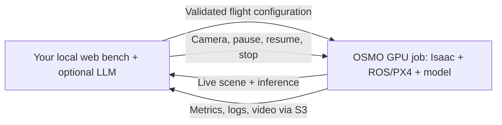

# Run WS2 flights on NVIDIA OSMO

The web viewer, experiment campaign and optional Claude/Codex stay on **your
computer**. Each flight becomes one remote GPU job containing Isaac Sim,
ROS/PX4 and one selected network. Results, logs and video return to your local
campaign. Clean/attack flights are separate jobs, submitted sequentially.



Generated corridors are supported. Office assets are not included in the task
images. The [local Docker runtime](../README.md) remains available with
`--execution-backend local`.

## 1. Get access and sign in as yourself

Follow the lab's **Setting Up OSMO** and **Your Docker Image on OSMO** guides.
Each colleague needs their own account with:

- OSMO pool `adversialai` membership.
- Read/write access to the project's S3 bucket through their own OpenStack EC2 credential.
- Pull access to private Harbor project `adversialai`. Push access is only needed
  when publishing an image; ordinary users can reuse published images.

Docker login alone does not grant Harbor membership. Ask the lab administrator
for missing permissions. Do not share another person's login files or keys.

```bash
curl -fsSL https://raw.githubusercontent.com/NVIDIA/OSMO/refs/heads/main/install.sh | bash
osmo version
osmo login https://airlab-share-01.andrew.cmu.edu
osmo profile set pool adversialai
osmo profile list
```

Use your own project's OpenStack RC file and EC2 credential. If you already
have a suitable EC2 credential, reuse it rather than creating another:

```bash
sudo apt-get install python3-openstackclient
source /path/to/your/project/openrc.sh
openstack ec2 credentials create
read -r -p 'EC2 access key: ' AWS_ACCESS_KEY_ID
read -r -s -p 'EC2 secret key: ' AWS_SECRET_ACCESS_KEY
```

Register those values in your OSMO account:

```bash
osmo credential set dsta-adv --type DATA --payload \
  endpoint=s3://adversialai_osmo_dataset region=us-east-1 \
  access_key_id="$AWS_ACCESS_KEY_ID" access_key="$AWS_SECRET_ACCESS_KEY" \
  override_url=https://airlab-cloud.andrew.cmu.edu:8080
unset AWS_ACCESS_KEY_ID AWS_SECRET_ACCESS_KEY
```

Register your Harbor login (or an authorized project robot credential):

```bash
read -r -p 'Harbor username: ' WS2_HARBOR_USER
read -r -s -p 'Harbor password or robot secret: ' WS2_HARBOR_SECRET
osmo credential set airlab-harbor-cred --type REGISTRY --payload \
  registry=airlab-docker.andrew.cmu.edu \
  username="$WS2_HARBOR_USER" auth="$WS2_HARBOR_SECRET"
unset WS2_HARBOR_SECRET
osmo credential list
```

The credential names above are labels saved in **your** OSMO account, not shared
credentials. If you choose different labels, update `data_credential` and
`registry_credential` in your configuration. OSMO matches DATA/REGISTRY
credentials by URL/registry; it does not accept an `imagePullCredentials` task
field in the validated 6.2 server / 6.3 client combination.

## 2. Install only the local controller/viewer

Linux with Python 3.10+ is the supported controller environment. With published
images, no local GPU, Docker, ROS, Isaac or model repositories are required.
From your own clone:

```bash
git clone --branch eungchang/adv-ws2 git@github.com:castacks/AirStack.git
cd AirStack
python3 -m venv .venv-ws2
.venv-ws2/bin/pip install PyYAML Pillow imageio-ffmpeg
mkdir -p robot/ros_ws/ws2_runtime
cp tools/ws2_bench/osmo/config.example.yaml robot/ros_ws/ws2_runtime/osmo.yaml
```

Edit `osmo.yaml`: select pool/platform, published image digests, credential
labels and a dedicated S3 prefix. For example, use
`s3://adversialai_osmo_dataset/ws2/YOUR_USER/episodes` to separate your outputs.
Every job also has a unique run ID. Do not put any secret in this file.
Unconfigured model images fail before submission; mutable `:latest` tags are
not accepted. See the image availability section below.

```bash
.venv-ws2/bin/python tools/ws2_bench/check_install.py --planner pulp_dronet \
  --execution-backend osmo --osmo-config robot/ros_ws/ws2_runtime/osmo.yaml \
  --check-accounts
```

This reads your saved credential labels and pool membership. It submits no job
and cannot prove image-pull, S3 write or GPU compatibility; the first flight
checks those. Omit `--check-accounts` for an offline configuration check.

For LLM-guided testing, install/authenticate the selected official CLI with your
own account on this computer: [Claude/Codex setup](../CORRIDOR_AGENT.md).
Run the viewer as that same OS user. Random/Search needs neither CLI nor an LLM
login. LLM credentials are never included in OSMO jobs or task images.

## 3. Start the viewer and a flight

```bash
.venv-ws2/bin/python tools/ws2_bench/dashboard.py --execution-backend osmo \
  --osmo-config robot/ros_ws/ws2_runtime/osmo.yaml --port 8892
```

Open **http://127.0.0.1:8892**. For a first check, run one flight from a second
terminal instead of clicking Start tests:

```bash
.venv-ws2/bin/python tools/ws2_bench/episode.py \
  tools/ws2_bench/scenarios/corridor_pulp.yaml --execution-backend osmo \
  --osmo-config robot/ros_ws/ws2_runtime/osmo.yaml \
  --no-bag --camera follow --record-video
```

Use `corridor_mononav.yaml` or `corridor_kim.yaml` for the other models.
The viewer shows both the simulator and actual inference, and supports camera
control, Pause, Resume and Stop. Recording happens inside the task from takeoff
through termination, independent of preview network speed. Omit `--no-bag` for
ROS bags. Stop lands and collects artifacts when the task is reachable.

Then use **Start tests → Corridors**, select one model and Random/Search or
LLM-guided tests with your authenticated provider. The bench launches each next
job after the previous result is collected. Do not start a separate CLI flight
while a campaign is active. To run a campaign CLI remotely, prefix its command:

```bash
WS2_EXECUTION_BACKEND=osmo \
WS2_OSMO_CONFIG="$PWD/robot/ros_ws/ws2_runtime/osmo.yaml" \
.venv-ws2/bin/python tools/ws2_bench/agent_campaign.py \
  --planner pulp_dronet --action-space corridor --policy random --budget 2 \
  --clean-validation-runs 0 --infrastructure-retries 0 \
  --clean-failure-policy record --review-seconds 0 \
  --output robot/ros_ws/ws2_runtime/campaigns/my_osmo_check
```

For an agent, use `--policy agent_search --provider codex` or `--provider claude`.
For local execution, explicitly select `local` and follow the local install
instructions. Use a new output directory after changing backend, image or study
settings. The campaign's `--backend` option selects a *testing policy*, not
local/OSMO execution.

## Image availability and runtime limits

All three targets have passed short remote flight integration checks on RTX
PRO 5000: takeoff, actual model inference/movement, both viewer feeds, camera
control, pause/resume and graceful stop. Kim was launched through the web
Start tests path; PULP and MonoNav were launched through the episode CLI.

| Network | Local inference | OSMO inference |
|---|---|---|
| MonoNav | PyTorch 1.13 / CUDA 11.6 | PyTorch 2.7.1 / CUDA 12.8 + Open3D 0.19, GPU |
| Kim/FCRN | TensorFlow 2.15, GPU | TensorFlow 2.15, explicitly CPU |
| PULP-DroNet | PyTorch 1.13, CPU | PyTorch 1.13, CPU |

Isaac uses the GPU for every target. Kim's CPU image preserves its graph and
checkpoints: the tested TensorFlow 2.20 GPU runtime failed with
`CUDA_ERROR_INVALID_PTX` on this Blackwell server. This device choice is recorded in `image_manifest.json` and worker
startup logs, and is not an automatic fallback. Kim GPU optimization remains
separate work. Compare methods within the same recorded runtime/resources;
CPU/GPU timing is not interchangeable.

Image references:

```yaml
images:
  mononav: airlab-docker.andrew.cmu.edu/adversialai/ws2-mononav@sha256:003429388f95d6d2e9520843778458b22c40a5fd26c6afa57007dcfcddf361ac
  kim: airlab-docker.andrew.cmu.edu/adversialai/ws2-kim@sha256:0d0b428e73ab5abdcc3206d8b379edcb0f04dca8f24e06ce649d123042a7ad5d
  pulp_dronet: airlab-docker.andrew.cmu.edu/adversialai/ws2-pulp@sha256:5451ebd7edfff6541d6bc44d2d36faac4339d2f15c1db80e76639f3cd4459fde
```

PULP and MonoNav also passed remote MP4 retrieval; the MonoNav recording was
fully decoded locally. These deliberately stopped flights validate integration,
not completed missions or success rates. Extended remote LLM-guided campaigns
and comparisons with local model timing remain separate validation. Do not substitute the local
worker-only images for the complete OSMO task images.

A fresh Isaac process can take several minutes to initialize cameras. The
remote simulator and model initialization each allow ten wall-clock minutes;
flight/attack timing and
metrics use simulation time. Inspect **Startup / campaign log** before
submitting another job. Defaults use one GPU, 6 CPU, 48 GiB RAM, 80 GiB disk,
90-minute execution and 60-minute queue limits. Set realistic limits according
to the lab's usage rules. Wall-clock limits continue during Pause.

```bash
osmo resource list --pool adversialai --mode free
osmo workflow events WORKFLOW_ID
osmo workflow query WORKFLOW_ID
```

A pool membership does not reserve capacity. A100 is not a drop-in replacement
for the RTX-rendered Isaac task; use a validated rendering-capable platform.

Each episode's `osmo/` directory contains job identity, status, the checksummed
result archive and path mapping. Infrastructure errors are distinct from
collisions or mission failures. If `osmo_pending_cleanup.json` appears, inspect
and cancel the recorded job before removing the marker. If graceful stop cannot
reach a task, cancellation can leave partial artifacts unavailable.

## Build/publish updated images (maintainers)

Ordinary users can skip this. Initialize AirStack submodules, place the selected
model repository beside AirStack, and restore its weights using its README.
The exporter copies tracked source plus explicitly selected model assets; it
excludes local credentials, runtime data and containers. The image manifest
records source commits, modified-file hashes and model hashes.

```bash
.venv-ws2/bin/python tools/ws2_bench/osmo/build_context.py \
  --planner kim --output /tmp/ws2-osmo-kim

docker build --build-arg PLANNER=kim -t ws2-osmo-kim:VERSION /tmp/ws2-osmo-kim
docker login airlab-docker.andrew.cmu.edu
docker tag ws2-osmo-kim:VERSION airlab-docker.andrew.cmu.edu/adversialai/ws2-kim:VERSION
docker push airlab-docker.andrew.cmu.edu/adversialai/ws2-kim:VERSION
docker image inspect airlab-docker.andrew.cmu.edu/adversialai/ws2-kim:VERSION \
  --format '{{json .RepoDigests}}'
```

Use `pulp_dronet` or `mononav` as the planner/build argument for those models.
MonoNav also needs `--torch-cache /path/to/cache`, containing
`hub/checkpoints/ZoeD_M12_N.pt` and one pinned MiDaS hub source. The local
`mononav-torch-cache` Docker volume is a suitable source after a successful
local run. Publish source/checkpoints inside the image, never credentials.

The Dockerfile pins Isaac/robot bases and micromamba. Worker packages are
recorded in `model_packages.txt`; remote model requirements are in
`osmo/requirements/`. Local worker images remain separate. Validate actual GPU
inference and a flight on the target platform after dependency changes; an
import or dry-run alone is insufficient. Keep the source checkout used by the
controller aligned with the published image, and record the image digest.
